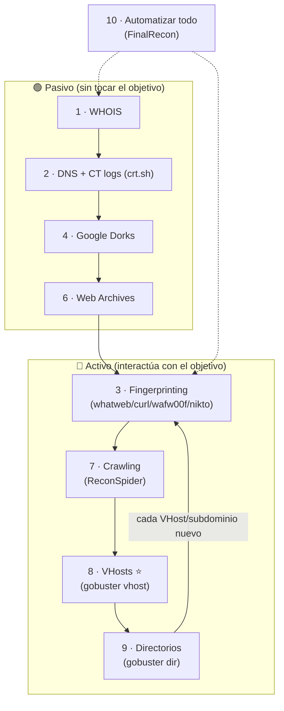
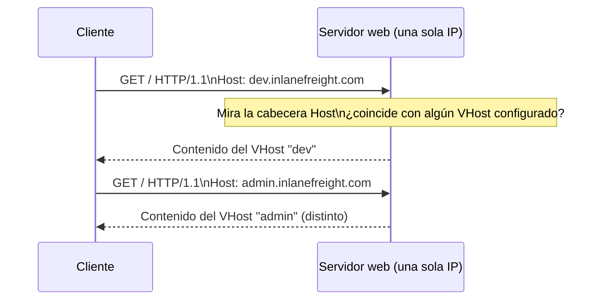

# Information Gathering - Web Edition — Cheatsheet

> 📋 Cheatsheet de referencia (comandos, tablas, metodología) — **no** es un writeup de laboratorio con capturas. Para los writeups con capturas de Skills Assessments resueltos, ver `$ ls modulos/` en el README principal.

## Contenido

- [Information Gathering Web — Índice y guía](#information-gathering-web--índice-y-guía)
- [WHOIS](#whois)
- [Descubrimiento mediante motores de búsqueda (Google Dorks)](#descubrimiento-mediante-motores-de-búsqueda-google-dorks)
- [Web Archives (Wayback Machine)](#web-archives-wayback-machine)
- [Análisis de huella digital (Fingerprinting)](#análisis-de-huella-digital-fingerprinting)
- [Automatización del reconocimiento](#automatización-del-reconocimiento)
- **DNS & Subdomains**
  - [Herramientas de DNS](#herramientas-de-dns)
  - [Enumeración de subdominios](#enumeración-de-subdominios)
  - [Transferencias de zona DNS (AXFR)](#transferencias-de-zona-dns-axfr)
  - [Hosts virtuales (VHosts)](#hosts-virtuales-vhosts)
  - [DNS](#dns)
- **Crawling**
  - [Crawling](#crawling)
  - [Crawlers en la práctica (Scrapy / ReconSpider)](#crawlers-en-la-práctica-scrapy--reconspider)
  - [robots.txt](#robotstxt)
  - [.well-known](#well-known)

---

## Information Gathering Web — Índice y guía

Nota índice del módulo: enlaces a todas las notas + el **procedimiento** de recon web (de pasivo a activo).

---

### Activo vs. pasivo (añadido)

Todo el reconocimiento web cae en una de estas dos categorías; el orden del procedimiento de abajo va, a propósito, **de pasivo a activo**:

| Tipo | Qué es | Riesgo de detección | Ejemplos |
|------|--------|---------------------|----------|
| **Pasivo** | Recopila info **sin tocar** el objetivo, de fuentes públicas | Bajo | WHOIS, buscadores, DNS (consultas normales), Web Archives, redes sociales |
| **Activo** | Interactúa **directamente** con el objetivo (sondas/peticiones) | Alto | Fuerza bruta de subdominios/VHosts/directorios, crawling del propio sitio, escaneo |

> [!TIP]
> **Por qué empezar por lo pasivo**
> Lo pasivo es gratis en riesgo: no deja huella en el objetivo. Agota siempre esas fuentes (WHOIS, Google Dorks, CT logs, Wayback Machine) **antes** de pasar a fuerza bruta activa (subdominios, VHosts, directorios).

---

### Índice de notas

- **Pasivo / OSINT** → **Whois** · **Descubrimiento mediante motores de búsqueda** (Google Dorks) · **Web Archives**
- **Fingerprinting** → **Análisis de huella digital (Fingerprinting)**
- **DNS y subdominios** → **DNS (registros)** · **Herramientas de DNS** · **Subdominios** · **Transferencias de zona DNS** · **Hosts virtuales**
- **Crawling** → **Crawling** · **Bichos Rastreros** (Scrapy/ReconSpider) · **robots.txt** · **well-known**
- **Automatización** → **Automatización del reconocimiento** (FinalRecon)

---

### Metodología / procedimiento (en orden)

1. **WHOIS** (pasivo) — datos de registro del dominio.
2. **DNS y subdominios** — `dig any`/`dig axfr`, fuerza bruta con `dnsenum`.
3. **Fingerprinting** — `whatweb`, `curl -I`, `wafw00f`, `nikto`.
4. **Motores de búsqueda / Google Dorks** (pasivo) — ficheros y páginas expuestas.
5. **Ficheros de descubrimiento** — `robots.txt`, `/.well-known/`, `sitemap.xml`.
6. **Web Archives** — versiones históricas (rutas eliminadas, robots.txt antiguos).
7. **Crawling** — `ReconSpider.py` → `results.json`.
8. **VHosts** ⭐ — `gobuster vhost` (un VHost puede existir sin DNS público).
9. **Directorios** — `gobuster dir` (repetir en cada VHost/subdominio).
10. **Automatizar** — `FinalRecon` para varias fases de golpe.

> [!WARNING]
> **Lo más importante**
> **Enumera VHosts y subdominios a fondo**: cada nombre nuevo es un sitio nuevo. Añádelo a `/etc/hosts` y repítele fingerprinting + `gobuster dir`.



> [!TIP]
> **El bucle que importa**
> Cada **VHost o subdominio** que descubras (paso 8/2) se convierte en un **sitio nuevo que repasar** desde fingerprinting: es un bucle, no una línea recta.

---

### Cheatsheet corta

| Fase | Comando |
|------|---------|
| WHOIS | `whois <dominio>` |
| DNS | `dig any <d> @<ns>` · `dig axfr <d> @<ns>` · `dnsenum --enum <d> -f <wl> -r` |
| Subdominios (pasivo) | `curl -s "https://crt.sh/?q=%.<d>&output=json" \| jq -r '.[].name_value' \| sort -u` |
| Fingerprint | `whatweb <url>` · `curl -I http://<t>` · `wafw00f <t>` · `nikto -h <t> -Tuning b` |
| Crawling | `python3 ReconSpider.py http://<t>` |
| **VHosts** | `gobuster vhost -u http://<IP> -w <wl> --append-domain` |
| Directorios | `gobuster dir -u http://<t> -w <wl>` |
| Todo en uno | `./finalrecon.py --url http://<t> --full` |

---

## WHOIS

**WHOIS** es un protocolo de consulta para obtener información sobre el **registro de un dominio**: quién lo registró, cuándo, con qué registrador y qué servidores de nombres usa. Es **reconocimiento pasivo** (consultas a bases de datos públicas, sin tocar el objetivo).

```bash
whois <dominio>
```

> [!NOTE]
> **Qué información revela**
> - **Registrar** (empresa donde se registró el dominio).
> - **Fechas** de creación, actualización y expiración.
> - **Name servers** (NS) del dominio.
> - Datos de contacto del *registrant* (a menudo ocultos por privacidad/WHOIS privacy).
> - A veces, **rangos de IP** o correos internos útiles para ampliar la superficie.

> [!NOTE]
> En las notas originales este fichero era solo un título ("Lo que es whois"). Se ha rellenado con la información estándar de WHOIS para que sirva de referencia.

---

Relacionado: **DNS** (los NS que da WHOIS son el punto de partida) · **0 - Information Gathering Web (Índice y guía)**

---

## Descubrimiento mediante motores de búsqueda (Google Dorks)

Los **Google Dorks** son operadores de búsqueda avanzados que permiten afinar las consultas para encontrar información expuesta (paneles de login, ficheros sensibles, documentos, subdominios) de forma **totalmente pasiva**.

### Operadores

| Operador | Descripción | Ejemplo | Qué hace el ejemplo |
|----------|-------------|---------|---------------------|
| `site:` | Limita a un sitio/dominio. | `site:example.com` | Páginas públicas de example.com. |
| `inurl:` | Término en la URL. | `inurl:login` | Páginas de login. |
| `filetype:` | Archivos de un tipo. | `filetype:pdf` | PDFs descargables. |
| `intitle:` | Término en el título. | `intitle:"confidential report"` | Documentos con ese título. |
| `intext:` / `inbody:` | Término en el cuerpo. | `intext:"password reset"` | Páginas con ese texto. |
| `cache:` | Versión en caché. | `cache:example.com` | Contenido anterior cacheado. |
| `link:` | Páginas que enlazan a una URL. | `link:example.com` | Quién enlaza a example.com. |
| `related:` | Sitios relacionados. | `related:example.com` | Sitios similares. |
| `info:` | Resumen de una web. | `info:example.com` | Detalles básicos. |
| `define:` | Definiciones. | `define:phishing` | Definición de "phishing". |
| `numrange:` | Números en un rango. | `site:example.com numrange:1000-2000` | Páginas con números 1000-2000. |
| `allintext:` | Todas las palabras en el cuerpo. | `allintext:admin password reset` | "admin" y "password reset" en el texto. |
| `allinurl:` | Todas las palabras en la URL. | `allinurl:admin panel` | "admin" y "panel" en la URL. |
| `allintitle:` | Todas las palabras en el título. | `allintitle:confidential report 2023` | Las tres palabras en el título. |
| `AND` | Exige todos los términos. | `site:example.com AND (inurl:admin OR inurl:login)` | Admin/login en example.com. |
| `OR` | Cualquiera de los términos. | `"linux" OR "ubuntu" OR "debian"` | Páginas que mencionen alguno. |
| `NOT` | Excluye un término. | `site:bank.com NOT inurl:login` | bank.com sin las de login. |
| `*` (comodín) | Cualquier carácter/palabra. | `site:socialnetwork.com filetype:pdf user* manual` | Manuales de usuario en PDF. |
| `..` (rango) | Rango numérico. | `site:ecommerce.com "price" 100..500` | Productos con precio 100-500. |
| `" "` (comillas) | Frase exacta. | `"information security policy"` | Frase exacta. |
| `-` (menos) | Excluye términos. | `site:news.com -inurl:sports` | news.com sin deportes. |

> [!TIP]
> Se combinan entre sí. Ejemplo clásico para reconocimiento: `site:<objetivo> (filetype:pdf OR filetype:xlsx OR filetype:docx)` para localizar documentos filtrados, o `site:<objetivo> inurl:admin` para paneles.

---

Relacionado: otra fuente 100% pasiva → **Web Archives** · **0 - Information Gathering Web (Índice y guía)**

---

## Web Archives (Wayback Machine)

La **Wayback Machine** (<https://web.archive.org/>) guarda **versiones históricas** de sitios web a lo largo del tiempo. Es **reconocimiento pasivo**: consultas un archivo público, no tocas el objetivo.

```
https://web.archive.org/
```

> [!TIP]
> **Por qué es útil en pentest**
> Permite ver **cómo era el sitio antes**: páginas y endpoints **eliminados**, ficheros que ya no están enlazados, versiones antiguas de `robots.txt` (que revelan rutas que hoy ocultan), subdominios o tecnologías retiradas, comentarios y credenciales que estuvieron expuestos. Todo eso puede seguir siendo válido o dar pistas.

> [!NOTE]
> En las notas originales este fichero era solo la URL. Se ha ampliado con la explicación estándar para que sirva de referencia.

---

### Resumen rápido

| Recurso | Para qué |
|---------|----------|
| `https://web.archive.org/` | Ver versiones históricas del sitio (páginas/rutas eliminadas, robots.txt antiguos) |

---

Relacionado: robots.txt antiguos revelan rutas → **robots.txt** · otra fuente pasiva → **Descubrimiento mediante motores de búsqueda** · **0 - Information Gathering Web (Índice y guía)**

---

## Análisis de huella digital (Fingerprinting)

El *fingerprinting* consiste en **identificar las tecnologías** del objetivo (servidor web, versiones, lenguajes, frameworks) para buscar vulnerabilidades asociadas.

### Técnicas

- **Captura de banners (Banner Grabbing)**: analizar los banners que presentan los servidores web y otros servicios. A menudo revelan el **software del servidor, números de versión** y otros detalles.
- **Análisis de cabeceras HTTP**: las cabeceras que se transmiten en cada solicitud/respuesta contienen mucha información. La cabecera **`Server`** suele revelar el software del servidor web, y **`X-Powered-By`** puede revelar tecnologías adicionales (lenguajes de scripting, frameworks).
- **Sondeo de respuestas específicas**: enviar solicitudes especialmente diseñadas puede provocar respuestas únicas que revelan tecnologías o versiones (ciertos mensajes de error o comportamientos son característicos de un servidor/software concreto).
- **Análisis del contenido de la página**: la estructura, scripts y otros elementos de la página dan pistas sobre las tecnologías (por ejemplo, una cabecera de copyright que indica el software usado).

### Herramientas

#### curl — Cabeceras HTTP

```bash
curl -I http://inlanefreight.com
```
El primer paso es recopilar información del propio servidor web. `-I` (o `--head`) pide **solo las cabeceras HTTP**, no el contenido completo. Fíjate en `Server` y `X-Powered-By`.

#### wafw00f — Detectar WAF

```bash
wafw00f inlanefreight.com
```
Detecta si el objetivo está protegido por un **WAF (Web Application Firewall)** y de qué tipo. Útil para saber si tus pruebas serán filtradas/bloqueadas.

#### Nikto — Escáner web

```bash
nikto -h inlanefreight.com -Tuning b
```
- `-h` → host objetivo.
- `-Tuning b` → ejecuta solo los módulos de **Identificación de Software** (fingerprinting), en vez de un escaneo completo.

> [!NOTE]
> **whatweb**
> Otra herramienta clave de fingerprinting es **`whatweb`** (`whatweb <url>`): identifica CMS, servidores, frameworks, versiones y librerías JS de una sola pasada. Es de las más usadas en esta fase.

---

### Resumen rápido

| Comando | Qué hace |
|---------|----------|
| `curl -I http://<target>` | Ver cabeceras HTTP (`Server`, `X-Powered-By`) |
| `whatweb <url>` | Identificar tecnologías del sitio |
| `wafw00f <target>` | Detectar WAF |
| `nikto -h <target> -Tuning b` | Fingerprinting con Nikto |

---

Relacionado: repítelo en cada → **VHost** / **subdominio** nuevo · automatízalo → **Automatización del reconocimiento** · **0 - Information Gathering Web (Índice y guía)**

---

## Automatización del reconocimiento

Cuando ya sabes hacer el recon a mano, conviene **automatizar** varias fases con una herramienta todo-en-uno. La del módulo es **FinalRecon**.

### FinalRecon

Herramienta de reconocimiento **todo-en-uno** que reúne varias fases (cabeceras, WHOIS, SSL, crawling, DNS, subdominios, directorios, Wayback) en un solo comando.

#### Qué hace

| Módulo | Para qué |
|--------|----------|
| **Información de cabecera** | Servidor, tecnologías y posibles malas configuraciones de seguridad. |
| **Búsqueda Whois** | Datos de registro del dominio (registrante, contacto). |
| **Información del certificado SSL** | Validez, emisor y detalles del certificado SSL/TLS. |
| **Rastreador (crawler)** | Extrae enlaces internos/externos, recursos (HTML/CSS/JS), imágenes, `robots.txt`, `sitemap.xml` y enlaces en JavaScript / Wayback. |
| **Enumeración de DNS** | Consulta 40+ tipos de registros (incluido DMARC para seguridad del correo). |
| **Enumeración de subdominios** | Usa múltiples fuentes: crt.sh, AnubisDB, ThreatMiner, CertSpotter, Facebook API, VirusTotal API, Shodan API, BeVigil API. |
| **Enumeración de directorios** | Soporta wordlists y extensiones personalizadas para descubrir directorios/ficheros ocultos. |
| **Wayback Machine** | Recupera URLs de los últimos 5 años para analizar cambios y posibles vulnerabilidades. |

#### Instalación

```bash
git clone https://github.com/thewhiteh4t/FinalRecon.git
cd FinalRecon
pip3 install -r requirements.txt
chmod +x ./finalrecon.py
./finalrecon.py --help
```

#### Uso

```bash
./finalrecon.py --url http://<target> --headers --whois --sslinfo --crawl --dns
./finalrecon.py --url http://<target> --full
```
Puedes lanzar módulos sueltos (`--headers`, `--whois`, `--sslinfo`, `--crawl`, `--dns`, `--dir`) o **todo** con `--full`.

---

### Resumen rápido (cheatsheet)

| Comando | Qué hace |
|---------|----------|
| `git clone https://github.com/thewhiteh4t/FinalRecon.git` | Descargar la herramienta |
| `pip3 install -r requirements.txt` | Instalar dependencias |
| `./finalrecon.py --url <url> --full` | Recon completo (todos los módulos) |
| `./finalrecon.py --url <url> --headers --whois --sslinfo --crawl --dns` | Módulos concretos |

---

Relacionado: lo que automatiza, a mano → **Whois** · **DNS** · **Análisis de huella digital (Fingerprinting)** · **Crawling** · **Web Archives** · **0 - Information Gathering Web (Índice y guía)**

---

## DNS & Subdomains

### Herramientas de DNS

| Herramienta | Características clave | Casos de uso |
|-------------|----------------------|--------------|
| `dig` | Búsqueda de DNS versátil; soporta varios tipos (A, MX, NS, TXT…) y salida detallada. | Consultas manuales, transferencias de zona (si se permiten), troubleshooting, análisis en profundidad. |
| `nslookup` | Búsqueda de DNS más simple, sobre todo A, AAAA y MX. | Consultas básicas y verificaciones rápidas de resolución. |
| `host` | Búsqueda de DNS optimizada con salida concisa. | Verificaciones rápidas de A, AAAA y MX. |
| `dnsenum` | Enumeración automatizada: diccionario, fuerza bruta, transferencias de zona. | Descubrir subdominios y recopilar info DNS eficientemente. |
| `fierce` | Reconocimiento y enumeración de subdominios con búsqueda recursiva y detección de comodines. | Recon DNS fácil, identificar subdominios y objetivos. |
| `dnsrecon` | Combina varias técnicas de recon DNS; varios formatos de salida. | Enumeración completa de DNS y recopilación de registros. |
| `theHarvester` | OSINT: recopila info de varias fuentes, incluidos registros DNS y correos. | Reunir correos, empleados y datos asociados a un dominio. |
| Servicios online de DNS | Interfaces web para búsquedas de DNS. | Consultas rápidas cuando no hay herramientas de CLI a mano. |

---

Relacionado: tipos de registro → **DNS** · fuerza bruta de subdominios → **Subdominios** · **0 - Information Gathering Web (Índice y guía)**

---

### Enumeración de subdominios

La **enumeración de subdominios** es el proceso de identificar y listar sistemáticamente los subdominios de un dominio. Desde el punto de vista del DNS, suelen estar representados por registros **`A`** (o **`AAAA`** para IPv6).

#### Técnicas

| Enfoque | Qué hace | Ejemplos |
|---------|----------|----------|
| **Activa** | Interactúa directamente con el DNS del objetivo o le hace fuerza bruta | Fuerza bruta de diccionario, transferencias de zona |
| **Pasiva** | Recopila subdominios **sin tocar** el objetivo, de fuentes públicas | Logs de Certificate Transparency, buscadores |

- **Transferencia de zona DNS (AXFR)**: si el servidor lo permite, entrega todos los registros de golpe (ver nota de *Transferencias de zona DNS*).
- **Fuerza bruta** (activa): probar nombres de un diccionario contra el DNS.
- **Certificate Transparency** (pasiva): consultar logs públicos de certificados — ver abajo.

> [!TIP]
> **Combina ambas**
> La activa es más exhaustiva pero deja huella; la pasiva es sigilosa pero depende de lo que haya quedado público. Lánzalas **las dos**: la pasiva primero (gratis en riesgo), la activa después para rellenar huecos.

##### DNSEnum — Fuerza bruta de subdominios (activa)

```bash
dnsenum --enum inlanefreight.com -f /usr/share/seclists/Discovery/DNS/subdomains-top1million-20000.txt -r
```
- `--enum` → opciones de enumeración por defecto.
- `-f <wordlist>` → diccionario de subdominios (aquí, uno de **SecLists**).
- `-r` → recursivo (enumera subdominios de los subdominios encontrados).

##### Certificate Transparency — crt.sh (pasiva, añadido)

Cada certificado TLS emitido queda registrado en logs públicos **CT (Certificate Transparency)**, pensados para evitar certificados fraudulentos. Consultarlos vía [crt.sh](https://crt.sh/) revela subdominios **sin tocar el objetivo**:

```bash
curl -s "https://crt.sh/?q=%.inlanefreight.com&output=json" | jq -r '.[].name_value' | sed 's/\*\.//g' | sort -u
```
- `%` → comodín de SQL (todos los certificados de `*.inlanefreight.com`).
- `jq -r '.[].name_value'` → extrae solo los nombres de dominio del JSON.
- `sed 's/\*\.//g'` → quita el prefijo `*.` de los wildcards.
- `sort -u` → ordena y elimina duplicados.

> [!TIP]
> Es de los primeros comandos a lanzar en **cualquier** objetivo: es pasivo, gratis, y a menudo saca subdominios de `dev`/`staging`/`api` que nunca aparecerían en una wordlist genérica de fuerza bruta.

---

Cada subdominio nuevo es una **superficie de ataque nueva** (paneles, entornos `dev`/`staging`, APIs). Combínalo con la enumeración de **VHosts** para no dejarte los que no están en el DNS público.

---

Relacionado: **Transferencias de zona DNS** (AXFR, la otra técnica activa) · **Hosts virtuales** (VHosts sin DNS público) · **0 - Information Gathering Web (Índice y guía)**

---

### Transferencias de zona DNS (AXFR)

Una **transferencia de zona DNS** es una **copia completa** de todos los registros DNS de una zona (un dominio y sus subdominios) de un servidor de nombres a otro. Si un servidor la permite a cualquiera, filtra **toda la zona** → hallazgo enorme.

#### Cómo funciona el proceso

1. **Petición AXFR**: el DNS secundario envía una petición de transferencia al primario, normalmente de tipo **AXFR** (*Full Zone Transfer*).
2. **Transferencia del registro SOA**: el primario responde con su registro **SOA** (*Start of Authority*), que incluye el número de serie para que el secundario sepa si sus datos están actualizados.
3. **Transmisión de registros**: el primario transfiere todos los registros de la zona (A, AAAA, MX, CNAME, NS…) uno por uno.
4. **Transferencia completada**: el primario señala el fin de la transferencia.
5. **Acuse de recibo (ACK)**: el secundario confirma la recepción correcta y se completa el proceso.

##### dig — Solicitar la transferencia

```bash
dig axfr @nsztm1.digi.ninja zonetransfer.me
```
Pide la transferencia de zona (`axfr`) del dominio `zonetransfer.me` al name server `nsztm1.digi.ninja` (un dominio público de prueba, pensado para practicar AXFR).

> [!WARNING]
> Una AXFR debería estar **restringida** a los secundarios autorizados. Que un name server te la sirva a ti es una **mala configuración**: obtienes todos los subdominios e IPs internas sin fuerza bruta.

---

Relacionado: **Subdominios** (si falla el AXFR, toca fuerza bruta) · mismo ataque en Footprinting → **DNS (Footprinting)** · **0 - Information Gathering Web (Índice y guía)**

---

### Hosts virtuales (VHosts)

#### Subdominios vs VHosts

- **Subdominios**: extensiones de un dominio principal (`blog.example.com` de `example.com`). Suelen tener sus **propios registros DNS**, apuntando a la misma IP u otra.
- **Hosts virtuales (VHosts)**: configuraciones del **servidor web** que permiten alojar **varios sitios en un mismo servidor**. Pueden asociarse a dominios (`example.com`) o subdominios (`dev.example.com`), cada uno con su configuración.

> [!NOTE]
> **La diferencia clave**
> Un **VHost puede existir sin registro DNS público**. Por eso a veces no lo ves con enumeración de subdominios por DNS, pero **sí** existe en el servidor. Se descubre haciéndole fuerza bruta a la **cabecera `Host`**.

#### Cómo resuelve el servidor un VHost

1. **El navegador solicita un sitio**: al escribir un dominio, hace una petición HTTP a la IP asociada.
2. **La cabecera `Host` revela el dominio**: el navegador incluye el nombre de dominio en la cabecera `Host`, que le dice al servidor **qué sitio** se pide.
3. **El servidor determina el VHost**: examina la cabecera `Host` y busca en su configuración de hosts virtuales una entrada que coincida.
4. **Sirve el contenido correcto**: recupera los ficheros de ese VHost y los devuelve como respuesta.



> [!TIP]
> **Por qué esto habilita la fuerza bruta**
> Como **todo depende de la cabecera `Host`**, puedes mandar la misma IP con cabeceras `Host` distintas (eso es justo lo que hace `gobuster vhost`) y ver cuáles existen — sin que haga falta ningún registro DNS público.

---

Relacionado: **Subdominios** (la contraparte con DNS público) · añade el VHost a tu `hosts` → **DNS** · **0 - Information Gathering Web (Índice y guía)**

#### Tipos de alojamiento virtual

1. **Basado en nombres**: usa solo la **cabecera `Host`** para distinguir sitios. El más común y flexible (no necesita varias IPs). Puede tener limitaciones con `SSL/TLS`.
2. **Basado en IP**: una **IP única** por sitio. No depende de la cabecera `Host`, sirve para cualquier protocolo y aísla mejor, pero requiere varias IPs (caro/menos escalable).
3. **Basado en puertos**: distintos sitios en **puertos distintos** de la misma IP (p. ej. 80 y 8080). Útil con pocas IPs, pero obliga a indicar el puerto en la URL.

#### Enumeración de VHosts con gobuster

```bash
gobuster vhost -u http://<target_IP_address> -w <wordlist_file> --append-domain
```
- `vhost` → modo de fuerza bruta de **hosts virtuales** (varía la cabecera `Host`).
- `-u` → IP/URL del objetivo.
- `-w` → diccionario de nombres de VHost.
- `--append-domain` → añade el dominio base a cada palabra del diccionario (p. ej. `dev` → `dev.inlanefreight.com`).

> [!TIP]
> Fíjate en el **tamaño de la respuesta** (`Length`): un VHost válido suele devolver un contenido **distinto** al de por defecto. Filtra el tamaño de la página por defecto para quedarte solo con los que difieren.

---

### DNS

El **DNS** traduce nombres de dominio a direcciones IP. En reconocimiento web, entender sus registros permite descubrir infraestructura (servidores de correo, subdominios, name servers).

#### El archivo hosts

Resolución **local** que tiene prioridad sobre el DNS. Útil para mapear un dominio a una IP manualmente (imprescindible para atacar **VHosts**).

| SO | Ruta |
|----|------|
| Windows | `C:\Windows\System32\drivers\etc\hosts` |
| Linux | `/etc/hosts` |

#### Tipos de registro DNS

| Tipo | Nombre | Descripción | Ejemplo de zona |
|------|--------|-------------|-----------------|
| `A` | Address | Mapea un host a una IPv4. | `www.example.com. IN A 192.0.2.1` |
| `AAAA` | IPv6 Address | Mapea un host a una IPv6. | `www.example.com. IN AAAA 2001:db8:85a3::8a2e:370:7334` |
| `CNAME` | Canonical Name | Alias de un host, apunta a otro nombre. | `blog.example.com. IN CNAME webserver.example.net.` |
| `MX` | Mail Exchange | Servidor(es) de correo del dominio. | `example.com. IN MX 10 mail.example.com.` |
| `NS` | Name Server | Delega la zona a un name server autoritativo. | `example.com. IN NS ns1.example.com.` |
| `TXT` | Text | Texto arbitrario (verificación de dominio, SPF…). | `example.com. IN TXT "v=spf1 mx -all"` |
| `SOA` | Start of Authority | Info administrativa de la zona (NS primario, contacto, serial…). | `example.com. IN SOA ns1.example.com. admin.example.com. 2024060301 ...` |
| `SRV` | Service | Host y puerto de un servicio concreto. | `_sip._udp.example.com. IN SRV 10 5 5060 sipserver.example.com.` |
| `PTR` | Pointer | Búsqueda inversa: IP → nombre de host. | `1.2.0.192.in-addr.arpa. IN PTR www.example.com.` |

---

Relacionado: herramientas para consultar estos registros → **Herramientas de DNS** · enumerar subdominios → **Subdominios** · **0 - Information Gathering Web (Índice y guía)**

---

## Crawling

### Crawling

El **crawling** (o *spidering*) es el proceso **automatizado** de navegar sistemáticamente por la web, siguiendo enlaces para mapear un sitio y extraer información.

#### Qué recopila un crawler

- **Enlaces (internos y externos)**: los componentes fundamentales de la web, que conectan páginas dentro de un sitio (*internal*) y con otros sitios (*external*). Recopilarlos permite **mapear la estructura** del sitio, descubrir **páginas ocultas** e identificar relaciones con recursos externos.
- **Comentarios**: en blogs, foros o páginas interactivas. Los usuarios a veces revelan sin querer **detalles sensibles**, procesos internos o pistas de vulnerabilidades.
- **Metadatos** (*datos sobre datos*): títulos, descripciones, palabras clave, autores y fechas. Aportan **contexto** sobre el contenido y propósito de una página.
- **Ficheros sensibles**: los crawlers pueden buscar activamente ficheros expuestos por descuido:
  - **Backups** (`.bak`, `.old`)
  - **Configuración** (`web.config`, `settings.php`)
  - **Logs** (`error_log`, `access_log`)
  - …y otros que contengan **contraseñas, claves de API**, etc.

> [!WARNING]
> **Por qué importa**
> Examinar los ficheros extraídos —sobre todo **backups y configuración**— puede revelar un tesoro: **credenciales de base de datos, claves de cifrado** o incluso fragmentos de **código fuente**.

---

Relacionado: herramienta real para esto → **Bichos Rastreros** (Scrapy/ReconSpider) · qué NO rastrear (pero que te interesa) → **robots.txt** · **0 - Information Gathering Web (Índice y guía)**

---

### Crawlers en la práctica (Scrapy / ReconSpider)

#### Scrapy

Framework de Python para crawling/scraping. Base sobre la que corre ReconSpider.

```bash
pip3 install scrapy
```

#### ReconSpider

Crawler de reconocimiento (del módulo de HTB). Descarga, descomprime y ejecuta:

```bash
wget -O ReconSpider.zip https://academy.hackthebox.com/storage/modules/144/ReconSpider.v1.2.zip
```
```bash
unzip ReconSpider.zip
```
```bash
python3 ReconSpider.py http://inlanefreight.com
```

Tras ejecutarlo, los datos se guardan en un fichero JSON **`results.json`**, explorable con cualquier editor de texto. Estructura del JSON:

| Clave JSON | Descripción |
|------------|-------------|
| `emails` | Direcciones de correo encontradas en el dominio. |
| `links` | URLs de los enlaces encontrados dentro del dominio. |
| `external_files` | URLs de archivos externos (p. ej. PDFs). |
| `js_files` | URLs de los archivos JavaScript usados por el sitio. |
| `form_fields` | Campos de formulario encontrados en el dominio. |
| `images` | URLs de las imágenes encontradas. |
| `videos` | URLs de los vídeos encontrados. |
| `audio` | URLs de los archivos de audio encontrados. |
| `comments` | Comentarios HTML encontrados en el código fuente. |

> [!TIP]
> Revisa siempre `emails` (usuarios/objetivos), `js_files` (a veces filtran endpoints o claves de API) y `comments` (info sensible dejada por desarrolladores).

---

Relacionado: qué busca un crawler → **Crawling** · **robots.txt** · **well-known** · **0 - Information Gathering Web (Índice y guía)**

---

### robots.txt

`robots.txt` es un fichero de texto simple en el **directorio raíz** de un sitio (p. ej. `www.example.com/robots.txt`). Sigue el **Estándar de Exclusión de Robots**: indica a los bots qué partes del sitio pueden o no rastrear.

#### Directivas

| Directiva | Descripción | Ejemplo |
|-----------|-------------|---------|
| `Disallow` | Rutas o patrones que el bot **no** debe rastrear. | `Disallow: /admin/` (prohíbe el directorio admin) |
| `Allow` | Permite explícitamente rutas, incluso bajo un `Disallow` más amplio. | `Allow: /public/` |
| `Crawl-delay` | Retraso (segundos) entre solicitudes, para no sobrecargar. | `Crawl-delay: 10` |
| `Sitemap` | URL a un mapa del sitio XML para rastreo eficiente. | `Sitemap: https://www.example.com/sitemap.xml` |

> [!TIP]
> **Oro para el pentester**
> Las rutas en `Disallow` son **justo lo que el administrador no quiere que se indexe** (paneles admin, backups, zonas privadas). Es de lo primero que se mira: revela directorios interesantes sin fuerza bruta. El `Sitemap` también lista URLs útiles.

---

Relacionado: versiones antiguas de este fichero → **Web Archives** · otra ruta estandarizada → **well-known** · **0 - Information Gathering Web (Índice y guía)**

---

### .well-known

La ubicación **`/.well-known/`** de un servidor web centraliza **metadatos críticos** del sitio: ficheros de configuración e información sobre sus servicios, protocolos y mecanismos de seguridad. Es una ruta estandarizada (RFC 8615).

| Sufijo del URI | Descripción | Estado |
|----------------|-------------|--------|
| `security.txt` | Información de contacto para que investigadores reporten vulnerabilidades. | Permanente |
| `/.well-known/change-password` | URL estándar para dirigir a los usuarios a cambiar la contraseña. | Provisional |
| `openid-configuration` | Configuración de **OpenID Connect** (capa de identidad sobre OAuth 2.0). | Permanente |
| `assetlinks.json` | Verifica la propiedad de activos digitales (p. ej. apps) asociados a un dominio. | Permanente |
| `mta-sts.txt` | Política de **MTA-STS** (SMTP MTA Strict Transport Security) para seguridad del correo. | Permanente |

> [!TIP]
> `openid-configuration` es especialmente útil: revela **endpoints de autenticación** (authorization, token, jwks…), que amplían la superficie de ataque de la parte de identidad/OAuth.

---

Relacionado: otra ruta estandarizada → **robots.txt** · **0 - Information Gathering Web (Índice y guía)**

---
