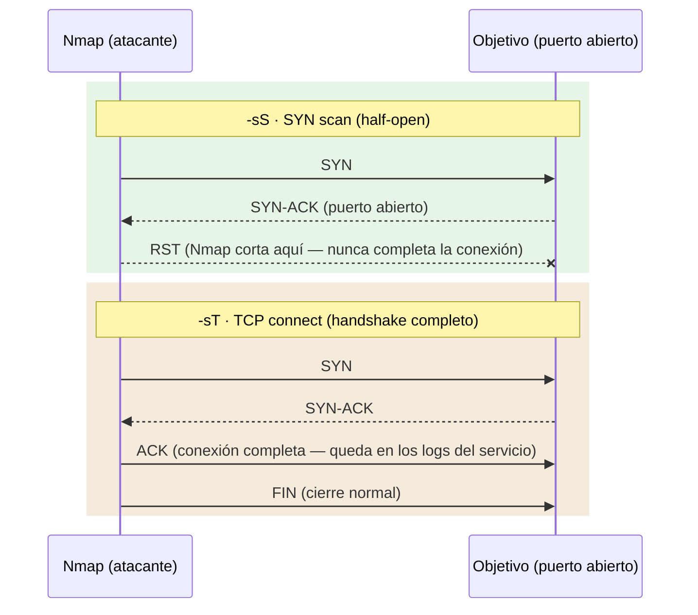
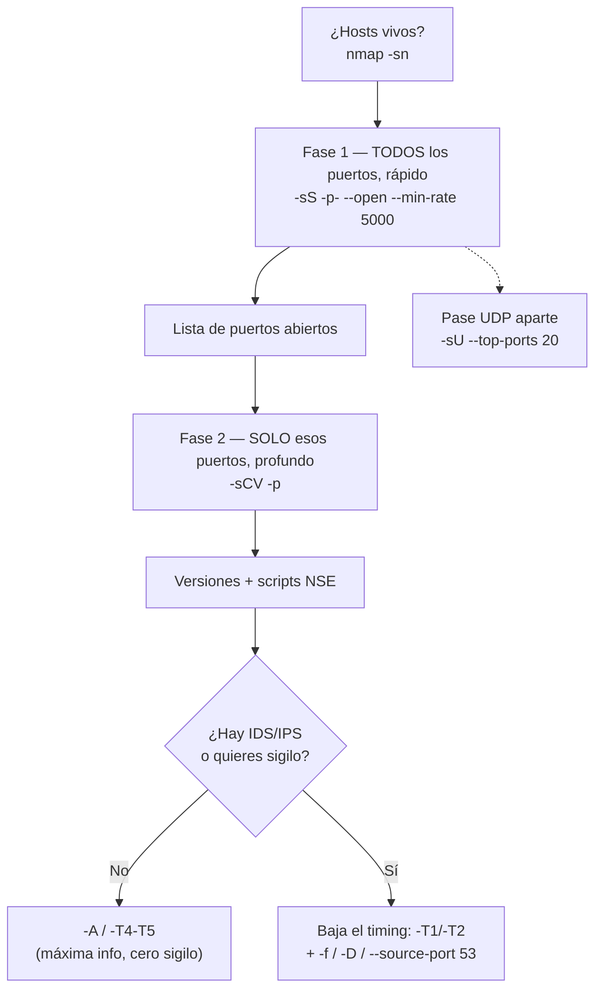

# Network Enumeration with Nmap — Cheatsheet

> 📋 Cheatsheet de referencia (comandos, tablas, metodología) — **no** es un writeup de laboratorio con capturas. Para los writeups con capturas de Skills Assessments resueltos, ver `$ ls modulos/` en el README principal.

## Contenido

- [Nmap — Índice y cheatsheet](#nmap--índice-y-cheatsheet)
- [Nmap — Introducción](#nmap--introducción)

---

## Nmap — Índice y cheatsheet

Nota índice del módulo: enlaza a la nota completa, resume la **metodología** y trae la **cheatsheet** para consulta rápida durante una máquina.

---

### Índice de notas

- **Nota completa** → **Network Enumeration with Nmap** — todo el detalle: descubrimiento de hosts, tipos de escaneo (con diagrama **SYN vs Connect**), selección de puertos, NSE, timing, formatos de salida, evasión de IDS/IPS, y un flujo visual de la metodología en 2 fases.

---

### Metodología de escaneo (2 fases)

```bash
# 1. Descubrir TODOS los puertos abiertos (rápido)
nmap -sS -Pn -vvv --min-rate 5000 --open -n -p- -oN AllPorts <IP>

# 2. Enumerar en profundidad SOLO los abiertos
nmap -sS -Pn -sCV -T4 -n -p<puertos_abiertos> -oN Ports <IP>

# 3. UDP aparte (no olvidar)
sudo nmap -sU --top-ports 20 -Pn -n <IP>
```

> [!TIP]
> `-p-` = todos los puertos · `--open` = solo abiertos · `-sCV` = `-sC` + `-sV` · `-oA` para guardar los 3 formatos.

---

### Cheatsheet

| Flag | Qué hace |
|------|----------|
| `-sS` / `-sT` / `-sU` | SYN (sigiloso, root) / TCP connect / UDP |
| `-sV` / `-sC` / `-sCV` | Versión / scripts por defecto / ambos |
| `-O` / `-A` | Detección de SO / agresivo (SO+versión+scripts+traceroute) |
| `-p-` / `-p22,80` / `-F` | Todos / lista / top 100 |
| `--open` | Solo puertos abiertos |
| `-Pn` / `-n` | Sin ping / sin DNS |
| `-sn` | Solo descubrimiento de hosts |
| `-PS`/`-PA`/`-PU`/`-PR` | Ping alternativo (TCP SYN/ACK, UDP, ARP) si ICMP está filtrado |
| `-T0…T5` | Timing: paranoid → insane |
| `--min-rate <n>` / `--max-retries <n>` | Paquetes/seg mínimo / reintentos |
| `-oN` / `-oG` / `-oX` / `-oA` | Salida normal / grepable / XML / todos |
| `--script <cat>` | NSE: `default`, `vuln`, `safe`… |
| `-D RND:5` / `-S <IP>` / `-g 53` | Decoys / IP origen / puerto origen |
| `-e <iface>` | Interfaz (ej. `tun0`) |

---

## Nmap — Introducción

Herramienta de escaneo de redes escrita en **C, C++, Python y Lua**. Sirve para **escanear redes e identificar los hosts que están disponibles**, qué puertos tienen abiertos, qué servicios corren en ellos y, opcionalmente, qué sistema operativo usan. Es la herramienta base de la fase de reconocimiento activo.

### Sintaxis básica

```bash
nmap <scan types> <options> <target>
```

- `<scan types>` → tipo de escaneo (`-sS`, `-sT`, `-sU`…).
- `<options>` → flags de configuración (salida, timing, scripts…).
- `<target>` → IP, rango, dominio o fichero con una lista de objetivos.

> [!NOTE]
> **Privilegios**
> Muchos tipos de escaneo (`-sS`, `-sU`, `-sA`, detección de SO) necesitan **crear paquetes en bruto (raw sockets)**, por lo que requieren `sudo`/root. Si los lanzas sin privilegios, Nmap "cae" automáticamente al escaneo TCP connect (`-sT`), que es más lento y ruidoso.

---

### Especificación de objetivos

```bash
sudo nmap 10.10.X.0/24
```
Escanea un **rango de red** completo usando notación CIDR (aquí, 256 direcciones de la subred `/24`). Útil para descubrir qué hosts están vivos antes de escanear puertos.

```bash
sudo nmap -iL <archivo>
```
Lee los objetivos desde un **fichero de lista** (`-iL` = *input list*), un objetivo por línea. Cómodo cuando ya tienes una lista de IPs guardada de un escaneo previo.

---

### Descubrimiento de hosts (host discovery)

Antes de escanear puertos conviene saber qué máquinas están vivas.

| Flag                 | Qué hace                                                                                                      | Cuándo usarlo                                                                                     |
| -------------------- | ------------------------------------------------------------------------------------------------------------- | ------------------------------------------------------------------------------------------------- |
| `-sn`                | Deshabilita el escaneo de puertos (**solo descubrimiento de hosts / ping sweep**)                             | Para listar rápido qué IPs están vivas en una red sin tocar puertos                               |
| `-Pn`                | Deshabilita las solicitudes de eco ICMP (**asume que el host está vivo y evita hacer PING**)                  | Cuando el host no responde a ping pero sabes/sospechas que está activo (firewall bloqueando ICMP) |
| `-PE`                | Realiza el descubrimiento mediante **ICMP Echo Request** (ping clásico) contra el objetivo                    | Para forzar el ping ICMP como método de descubrimiento                                            |
| `-n`                 | Desactiva la resolución de DNS                                                                                | Acelera el escaneo y evita consultas DNS que delatan tu actividad                                 |
| `--disable-arp-ping` | Desactiva el ARP ping                                                                                         | En redes locales, para forzar otro método de descubrimiento en vez del ARP                        |
| `--reason`           | Muestra **el motivo** de cada resultado (qué paquete recibió Nmap para marcar el puerto open/closed/filtered) | Para depurar y entender por qué un puerto sale en un estado concreto                              |

> [!TIP]
> `-Pn` es de los flags más útiles en máquinas de CTF/laboratorio: muchas bloquean ICMP y sin `-Pn` Nmap las marca como "caídas" y no escanea ningún puerto.
>
> No juntar -Pn con --disable-arp-ping, ya que quedaria anulado por el primero

#### Sondas de descubrimiento alternativas a ICMP (añadido)

Si ICMP está bloqueado (lo normal fuera de una LAN), Nmap puede "hacer ping" con **otros protocolos** para ver si algo responde:

| Flag | Sonda | Cuándo va mejor |
|------|-------|------------------|
| `-PS<puertos>` | **TCP SYN** al puerto indicado (ej. `-PS80,443`) | El firewall deja pasar tráfico a puertos web/comunes aunque bloquee ICMP |
| `-PA<puertos>` | **TCP ACK** | Firewalls *stateless* que solo filtran paquetes `SYN` entrantes |
| `-PU<puertos>` | **UDP ping** (ej. `-PU53`) | Objetivo con todo TCP filtrado pero UDP abierto |
| `-PR` | **ARP ping** | **Por defecto en LAN** — el más fiable ahí, porque ARP no se puede filtrar en la misma red |

> [!TIP]
> En una red local, Nmap usa ARP (`-PR`) automáticamente y es casi infalible. Fuera de la LAN (a través de routers), ARP no sirve — ahí es donde `-PS`/`-PA`/`-PU` entran en juego como alternativas a `-PE` (ICMP).

#### `--dns-server` — Resolver contra un DNS concreto

```bash
sudo nmap --dns-server <ns> <target>
```
La resolución DNS se hace usando el **servidor de nombres especificado** en vez del del sistema. Útil para consultar el **DNS interno** del objetivo y descubrir nombres de host que tu resolvedor no conoce.

---

### Tipos de escaneo de puertos

#### `-sS` — SYN scan (sigiloso, *half-open*)

```bash
sudo nmap -sS <target>
```

- **Nunca completa el saludo de tres vías** (*three-way handshake*), por lo que **no establece una conexión TCP completa** con el puerto escaneado.
- Si el objetivo devuelve un paquete **SYN-ACK**, Nmap detecta que el puerto está **abierto**.
- Si el objetivo devuelve un paquete con el flag **RST**, es indicador de que el puerto está **cerrado**.
- Si Nmap **no recibe respuesta**, lo muestra como **filtered** (normalmente por un firewall que descarta el paquete).

> [!NOTE]
> Es el escaneo por defecto cuando corres Nmap como root, y el más usado por ser rápido y relativamente sigiloso. Requiere privilegios.

#### `-sT` — TCP connect scan

```bash
nmap -sT <target>
```
Utiliza el **three-way handshake completo**. **No es nada sigiloso**, porque abre y cierra conexiones TCP reales que quedan registradas en los logs del servicio.

> [!NOTE]
> Es el escaneo que se usa por defecto **sin privilegios root**, ya que no necesita raw sockets.

#### `-sS` vs `-sT` — por qué uno es sigiloso y el otro no (añadido)



La diferencia es **ese último paso**: `-sS` manda un `RST` y aborta antes de completar la conexión → el servicio objetivo casi nunca llega a **loguear** la conexión. `-sT` sí completa el *handshake* → el sistema operativo abre una conexión real, que queda registrada.

#### `-sU` — UDP scan

```bash
sudo nmap -sU <target>
```
**Descubrimiento de puertos UDP**. Importante porque servicios como DNS (53), SNMP (161) o DHCP viven en UDP y un escaneo TCP nunca los verá.

> [!NOTE]
> El escaneo UDP es **mucho más lento** que el TCP: UDP no confirma la recepción, así que Nmap tiene que esperar timeouts. Combínalo con `--top-ports` para no escanear los 65535 puertos.

#### `-sA` — ACK scan

```bash
sudo nmap -sA <target>
```
Realiza un **escaneo ACK** en los puertos especificados. No sirve para saber si un puerto está abierto, sino para **mapear reglas de firewall** (distinguir puertos *filtered* de *unfiltered*).

---

### Selección de puertos

| Flag | Qué hace | Cuándo usarlo |
|------|----------|---------------|
| `-F` | Escaneo rápido de los **100 puertos** más comunes | Primer barrido veloz para tener resultados rápidos |
| `--top-ports=10` | Escanea los **N puertos más frecuentes** estadísticamente | Cuando quieres cubrir lo más probable sin escanearlo todo (muy útil en UDP) |
| `-p-` | Escanea **todos los puertos** (1-65535) | Enumeración exhaustiva: no dejar ningún puerto sin mirar (más lento) |
| `-p22-110` | Escanea un **rango** de puertos (del 22 al 110) | Acotar el escaneo a un tramo concreto |
| `-p22,25` | Escanea una **lista** de puertos concretos (22 y 25) | Comprobar solo puertos que ya te interesan |
| `-p<puerto>` | Escanea un **único puerto** | Verificar rápidamente un servicio concreto |
| `--open` | Muestra **solo los puertos abiertos** (oculta closed/filtered) | Deja el output limpio para copiar la lista de puertos y pasarla al escaneo profundo |

> [!TIP]
> Estrategia habitual: primero `-p-` para descubrir **todos** los puertos abiertos, y luego un segundo escaneo `-sV -sC` **solo sobre esos puertos** (`-p22,80,443…`) para ir rápido en la parte profunda.

---

### Detección de servicios y sistema operativo

#### `-sV` — Detección de versión

```bash
sudo nmap -sV <target>
```
Realiza la **detección de la versión del servicio** en los puertos abiertos (por ejemplo `Apache 2.4.52`, `OpenSSH 8.9`). Es clave para buscar vulnerabilidades asociadas a una versión concreta.

```bash
sudo nmap -sV --version-intensity 2 <target>
```
`--version-intensity <0-9>` ajusta **cuántas sondas** usa la detección de versión: menor número = más rápido y menos ruidoso; mayor número = más preciso. Se complementa con `-sV`.

#### `-sCV` — Versiones + scripts por defecto (atajo)

```bash
sudo nmap -sCV <target>
```
`-sCV` es la **forma abreviada de combinar `-sC` y `-sV`** en un solo flag: ejecuta los scripts por defecto y la detección de versión a la vez. Es el flag típico del escaneo profundo sobre los puertos ya descubiertos.

#### `-O` — Detección de sistema operativo

```bash
sudo nmap -O <target>
```
Realiza una **detección del sistema operativo** del objetivo por sí sola (sin activar todo lo demás de `-A`), analizando cómo responde la pila TCP/IP. Requiere privilegios root.

> [!NOTE]
> La detección de SO **no siempre acierta**: da un porcentaje de confianza y a veces solo una "conjetura". Es más fiable si hay al menos un puerto abierto y uno cerrado detectados.

#### `-A` — Escaneo agresivo

```bash
sudo nmap -A <target>
```
Realiza **detección de servicios, detección del sistema operativo, traza de ruta (*traceroute*) y ejecuta los scripts por defecto** contra el objetivo. Es un "todo en uno".

> [!WARNING]
> `-A` es **muy ruidoso e intrusivo**: manda muchas sondas y es fácilmente detectable por un IDS/IPS. Úsalo cuando el sigilo no importe (laboratorios, o cuando ya sabes que el objetivo está monitorizado y no te importa).

---

### Scripts NSE (Nmap Scripting Engine)

```bash
sudo nmap -sC <target>
```
`-sC` ejecuta los **scripts por defecto** (categoría *default*). Añade información extra útil (banners, títulos HTTP, certificados…).

```bash
sudo nmap --script <category-or-script-name> <target>
```
Ejecuta una **categoría** de scripts (`vuln`, `auth`, `discovery`, `safe`…) o un script concreto por nombre.

- **`safe`**: no debería causar problemas ni cambios en el target
- **`intrusive`**: puede consumir recursos, ser detectado fácilmente, o causar efectos no deseados
- **`vuln`**: chequea vulnerabilidades específicas (CVEs conocidos, misconfiguraciones explotables)
- **`exploit`**: va más allá de detectar, intenta explotar activamente
- **`auth`**: intenta saltarse o comprobar mecanismos de autenticación
- **`brute`**: ataques de fuerza bruta contra credenciales
- **`discovery`**: enumeración de información del servicio/red
- **`dos`**: puede provocar denegación de servicio — **extremo cuidado** con esta categoría, literalmente puede tirar el servicio

```bash
sudo nmap --script vuln <target>
```
Utiliza **todos los scripts de la categoría** especificada; en este caso `vuln` busca vulnerabilidades conocidas en los servicios detectados.


> [!WARNING]
> Los scripts de la categoría `vuln` son **intrusivos y ruidosos**: algunos intentan explotar el servicio, así que pueden tumbarlo. No los lances a ciegas en producción.
>
> muchos scripts de `vuln` **necesitan** saber la versión exacta del servicio para poder comparar contra su base de conocidas vulnerables; sin `-sV` antes, algunos scripts de esta categoría ni se disparan porque su `portrule` puede depender de la versión detectada.
>

#### Actualizar la base de scripts y su base de datos de vulns

```bash
sudo nmap --script-updatedb
```

#### Dónde están los scripts y cómo leerlos (añadido)

```bash
ls /usr/share/nmap/scripts/ | grep <servicio>   # buscar scripts por nombre (ej. "smb", "ftp")
nmap --script-help <script>                      # ver qué hace un script concreto antes de lanzarlo
```
Útil para elegir un script **específico** en vez de una categoría entera cuando ya sabes qué servicio tienes delante.

---

### Formatos de salida

Guardar siempre los resultados es una buena práctica para no repetir escaneos y poder procesarlos después.

| Flag | Extensión | Formato | Cuándo usarlo |
|------|-----------|---------|---------------|
| `-oN` | `.nmap` | Normal (legible por humanos) | Lectura directa |
| `-oG` | `.gnmap` | Grepable | Filtrar con `grep`/`awk` desde la terminal |
| `-oX` | `.xml` | XML | Procesar con otras herramientas o convertir a HTML |
| `-oA` | `.nmap` + `.gnmap` + `.xml` | **Todos a la vez** | Lo más práctico: un solo flag genera los tres |

```bash
sudo nmap -sV <target> -oA escaneo
```
Guarda los resultados en **todos los formatos** con el nombre base que especifiques (`escaneo.nmap`, `.gnmap`, `.xml`).

#### Convertir el XML a HTML

```bash
xsltproc target.xml -o target.html
```
Transforma el informe **XML en una página HTML** con estilo, cómoda de leer en el navegador.

```bash
xdg-open <fichero>
```
Abre el fichero con la **aplicación predeterminada** del sistema (por ejemplo, abrir el `.html` anterior en el navegador).

---

### Rendimiento y temporización (*timing templates*)

Los templates `-T` ajustan la velocidad/agresividad del escaneo. A mayor número, más rápido pero más ruidoso y detectable.

| Flag | Nombre | Qué hace | Cuándo usarlo |
|------|--------|----------|---------------|
| `-T0` | paranoid | Extremadamente lento | Máxima evasión de IDS (un puerto cada varios minutos) |
| `-T1` | sneaky | Muy lento | Evasión de IDS, escaneos sigilosos |
| `-T2` | polite | Lento, poco intrusivo | Redes frágiles o cuando no quieres saturar |
| `-T3` | normal | **Por defecto** | Uso general equilibrado |
| `-T4` | aggressive | Rápido | Redes rápidas y fiables (laboratorios/CTF); ruidoso |
| `-T5` | insane | Muy rápido | Máxima velocidad; puede perder resultados y es muy detectable |

```bash
sudo nmap --min-rate 300 <target>
```
`--min-rate` establece el **número mínimo de paquetes por segundo**. Fuerza una velocidad de suelo independientemente del template; útil para acelerar escaneos grandes.

#### Ajuste fino de tiempos

Estos flags dan control manual sobre los tiempos de espera, más preciso que un template `-T`:

| Flag | Qué hace | Cuándo usarlo |
|------|----------|---------------|
| `--max-retries <num>` | Nº de **reintentos** por puerto antes de darlo por perdido | Bajarlo (ej. `--max-retries 1`) acelera mucho; subirlo mejora la fiabilidad en redes con pérdidas |
| `--initial-rtt-timeout 50ms` | Tiempo de espera **RTT inicial** de cada sonda | Redes rápidas: bajarlo para no esperar de más |
| `--max-rtt-timeout 100ms` | Tiempo de espera **RTT máximo** de cada sonda | Poner un techo bajo para acelerar; subirlo en redes lentas para no perder puertos |

> [!WARNING]
> `-T4`, `-T5` y `--min-rate` altos son **ruidosos** y disparan alertas en IDS/IPS. Para sigilo, baja el timing (`-T1`/`-T2`).

> [!TIP]
> Combo típico para acelerar un escaneo de todos los puertos sin perder fiabilidad: `--min-rate 1000 --max-retries 2`.

---

### Verbosidad y monitorización

| Flag | Qué hace | Cuándo usarlo |
|------|----------|---------------|
| `-v` / `-vv` / `-vvv` | *Verbose*: aumenta la cantidad de información mostrada; cada `v` extra sube el nivel de detalle | Ver resultados a medida que llegan, sin esperar al final (`-vvv` = máximo detalle) |
| `--packet-trace` | Muestra **todos los paquetes** enviados y recibidos | Depuración: entender exactamente qué está haciendo Nmap a nivel de red |
| `--stats-every=5s` | Muestra el **progreso del escaneo** cada 5 segundos | Escaneos largos, para saber cuánto queda sin pulsar teclas |

---

### Evasión de firewalls e IDS/IPS

> [!TIP]
> **Idea práctica**
> Se puede utilizar un **VPS** y lanzar un escaneo ruidoso a propósito para **identificar si el objetivo cuenta con un IDS/IPS** (si te bloquean o te "banean" la IP del VPS, hay defensa activa) sin quemar tu IP real.

```bash
sudo nmap -D RND:5 <target>
```
`-D RND:5` genera **cinco IPs de origen aleatorias** (*decoys*, señuelos) que aparecen como origen de la conexión junto a la tuya, para ocultar cuál es la real entre el ruido.

> [!NOTE]
> Si lo acoplas a `-sV`, los señuelos **no aportan nada**: la detección de versión necesita completar la conexión, así que se hace desde tu **IP real** de todas formas.

```bash
sudo nmap -S <IP> <target>
```
`-S` escanea el objetivo **usando una IP de origen diferente** (*spoofing* de la IP fuente).

```bash
sudo nmap -e <interfaz> <target>
```
`-e` especifica la **interfaz de red** que se usa para el escaneo (por ejemplo `tun0` en una VPN de HTB). Útil cuando tienes varias interfaces y quieres asegurarte de salir por la correcta.

```bash
sudo nmap --source-port <port> <target>
sudo nmap -g <port> <target>
```
`--source-port` (forma corta **`-g`**) realiza los escaneos desde el **puerto de origen especificado**. Algunos firewalls confían en tráfico que aparenta venir de puertos "de confianza" como el 53 (DNS).

> [!NOTE]
> `-g <port>` y `--source-port <port>` son **equivalentes**; `-g` es solo el alias corto.

#### Conectar a un puerto filtrado

Recomendado usar el **puerto 53** como origen para intentar atravesar reglas de firewall:

```bash
nc -nv 10.129.2.28 50000 -p 53
```
Conecta con `ncat` al objetivo (`10.129.2.28`) en el puerto `50000`, forzando el puerto de origen 53 (`-n` sin DNS, `-v` verbose). Sirve para comprobar si un puerto marcado como *filtered* deja pasar tráfico cuando parece venir de DNS.

---

### Herramientas complementarias

```bash
nc -nv
```
`netcat` con `-n` (sin resolución DNS) y `-v` (verbose). Se usa para **conectar manualmente a un puerto** y leer su banner o interactuar con el servicio una vez Nmap lo ha descubierto.

---

### Ejemplos prácticos y recomendaciones de uso

> [!NOTE]
> En los ejemplos, `<target>` es la IP o dominio del objetivo. Ajusta según tu caso.

#### Metodología en dos fases (flujo recomendado para máquinas)

Es la forma más eficiente de enumerar un objetivo: un primer escaneo **rápido y amplio** para saber qué puertos están abiertos, y un segundo escaneo **lento y profundo** solo sobre esos puertos.



**Fase 1 — Descubrir todos los puertos abiertos (rápido):**

```bash
nmap -sS -Pn -vvv --min-rate 5000 --open -n -p- -oN AllPorts 10.129.40.27
```
SYN scan de **todos** los puertos (`-p-`) a alta velocidad (`--min-rate 5000`), mostrando **solo los abiertos** (`--open`) en vivo (`-vvv`) y sin DNS (`-n`). El resultado se guarda en `AllPorts`.

**Fase 2 — Enumerar en profundidad solo los puertos abiertos:**

```bash
nmap -sS -Pn -sCV -T4 -n -p80,110,143,993,995,10000 -oN Ports 10.129.40.27
```
Sobre la lista de puertos hallada en la fase 1, lanza versiones + scripts por defecto (`-sCV`) y guarda en `Ports`.

> [!NOTE]
> **Requisitos y matices**
> - `-sS` necesita **root**; si no vas como root, Nmap cae a `-sT` en silencio.
> - `-T5` y `--min-rate 5000` son perfectos para **HTB/labs** (estables, sin IDS); en un pentest real o VPN inestable pueden **perder puertos**, ahí baja a `-T4` y añade `--max-retries 2`.
> - Este flujo es **solo TCP**; añade un pase UDP aparte (`-sU --top-ports=20`) para no perderte DNS/SNMP.
> - Podrías usar `-oA` en vez de `-oN` para guardar los tres formatos de golpe.
>
> - `-T5` es "sé agresivo en todo, timeouts cortos, pocos reintentos, máximo paralelismo". `--min-rate` es "no importa nada de lo anterior, simplemente no dispares más lento que X paquetes por segundo". Uno es una filosofía general de comportamiento, el otro es un número concreto que fuerzas directamente.

#### Barrido inicial de red (¿qué hosts hay vivos?)

```bash
sudo nmap -sn 10.129.2.0/24
```
Solo descubrimiento de hosts, sin tocar puertos. Primera foto de la red.

#### Escaneo sigiloso (bajo perfil, evadir IDS)

```bash
sudo nmap -sS -T2 -n -Pn --scan-delay 1s <target>
```
SYN scan + timing lento (`-T2`) + sin DNS + asumiendo host vivo (sin discovery, para no generar tráfico extra de comprobación). `--scan-delay 1s` fuerza una pausa explícita entre probes — más predecible que fiarte solo del template `-T2`, que ya mete delay pero no te deja ver el número exacto.

Para aún más sigilo, baja a `-T1` y añade puerto de origen de confianza:

```bash
sudo nmap -sS -T1 -n -Pn --source-port 53 <target>
```
Muchos firewalls antiguos o mal configurados tienen reglas que **confían por defecto en tráfico que viene del puerto 53** (DNS) o del 20 (FTP-data), porque asumen que si algo responde desde ahí es tráfico legítimo de servidor DNS. Nmap te permite **forzar tu puerto origen** a 53, así el firewall del target puede confundir tu escaneo con respuestas DNS legítimas y dejarlo pasar sin aplicar las reglas normales de filtrado a puertos "sospechosos" de origen alto/aleatorio.

```bash
sudo nmap -sS -T1 -n -Pn -f <target>
```
`-f` fragmenta el paquete IP en trozos más pequeños (por defecto 8 bytes de payload TCP por fragmento), dificultando que un IDS simple que inspecciona paquete por paquete reconstruya la firma completa. IDS/firewalls modernos suelen reensamblar fragmentos antes de inspeccionar, así que de nuevo, funciona mejor contra sistemas menos sofisticados.

```bash
sudo nmap -sS -T1 -n -Pn -D RND:10 <target>
```
`-D` manda el escaneo real mezclado con paquetes falsos que aparentan venir de otras IPs (decoys), para que en los logs del target aparezcan múltiples orígenes y sea más difícil identificar cuál es el atacante real entre el ruido.

##### **Escaneo sigiloso (bajo perfil, evadir IDS)**

###### Nivel básico — timing lento, sin discovery innecesario:


```bash
sudo nmap -sS -T2 -n -Pn <target>
```

###### Nivel medio — timing más lento + puerto origen de confianza (útil contra firewalls que confían en tráfico DNS/FTP):


```bash
sudo nmap -sS -T1 -n -Pn --source-port 53 <target>
```

###### Nivel avanzado — añade fragmentación (dificulta inspección por firmas simples) y decoys (oculta el origen real entre ruido):


```bash
sudo nmap -sS -T1 -n -Pn -f -D RND:10 --source-port 53 <target>
```


#### Escaneo bruto / agresivo (rápido y ruidoso)

```bash
sudo nmap -sS -sCV -A -T4 --min-rate 5000 <target>
```
Todo activado: SYN scan + versiones + scripts por defecto + agresivo (SO, traceroute) a alta velocidad. **Máxima información, cero sigilo.** Ideal en laboratorios/CTF donde nadie te vigila.

#### Escaneo UDP de los servicios más comunes

```bash
sudo nmap -sU --top-ports=10 <target>
```
UDP es lento, así que se limita a los 10 puertos más frecuentes. No olvides UDP: DNS, SNMP y DHCP viven ahí.

> [!TIP]
> **Flujo recomendado**
> 1. Descubrir hosts vivos con `-sn`.
> 2. Escaneo rápido TCP (`-sS -F` o `--top-ports`) para tener puertos cuanto antes.
> 3. Escaneo profundo sobre los puertos abiertos (`-sV -sC`) guardando con `-oA`.
> 4. UDP aparte (`-sU --top-ports`).
> 5. Ajustar el sigilo con `-T` según si hay o no defensas.

---

### Resumen rápido (cheatsheet)

| Flag / Comando | Qué hace |
|----------------|----------|
| `-sS` | SYN scan sigiloso (*half-open*), no completa el handshake — **por defecto con root** |
| `-sT` | TCP connect (handshake completo), ruidoso — por defecto sin root |
| `-sU` | Escaneo de puertos UDP |
| `-sA` | ACK scan (mapear reglas de firewall) |
| `-sn` | Solo descubrimiento de hosts (sin escanear puertos) |
| `-Pn` | Asume host vivo (desactiva ping ICMP) |
| `-PE` | Descubrimiento por ICMP Echo Request |
| `-PS`/`-PA`/`-PU`/`-PR` | Ping por TCP SYN / TCP ACK / UDP / ARP (alternativas si ICMP está filtrado) |
| `-n` | Sin resolución DNS |
| `--reason` | Muestra el motivo de cada resultado |
| `--dns-server <ns>` | Resolver DNS contra un servidor concreto |
| `-F` | Rápido: 100 puertos más comunes |
| `--top-ports=N` | Los N puertos más frecuentes |
| `-p-` | Todos los puertos (1-65535) |
| `-p22-110` / `-p22,25` | Rango / lista de puertos concretos |
| `--open` | Muestra solo los puertos abiertos |
| `-sV` | Detección de versión de servicios |
| `-sC` | Scripts por defecto (NSE) |
| `-sCV` | Atajo de `-sC -sV` (scripts por defecto + versiones) |
| `--script vuln` | Scripts de la categoría `vuln` |
| `--script-help <script>` | Ver qué hace un script antes de lanzarlo |
| `-O` | Detección de sistema operativo |
| `-A` | Agresivo: versión + SO + traceroute + scripts por defecto |
| `-oA <nombre>` | Guarda en todos los formatos (.nmap, .gnmap, .xml) |
| `-T0` … `-T5` | Timing: paranoid → insane (lento/sigiloso → rápido/ruidoso) |
| `--min-rate 300` | Mínimo de paquetes por segundo |
| `--max-retries <num>` | Reintentos por puerto |
| `--initial-rtt-timeout` / `--max-rtt-timeout` | Timeout RTT inicial / máximo por sonda |
| `-v` / `-vv` / `-vvv` / `--packet-trace` | Más información (más `v` = más detalle) / ver todos los paquetes |
| `--stats-every=5s` | Progreso cada 5 s |
| `-D RND:5` | 5 IPs señuelo (*decoys*) |
| `-S <IP>` | IP de origen distinta (spoof) |
| `-e <interfaz>` | Interfaz de red del escaneo (ej. `tun0`) |
| `--source-port 53` / `-g 53` | Escanear desde puerto de origen 53 (DNS) |
| `-iL <archivo>` | Objetivos desde un fichero |
| `xsltproc t.xml -o t.html` | Convertir informe XML a HTML |

---
